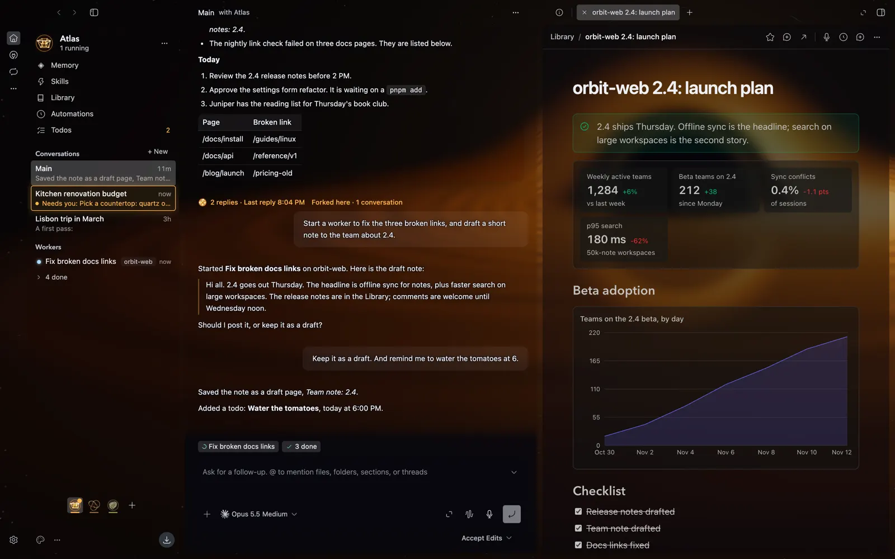

# BB Studio

**Work with your AI as a team.**

BB Studio gives you a Bot, an AI teammate that remembers your work, learns how you like things done, and hands long jobs to workers while you keep talking. You work together in pages, designs, apps, whiteboards and VS Code, all open beside the chat.

[Download for macOS](https://github.com/patleeman/bb-studio/releases/latest) · [Website](https://patleeman.github.io/bb-studio/) · A very opinionated fork of the excellent [bb](https://getbb.app/)

## Bots: a working relationship

Your Bot keeps its memory and skills across all of its conversations with you, so you never start from zero. It holds many conversations at once and manages workers that do long jobs in parallel.

- **Conversations and workers.** Start a new conversation whenever you like; long jobs go to workers that run while you keep talking, and approvals come to you.
- **Memory, Skills, Automations and Todos.** Your Bot remembers what matters, learns how you like things done, and runs your routines on schedule.

## Collaboration: more ways to work than chat

Pages, designs, apps, whiteboards and VS Code open beside the conversation, and you and your Bot edit them together.

- **Pages.** Ask for a plan and get a real document, with charts, stats, tables and live embeds.
- **Designs.** Describe a screen and get a prototype you can click through and comment on.
- **Whiteboards.** Sketch an idea instead of describing it, on the same board as your Bot.
- **VS Code.** Built in, beside the conversation, with your Bot pointing at the lines it means.
- **Workbench.** Tabs and splits beside the chat, and ⌘K to find anything.
- **Voice.** Speaking is faster than typing: dictate into any message, page or comment, and turn a recorded meeting into notes. Dictation and recordings are transcribed by the voice service you choose; recorded Zoom, Meet and FaceTime calls are transcribed on your Mac with WhisperKit by default.

## Platform: apps, not just answers

When you need a tracker or a dashboard, your Bot builds it as an app that you keep and reopen. Underneath is bb, which supplies the providers, the plugins and the threads that talk to each other.

Also in BB Studio: the Library, Accounts, nine living scenes and eight classic themes, and an iPhone app in testing through TestFlight.

## Built on bb

[bb](https://getbb.app/) is a metaharness: one app that runs many coding agents and providers. bb supplies the providers, the plugins and the threads that talk to each other; BB Studio is a very opinionated fork of the excellent bb that adds a way of working on top.

## Development

| Path | What |
|---|---|
| `desktop/` | The desktop app: a fork of bb. On `main` it is a generated snapshot of the `desktop` branch; never edit it here. |
| `plugins/` | The Studio plugins, with their own pnpm workspace, contracts and docs. |
| `ios/` | The iPhone app (XcodeGen). |
| `site/` | The website, built and deployed to GitHub Pages. |
| `scripts/`, `docs/` | Monorepo tooling and notes. |

How the pieces fit, how to build and how upstream syncs work are in [docs/MONOREPO.md](docs/MONOREPO.md). Each folder has its own guide: [desktop/STUDIO_FORK.md](desktop/STUDIO_FORK.md), [plugins/AGENTS.md](plugins/AGENTS.md) and [plugins/packages/bb-studio/README.md](plugins/packages/bb-studio/README.md), [ios/README.md](ios/README.md) and [site/README.md](site/README.md).

The fork stays thin. Features live in plugins; core edits to bb are small, generic hooks, each listed in a ledger (`scripts/fork/core-edits.json`) with its intent and a line budget, and checked by a script. The rebrand and app identity are generated by scripts, and the whole stack is replayed onto bb's latest code at each sync. The rules are in [desktop/AGENTS.fork.md](desktop/AGENTS.fork.md).

## License

MIT. See [LICENSE](LICENSE) and [NOTICE](NOTICE). `desktop/` is derived from bb, Copyright (c) 2026 Michael Yong, MIT ([desktop/LICENSE](desktop/LICENSE)).
