# BB Studio

A personal native iOS and watchOS app for BB and
[BB Studio](https://github.com/patleeman/bb-studio): BB's threads, approvals,
terminals and automations, plus the Studio suite of plugins (Studio, Pages,
Talk, Draw, Artifacts, Design, Dashboards and mini apps; item chat ships inside Studio). Everything else opens the BB web
app in an in-app web view (the safari button on every thread, Pages, Drawings and Design).

Studio features need the matching plugins from the bb-studio marketplace on the
server. The app uses only those and the plugins that ship with BB, plus its own
push relay, the [Studio Mobile](../../packages/bb-studio-mobile/) plugin (`mobile`). The app was called BB Go; its bundle IDs and app group
are unchanged, and old `bbgo://` links still open.

| Feature | Where |
|---|---|
| Home: the BB web sidebar on the phone, following its organization (BB's Thread List preferences). Automations, Pinned, your project groups in the sidebar's order, then Threads. Running threads first, then most recent activity; child threads nest under their parent; sections collapse | `iOS/Inbox/InboxView.swift` |
| Swipe and context-menu actions: archive, delete (with confirmation), pin, read/unread, rename | `iOS/Inbox/InboxView.swift` |
| Search across thread titles and messages, active and archived | `iOS/Inbox/InboxView.swift` |
| New thread with project, provider, model, reasoning, and permissions (the choice becomes the project default, as in the web app). | `iOS/Inbox/NewThreadView.swift` |
| New thread is a chat: an empty conversation with the composer focused at the bottom (⌘↩ to start). Chips above it pick the project (optional, as on desktop: "No project" starts the thread in BB's personal project, the default when none is remembered) and the workspace (project default, project checkout, new worktree with a base branch, or an existing environment); the composer's model button picks provider, model, reasoning and permissions. All start on the project's defaults | `iOS/Inbox/NewThreadView.swift` |
| New project, from the project chip's menu as on desktop: pick the machine, type or browse to the folder on it, and the name defaults to the folder's (`POST /api/v1/projects` with a `local_path` source). The new project is selected for the thread | `iOS/Inbox/NewProjectView.swift`, `Shared/Projects.swift` |
| Thread view with live updates, send, and stop. Opens at the newest message and follows new output only while you're at the bottom; a jump button brings you back. Older pages load as you reach the top, without moving what you're reading. File paths in messages (inline code like `docs/plan.md:12`, or Markdown file links) open in the file viewer, including absolute paths outside the workspace like `/tmp/shot.png`, read from the thread's host. The ⋯ menu has Find in thread, Rename, Model & permissions, Mute notifications, Open in BB web, Share link, and Copy Thread ID (also on a thread row's long-press) | `iOS/Thread/ThreadView.swift` |
| Live updates fetch only what changed: new rows since the last sequence, and the thread or its approvals only when those changed | `iOS/Thread/ThreadModel.swift` |
| A red "New" line where you left off; the thread opens there when there's something unread | `iOS/Thread/ThreadView.swift` |
| Find in thread: searches every message, with a match count and up/down to step through them | `iOS/Thread/FindBar.swift` |
| Drafts are kept per thread, and Home marks threads that have one | `iOS/Thread/Drafts.swift` |
| `@` suggests threads, recordings, pages, drawings, and artifacts, and sends them as real BB mentions | `iOS/Thread/MentionSuggestions.swift`, `Shared/Mentions.swift` |
| `/` searches the project's commands and skills and inserts the chosen command as a BB command mention | `iOS/Thread/CommandSuggestions.swift`, `Shared/ComposerCommands.swift` |
| The composer is one card, as in ChatGPT: attachments, the field at full width, then + (attach), the model button (model and reasoning level; opens Model & permissions), dictate, and send. Tap the mic to dictate inline, as on desktop: no sheet; the mic turns active and Listening (time, level, ✓ finish, ✕ cancel) shows over the composer while your words stream into the field after what you typed, in short segments as Talk transcribes them. Tap the mic again or ✓ to finish: the full transcript replaces the streamed words and stays in the field to edit and send. ✕ puts back what you typed. Leaving the thread or the app, or a sheet opening, finishes it into the field rather than losing words. Hold the mic to talk and send as before. In voice mode push to talk takes the mic's place (see [Voice mode](#voice-mode)); a talk's status always shows in the one pill over the composer, never in the field. It grows with the message, then offers a full-screen editor. While dictation has words on the way (the mic's dictation or talk, or the keyboard's own mic), Send and ⌘↩ are off (VoiceOver reads "Listening…" or "Transcribing…" beside Send) until the text is in the field; an error, cancel or closing the sheet frees it. The keyboard's dictation is read from UIKit's input mode ("dictation"), its recording-ended, failed and result-placeholder callbacks on the field, and the next text change; the same input-mode check holds Send in New thread, Write, Capture note, page comments, Work with this page, Chat About This and queued-message edits | `iOS/Thread/Composer.swift`, `iOS/Thread/ThreadView.swift`, `iOS/Thread/DictationGate.swift` |
| Change a thread's model, reasoning level, and permissions (Accept edits, Auto, Full access, up to the machine's ceiling) for its next turns. BB takes permissions with each message, so the choice goes out with the next one you send. Until then a card over the composer shows it, with Undo. A Provider picker (BB's available providers) moves the thread to another provider: BB can't change a thread's provider, so Hand off calls Studio's `thread_handoff_to_model`, "Handing off to <provider>…" shows over the composer while Studio summarizes the thread into a new one (permissions carry over), and the app then follows the new thread (in the Bot chat, the bot's next thread) | `iOS/Thread/ExecutionSheet.swift`, `Shared/ModelHandoff.swift` |
| File edits show `+N −M` and open to a red/green diff | `iOS/Thread/DiffView.swift` |
| Messages written while BB is unreachable wait in an outbox and send, in order, when it's back. Failures that may have reached BB wait for Try again, so nothing sends twice | `iOS/Thread/Outbox.swift` |
| Mute a thread's notifications (for all BB Studio devices, through the relay). Notifications group by thread | `iOS/Thread/MutedThreads.swift`, `packages/bb-studio-mobile/server.ts` |
| Read BB Pages (in Studio): each page's text, tables, callouts, stats, charts, and embeds. Embedded drawings, artifacts, recordings and other Studio items show as cards and open natively. Work with this page (a bar at the bottom starts a thread that knows the page), the page's past chats, rename, archive, and version history with save and restore. Comments (the toolbar button shows how many are open): read threads with the text they're on, reply, resolve or reopen, show resolved ones, and start a thread on any block. A thread started from a page links back to it | `iOS/Pages/` |
| Studio search across items and threads | `iOS/Studio/StudioView.swift` |
| Talk recording summaries: generation and regeneration for voice notes, ideas, and meetings | `iOS/Talk/RecordingsView.swift` |
| Related links, item threads, and comments with reply and resolve on Studio items | `iOS/Studio/RelatedSection.swift` |
| Studio Design: a design's rounds, newest first, each a row of its live screens; tap one to play it full screen (Fit or Fill, start at a prototype step). Shows the reviewer's status and the comments; pinning new comments opens BB web. It reloads when the design plugin signals a change to this design, and after a socket reconnect, instead of polling | `iOS/Studio/DesignView.swift`, `iOS/Thread/ItemCard.swift`, `Shared/Designs.swift` |
| Studio Dashboards, read-only: the widgets in one column, ordered by the narrowest layout's rows then columns. Stat (delta and sparkline), line, bar, area and pie charts (Swift Charts), table (scrolls sideways), list and feed (links open in Safari), ticker (a strip you scroll, no marquee), note, progress bar or gauge, clock and countdown, image, and embeds (Studio items and threads open in the app, web pages in Safari) are native. Custom widgets run their HTML in a WKWebView with the desktop's sandbox document and CSP (no network, nothing stored, no navigation) and get `{data, options, theme, size}`; they may ask for more height. Each tile says when its data came in, or what failed. Pull to refresh calls `dashboards.refresh`. While the screen is on top and the app active, the phone sends the `dashboards.view` heartbeat every 30 s, so the server keeps url and script widgets fresh, and leaves when either stops; it reloads on the `dashboards` realtime signal instead of polling. Editing, settings and script approval stay on the desktop ("Approve on desktop") | `iOS/Studio/DashboardView.swift`, `Shared/Dashboards.swift` |
| Studio mini apps, live: the app runs in a WKWebView holding its sandboxed frame, and the phone is its host, as BB's desktop is. It answers the frame's record calls (`minis.db.*`) and saves its shared state (`minis.live.save`), keeps the copy open for agent actions (`minis.live.open`, `touch`, `close`, `result`), and passes on other copies' state, record changes and agent commands from the `minis` realtime signal. Only messages from that frame are read. Network, BB access and sending to the agent are refused with "Open this mini app in BB on your computer to …"; access waiting for approval shows as a banner, approved on the desktop. Light and dark follow the phone. `::mini{id}` reply cards run the app inline, as the desktop's do, under a header with its name and Open: the height fits the app's content (its `size` messages) between the manifest's `size.minHeight` and `size.maxHeight`. Drags over an app that fits scroll the thread; one taller than the card scrolls inside it. A card makes its web view only near the screen and drops it, closing its copy (`minis.live.close`), once far away, keeping its height; at most three run at once, cards on screen first, and a paused one runs on a tap. A web content process that dies loads again, up to three times a minute | `iOS/Studio/MiniAppView.swift`, `Shared/Minis.swift`, `iOS/Thread/MiniReplyCard.swift` |
| Studio reply cards: `::page`, `::drawing`, `::design`, `::recording` and `::artifact` lines show the item under its name, read-only, as BB web does: the page's text, the drawing, the newest round's first screens, the recording's summary and first transcript lines, or the artifact's image, page, PDF or text. The eye button hides or shows every card's preview; tap the name to open the item | `iOS/Thread/ItemCard.swift`, `iOS/Studio/ArtifactView.swift` |
| Edit the whole page as one continuous Markdown text, styled as you type: headings stand out, checkboxes toggle on tap, and Return continues lists. Heading, list, checklist, link, and dictation controls sit above the keyboard. Edits autosave a moment after typing stops; the server rewrites only changed blocks through the live Yjs document, keeps blocks with comments intact, and asks for a reload if the page changed elsewhere. Empty pages open in the editor. Keep updated status and agent activity are visible on the page | `iOS/Pages/PageEditor.swift`, `iOS/Pages/PageTextView.swift`, `iOS/Pages/PageActivity.swift` |
| Automations: create agent schedules; edit names, prompts and schedules; browse runs by project, run now, pause and resume | `iOS/Tools/AutomationsView.swift`, `iOS/Tools/AutomationEditor.swift` |
| Drafts: long-press Send, then Save as Draft to park a message on the thread until you send it | `Shared/PluginExtras.swift` |
| Plan reviews: when an agent asks for a Plannotator review, a card opens the review UI; cancel from its menu | `iOS/Thread/PlanReviewSheet.swift` |
| Custom instructions: edit the text BB adds to every agent's system prompt (Settings → Agents) | `iOS/App/CustomInstructionsView.swift` |
| Usage, in Settings: each pooled Claude and Codex account's 5-hour and weekly limits, with reset times | `iOS/Tools/UsageView.swift` |
| Send later: long-press Send for 30 minutes, 1 hour, 3 hours, tomorrow at 9, or a picked time | `iOS/Thread/SendLater.swift` |
| Side chat: ask about one message in a hidden fork without derailing the thread | `MessageBubble` |
| Host settings: keep the Mac awake, and how many threads run at once | `iOS/Tools/ServerControls.swift` |
| Installed plugin status and errors in Settings → Plugins. Today (Studio), Pages (Studio Pages), Drawings (Studio Draw) and Automations show "Install <plugin> to use this." when their plugin is missing or not running, instead of BB's raw 404 or 503 text | `iOS/Tools/PluginStatusView.swift`, `Shared/BBClient.swift` |
| Files & changes: a thread's uncommitted changes with diffs, a file browser, file search, and file previews (images, rendered Markdown, text) | `iOS/Thread/FilesView.swift` |
| Pull request status and link for the workspace branch, when BB finds one | `iOS/Thread/FilesView.swift` |
| Terminals: BB's persistent terminals, from a thread's ⋯ menu (its workspace). A full VT terminal (SwiftTerm) with a key bar for Esc, Ctrl, Tab and arrows; new shell or run a command; rename, restart, close, paste, copy output, text size. Reconnects replay only missed output, and the shell keeps running when you leave | `iOS/Terminal/`, `Shared/Terminals.swift` |
| Edit the last message you sent, retry a failed turn, fork, inspect context usage, compact, clear context with confirmation, and resend a recent prompt | `ThreadView`, `iOS/Thread/ThreadContextView.swift`, `iOS/Thread/PromptHistoryView.swift` |
| Archived threads, in Settings: search, open, and unarchive | `iOS/Tools/ArchivedView.swift` |
| Drawings (in Studio): Excalidraw drawings rendered natively, with zoom, live updates while an agent draws, and share as an image, and rename | `iOS/Tools/DrawingsView.swift` |
| Create and edit drawings in the full Excalidraw editor inside the app, including pen, shapes, text, moving, deleting, and undo. Empty drawings open in the editor | `iOS/Tools/DrawingsView.swift` |
| Markdown in replies and your own messages: headings, nested and task lists, quotes, tables, code blocks with Copy, images (``: files on the thread's host, absolute or from the workspace root, as BB web loads them, or web URLs; tap for full screen), and `@thread` mentions that show the thread's title and open it. Long messages of yours fold at 15 lines with Show more, as in BB web | `iOS/Thread/Markdown.swift`, `iOS/Thread/MarkdownImage.swift`, `iOS/Thread/Messages.swift` |
| Image attachments in a thread show three to a row; tap one to view it full size | `iOS/Thread/Messages.swift` |
| Emoji reactions from `::reactions{items="…"}`, and Pages' Next row (`::next{reply="…" btw="…" do="…"}`) as a "What next?" card with labeled Reply, Ask for and By the way rows, as in BB web. Replies are capsules; requests and note actions are dashed rounded squares. Every note has Tell me more, which drafts "💬 Tell me more: <note>" so the agent explains it in the thread, as on the web, and 🐛 notes have Fix this. Tapping any chip drafts it (it doesn't send). Long-press a reply for the server's configured reactions; select text to react with its quote | `iOS/Thread/Messages.swift`, `Shared/ReactionSettings.swift` |
| Long-press a message: when it was sent, Copy, Select Text, Quote, Share, Read Aloud (with Studio's voice mode). Long-press an edit or file read in the steps for Open File and Copy Path, or a command for Copy Command | `iOS/Thread/Messages.swift` |
| Tool activity collapses into one row per run ("3 commands, 2 edits"). Tap for each step and its output | `iOS/Thread/Messages.swift` |
| Edit a queued message or draft before it sends. Attachments stay, @-mentions stay while their text does, and the edit is refused if the message sent or changed meanwhile | `iOS/Tools/QueuedMessageEditor.swift`, `BBClient.editQueued` |
| The shelf above the composer: model fallback, plan mode (exit), goal (clear), background work, todo progress, and queued messages (tap to edit, send now, remove). Two or more queued messages fold into one "N queued" row; expanded, hold and drag to reorder, or use Move to Top / Up / Down | `iOS/Thread/ThreadShelf.swift` |
| Paste text or images into the composer. Images become attachments | `iOS/Thread/Composer.swift` |
| Answer approvals (command, file, permission, plan) and questions in the thread, including the ask-user-question plugin's multi-question forms, Studio Design's questions before designing (picks, toggles, short answers, 1–5 scales, Decide for Me, Skip All), and secret requests (values go straight to the server and aren't kept). Other plugin forms open the web app | `iOS/Thread/InteractionCard.swift`, `Shared/Interactions.swift` |
| Attachments from photos, the camera, or files (JPEG re-encoded, 35 MB limit) | `iOS/Thread/Attachments.swift` |
| Offline cache: the inbox and recent thread messages show before the network answers | `DiskCache`, `ThreadModel` |
| Connection banner when BB is unreachable (usually Tailscale off), with Open Tailscale and Retry | `ConnectionBanner` |
| Actionable notifications: Approve, Deny, Approve plan, and Answer from the lock screen. Multiple-choice questions get a button per option. Finished turns (the Bot's messages too) get Reply, which sends to the thread; errors are plain alerts; tap to open the thread | `iOS/App/NotificationActions.swift`, `NotificationService/`, `packages/bb-studio-mobile/apns.ts` |
| A thread's notifications disappear once it's read or answered, in the app or on another device (by the relay's silent push) | `iOS/App/NotificationActions.swift`, `packages/bb-studio-mobile/clear.ts` |
| Studio tab: pages, recordings, dictations, drawings and artifacts in one list, grouped by day, with kind and project filters (each kind is a page: swipe sideways between All, Pages, Recordings and the rest, while a swipe on a row still opens its actions; the chips stay pinned above), an Archived filter, search (titles plus the Studio plugin's content search, with the matching text shown in bold under the row), thumbnails for drawings and image artifacts, and swipe to delete or archive. Long-press for New Thread with This, each add-on's own actions (Copy Transcript, Copy as Markdown, Copy Text), Move to Project, and Archive or Restore. Capture tiles at the top: Dictate (long-press for Dictate a Page or Record), Write (a blank note, with a mic, that saves as a page or a thread and keeps its draft if you close it; long-press for New Page, Drawing and the rest), and Record. New (+) makes any kind Studio can create, like a page or a drawing, in the filtered project. Studio tags: colored tags on rows, tag filter chips, and Tags (toggle, New Tag…) on long-press, shown when the Studio plugin supports them; long-press a tag chip to rename or delete the tag. Select (also on search results) picks several items to archive or restore, move, tag, delete, or run an add-on's action on together. Uses the Studio plugin's overview when it's installed, or asks Pages, Talk, and Excalidraw directly | `iOS/Studio/StudioView.swift` |
| Item chat (with the Studio plugin): Chat About This on a drawing, artifact or recording starts a thread with the project's default agent that knows the item, or continues the item's last chat | `Shared/StudioChat.swift`, `iOS/Studio/StudioChatSheet.swift` |
| Artifacts (in Studio): files agents save from threads. Markdown rendered (or as source), code and text in monospace, images zoomable, HTML, PDF, audio and video in a sandboxed web view (WebKit plays media with its own controls). Versions, share the file, copy text, New Thread with This, Save as Page, open the source thread, rename, move, delete. `::artifact{…}` cards in replies and Studio links in messages open natively. `::inline-vis{…}` previews in replies (BB's built-in inline-vis plugin): HTML visualizations from the workspace or thread storage run in a sandboxed web view at the reply's height, Markdown files render natively, with collapse, full screen, and the web app's errors for a missing file or bad height. Save Files to Studio (from the thread menu or a reply's long-press) lists the files a reply made plus the thread's storage, and saves the chosen ones as artifacts or new versions | `iOS/Studio/ArtifactView.swift`, `iOS/Studio/SaveToStudioSheet.swift`, `iOS/Thread/InlineVis.swift` |
| Dictation and recordings through Studio, with an offline segment outbox. Dictating from a page or a note puts the text straight into that field when you tap the check mark (the thread and New thread composers dictate inline instead). A standalone dictation can be saved as a page, and recordings open to their transcript with share, copy, new thread, rename, retry of failed transcription, and delete. Play a recording: segments play back to back as one timeline with a scrub bar, back and forward 15 seconds, 0.75× to 2× speed, and lock-screen controls; the transcript comes in paragraphs with their start times, the sentence playing is highlighted, and tapping any sentence plays from there. Browser recordings are WebM/Opus, which iOS can't open, so the app demuxes them and decodes the Opus itself | `iOS/Talk` |
| Voice mode, Studio's (see [Voice mode](#voice-mode)): a speaker beside the mic speaks a thread's replies in Studio's voice, holding the mic sends what you say, and Read Aloud on any message | `iOS/Voice`, `Shared/BBClient+Voice.swift` |
| Bot tab (first in the tab bar: Bot, Threads, Studio, Settings; was Chief of Staff; replaces Web). The app opens on it at every launch, with or without a Bot or Studio; a link, notification tap, widget, quick action or Siri opens its own target instead: with one bot it opens that bot's chat (‹ goes to the list); with several, a list (`bot_list`) of avatar, name, status and latest reply, primary first then by name; a bot that needs you says why in its status line ("Asked you a question", in orange) with a count badge (`bot_attention`); + New bot opens the same welcome as below (external bots are imported on desktop). With no bot, the tab is a welcome (see Bot: first-time setup). Each chat scopes every call by `botId`; external bots hide Memory and Skills. The bot chat's composer has the same model button as any thread (see Model & Permissions). Widgets, Siri and the watch stay on the primary bot. The primary bot's thread is the lead of BB's personal project; its emoji menu shows its state and offers Automations… (one list of check-ins, reminders, watchers and runners from `bot_automations`: swipe to pause or delete, tap for its schedule, instruction or script, recent runs with outcomes, Run now and Edit; + makes any kind with a native schedule editor of presets, day chips, several times, every N in a window, quiet hours, end date, timezone or raw cron, or a date for a reminder; Turn off check-ins pauses every check-in; `bot_automation_*`, `iOS/Bot/BotAutomationsSheet.swift`, `Shared/BotAutomations.swift`), Pause / Resume and Stop… (confirmed: stops the threads it started and its automations), all on `bot_get`, `bot_set_run`, `bot_pause`, `bot_resume`, `bot_stop`. Only the Bot itself needs you: `bot_activity`'s `attention` (its chat asked a question, wants an approval, or has replies you haven't read; cleared on the server when you read or answer it) badges the bell with its count, the chat header's status line says why ("Asked you a question", "1 thing for you") and otherwise shows what it did before, and the Activity sheet then leads with the Bot's chat row saying why ("Asked you a question") with the count. Activity lists the bot's sub-threads as the desktop Bots sidebar does: Running, Runners, Recurring, Recent and Earlier conversations, a worker nested under the thread that started it, each with the desktop status dot (running, waiting, failed, done) and age. A thread held by a question the Bot owns stays under Running with an amber ring and what it waits for under its title ("Waiting for approval", its `waitingFor`); runners show their schedule and next run in plain English ("Daily 7:05 AM and 5:05 PM · Next run Tue 7:05 AM", a port of desktop `describeCron`) and their state only (running, next run, quiet, reported, failed, paused; an urgent report is "reported", for the Bot to pass on), and swipe for Pause / Resume and Run now; Earlier conversations is the Bot's handoff chain with titles and starts collapsed (collapsed groups are remembered). A tap opens the thread in the normal thread view. It refreshes with the tab's Activity (BB's thread changes) and on pull, with no timers of its own (`bot_activity`, `bot_runners`, `bot_chain`, `bot_runner_*`; `iOS/Bot/BotThreadsSheet.swift`, `Shared/BotThreads.swift`); a paused or stopped Bot shows a banner with Resume. A thread's ⋯ menu has Make this my Bot (`bot_set_thread`); on the Bot's thread it reads "<emoji> <name> · your Bot" with Check-ins…. Hold the composer's mic to talk and send on release; slide left or tap Cancel to cancel, which never sends and deletes the recording from the phone and from Talk on the server it was recorded to (later, if that server is offline). The Action button, `bbstudio://bot-talk` (also `chief-talk`) and the "Talk to my bot" shortcut start a hands-free talk, and the next press or a tap on the mic sends it; `bbstudio://bot` (also `chief`) opens the tab. Talking ends unsent and deleted when the thread closes, the app backgrounds, a call interrupts, or dictation opens. The Bot's thread, name and emoji are kept per server; with no Bot, or a server without Studio, the tab, widget, Siri and watch say so instead of sending. "Tell my bot" sends a message and reads the reply | `iOS/Thread/HoldToTalk.swift`, `iOS/App/RootView.swift`, `Shared/Bot.swift`, `iOS/Thread/BotMenu.swift`, `iOS/App/BotHeartbeat.swift`, `Widgets/BotWidget.swift`, `Watch/WatchApp.swift` |
| Action button and Siri shortcuts: Dictate, Open thread, New thread, Write, "Ask BB" (Siri waits for the reply and reads it). Home Screen quick actions (long-press the icon): Dictate, Write, New Thread; `bbstudio://write` opens the same sheet | `iOS/App/Intents.swift`, `iOS/App/BBStudioApp.swift` |
| Capture to BB opens one sheet for voice, dictation, a note, a photo or file, or a new thread. Add it in Settings → Action Button → Controls; it is also available in Control Center, Shortcuts, and Siri. | `iOS/Capture/CaptureSheet.swift`, `Widgets/Controls.swift` |
| Control Center and lock screen controls: Dictate, New thread | `Widgets/Controls.swift` |
| The BB Studio theme's coral accent (#c7431a light, #ff7a45 dark, from the Silk S icon) on buttons, chips, your messages and unread dots, across the app, widgets, share sheet and watch. BB web views follow the server's theme | `*/Assets.xcassets/AccentColor.colorset`, `project.yml` |
| Home and lock screen status widgets: what needs you is the Bot's attention (`bot_attention`: its count, and its reason such as "Asked you a question" as the headline, opening the Bot), then what's running. From a Studio without `bot_attention`, or when it fails, they count BB's threads waiting on you as before. `-qaStateDemo widgets` draws the widget's view in the app for screenshots | `Widgets/StatusWidget.swift`, `Shared/ThreadSummary.swift` (`NeedsYouCount`) |
| Work widget: the Bot's attention (its reason, opening the Bot; BB's waiting threads on an older Studio) and approvals, and running agents. Tap a thread or review link to open it | `Widgets/WorkWidget.swift` |
| Spotlight indexes open threads and Studio pages, recordings, drawings, and artifacts; removed items leave search. Handoff opens the current thread in the Mac browser | `iOS/App/Spotlight.swift` |
| Share extension: send text, links, images, and files to a new or existing thread | `Share/` |
| URL scheme `bbstudio://thread/<id>`, `reply/<id>` (opens the thread and its reply), `page/<id>`, `automations`, `usage`, `archived`, `studio` (also `talk`, `pages`), `drawing[/<id>]` (also `drawings`), `artifact/<id>`, `design/<id>`, `recording/<id>`, `new`, `capture`, `dictate`, `record`, `write`, `voice/<id>` (the thread with voice mode on), `bots` (the list), `bot[/<id>]` (also `chief`, and the old `web`, for the primary bot), `bot-talk` (also `chief-talk`; starts or sends a hands-free talk), `settings`. Links with the old `bbgo://` scheme still open | `AppModel.handle` |
| A Live Activity while a Talk recording is in progress | `Widgets/ItemActivities.swift`, `iOS/App/LiveItems.swift` |
| Shortcuts can select threads and pages; open a page, send to a thread, and start a Talk recording | `iOS/App/StudioIntents.swift` |
| iPad: sidebar tabs, a split view with the inbox beside the thread, a Find button, and a readable width for messages. A Thread menu in the menu bar. Keyboard: ⌘↩ send, ⌘N new thread, ⌘↓ latest, ⇧⌘M model, ⌘. stop; in find, ⌘G / ⇧⌘G step | `iOS/App/RootView.swift` |
| Haptics for sends, answers, errors, and swipe actions | |
| Watch app: inbox, last messages, dictated or quick replies, and answering approvals and questions (relayed through the phone). A thread that fails to load shows the error with Retry; a deleted thread says "This thread no longer exists." and stops polling | `Watch/` |
| Watch complication: the Bot's attention (its reason, else a count; BB's waiting threads on an older Studio) and running counts, sent by the phone in `StatusSnapshot` | `WatchWidgets/` |
| APNs push relay for BB's push-notifications plugin, with notification categories | `packages/bb-studio-mobile/` |
| Push registration replaces this install's prior subscription when APNs changes its token. Simulator and QA runs skip registration | `iOS/App/PushRegistration.swift` |

## Bot: first-time setup

With no bot, the Bot tab is the same welcome as desktop: **Meet your Bot**,
one question (**What should your Bot help with?**), ideas that fill it, and
**Create Bot**. Create makes the Bot as "Chief of Staff" with a drawn blob
(`bot_create` with `setup`; `BotSetup` in `Shared/Bot.swift`) and opens its
chat, where Studio's setup message has it introduce itself, ask a couple of
questions, and then pick its own name, description and look. The Bots list's
+ shows it as **Make another Bot** in a sheet. Debug builds show it with no
server through `-qaBotDemo onboarding` (`iOS/Bot/BotDemo.swift`;
`iOS/Bot/BotOnboarding.swift`).

| Light | Dark |
| --- | --- |
| 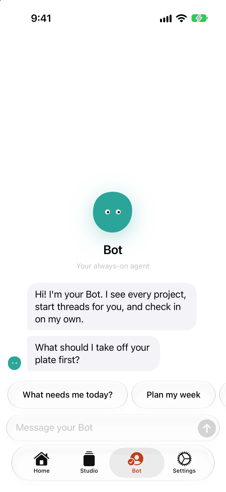 | 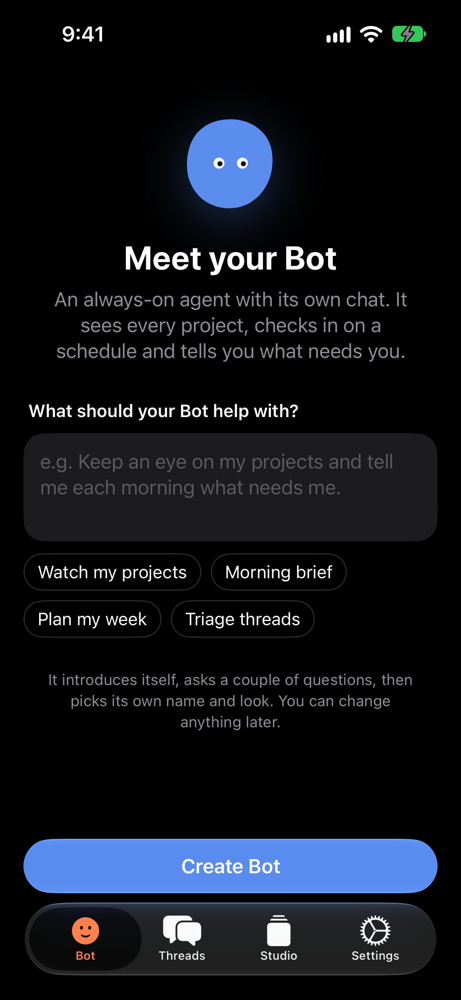 |

## Bot chat: opening and sending

The Bot chat opens on what the phone last saw: the Bots list and the bot
(`BotSnapshot` in `iOS/Bot/BotTab.swift`) and the thread's last 50 messages
(`TimelineCache`, one JSON file per thread, written after each load and
update). With nothing cached it shows grey bubbles (`ChatSkeleton`), not a
blank screen. The server's page goes in over the cached rows by id
(`TimelineMerge`), so nothing redraws or jumps when they match. A sent
message shows at once, faded, until the server's row for it replaces it
(`PendingSend`). "Scroll to the bottom" goes to a marker view at the end of
the chat rather than the lazy stack's edge, which could leave the chat blank
after a send with the keyboard up. Only a short scroll from near the bottom animates, toward the edge;
farther ones jump to the marker, since an animated scroll to an id in a lazy
stack re-aims as rows above measure and visibly runs through the chat.

Signposts time the open (Points of Interest, `BotChatOpen`; `ChatPerf`).
Debug builds print `[perf]` lines to stderr. To measure, launch with
`simctl launch --console` and `-qaBotDemo chat -qaDemoLatency 600`: a local
fake server serves a 300-message chat (`-qaDemoMessages`) through
`BBClient.transport`. `-qaDemoColdCache` drops the caches first, and
`-qaDemoSend <text>` types a message and sends it.

## Bot chat: terminals

The Bot chat's ⋯ menu has **Terminals**, the same item a regular thread's ⋯
menu has: it opens the terminals of the Bot's current chat thread, scoped to
that thread (`TerminalScope.forThread` in `Shared/Terminals.swift`), so a
one-off script doesn't need a new thread. Like a regular thread, it shows once
the thread has an environment; the chat's `ThreadView` reports it to the Bot
tab (`BotChrome.environmentChanged`). `BotTerminalUITests` checks it on
`-qaBotDemo chat`.

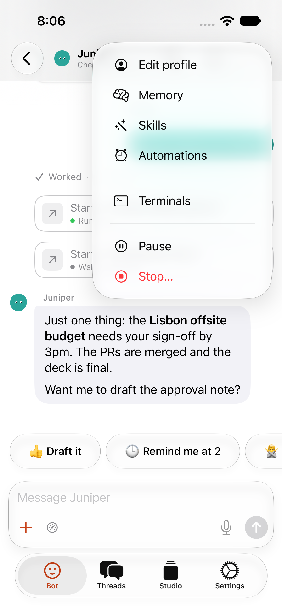

## Expand to page

When a message grows into meeting notes, the note button beside the mic in a
thread's composer (the Bot's chat too) moves the draft into a Notes page linked
to the thread, as on desktop (`notes.create`). The composer is cleared once the
server has saved the text; attachments stay in it. With a note already open,
the button adds the draft to the end of it. The note opens full screen in the
page editor (`PageEditor`), which writes every change to the phone at once and
to BB a moment after typing stops, and right away when you leave the app. The
format bar's mic dictates into it, and so does the keyboard's.

While the note is open, a **Notes in progress** chip above the composer
reopens it (`notes.forThread`, read on appear and on Studio's `pages` signals;
no polling). The editor's toolbar has the done actions: **Send to thread**
(`notes.send`, auto: the Markdown, or a link and "Summarize these notes" when
it's long), **Keep as page** (asks for a title; `notes.keep`) and **Discard**
(asks first; `notes.discard`). Send and Keep save the latest typing first, and
wait while dictation still has words on the way.

| Draft and the expand button | Notes in progress | The note's editor |
| --- | --- | --- |
| 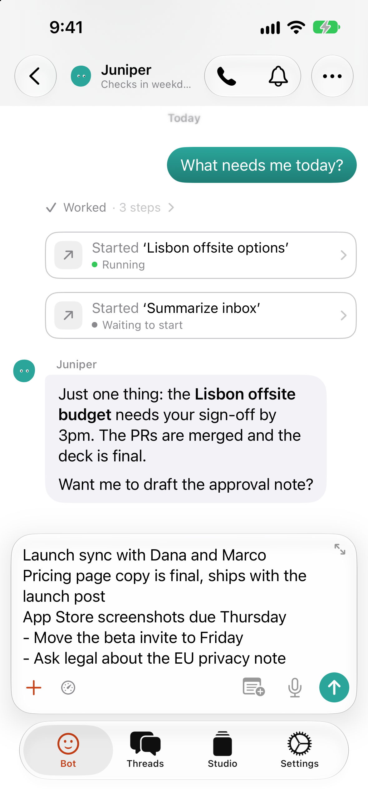 | 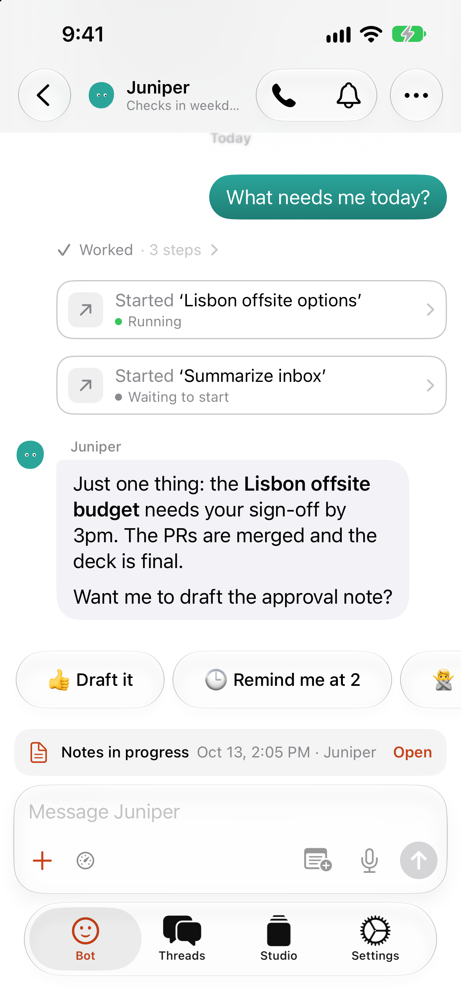 | 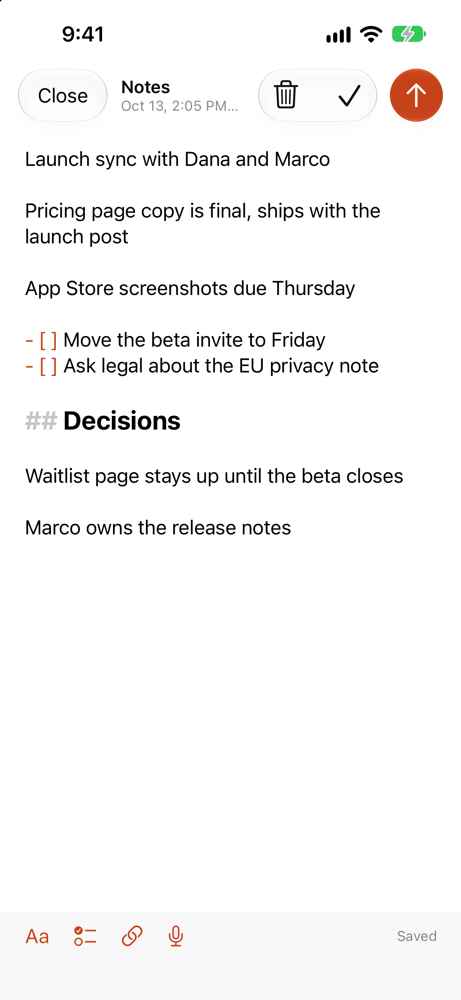 |

| Keep as page | Discard |
| --- | --- |
| 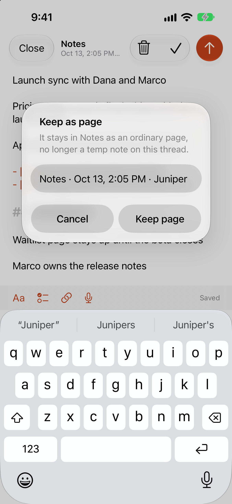 | 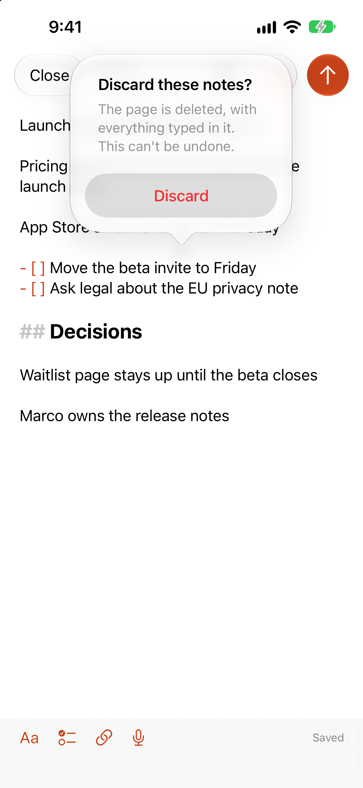 |

Debug builds show these with no server: `-qaBotDemo chat -qaNotesDemo
draft|chip|editor|keep|discard` (`iOS/Thread/NotesDemo.swift`).

## Dashboards

Studio Dashboards render read-only as cards in one column on iPhone, and in as
many columns as fit on iPad. Each card's title sits on the left and when its
data came in on the right. A widget that can't show data yet says why in its
body instead: waiting for an agent's data, a failed fetch (with the error and
"Pull down to try again"), or a script that needs approval on the desktop.

| Light | Dark | Charts |
| --- | --- | --- |
| 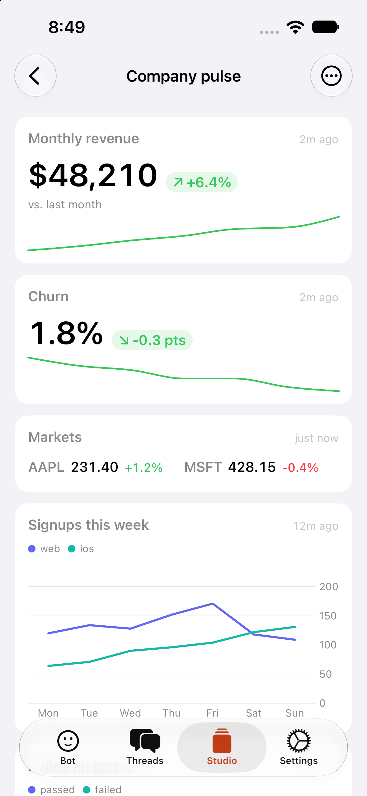 | 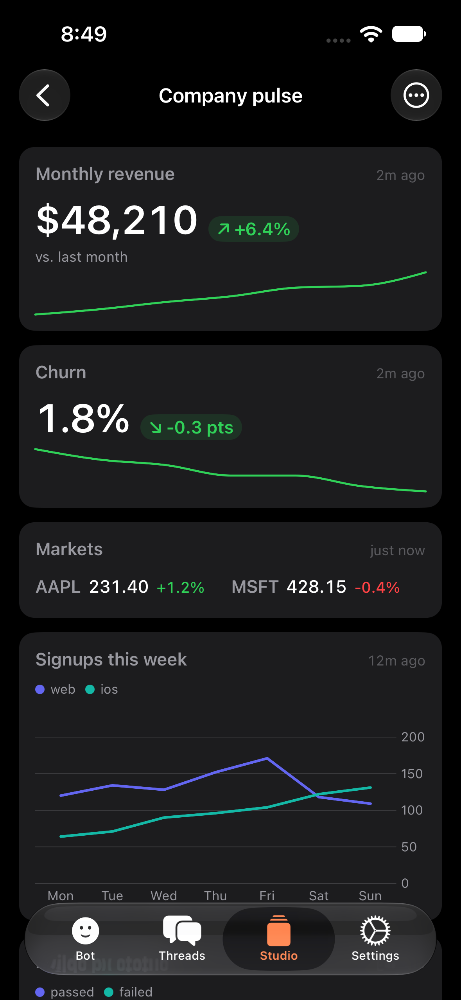 | 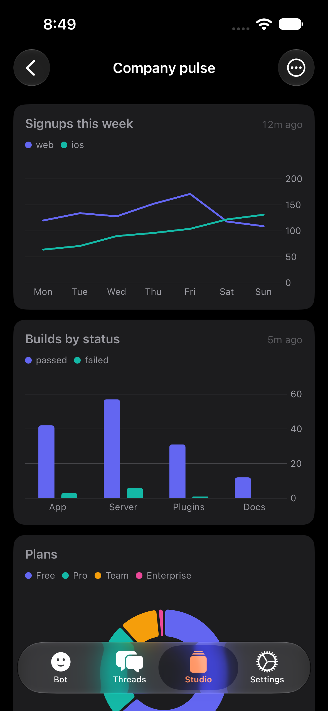 |

| Gauge, table, list | Tile states | No widgets yet | Accessibility type size |
| --- | --- | --- | --- |
| 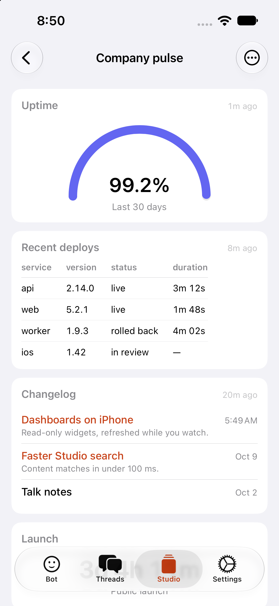 | 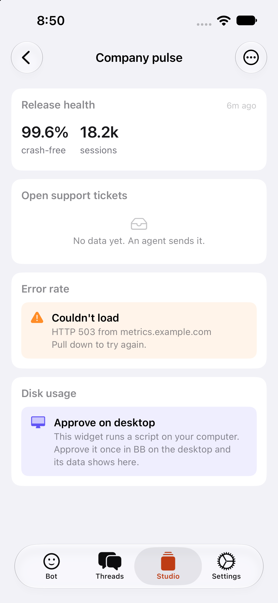 | 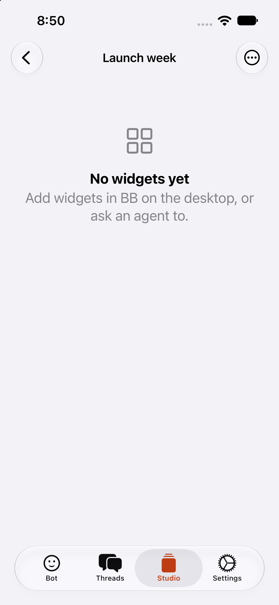 | 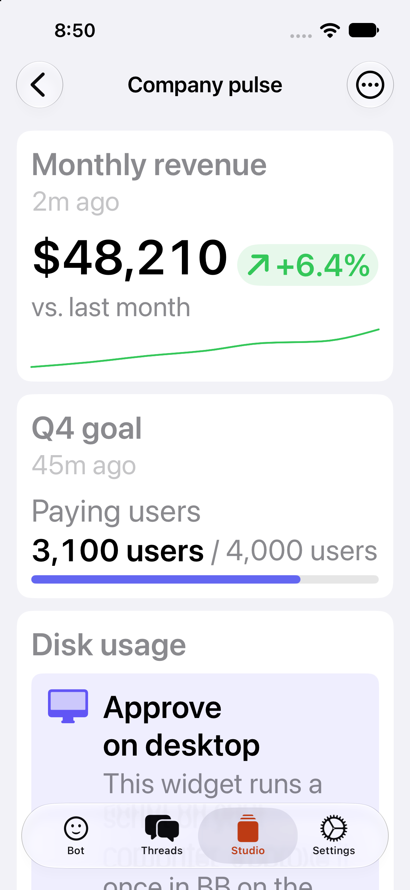 |

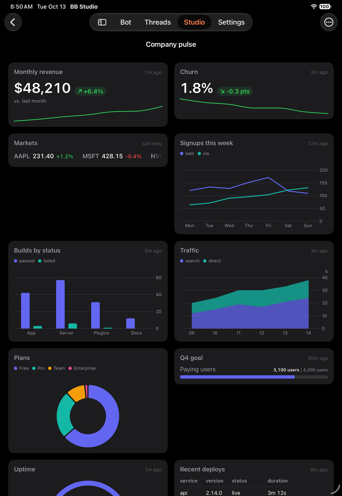

Debug builds draw these from a local fixture with every widget type, without a
server: `-qaDashboardDemo -openURL bbstudio://dashboard/qa-demo`
(`qa-empty` for a dashboard with no widgets). Add
`-qaDashboardWidgets w_signups,w_plans` to keep only some widgets; the IDs are
in `iOS/Studio/DashboardDemo.swift`.

## Voice mode

Studio's voice mode, as on desktop. The speaker beside a thread's mic turns
it on (`voice.set`); touch and hold it for Conversational Replies, the
speed, and Voice Settings (engine, model, voice, speed and a sample, from
`speech.*`; also in Settings → Voice while Studio is running). It's hidden
when the server's Studio has no voice mode.

When a voice thread's agent finishes, Studio makes the audio and announces
it on the `studio-voice` signal. The open thread plays it through the app's
one player (`VoicePlayer`): each piece downloads whole and plays in
AVAudioPlayer at Speech's speed (0.5× to 2×) while the next one downloads,
and a new reply cuts off the one speaking. Over the composer, Speaking shows
the level, the speed (tap for the next) and Stop, and the piece being spoken
is lit up in its message. Read Aloud in a message's menu reads it the same
way (`speech.prepare` per piece, after the ported `speakable` and
`speechChunks`). With a voice thread open, the app keeps its socket and plays
silence with the screen locked, so replies still play, until a minute after
the thread stops working and nothing is speaking.

### One mic, one indicator

The composer has one mic and one indicator, as on desktop (Studio's page
"Composer: one recording surface"): at most one timer and one level at a
time, always in the same spot over the composer. Your voice is a red dot and
red bars; the Bot's is a blue speaker and blue bars, shown only while it speaks.
Input and output never show together. "Listening…" and "Speaking…" go in
the field's placeholder, not beside the buttons (`iOS/Voice/ComposerVoice.swift`).

- **Idle:** the mic (dictate) and the speaker (voice mode), no timers.
- **Dictating:** one red recorder pill with a timer, ✕ and ✓.
- **Voice mode on:** voice mode owns the mic, so the dictation mic is hidden
  and push to talk (a waveform) takes its place. Turning voice mode on while
  dictating finishes the dictation into the draft first. No timer.
- **The Bot speaking:** the same spot shows the speaker, its level, the speed
  and Stop.

Push to talk is the default: hold to talk, let go to send (slide left to
cancel). Pressing while the Bot speaks stops it. Hold without speaking for
a second (a long press) and it switches to hands-free: it listens all the
time, sends each turn after 1.5 s of quiet once you've spoken, and listens
again. Talking over the Bot stops it (barge-in): the mic's level (Talk's
`LevelTracker`, 0–1) above 0.45 for 0.3 s while it speaks, higher than the
0.35 that counts as speech, and the capture runs in the voice-chat audio mode
so its own echo is cancelled. A reply that plays out with nobody talking over
it drops what the mic heard meanwhile and listens afresh. Tap the red pill
(or push to talk) to go back to push to talk; VoiceOver has a Hands-free
action. The first time voice mode is on, "Hold to talk · long-press for
hands-free" shows for a few seconds, once (tapping push to talk shows it
again).

Voice mode's talks cut phrase-length segments (2.5 s target, 8 s max, 300 ms
pause), put the words in the field as Talk transcribes them, and send with
Studio's agent-only conversational note when Conversational Replies is on.

The meters and the mic's polling share one 10 Hz clock (`VoiceClock`) that
runs only while something is listening or speaking and stops while the app
is inactive; there are no per-frame animations. Debug builds show each state
with no server or mic: `-qaBotDemo chat -openURL bbstudio://bot -qaVoice
idle|dictating|ptt|handsfree|speaking|hint` (`-qaDictation listening` also
shows the dictating pill).

| | Idle | Dictating | Push to talk, held | Hands-free | The Bot speaking | First-time hint |
| --- | --- | --- | --- | --- | --- | --- |
| Light | 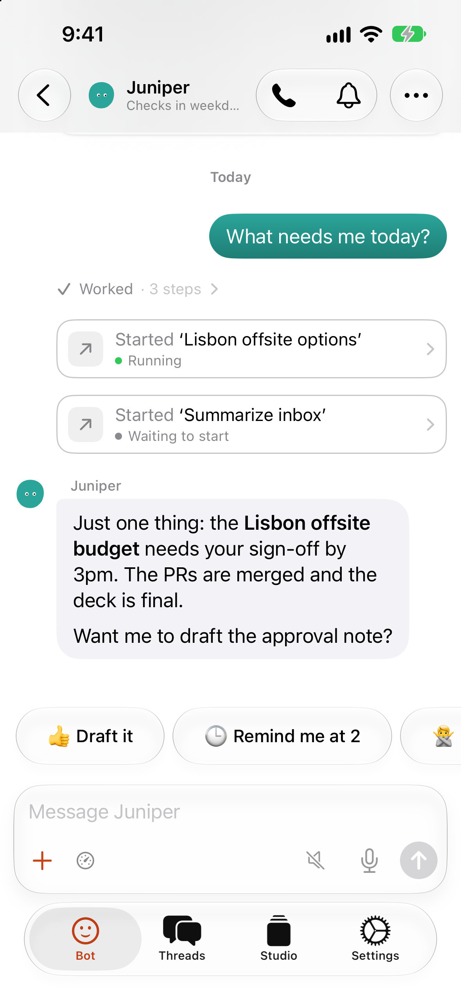 | 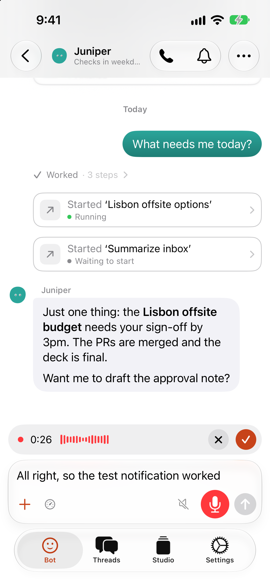 | 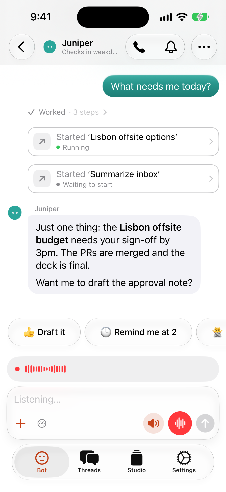 | 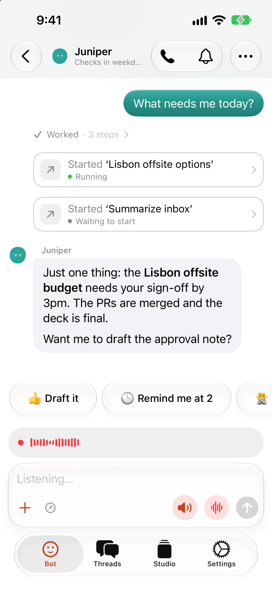 | 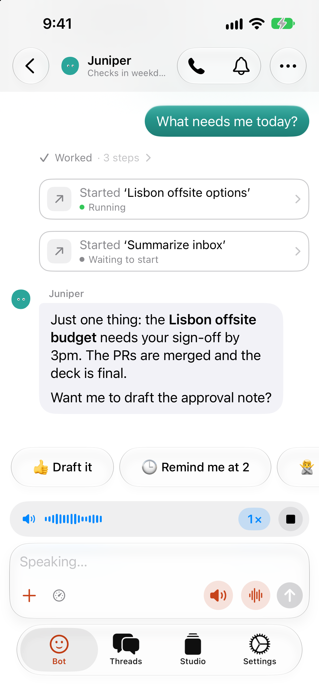 | 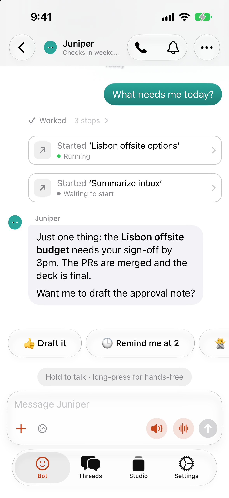 |
| Dark | 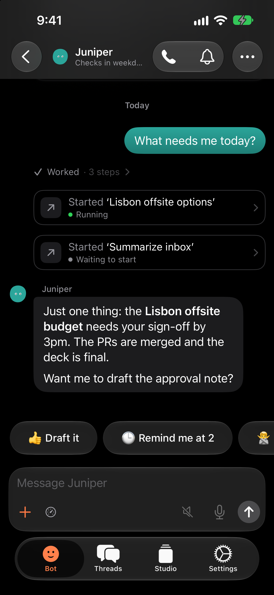 | 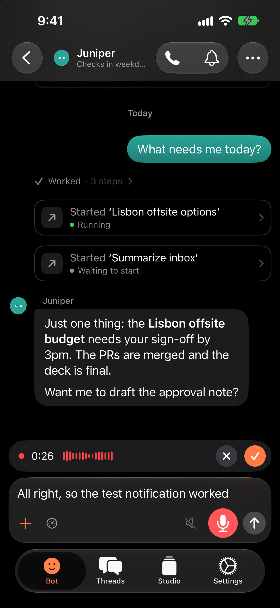 | 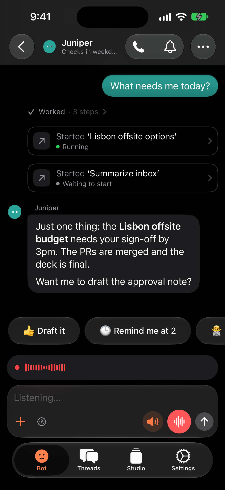 | 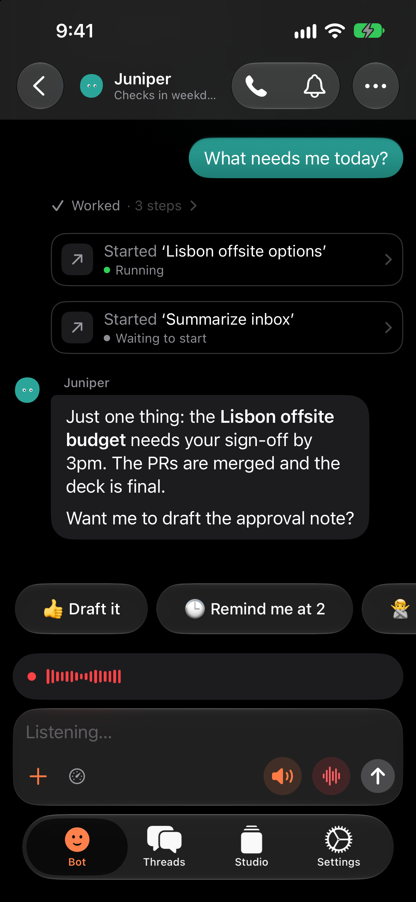 | 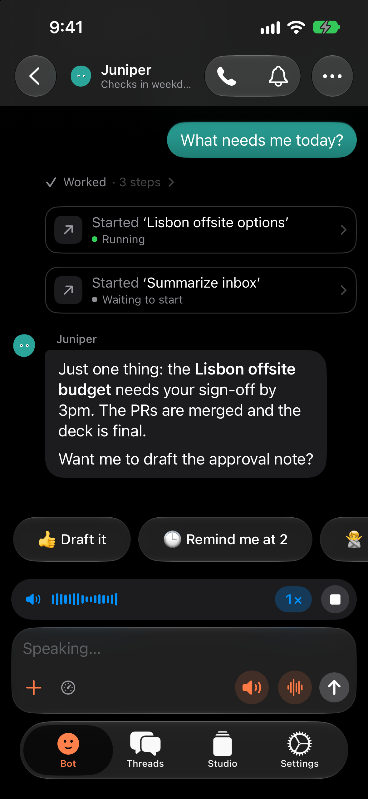 | 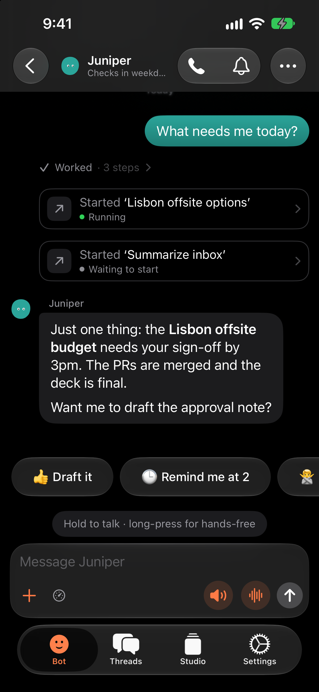 |

The app has no New voice chat: turn voice mode on in any thread with the
speaker beside the mic, or open `bbstudio://voice/<id>`. Studio's
`voice.new` RPC (and `BBClient.newVoiceChat`) remain, unused by the app.
Before and after: [docs/ios/no-voice-chat](../../docs/ios/no-voice-chat/README.md).

| Speaking, with the piece lit up | The speaker's menu | Voice settings |
| --- | --- | --- |
| 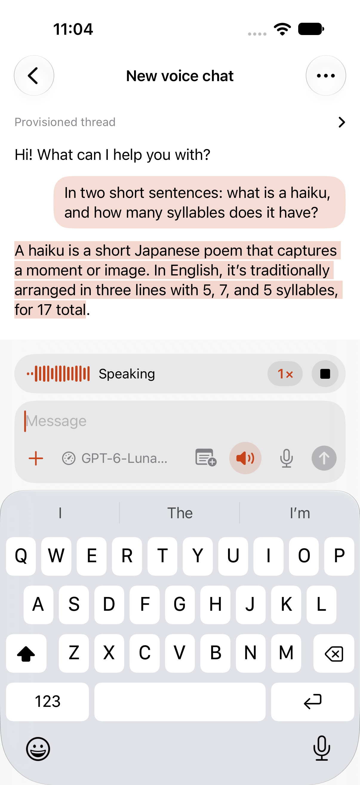 | 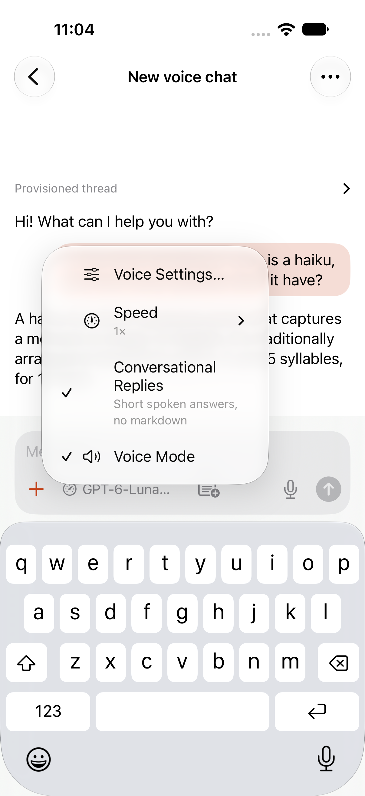 | 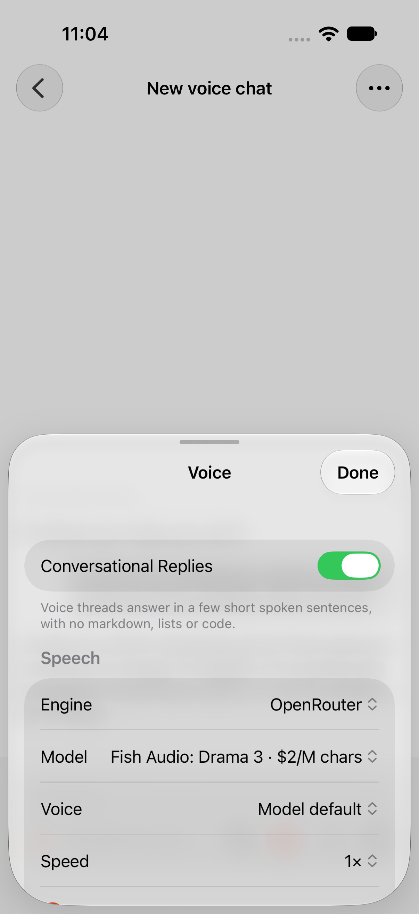 |

Tapping the mic in any composer dictates inline the same way (see the
composer row above); here in New thread, the words streaming in after what
was typed:

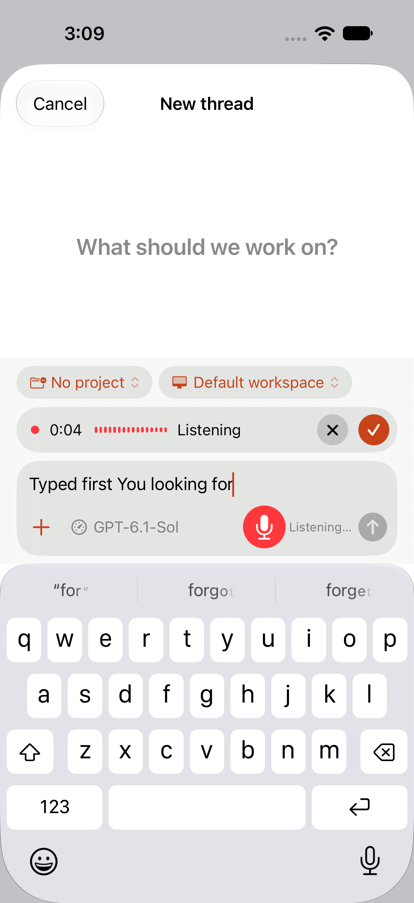

`testVoiceChat` runs this against a staged BB whose Studio can speak (start
it with `OPENROUTER_API_KEY` set) and a scratch thread there: it opens the
thread with `bbstudio://voice/<id>`, sends a message and waits for the reply
to play, reads it aloud again, and opens the voice settings. It sends to the
staged server.

```sh
BB_STAGED_DIR=$TMPDIR/bb-staged-ios-voice BB_STAGED_PORT=49550 node ../../scripts/staged-bb.mjs start
TEST_RUNNER_BBGO_QA_VOICE_SERVER=http://127.0.0.1:49550 TEST_RUNNER_BBGO_QA_VOICE_THREAD=thr_... xcodebuild test -scheme BBStudio \
  -destination 'id=<your-private-simulator-id>' -only-testing:BBStudioUITests/ThreadUITests/testVoiceChat
```

## Connection

The app talks to `https://patricks-megamac.tail5a01ec.ts.net`, which
`tailscale serve` proxies to BB on `127.0.0.1:38886`. BB has no client auth,
so the tailnet is the boundary. You can change the server in Settings. After a switch, the app registers its push token with the new server at once, without a relaunch.

Queued messages and recorded audio belong to the server where they were created.
Switching servers pauses that server's queued work until you switch back; sends
already in flight finish against their original server. Older queued messages
have no trustworthy server identity and wait for you to select their original
server and tap Try again. Older audio stays on the phone until you confirm its
server with Settings → Older recordings → Resume older uploads.

If saving a new audio segment fails, Talk stops the microphone and keeps the
source audio for Retry saving. It blocks finishing and closing until every
segment is durably queued; a late segment timeout is shown as a recoverable error.

Notification actions and links require the matching Studio Mobile relay's server
identity. Update the relay with the app; notifications received before this
identity was available must be reviewed manually in the app.

## Build

```sh
brew install xcodegen
xcodegen generate
open BBStudio.xcodeproj   # run the BBStudio scheme on your iPhone; the watch app is embedded
```

To install on your paired iPhone without TestFlight (a Debug build that
replaces the TestFlight one):

```sh
scripts/device.sh
```

Headless simulator runs: `-skipPushPrompt YES -openURL bbstudio://thread/<id>`.
`-qaShelfDemo` (Debug builds) fills every thread's shelf with sample cards.

UI tests click through Home and a thread (reaction chips, paste, the message
menu, quoting, and jump-to-latest) against the BB server the simulator is
signed in to. Point them at a throwaway thread whose newest reply ends with a
`::reactions` line:

```sh
TEST_RUNNER_BBGO_QA_THREAD=thr_xxx xcodebuild test -scheme BBStudio \
  -destination 'platform=iOS Simulator,name=iPhone 18 Pro' -only-testing:BBStudioUITests
```

`testProbe` screenshots any thread while scrolling up through it, without
changing anything: `TEST_RUNNER_BBGO_PROBE_THREAD=thr_xxx`, plus optionally
`TEST_RUNNER_BBGO_PROBE_SWIPES=<n>`, `TEST_RUNNER_BBGO_PROBE_FAST=1`, and
`TEST_RUNNER_BBGO_PROBE_FIND=<text>` to stop once that text is on screen.
Screenshots land in `/tmp/qa-ui-probe-*.png`.

`ComposerUITests.testMicTapDictatesInline` taps the mic in New thread against a
server with Studio (`TEST_RUNNER_BBGO_QA_SERVER=http://127.0.0.1:<port>`, for
example a staged BB; nothing is sent): Listening with ✓ and ✕, ✕ restoring
what was typed, and ✓ leaving the result in the field
(`/tmp/qa-composer-dictation.png`).

`MiniAppUITests` opens a mini app on a staged BB
(`TEST_RUNNER_BBGO_QA_MINI=mini_…`) whose app has "Add task", "Count <n>" and
"Fetch" buttons: Add task writes a record through the phone's relay, Count
saves shared state, and Fetch shows the phone's refusal
(`/tmp/qa-mini-*.png`).

`MiniCardUITests` runs mini apps in reply cards on a staged BB
(`TEST_RUNNER_BBGO_QA_MINI_THREAD=thr_…`). The thread's newest reply holds, in
order, `::mini` cards for the app above ("Add task", "Count <n>", "Fetch"), a
"Long list" app taller than its card (rows "Row 1"…, `size.maxHeight` below the
rows' height), a note app ("Tap note", "Note taps: <n>") and the first app
again. It uses the last card, drags over it to scroll the thread, scrolls the
long list inside its card without moving the thread, taps the note, and checks
that the first copy shows the shared count and new record. It then writes
`/tmp/qa-mini-cards-ready` and waits up to a minute for a record titled
"Server task" in the first app, which you insert through `minis.db.insert` on
the staged server, to arrive by realtime (`/tmp/qa-mini-cards-*.png`).

For deterministic Duo testing without an agent-produced reply, additionally set
`TEST_RUNNER_BBGO_QA_SERVER` to the isolated staged server and
`TEST_RUNNER_BBGO_QA_MINI_IDS` to three comma-separated mini IDs: the task counter,
long list, and note, in that order. Set `TEST_RUNNER_BBGO_QA_MINI_THREAD=thr_botdemo01`.
The Debug-only `-qaDuoMinis` fixture renders those real apps in local reply rows;
records, shared state, frames and realtime still use the staged server. In this
mode the full card test inserts its own external “Server task” record through
RPC. `testScrollOwnershipInOuterAndLandscape` uses the same fixtures in exact
466 × 678 and 951 × 669 windows on an owned 13-inch iPad simulator.

`DuoLayoutUITests` uses local messages to check the same-process outer → landscape
→ portrait → outer transition, draft retention, the visible message within 90
points, bottom pinning, split-only back-button hiding, and keyboard layout. See
[the built Duo captures and test notes](../../docs/ios/duo/README.md).

`StudioPagingUITests` swipes Studio between its kinds and drags an item row
partway open (`/tmp/qa-studio-paging-*.png`).

Unit tests use a private simulator clone:

```sh
export BB_TEST_SIMULATOR_ID=<your-private-simulator-id>
scripts/test.sh
```

On Apple silicon the simulator receives real (sandbox) pushes once you allow
notifications, including through the notification extension.

## Still to do (needs Apple credentials)

1. **Device install**: open the project in Xcode once, and let automatic
   signing (team 3753DAN98U) register these bundle IDs:
   - `nyc.plee.bbgo` (with Push Notifications).
   - `nyc.plee.bbgo.share`.
   - `nyc.plee.bbgo.notifications`.
   - `nyc.plee.bbgo.widgets`.
   - `nyc.plee.bbgo.watchkitapp`.
   - `nyc.plee.bbgo.watchkitapp.widgets`.

   All of them share the app group `group.nyc.plee.bbgo`. The widgets, the
   share extension, and the complication read the server URL and status from
   it.
2. **APNs key**: create an APNs auth key for **Sandbox & Production** (Certificates, IDs & Profiles →
   Keys). Then:
   ```sh
   cd ../../packages/bb-studio-mobile && npm install && bb plugin build && bb plugin install .
   bb plugin config mobile set apnsKeyPath ~/path/to/AuthKey_XXXXXXXXXX.p8
   bb plugin config mobile set apnsKeyId XXXXXXXXXX
   bb mobile status
   ```
3. **Route BB pushes through the relay**. This changes the push-notifications
   plugin, and non-APNs tokens still reach Expo:
   ```sh
   bb plugin config push-notifications set expoPushUrl \
     "http://127.0.0.1:38886/api/v1/plugins/mobile/http/push?token=$(bb plugin token mobile)"
   ```
   The app registers itself (`apns:<token>`) on its first launch after you
   grant notification permission.
4. **TestFlight** (optional):
   1. Sign in to Xcode with the team's Apple ID (Settings → Accounts). The
      script signs and uploads through that account. An App Store Connect API
      key can't manage App Groups, so it can't sign this app.
   2. Create the app in App Store Connect with bundle ID `nyc.plee.bbgo`. The
      bundle ID appears in the list after the first signed archive
      (`scripts/testflight.sh --archive-only`).
   3. Run:
      ```sh
      scripts/testflight.sh                 # archive, sign, upload
      scripts/testflight.sh --archive-only  # signed archive, no upload
      scripts/testflight.sh --dry-run       # unsigned Release archive
      ```
   The build number is the UTC time, so each upload is newer than the last.
   Upload only when Patrick asks for a build: batch changes into one upload,
   not one per commit. Apple caps uploads per day, and each build means a new
   install. To try a change on the phone meanwhile, use the Debug install above.
   Internal testers (you) get builds without App Review. TestFlight builds use
   production APNs, so the APNs key must be enabled for **Sandbox & Production**.
