# Duo split view: composer width, jump button and bottom gap

> **Follow-up, 25 October 2026 (TestFlight 20261026.0130).** The status corner
> described below is gone, and the composer sits lower. See
> [No status corner, no gap under the composer](#no-status-corner-no-gap-under-the-composer).
>
> **Follow-up, 26 October 2026.** Beside another app in iOS's split of the
> inner screen, the gap came back: that rule ran only in our two pages. See
> [the gap under the composer beside another app](../composer-gap/README.md).

25 October 2026. On the iPhone Duo inner screen (951 × 669 points, phone
idiom, two pages), three things were wrong in a chat in the right page:

1. The composer stopped about 84 points short of the page's right edge, while
   the message bubbles reached it.
2. The “Jump to latest” button sat in the bottom-right corner of that narrower
   composer, on top of the user's bubbles.
3. Transcript text ran under the status bar's clock and icons at the top right.

## Cause

The Duo reports its status bar as an 84-point safe-area inset on the window's
trailing edge, a column the height of the window. The clock and icons sit only
in its top 100 or so points.

The [v7 layout](../duo/V7.md) let the transcript run under that column
(`RegularScrollingSurface` ignores the trailing safe area beside two pages), but
not the composer or the jump button. Both stayed inside the safe area, so the
composer ended at x 855 while bubbles reached x 939, and the jump button sat at
the safe edge, over the bubbles. Patrick's screenshot of the real inner screen
shows the same 84 points: its composer also ends at about x 855.

Nothing covered the top of the column either. Rows scrolled under the header
bar (58 points high), but the clock and icons reach further down, so text below
the header ran under them. The system doesn't report how far down they reach:
the top safe-area inset is 0 and, in the simulator, the status bar frame is the
outer screen's.

## Fix

Beside two pages (`DuoLayout.twoPages`), in `ThreadView`:

- **Composer.** The transcript, jump band and composer together ignore the
  trailing safe area, as the transcript alone did. The composer uses the
  transcript's margins (12 points in the Bot's chat, 16 in other threads), so
  both edges line up with the bubbles. The header and find bar keep their
  buttons clear of the status column.
- **Jump button.** It floats above the composer, centred on the page, in the
  transcript's bottom inset. Behind it, one soft scrim of the page's background
  starts 24 points above the button, is nearly opaque by its middle, and runs
  down behind the composer to the window's bottom edge. Rows fade out as they
  pass under the button and composer, with no hard edge, and none shows between
  them. The button and scrim show only up in the history; at the end both go,
  and the last row sits whole above the composer.
- **Status corner.** `StatusCorner` covers the top 104 points of the status
  column with the page's background, fading out over 16 points below it.
  Rows scroll under it as they scroll under the header. It shows only when the
  window has a trailing inset and no leading one: the Duo's status column, not
  a landscape iPhone's notch insets.

The outer screen, portrait and other iPhones keep one page, and nothing changed
there: the composer keeps its 12-point margins inside the safe area and the
jump button floats in the bottom-right corner.

The quick replies' row now borders the status column. SwiftUI stretches that
scroll view's frame to the window edge and insets its content by the same
12 points, so the replies still show only within the composer's width. The
Debug `replies-end` helper now scrolls to that inset end.

## Tests

`DuoSplitComposerUITests` runs on an owned iPhone Duo simulator with the
`-qaDuoWideTitles` fixture. In the Bot's chat, a Bot thread from Running and a
normal thread from the Threads list, it checks that:

- the composer's leading and trailing edges match the transcript's content
  edges within 4 points;
- the jump button, shown up in the history, is centred on the page within
  2 points and is above the composer;
- the jump button lies below the transcript's visible area (its bottom inset
  includes the button), and doesn't overlap the last visible row's text;
- at the end, the button is gone and the last row ends above the composer;
- any transcript text in the status column's top 100 points is covered.

Before the fix, all four failed in all three cases: the composer ended at
x 855 against the transcript's 939 or 935, the button's centre was at x 823
instead of 721, and text lay under the clock and icons. A second test checks
that the Duo's outer screen and an iPhone 18 Pro keep the old composer and
corner button.

The Debug transcript probe `transcript-<thread id>` records the transcript's
content edges. Debug `mid` now scrolls ordinary threads, not just the Bot's
chat. The quick-reply test's Duo history fixture has one reply made longer
(“Later today”), so the row is still wider than the wider landscape composer
(435 points) but fits the portrait one (473).

## Renders

Dark, UIKit window renders at 2×, on `origin/main` 8acc6877 (no New voice chat
button). “History” is scrolled up so the jump button shows; there the status
column's cover hides the top right of the rows scrolled under it. The before
renders come from the earlier base, 5c1c8f8a.

| Case | Before (history) | After, history | After, end |
| --- | --- | --- | --- |
| Bot chat | 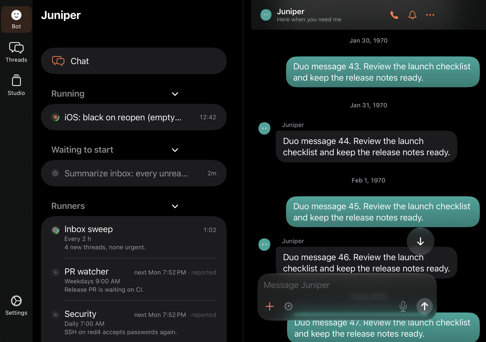 | 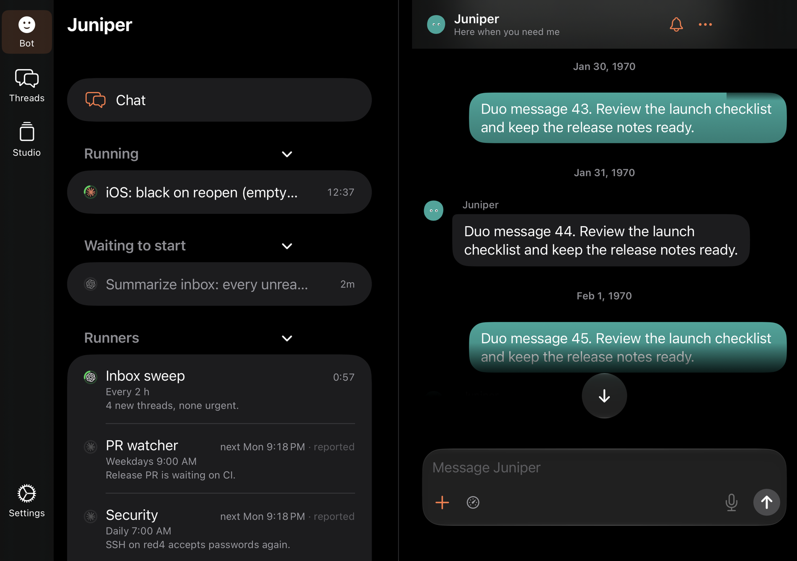 |  |
| Bot thread (Running) | 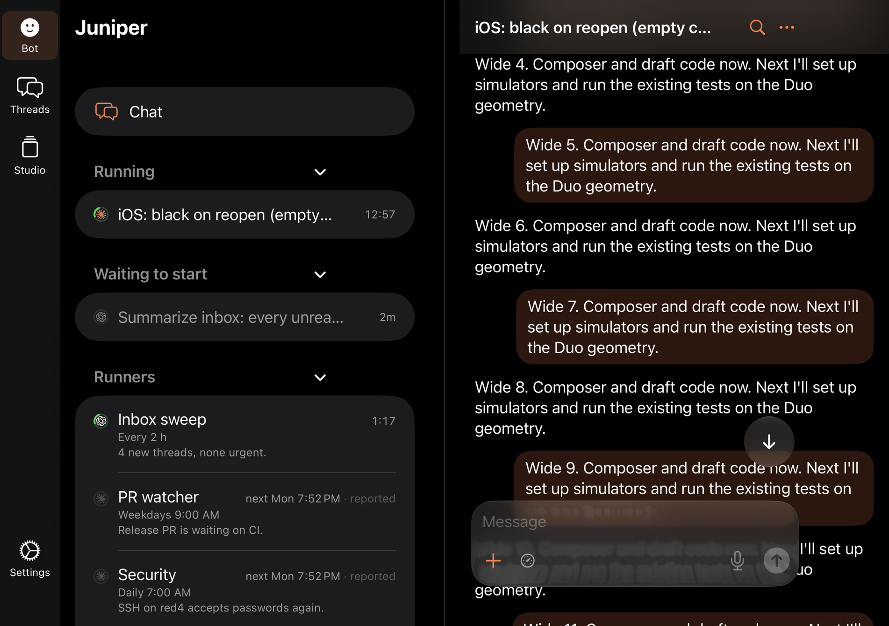 | 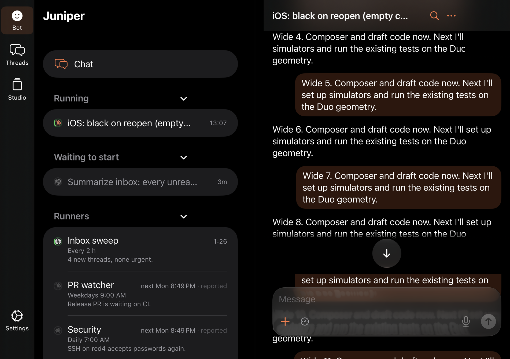 | 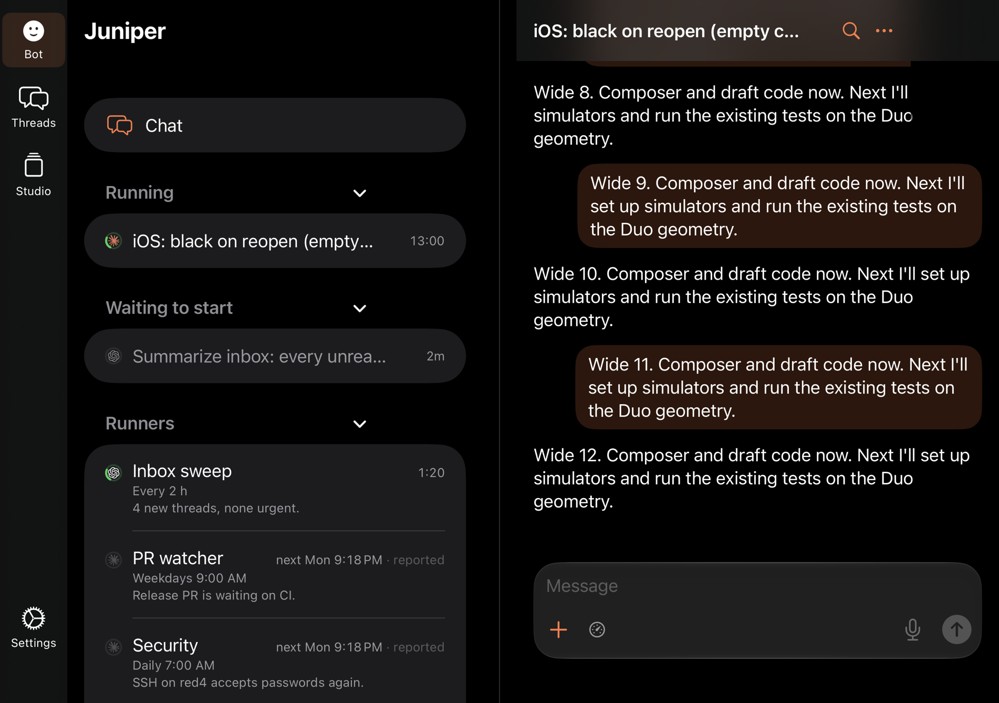 |
| Normal thread (Threads) | 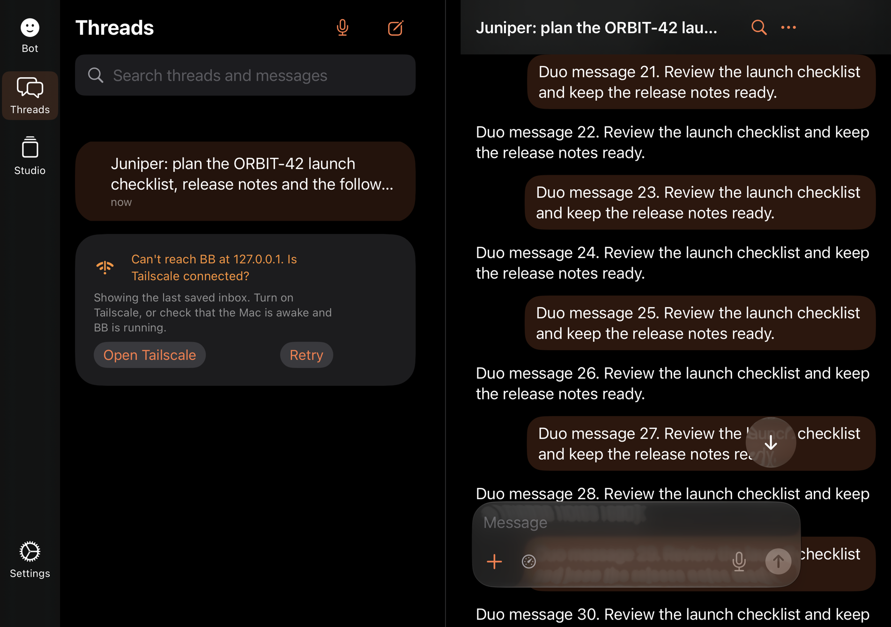 | 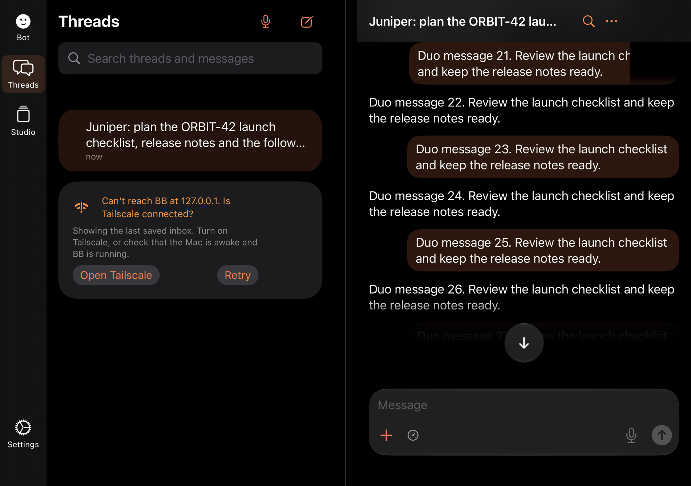 | 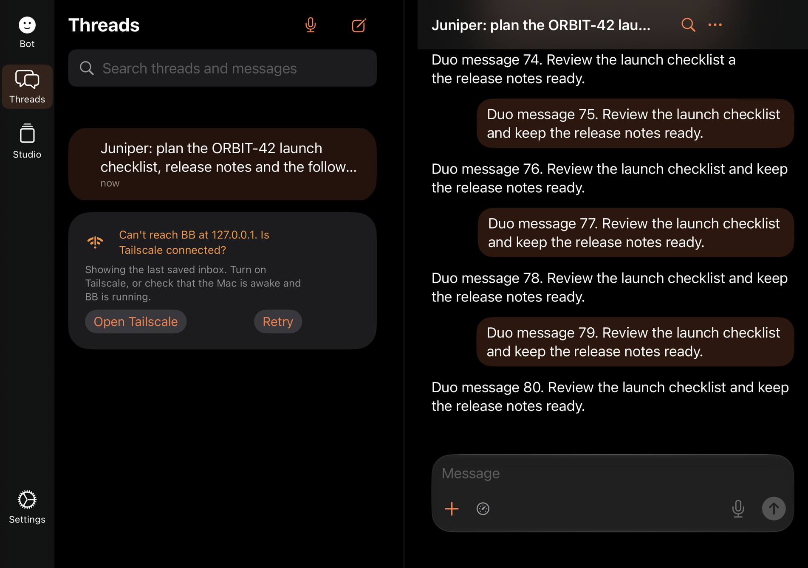 |

The Duo's outer screen (466 × 678) and an iPhone 18 Pro keep one page and the
old layout: [outer](after-outer.png), [iPhone](after-iphone.png).

The simulator doesn't draw the Duo's clock and icons, so the renders show the
covered corner but not the cluster itself. Its height (104 points) is measured
from a screenshot of the real inner screen.

## No status corner, no gap under the composer

Patrick, on TestFlight 20261026.0130, in the inner split's right page:

1. “The black area is unnecessary.” The status corner's 104-point box behind
   the clock and Wi-Fi covered the top of the bubbles. Text passing under the
   clock is fine.
2. “There is also a gap under the input area.” The composer stood well clear
   of the screen's bottom edge, while the list in the left page ran to it.

### Cause

The inner window reports a 34-point bottom safe area (`safeBottom` 34 in the
Debug `layout` probe, at 951 × 669), the home indicator's. The thread screen
ignored only the trailing safe area beside two pages, so the composer's
`safeAreaInset` sat inside the bottom one too: 34 points of inset plus its own
8-point padding, a 42-point gap. In Patrick's screenshot the gap is the same,
about 42 points. The left page's list ignores the bottom safe area, so it ran
to the edge. Nothing added the inset twice.

### Fix

- **Status corner.** `StatusCorner` and `DuoLayout.statusClusterHeight` are
  removed. Rows scroll under the clock and icons.
- **Composer.** Beside two pages the thread screen ignores the bottom container
  safe area as well as the trailing one. The composer keeps its 8-point
  padding, so it ends 8 points above the window's bottom edge: the gap a phone
  leaves under its composer above the home indicator, the tab bar or the
  keyboard. The keyboard's safe area still applies. The jump button, its scrim
  and the composer's width are unchanged. Only the phone idiom (the Duo's
  inner screen) drops the bottom inset: a landscape iPad also shows two pages,
  and keeps its composer above its home indicator.

The outer screen (466 × 678) and an iPhone keep one page and are unchanged:
the composer sits 8 points above the 34-point home indicator on the outer
screen, and above the tab bar on an iPhone 18 Pro.

### Tests

`DuoSplitComposerUITests` no longer checks the status corner. In the Bot's
chat, a Bot thread and a normal thread, it now checks that the composer ends
8 points (within 2) above the window's bottom edge, at the end and up in the
history, and that with the keyboard up the composer stays above it. Before
the fix it failed with a 42-point gap in every case. The narrow test checks
that the composer still clears the home indicator by at least 8 points.
`DuoQuickRepliesUITests` now expects the composer's 8 points from the
window's edge, not from the home indicator.

### Renders

Dark, inner split, Bot chat, at 2×. Before is this branch's test-first state
(base 6b785288), after is the fix.

| | Up in the history | At the end |
| --- | --- | --- |
| Before |  | 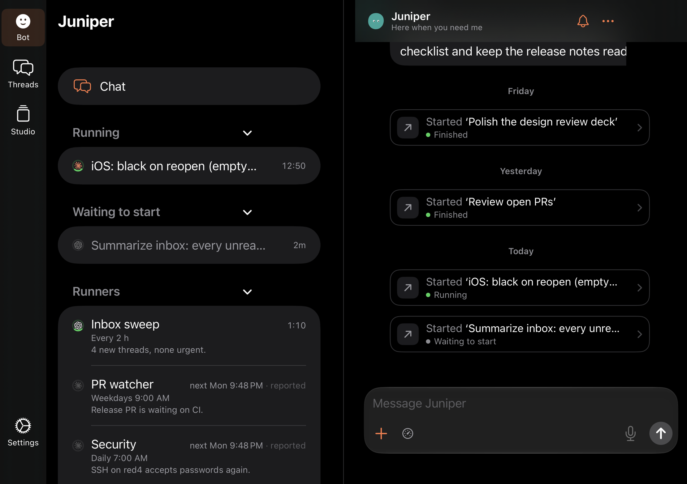 |
| After | 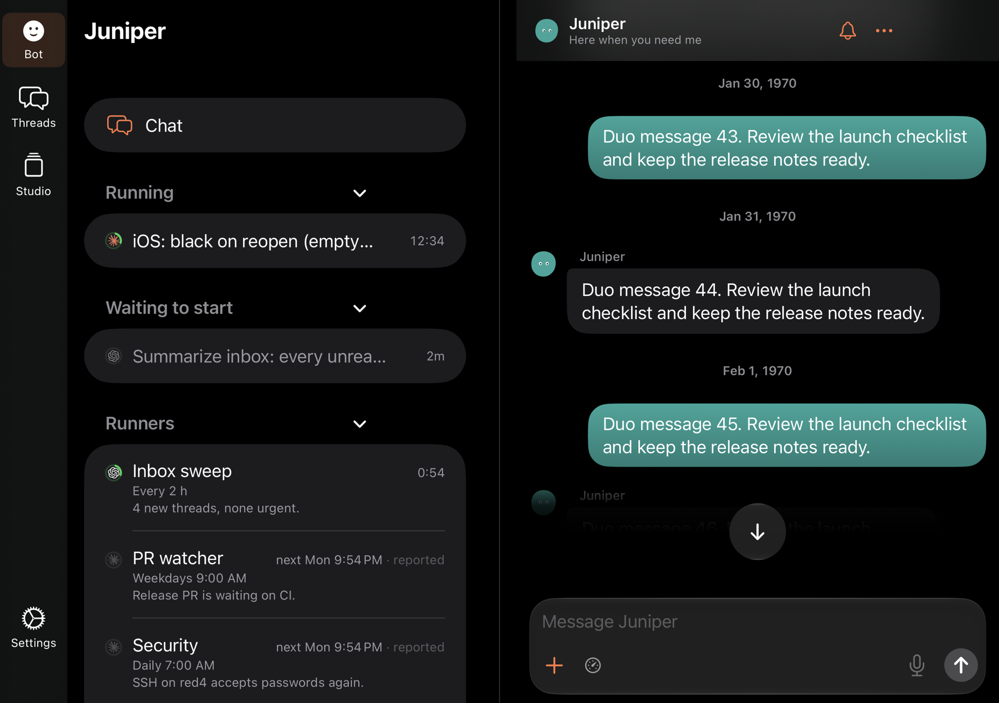 | 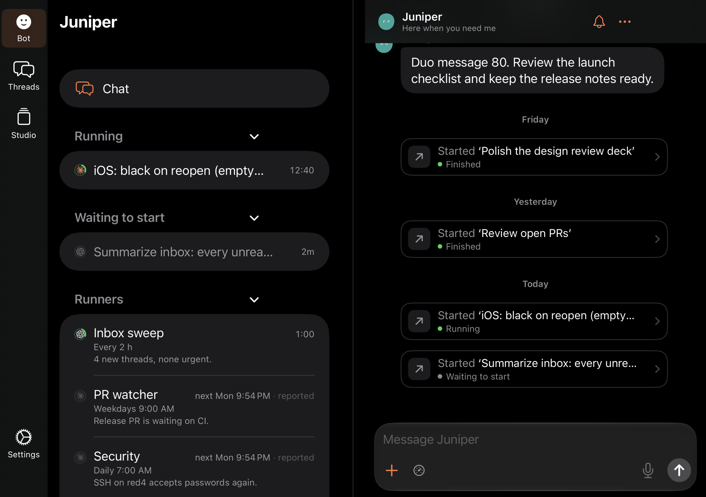 |
