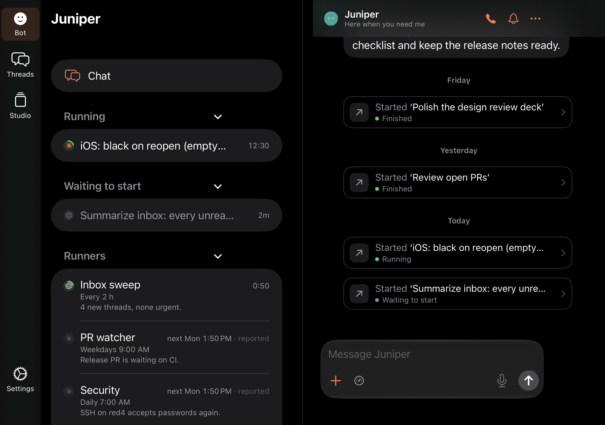
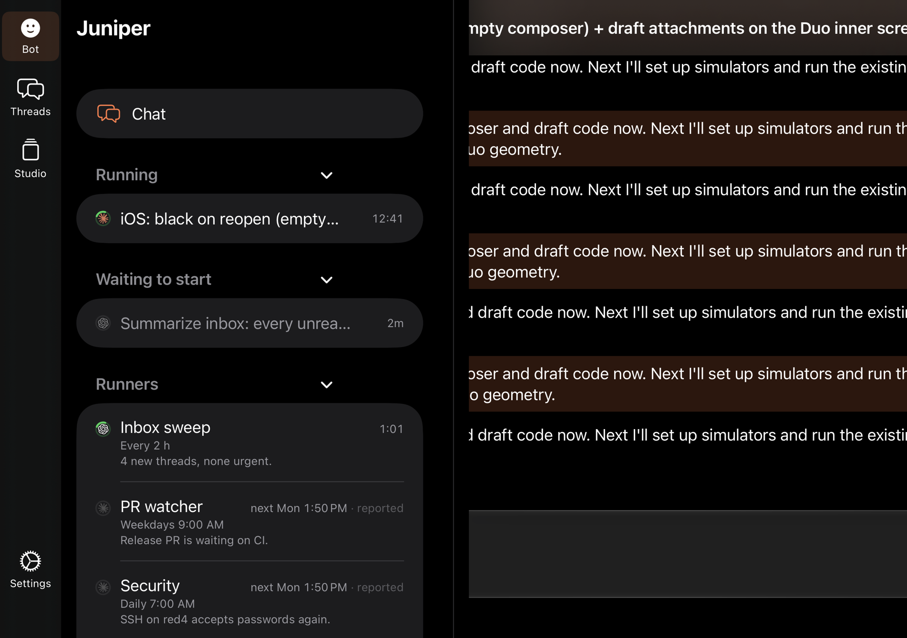
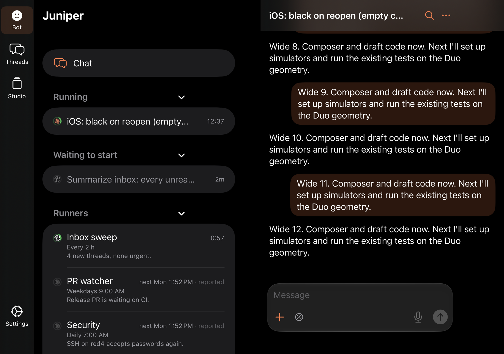
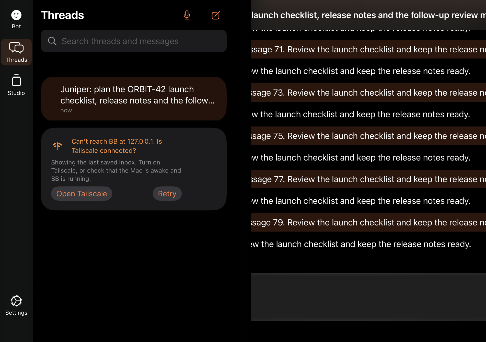
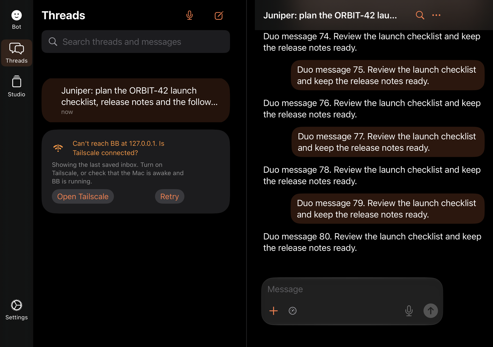

# Duo split view: the detail pane wider than its column

25 October 2026. On the iPhone Duo inner screen (951 × 669 points, phone
idiom, two pages), a thread with a long title was laid out wider than the
right page. The transcript, title and composer were centred on the page and
cut off at the crease and at the window edge, so the page looked zoomed in.

## Cause

The split view's in-page header, `DuoHeader`, pinned its title to the full
width of its text with `fixedSize(horizontal: true, vertical: false)`. The
header is a top `safeAreaInset` on the thread view, and SwiftUI makes a view
at least as wide as its insets. A title wider than the page (such as
“iOS: black on reopen (empty composer) + draft attachments”) therefore
widened the whole thread view: its transcript, composer and jump button. The
page then centred and clipped that wider view.

Nothing cached a width. `TranscriptResizeAnchor`, `GeometryReader` and the
window probe were not involved; the overflow came only from the title's
ideal width.

## Fix

`DuoHeader` now gives its title `lineLimit(1)` and `layoutPriority(1)`,
not `fixedSize`. The title takes the room the action buttons leave and
truncates there. The actions keep their fixed size.

## Which cases broke

| Case | Before | After |
| --- | --- | --- |
| The Bot's chat | Fits (its header is the Bot's name and status) | Fits |
| A Bot thread from Running | Broken: page from x 287 to 1072 | Fits |
| A Bot thread from Waiting to start | Broken: page from x 222 to 1137 | Fits |
| A normal thread from the Threads list | Broken: page from x 256 to 1103 | Fits |

Any thread whose title is wider than the right page broke, whichever list
opened it. Short titles, such as the old “Juniper” fixture, fit, so the
existing Duo tests did not catch it.

## Test

`DuoSplitWidthUITests` runs on an owned iPhone Duo simulator with the
`-qaDuoWideTitles` fixture, which gives the Duo threads and the Bot's Running
and Waiting threads long titles and opens them offline. For each case it checks
that the composer, transcript text, title, jump button and transcript scroll
view lie between the crease (x 491.5) and the window's edge. It failed for the
three broken cases before the fix and passes after it.

## Renders

Dark, 951 × 669 phone window, UIKit renders at 2×.

| Case | Before | After |
| --- | --- | --- |
| Bot chat |  |  |
| Running |  |  |
| Waiting |  |  |
| Threads |  |  |
