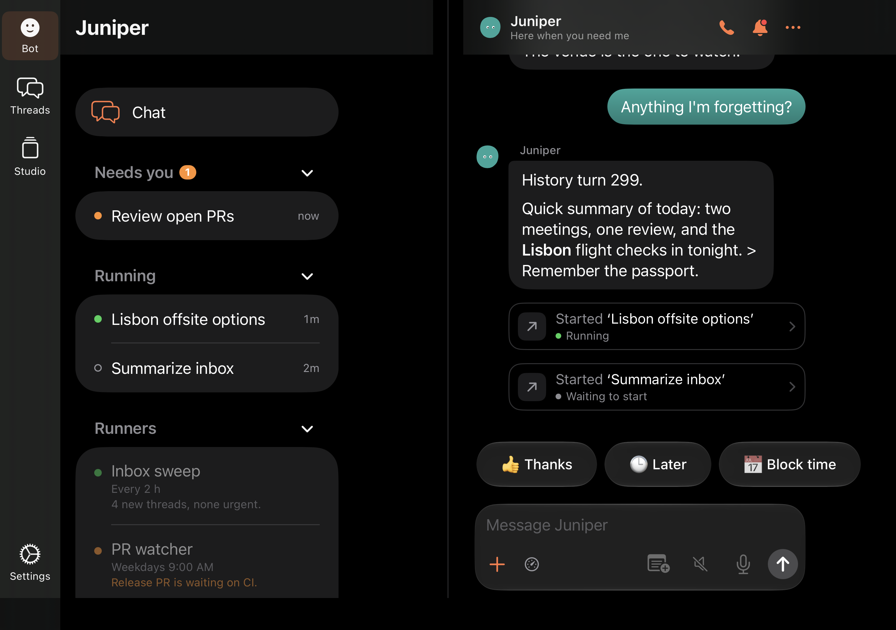
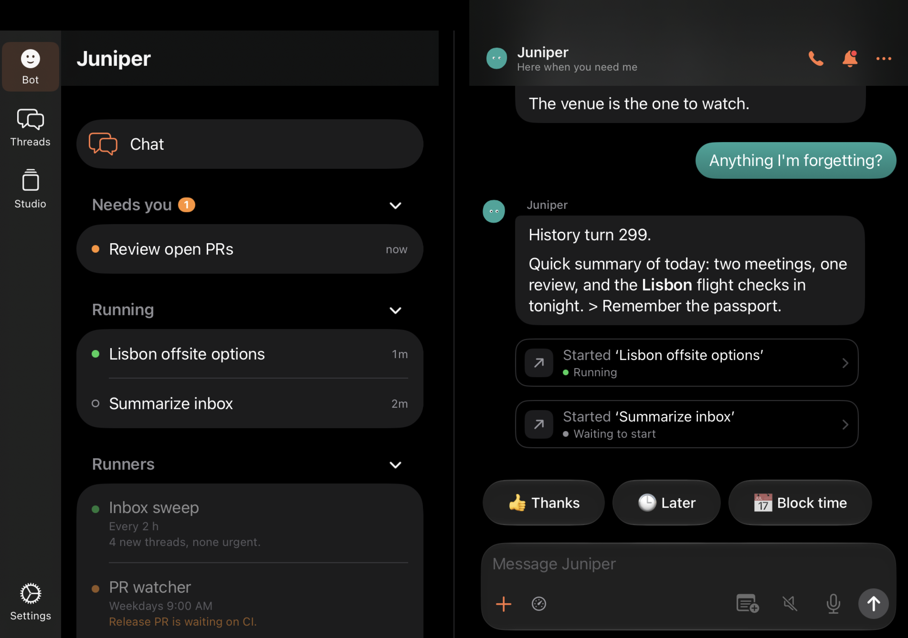
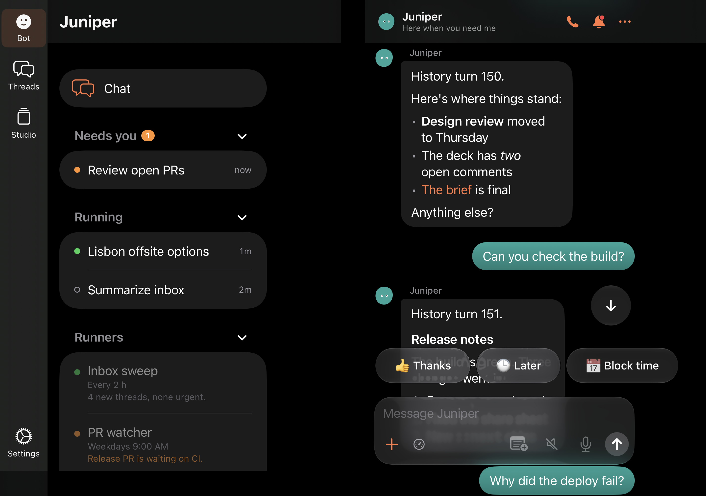
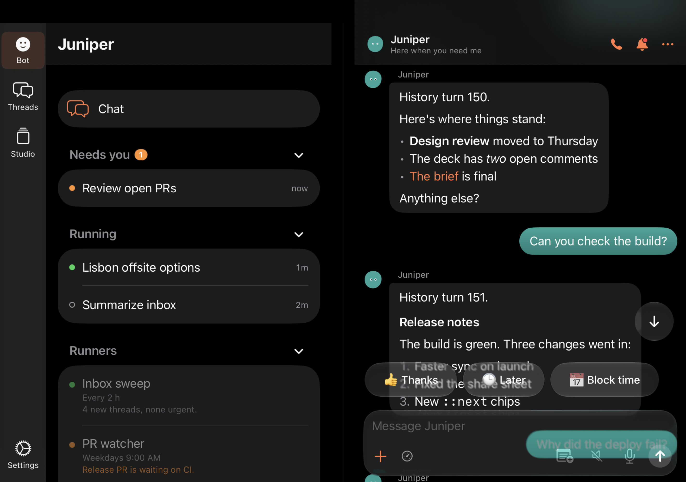
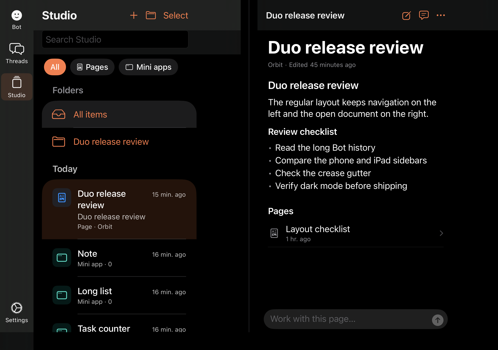
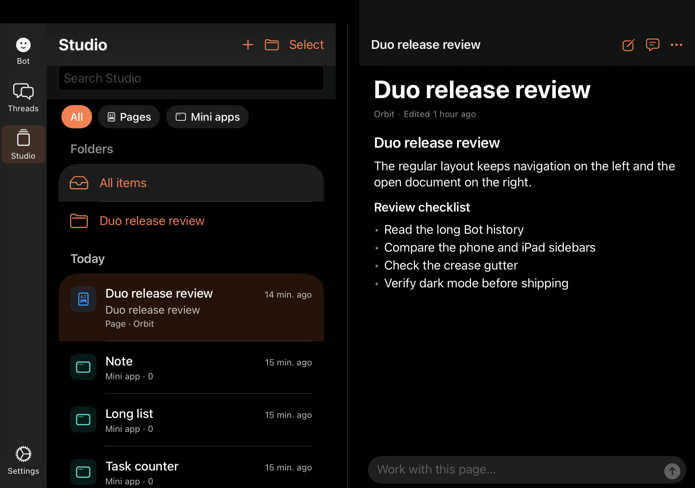
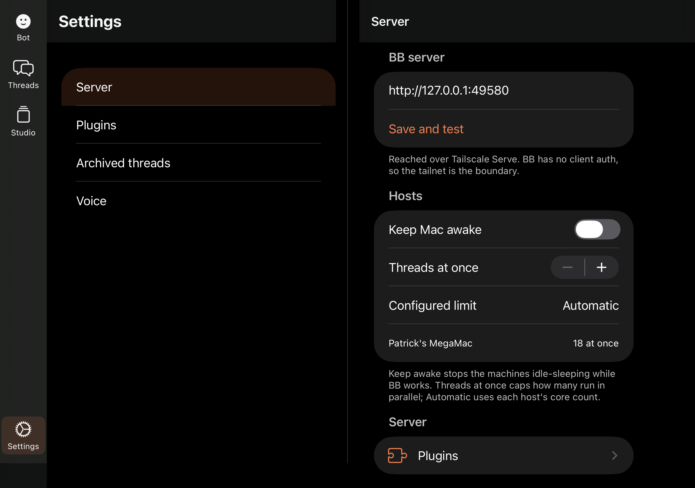
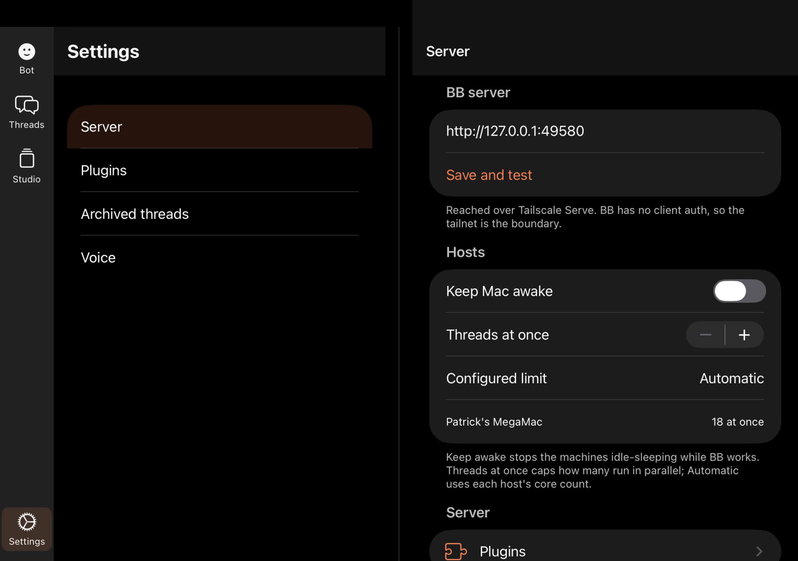
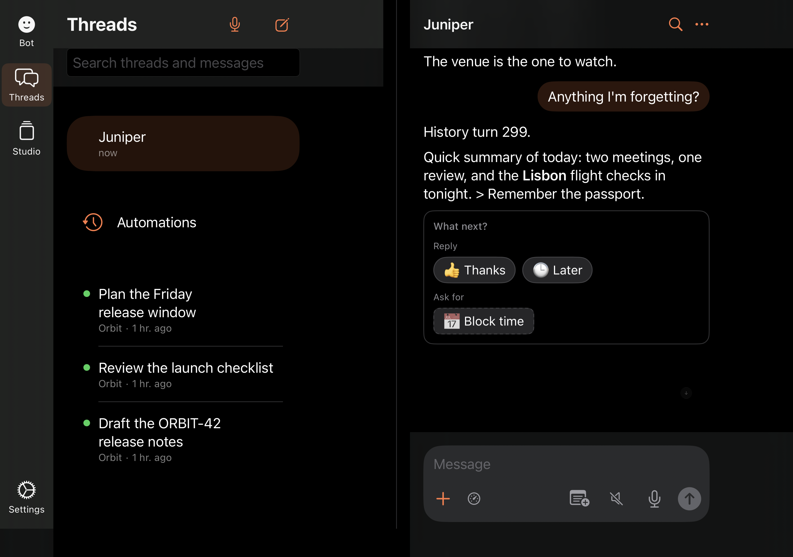
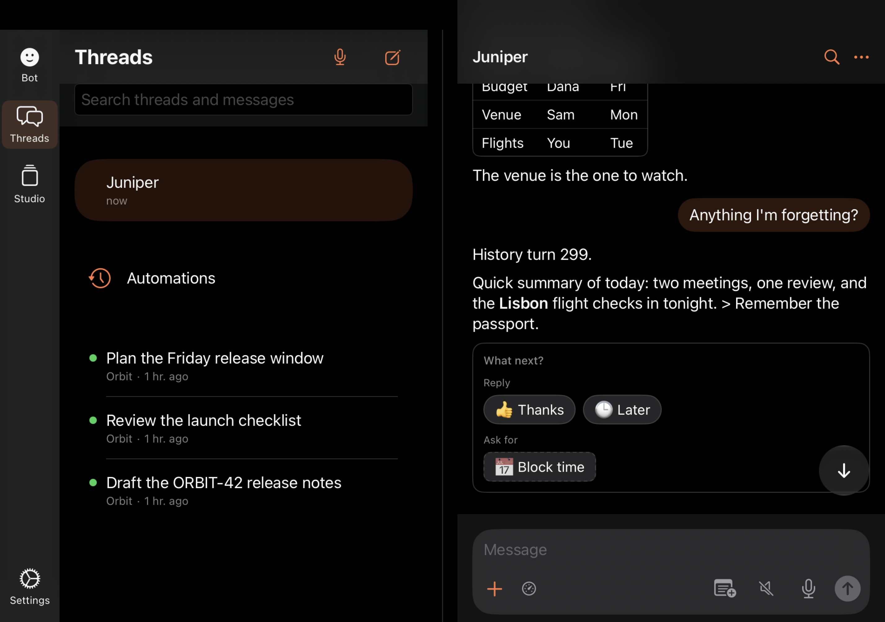

# Duo v3: shared regular layout and long-history restoration

23 October 2026. This follows the blank Chief of Staff chat reported from
`7585f7cd` in build 20261023.2018. The phone and iPad now use the same
`RegularPages` hierarchy at the Duo landscape size. The detail navigation stack
stays mounted when the sidebar appears or disappears.

## Scrolling

These defects made the old width-change handling unreliable:

- Bot chat rows did not supply measurements to the resize keeper. Ordinary
  thread rows did, but their cache could retain disappeared lazy rows. In the
  long-history trace, turn 298 was selected as the anchor while turn 150 was
  being read.
- A raw point stopped identifying its message as mixed-height lazy rows above
  it measured. The restore now retains a message id with an alignment for its
  saved offset. Fresh next-width measurements are kept separately from the
  previous fold's measurements, and disappearing rows leave the cache.
- A transient empty visibility callback could erase a valid reading anchor
  before the width change arrived. The keeper retains the last valid message
  through that gap, then validates its new geometry.
- The overscroll repair included the visible bottom in its calculation of the
  content end, preventing it from detecting a viewport beyond the content.
  It now repairs a wholly blank viewport beyond the actual content end, without
  reacting to partial overscroll or short fitting content. It waits while a resize
  restore is in progress so intermediate lazy estimates cannot interrupt it.

Every point correction must be finite and between zero and content height
minus the unobscured viewport height. Insets do not enlarge that range. If the
row cannot be measured, the target is invalid, or no measured row is visible
after restoration, the existing bottom-marker operation is the fallback.
Newest-message pinning uses the transcript's existing 120-point tolerance.
Height-only changes still do not request a resize restore.

The fixture has 600 conversation messages (300 turns), 100 tool rows, Markdown
lists, tables and code, next-action cards, and periodically much longer replies.
It uses the real Bot renderer and ScrollView. The tests cover a cold 951×669
open, repeated outer/landscape changes at the bottom, and middle-history changes
with a typed composer draft. The selected reading message is checked within
100 points at every change after restoration settles; the draft must remain identical.
The model and keeper identities and model load count must also remain unchanged.
Visibility callbacks exclude stale lazy rows, and message rows take precedence
over tool groups and day separators.

The reading test was also run with the `7585f7cd` production root, Bot renderer
and scroll implementation restored temporarily in this worktree. Only the QA
fixture and scroll-position setup were added. All three width-change assertions
failed. The same test passes with the v3 implementation. The bounded-target and
offscreen-anchor unit tests also failed against the original implementation.

## Shared sidebars

There was no separate native iPad split implementation to route into. Both
idioms now share the regular layout instead. Wide windows also set the hosting
controller’s UIKit horizontal size class to regular; a SwiftUI environment
override alone leaves phone navigation chrome compact. The native override is
updated only when window geometry changes and clears on narrow windows:

- Bot embeds its existing activity list: Chat, Needs you, Running, Runners,
  Recurring, Recent and Earlier conversations, with the existing actions and
  data loading. The live chat remains on the right.
- Studio keeps its existing type, project and tag controls and item list on the
  left. Parent pages provide the folder filter; selecting an item updates the
  existing Studio navigation path and opens it on the right.
- Settings lists its sections on the left and reuses the existing settings,
  plugin, archive and speech views on the right.
- Open pages use the same in-page title and actions on both idioms. The
  existing edit, comment and menu actions are reused; narrow page toolbars
  retain their existing native placements. Wide headers keep titles and
  actions on one line.
- Threads keeps its shared inbox store and selected-thread detail.

The rail remains on the left. The 32-point gutter is centered on the window's
midpoint, accounting for leading safe areas. Outer and portrait windows retain
the native phone navigation and single-column views.

## Dark renders

Each image is an unmodified UIKit render of a built app at 951×669 points,
2853×2007 pixels. The Duo uses the **phone idiom**, and the iPad uses its actual
pad idiom and safe areas. Both use the same regular layout. Geometry and dark
appearance are recorded in `v3-capture-geometry.json`. The renderer captures the
app window, not the remote system status bar or keyboard.

Studio pages and mini apps and the real thread sidebar come from an isolated
staged BB at `7585f7cd`. The Bot and selected Threads conversation use the local
long fixture. No agent ran and no TestFlight build was made.

| Surface | iPhone Duo | iPad |
| --- | --- | --- |
| Bot at bottom |  |  |
| Bot in mid-history |  |  |
| Studio, item open |  |  |
| Settings |  |  |
| Threads |  |  |

Explicit bottom copies are also saved as `v3-bot-bottom-duo.png` and
`v3-bot-bottom-ipad.png`.

## Re-running the checks

Use `DuoLongTranscriptUITests` on an owned iPhone Duo simulator. Its DEBUG-only
resize links change the existing window, never relaunch the app. The middle
setup cancels an in-flight width restore as a real reader’s touch does.

For `DuoRegularComparisonUITests`, set `TEST_RUNNER_BBGO_QA_SERVER` to the
isolated staged BB and `TEST_RUNNER_BBGO_QA_DEVICE` to `duo` or `ipad`. Seed the
parent page **Duo release review**, a child page and the Orbit thread list.

Mini gesture checks use fresh counter, long-list and note apps. Preload the
reply’s early cards so an initial estimated-height correction does not mask the
drag being measured. Set `TEST_RUNNER_BBGO_QA_MINI_LAYOUT=outer` on the iPhone,
and `landscape` on the iPad. Gestures run in native scenes (402×874 iPhone 18 Pro compact
and 1376×1032 iPad landscape); the latter uses the same regular layout
decision. Forced window bounds remain useful for 951×669 renders and reading
assertions, but did not provide reliable physical gesture coordinates.
The test still requires the short card to move with the thread and the tall
card to scroll internally while its header stays within four points.

## Verification

- iOS unit suite: 341 tests, one skipped, zero failures.
- Duo phone: cold wide Bot, repeated bottom/middle width changes and draft/model
  retention; three phone-root tests; dark sidebar/detail comparison — passed.
- iPad: three existing fold/keyboard tests and the dark comparison — passed.
- Mini cards: both UI tests passed on iPhone 18 Pro; short/tall gesture ownership
  passed in the iPad’s native landscape split.
- Studio package-local typecheck and Vitest: passed, 272 files / 1,982 tests.
- Icon, documentation-link and whitespace checks: passed.

Direct mini-card drag assertions on the Duo simulator still fail. Forced-window
iPad drags also failed while native-scene drags passed. The installed 27.1
runtime supports only Duo; the standard iPhone and iPad run 27.0. These results
do **not** establish that mini-card gestures work on a physical Duo. No
production mini-card gesture code was changed. Check those gestures on the real
device before treating that part as verified.
