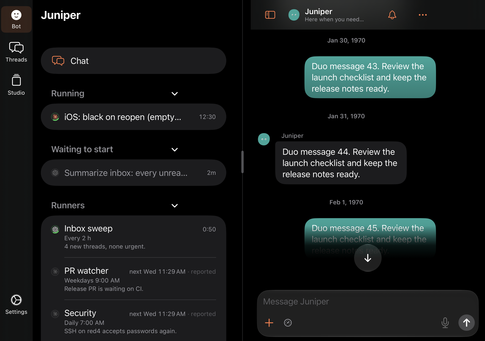
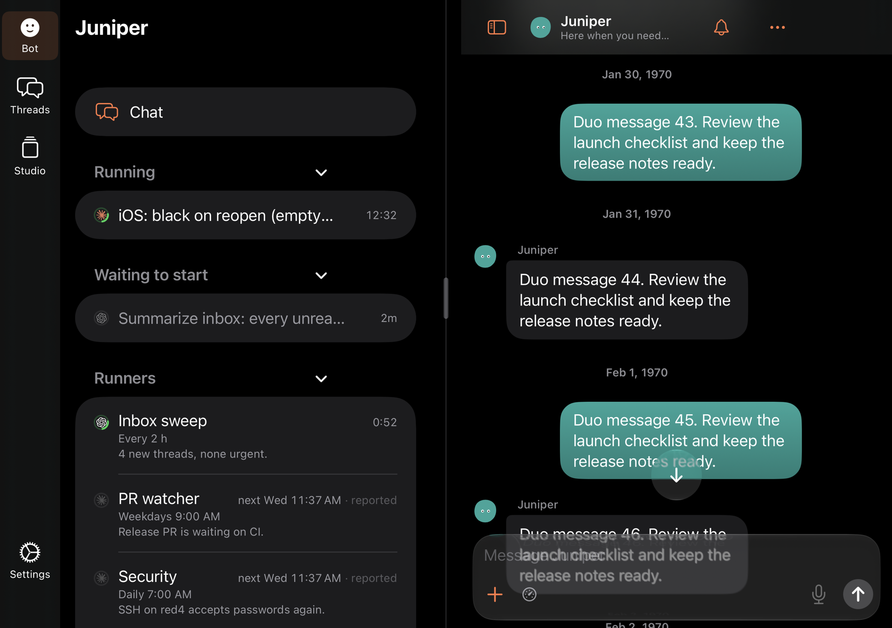
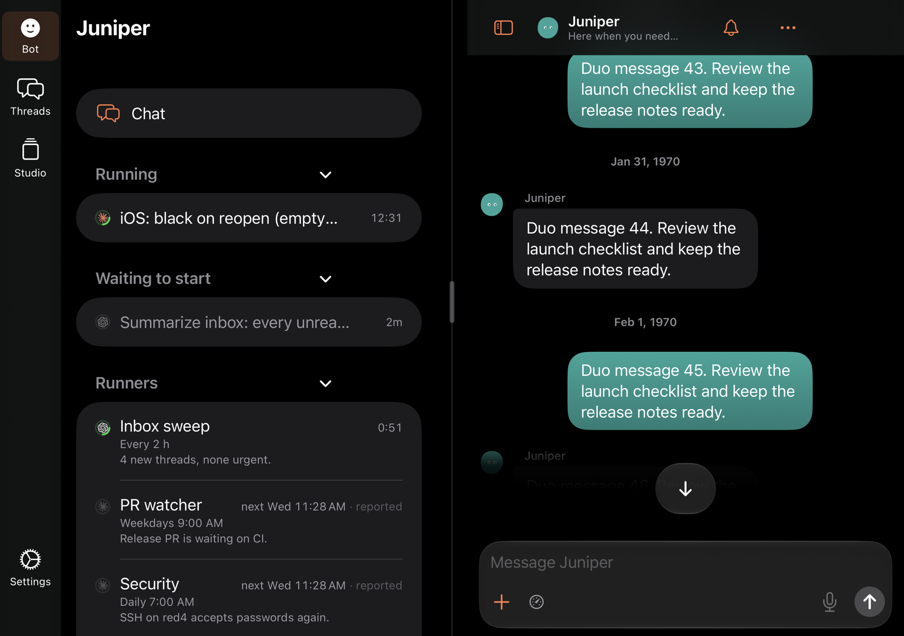
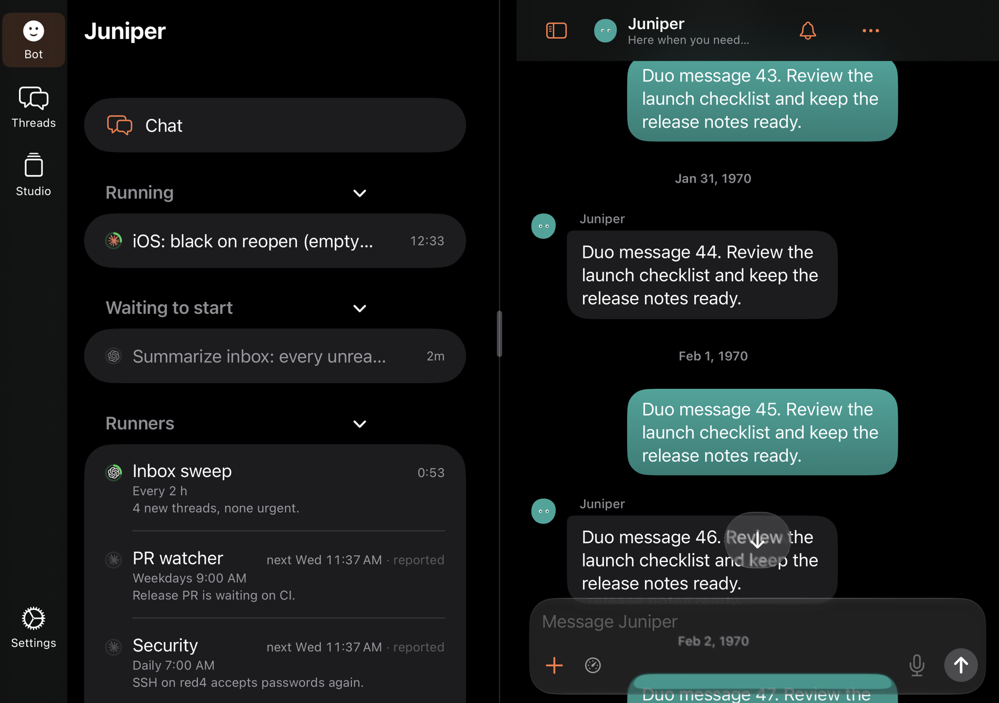
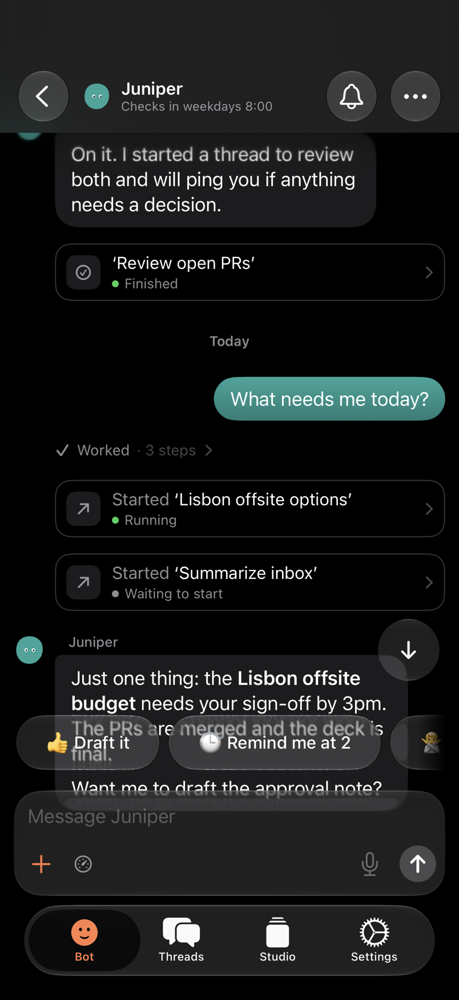
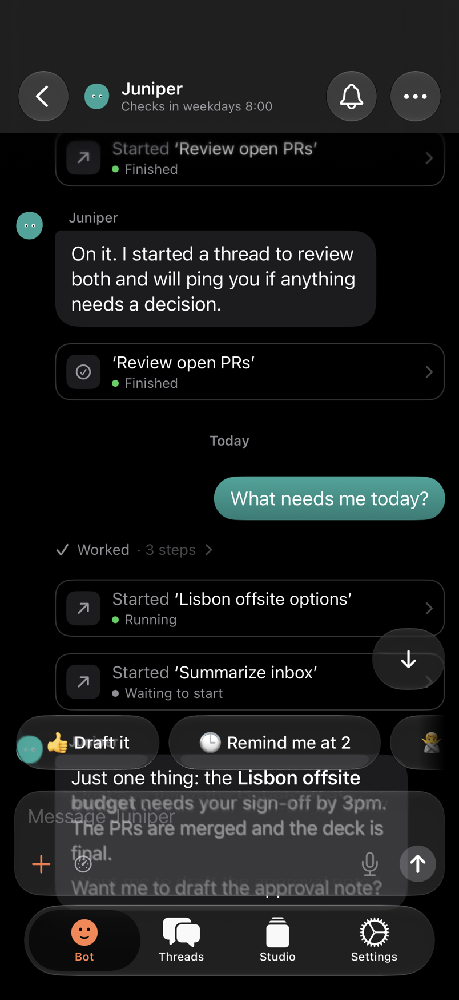

# No fade above the composer

27 October 2026. Patrick: “This black gradient is annoying. Get rid of it.”
Up in the history, transcript text faded into solid black from about three
lines above the “↓” jump button down to the composer.

## Cause

The fade was `JumpScrim` in `ThreadView.swift`, added in 65880d3f for the
Duo's split jump button ([duo split composer](../duo-split-composer/README.md)).
It ran from 24 points above the button, nearly opaque by its middle, down
behind the composer to the window's bottom edge. Both transcripts drew it:
the old one behind its jump band, the new one (`transcriptV2Pill`) behind the
pill. Both drew it only beside two pages: the Duo inner screen's split and its
full-width chat. On a phone the jump button floats in the corner with no
scrim, so the phone had no black fade before this change either.

## Fix

`JumpScrim` is gone. Beside two pages the jump button and pill sit in their
band on their own glass, and rows stay at full brightness right up to them
and the composer. Rows pass under the composer's own card and the 8 points
below it, as they do under a phone's bars. Nothing else changed: the band is
still in the transcript's bottom inset, so at the end the last row sits whole
above the composer, and in the history the button never covers the last
visible row.

## Tests

`NoFadeUITests` (dark, offline) opens the Bot chat on each transcript, scrolls
up into the history, and counts near-white pixels in the strip from 16 points
above the jump button down to the composer, beside the button. A fade dims
that strip, so it has none. A gap between rows can fall there, so the test
looks at up to six scroll positions 17 points apart.

- `TEST_RUNNER_NOFADE_LAYOUT=split` (iPhone Duo inner screen, right page):
  before the fix it failed on both transcripts with 0 bright pixels at all six
  positions. After it, 9,321 (old) and 11,494 (new) at the first position.
- `TEST_RUNNER_NOFADE_LAYOUT=phone` (iPhone 18 Pro): passes before and after
  (4,234 old, 7,117 new). The phone had no fade.

`DuoSplitComposerUITests` (both transcripts), `TranscriptV2UITests` (phone, outer,
split) and `TranscriptPastEndUITests` (phone, both transcripts; Duo outer)
still pass. No assertion checked for the scrim, so none needed changing.

## Renders

Dark, up in the history, at 2×. Before is 8f939f57.

| | Before | After |
| --- | --- | --- |
| Duo split, old transcript |  |  |
| Duo split, new transcript |  |  |
| iPhone, old transcript |  |  |
| iPhone, new transcript |  |  |
