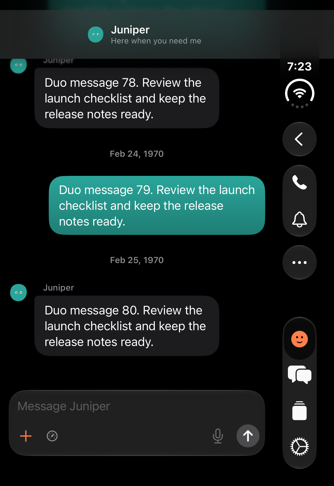
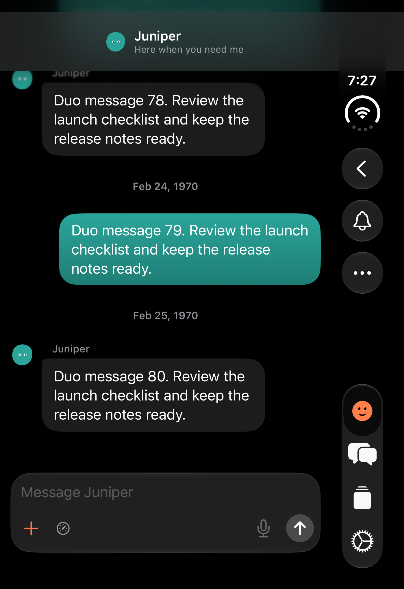
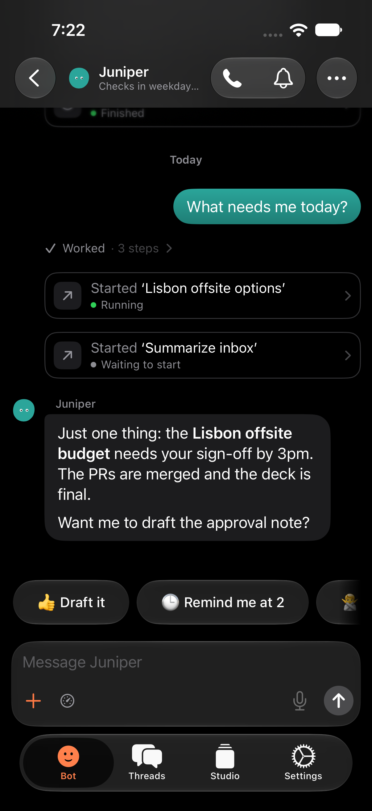
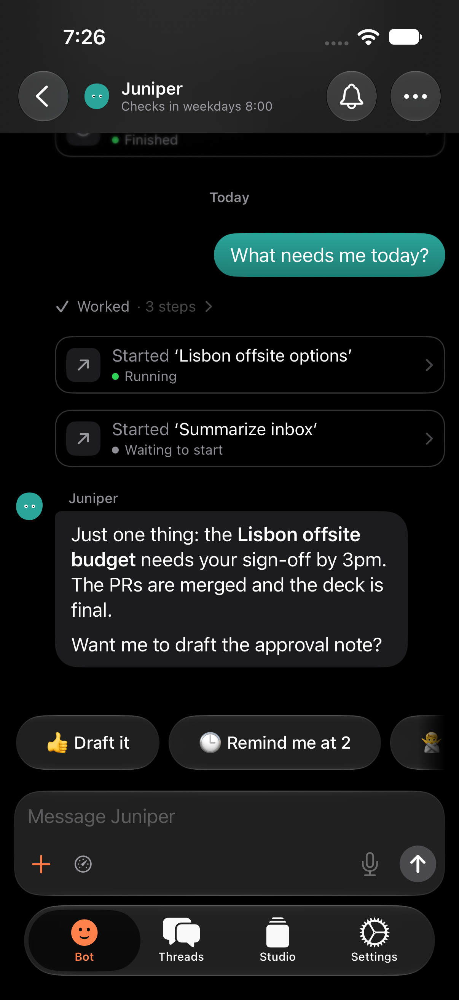
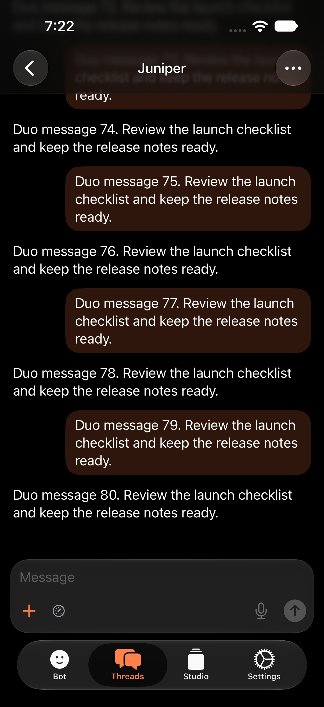
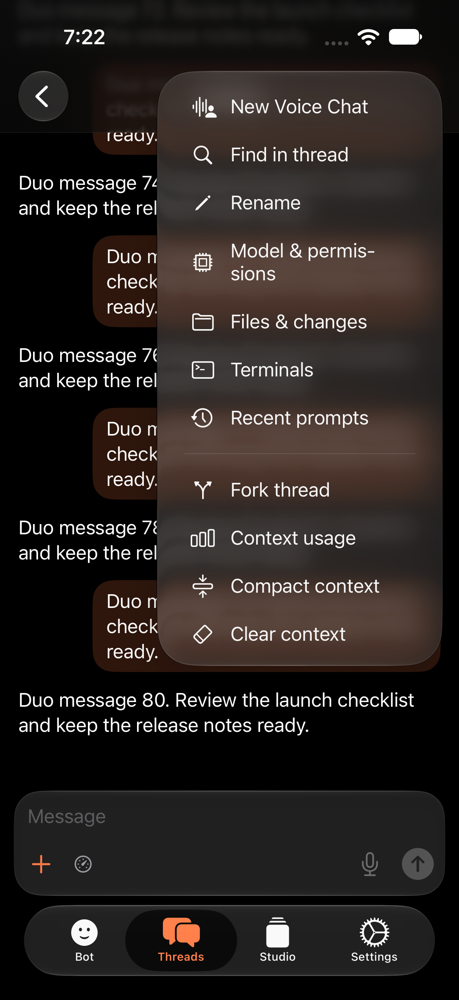
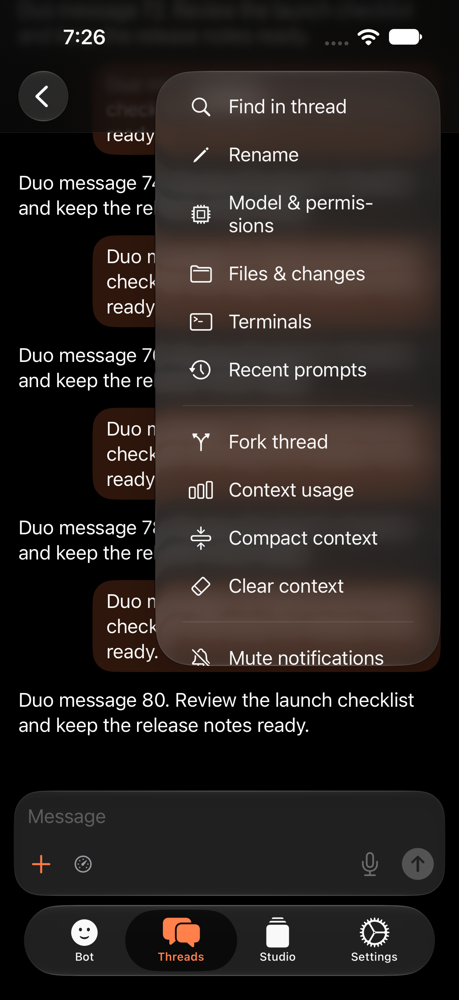

# No New voice chat

Patrick, Oct 25: "New voice chat button is awkward. It starts a thread with
tts on? We should get rid of it." The phone button is gone from the Bot's
rail, and every other New voice chat entry point went with it. The bell, the
⋯ menu, the composer's mic and its voice mode speaker stay.

Dark, on the local `-qaBotDemo` Bot (the server is a closed local port).
Captured by `NoVoiceChatUITests` with `TEST_RUNNER_NO_VOICE_SHOTS`, on the
iPhone Duo's outer screen (`TEST_RUNNER_NO_VOICE_DUO=1`) and an iPhone 17 Pro.

| | Before | After |
| --- | --- | --- |
| Duo outer screen, Bot chat rail |  |  |
| iPhone, Bot chat |  |  |
| iPhone, a thread |  |  |
| iPhone, the thread's ⋯ menu |  |  |

Removed on iOS: the Bot's phone button (narrow toolbar and the wide rail),
New Voice Chat in the thread ⋯ menu, a thread row's menu and Settings → Voice,
the "New voice chat with BB" App Intent and its Siri shortcut, the Control
Center control, the status widget's Voice link, and `bbstudio://voice`
without a thread id. `bbstudio://voice/<id>` still turns voice mode on in that
thread. In Studio: the voice button in a new thread's composer and the
*New voice chat* command.

Kept, now unused by any UI: Studio's `voice.new` RPC (`src/voice/register.ts`,
`contract.ts`, `sessions.start`) and the iOS client's `BBClient.newVoiceChat`.
