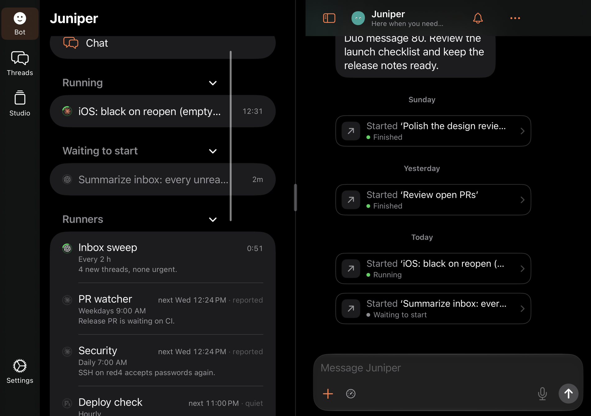
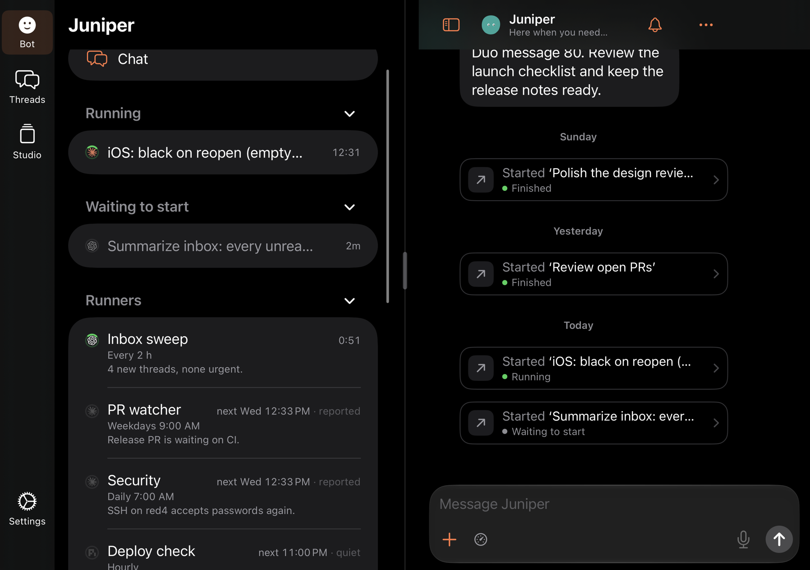
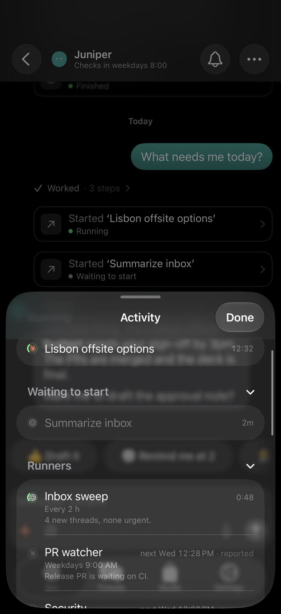

# One scroll indicator in the Bot's threads list

27 October 2026. Patrick, in the Bot tab beside the Bot chat: “Scroll bar is
fucked.” In the list of the Bot's threads (Running, Waiting to start, Runners,
Recurring…), a vertical scroll indicator floated about three quarters of the
way across, over the runners' “next 12:05 PM” and their summaries. A second
indicator showed at the screen's right edge.

## Cause

There was no nested scroll view. The floating bar was the list's own
indicator, drawn in the wrong place.

Beside two pages on the Duo's inner screen, the window has an 84-point
trailing safe area: the status column at the right page's edge. The left
page's list inherits it (its scroll view reports `safeAreaInsets.right` 84),
and UIKit insets a scroll view's indicator by its safe area. So the list's
indicator was drawn 84 points in from the list's edge, at x 369.7 in a list
that ends at 459.7, while the rows' text runs to 443.7. The rows didn't move:
`SidebarRowContent` already took the 84 points back from each row's trailing
inset. The second indicator is the chat's own, at the right page's edge.

Every sidebar list beside two pages uses the same margins
(`SidebarListMargins`): the Bot's list, Threads, Studio and Settings. The
phone's Activity sheet (the same list from the bell) has no status column,
and its indicator was already at its edge.

## Fix

`SidebarListMargins` ignores the trailing container safe area, so the list's
indicator sits at the list's own edge, past the rows' cards. It tells its rows
so (`sidebarIgnoresTrailingSafeArea`), and `SidebarRowContent` then gives
them their plain 20-point trailing padding instead of taking the column
back. Rows keep the margins they had. A row outside such a list still takes
the column back as before.

## Tests

`RunnerCardScrollUITests` (dark, offline, Bot demo) opens the list (the
Activity sheet on an iPhone, the sidebar on the Duo), scrolls it, and reads
every scroll view from `qa-duo/layout`, which now also reports each one's
safe area, whether it shows a vertical indicator, and where UIKit draws its
indicators. It checks that:

- no scroll view that shows a vertical indicator and scrolls vertically sits
  inside the list (the Duo's status-bar tap strip cells hide theirs);
- the list's vertical indicator starts at or past the rows' trailing edge;
- beside two pages, the Threads and Studio sidebars' indicators sit within
  8 points of their edge. With the demo's data neither scrolls, so this part
  printed “the sidebar doesn't scroll” and checked nothing.

Before the fix, on the Duo split, it failed: the indicator was at x 369.7, in
front of the rows' trailing edge at 443.7. After, it is at 453.7 in a list
ending at 459.7. On an iPhone it passes before and after (388.2 in a list
ending at 394). `DuoPaneWidthUITests`, `DuoSidebarSearchUITests`,
`DuoLayoutUITests`, `DuoEdgeToEdgeUITests`, `DuoPhoneRootUITests` and
`DuoSplitComposerUITests` still pass on the Duo.

## Renders

Dark, at 2×, while the list scrolls. Before is 496290af.

| | Before | After |
| --- | --- | --- |
| Duo inner screen, the Bot's sidebar |  |  |
| iPhone, the Activity sheet |  |  |
