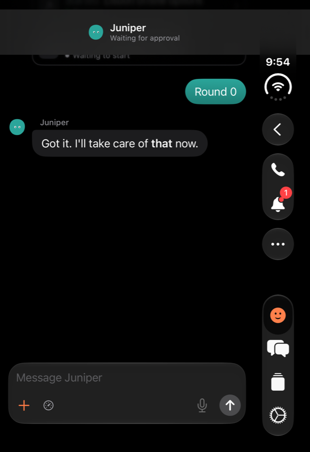
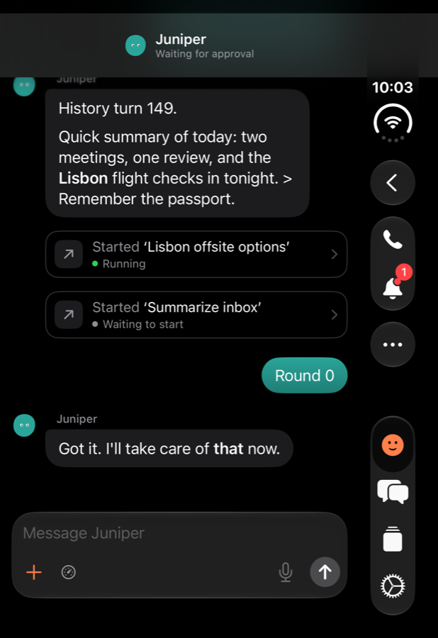
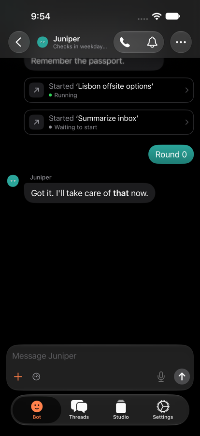
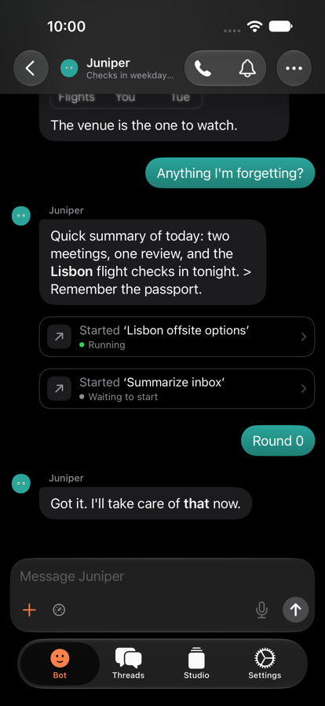

# iOS transcript "scrolls into black": root cause

Patrick, Oct 24: "Often it shows black like it scrolls too far down." It was
the Bot chat on the iPhone Duo's outer screen. The transcript area above the
floating composer was black, and the scroll indicator sat short at the
bottom of its track. That means the scroll offset was past the end of the
content.

## In plain words

The chat follows the bottom by pinning the scroll position to an invisible
marker view at the end of the transcript (`timeline-bottom`). SwiftUI keeps
an id pin when rows change, but not when the **bottom inset** changes. The
bottom inset is everything below the reader's view: the composer, the quick
replies and the keyboard. When the keyboard closes, the inset shrinks by the
keyboard's height, and the offset stays where it was. The bottom of the view
then sits a keyboard's height below the last row, and that band is black.

The one repair that existed (`settlePastEnd`) only ran when the **whole**
viewport was past the end. That was a deliberate narrowing in 1747e32b
("Fix Duo long-history restoration"). The Oct 1 fix (03c1bfb1) had repaired
any overshoot over 40 pt. The narrowing came with a note that re-aiming
partial overshoots risked a scroll/layout feedback loop. So every overshoot
smaller than one screen stayed for good: on the phone 236 pt, and on the Duo
outer screen 261 pt of a 438 pt reading area.

On the Duo outer screen the reading area is so short that a keyboard-high
band covers most of it. The rest sits under the frosted header's soft edge,
so it reads as an all-black screen, which is what Patrick saw. That last
step is an inference from the geometry; the measured overshoots are below.

## Evidence

`TranscriptPastEndUITests` reads the live `UIScrollView` (contentOffset,
contentSize, adjustedContentInset) after each step through the Debug-only
`qa-duo/layout` URL. `past` is how far the bottom of the unobscured view
(above composer and keyboard) is below the content's end. Positive means
blank space.

Before the fix (fce99dd3, which is main plus the harness only), closing the
keyboard at the bottom, three rounds each:

```
phone  r0 reply:           settled=-8.7  offset=1967.3 content=2398.0 insets=116.0/452.0
phone  r0 keyboard closed: settled=236.3 offset=1967.3 content=2398.0 insets=116.0/207.0
duo    r0 reply:           settled=-9.0  offset=2767.0 content=3026.0 insets=82.0/428.0
duo    r0 keyboard closed: settled=261.0 offset=2767.0 content=3026.0 insets=82.0/158.0
```

The offset doesn't move. Only the bottom inset changes (452 → 207 on the
phone, 428 → 158 on the Duo), and nothing requests a scroll. The app's
scroll log (`-qaScrollLog`, Duo) shows the same. The keyboard closes at
19.595 and nothing happens until the keyboard comes back at 23.456:

```
13.507 geo offset=2674.3 content=2933.0 container=168.0 insetTop=82.0 insetBottom=428.0 past=-8.7
19.595 geo offset=2674.3 content=2933.0 container=438.0 insetTop=82.0 insetBottom=428.0 past=261.3
19.602 geo offset=2674.3 content=2933.0 container=438.0 insetTop=82.0 insetBottom=158.0 past=261.3
23.456 geo offset=2674.3 content=2933.0 container=168.0 insetTop=82.0 insetBottom=158.0 past=-8.7
```

`excessBottom` returned 0 here: `visibleBottom - viewportHeight - contentHeight`
= 3194.3 − 438 − 2933 < 0. Its unit test even asserted that a 200 pt
overshoot is "0".

| Before | After |
| --- | --- |
|  |  |
|  |  |

### Two more ways past the end, found on the way

The same unrepaired overshoot also comes from these. Both were transient in
the tests, but both feed the same gap.

- **Content shrinking under the offset.** `ThreadModel.refreshTimeline`
  replaces every row with the newest page when that page's first row isn't
  already loaded (more than a page arrived at once). On the phone a 40-row
  burst took content from 3209 to 2523 pt with the offset still at 2593:
  737 pt past the end. The old repair caught it only because that was more
  than a screen.
- **Lazy-stack estimates during a fold restore.** On unfold, the content
  height collapsed from 3087 to 870 pt while the offset stayed at 1635. A
  bottom-marker jump then landed at offset 4350 against content 3865, with
  no rows on screen. The past-end repair is held off while a restore runs
  (`resizeAnchor.restoring`), and nothing re-checked once it finished.

Checked and ruled out: the bottom inset is applied once. It is the
`safeAreaInset(edge: .bottom) { composer }` plus the system keyboard or tab
bar. The measured insets (phone 207 at rest, 267 with quick replies, 452
with the keyboard; Duo 158 / 218 / 428) match the composer's frame.

## Follow-up: black right after sending with the keyboard open

Patrick, Oct 24 10:22 PM, on the Duo outer screen: black right after sending,
keyboard still open. With the keyboard up the outer screen shows only 168 pt
of chat, so any overshoot that size blanks the whole chat.

`testSendingWithTheKeyboardOpenFollowsTheStreamingReply` sends with the
keyboard open while the reply streams in over 8 updates (`-qaDemoStream`),
then a message from elsewhere streams in (`qa-duo/stream`). It samples every
~0.3 s and fails if the visible chat is ever wholly blank. On main at
b0c6a0bd it **fails on the Duo** (passes on the phone): 2 blank samples while
the reply streamed, and after one keyboard-up the newest row rested 180 pt
behind the keyboard.

The cause was the first fix itself. It pinned to the bottom with
`ScrollPosition.scrollTo(edge: .bottom)`. With a bottom inset, that lands
exactly one bottom inset past the end: 428 pt with the keyboard up, 158 pt
without. Every streamed update re-pinned, then the clamp pulled it back:

```
35.965 req scrollToBottom animated=false atBottom=true     (pinned to the edge)
35.968 req settlePastEnd 428.0 marker=false to 4499.0
35.968 geo offset=4845.0 content=4667.0 container=168.0 insetBottom=428.0 past=428.0 visible=
```

Each one is a black flash of up to 0.8 s. A 90 pt overshoot also stayed at
rest for about 4 s, because "pin to the edge" just re-landed in the same
place.

`testReopeningTheChatOpensAtTheNewestRow` goes back to the Bots list and
reopens the chat five times: plain, again, after a streamed reply while away,
after a 40-row burst while away, and after that. It passes on main and with
the fix, on the phone and the Duo, with no blank sample. That path didn't
reproduce here.

## Follow-up: black on reopen with an empty composer (not reproduced)

Patrick, Oct 25, TestFlight 20261025.0255 (with the fix below), on the Duo's
outer screen: back to the Bots list, reopen the Bot chat, and everything
between the header and the composer is black. It doesn't happen with a
draft in the composer, and tapping the composer brings the chat into place.

`testReopeningAfterAReplyWithAnEmptyComposerLeavesNoBlank` sends, waits for
a reply that offers quick replies (`-qaDemoNext`), goes back with the
keyboard up or closed, and reopens with an empty composer.
`testReopeningTheChatOpensAtTheNewestRow` covers a reopen without quick
replies, after a reply streamed while away, and after a 40-row burst. Both
pass on an iPhone and on the iPhone Duo simulator, whose outer screen has
the same layout as Patrick's screenshot (the status column and tab bar on
the right, an 82 pt top inset). No sample was blank.

Found on the way, from `-qaScrollLog`:

- Every open runs the fold restore. The scroll view first reports a
  zero-size container, and `TranscriptResizeAnchor.update` takes the
  change from width 0 to the real width as a fold. For about 2.6 s
  `keepAtEnd` is held (`keepAtEnd held … restoring=true` in the log),
  while the restore scrolls to the bottom 24 times. In every run here it
  ended at the newest row. Not opening a restore for a width of 0 didn't
  change any result, so it was left as it is.
- Repeated `scrollTo(y:)` requests for the same point are applied each
  time, so a request ignored as "unchanged" isn't the cause.

So the open questions are what on the device holds `keepAtEnd`, or drops
its request, after the last layout change. The geometry (a scroll phase
that never returns to idle, or a restore still running) can't be read on a
TestFlight build, because the scroll log is Debug-only.

### Found next: following lost to the app's own scroll

`testComposerHeightChangingAroundTheOpenRestoreLeavesNoBlank` grows the
composer to four lines and empties it again (quick replies go and come
back) from 0.2 to 3.4 s after a reopen: during the open restore's hold and
just after. The reopens all landed at the end, but its setup failed on the
phone and the Duo. After a reply from elsewhere streamed in with the
keyboard up and its quick replies appeared, the newest row rested 153 pt
(phone) and 184 pt (Duo) under the composer.

```
9.026 req keepAtEnd following=true from 2435.0 to 2345.0
9.080 req keepAtEnd held phase=animating restoring=false past=90.0
9.080 geo offset=2078.0 content=2513.0 … past=-185.0
11.616 geo offset=2353.0 content=2997.0 … past=-394.0   (nothing follows)
15.492 geo offset=2353.0 content=2997.0 … insetBottom=218.0 past=-184.0
```

An animated `scrollToBottom`, started by the new row, was cut short by
`keepAtEnd`'s own requests and came to rest 185 pt short. When a scroll
came to rest, the chat set `following` from where it rested, whoever had
scrolled, so it stopped following with no one touching the screen.

The fix, with `keepAtEnd` still the one owner:

- Only the reader's scroll (tracking or interacting) decides `following`
  when it comes to rest.
- A bottom-inset change (keyboard, composer, quick replies) while the view
  is near the end keeps it following.
- When the open restore releases its hold (`restore released` in the log),
  `keepAtEnd` checks once more after the next layout.

It is not shown to be Patrick's black reopen, which still hasn't
reproduced. It is the same kind of fault, though: the end owner held or
switched off, with nothing to wake it.

### The scroll log in Release builds

Settings ▸ Diagnostics ▸ Scroll log turns it on, in TestFlight builds
too. It writes the same lines as `-qaScrollLog`:
- scroll geometry: offset, content size, insets, `past`, the number of
  visible rows and their ids;
- the transcript's scroll requests, holds and releases, with timestamps.

It never writes message text. Row ids go through `ScrollLog.id`, which
drops anything that isn't shaped like an id. It stays on the phone in
`Documents/scroll-log.txt`, at most 512 KB: past that the oldest lines go.
Share log opens the system share sheet, and Clear deletes the file.


All in `apps/ios/iOS/Thread/ThreadView.swift` (`TranscriptResizeAnchor.swift`
has the measurements):

- **One owner of the end: `keepAtEnd()`.** The scroll geometry (`EndGeometry`)
  reports how far the view runs past the last row, the point that puts the
  last row at the bottom (`lastPoint`, from the *measured* content), and
  where the view is now. While the reader follows the end, any change
  scrolls to `lastPoint`: a reply streaming in, the keyboard opening or
  closing, the composer or quick replies changing. A view resting past its
  end comes back, following or not. It acts only once scrolling is idle,
  so a bounce isn't fought.
- **Following is the reader's choice.** It is set wherever a scroll comes to
  rest (near the end means following) and by `scrollToBottom`. It is
  cleared when the app takes the reader to a row with `read(_:anchor:)`: the
  unread row, a find match, the restored reading position, or an older
  page.
- **By point, never by edge.** Pinned to the marker's id, SwiftUI kept the
  offset when the inset changed (the first bug). Pinned to the edge, it
  landed one inset past the end (the follow-up). `scrollTo(edge:)` is no
  longer used. From far up, `scrollToBottom` still jumps to the marker's id
  first, because that lays the end out in the lazy stack; `keepAtEnd` then
  settles on the measured end.
- **The fold restore hands over when it ends.** `keepAtEnd` runs after
  `resizeAnchor.finish`. The restore still handles blank and above-the-top
  cases.
- The separate "follow the streaming text" `onChange` is gone; `keepAtEnd`
  covers it.

## Tests

`apps/ios/UITests/TranscriptPastEndUITests.swift`. Set
`TEST_RUNNER_SCROLL_DUO=1` for the Duo's outer screen and
`TEST_RUNNER_SCROLL_SHOTS=<dir>` for screenshots.

| Test | Before | After (phone and Duo) |
| --- | --- | --- |
| `testClosingTheKeyboardAtTheBottomLeavesNoBlank` | **fails** at fce99dd3: phone 236 pt, Duo 261 pt | passes |
| `testSendingWithTheKeyboardOpenFollowsTheStreamingReply` | **fails** on the Duo at b0c6a0bd: blank frames, newest row 180 pt behind the keyboard | passes, no blank sample |
| `testReopeningTheChatOpensAtTheNewestRow` | passes at b0c6a0bd | passes |
| `testRowsReplacedUnderTheReaderLeaveNoBlank` | passes (guard) | passes |
| `testFoldingNeverLeavesThePastEnd` (Duo) | passes (guard) | passes |

The keyboard tests also check that the newest row rides up with the
keyboard when it opens.

Reproduce (`apps/ios`, your own simulators):

```sh
export DEVELOPER_DIR=/Applications/Xcode.app/Contents/Developer
xcodegen generate
xcodebuild test -scheme BBStudio -destination id=<iphone> CODE_SIGNING_ALLOWED=NO \
  -only-testing:BBStudioUITests/TranscriptPastEndUITests
TEST_RUNNER_SCROLL_DUO=1 xcodebuild test -scheme BBStudio -destination id=<iphone-duo> \
  CODE_SIGNING_ALLOWED=NO -only-testing:BBStudioUITests/TranscriptPastEndUITests
```

For the step-by-step geometry, launch with `-qaScrollLog` (or turn on
Settings ▸ Diagnostics ▸ Scroll log) and read `Documents/scroll-log.txt` in
the app's container.

## Risks

- While an animated scroll runs, `keepAtEnd` waits for it to finish. A reply
  that grows during that time can sit up to a second behind the composer
  before it catches up. The test allows this; it never goes past the end.
- During a fold or unfold, the viewport can still pass the end for a moment
  while the restore runs. It's repaired as soon as the restore finishes.
  Real hinge folds can't be driven in this simulator; the tests resize the
  window.
- Not tried on a real Duo: the hardware keyboard's actual height on the outer
  screen. Images or mini cards resizing at the bottom are untested on
  device.
