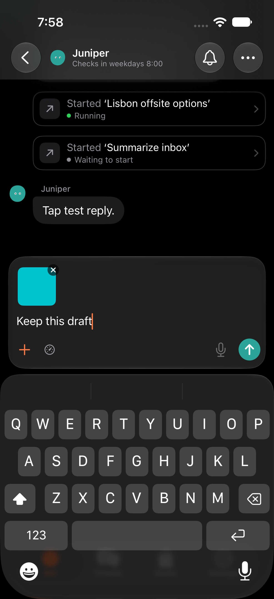
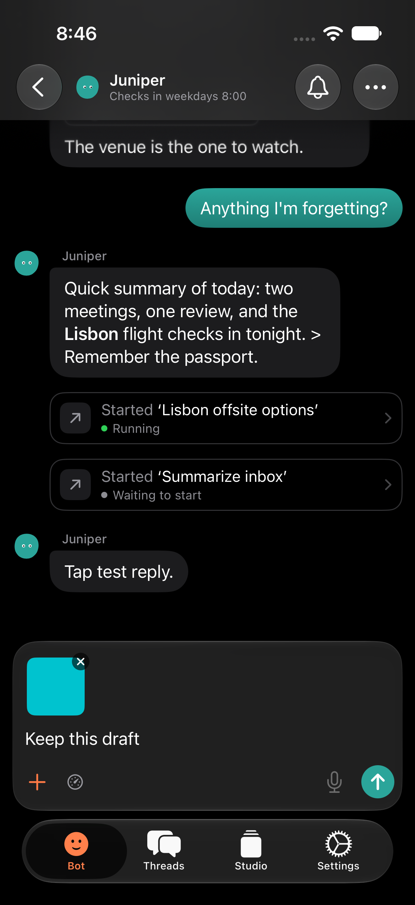
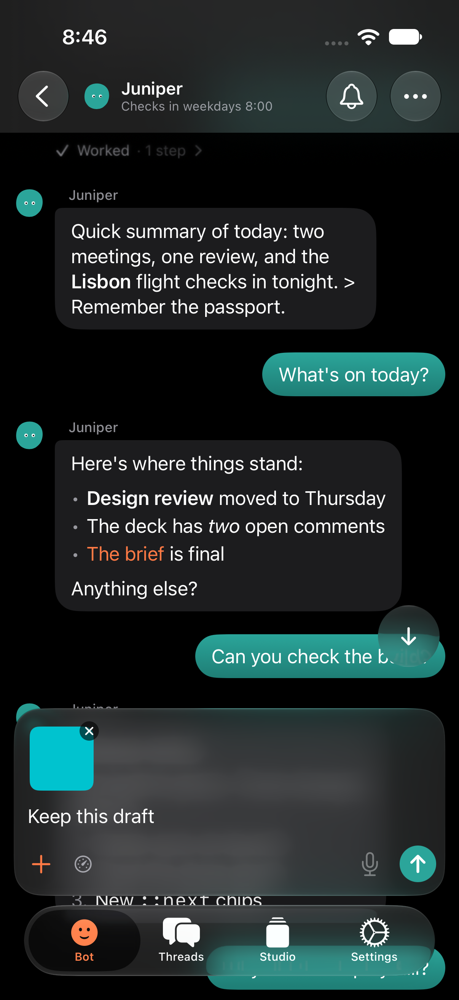
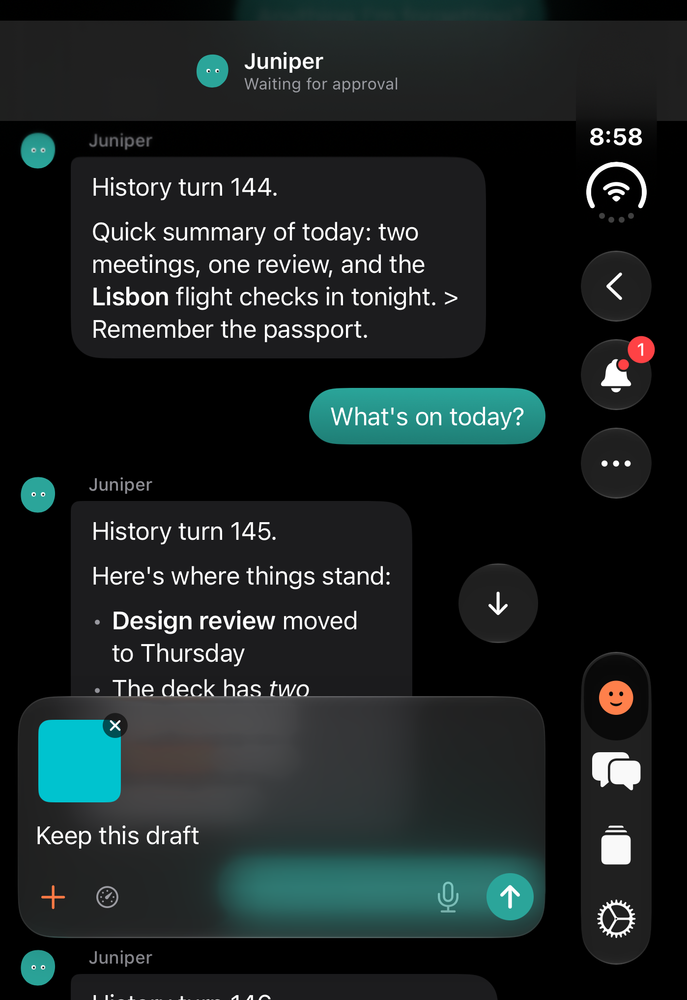
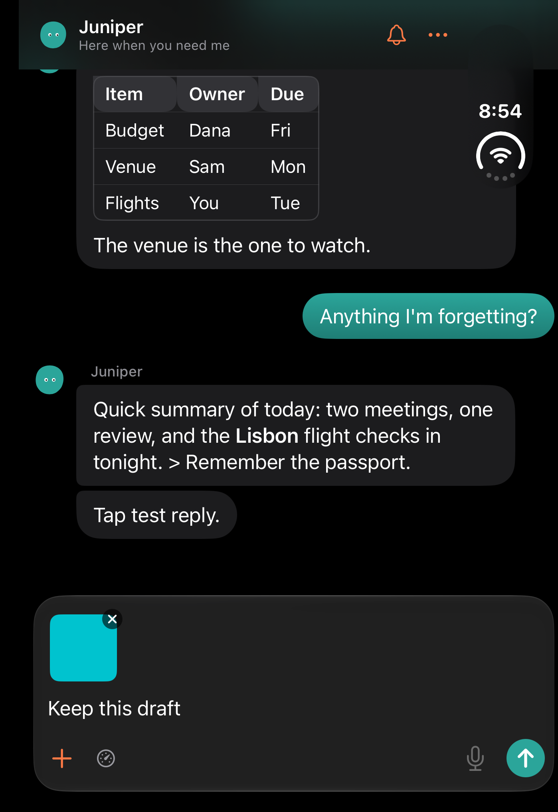
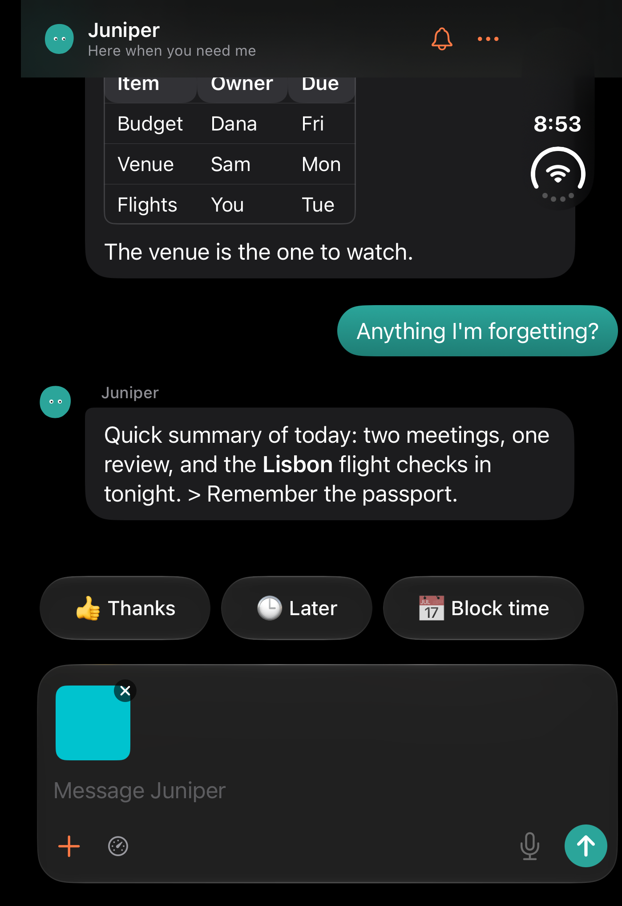

# A tap on the transcript closes the keyboard

Patrick, Oct 26: a tap anywhere in the chat's transcript should put the
keyboard away. This applies to the Bot chat and threads, on an iPhone and on
the Duo: the outer screen, the inner screen and its split.

Dark, on the local `-qaBotDemo` Bot (the server is a closed local port).
Captured by `TranscriptTapDismissUITests` with `TEST_RUNNER_TAP_SHOTS`, on an
iPhone 17 Pro and an iPhone Duo simulator.

| | Before | After |
| --- | --- | --- |
| iPhone, a tap on the newest reply |  |  |

More after-renders:

| iPhone, up in the history | Duo outer screen, up in the history | Duo inner screen, right page |
| --- | --- | --- |
|  |  |  |

Before the fix, the keyboard looked like
[this](before-phone-keyboard-up.png) before the tap, and the same after it.

## How it works

`TranscriptTapDismissesKeyboard` adds a `UITapGestureRecognizer` to the
transcript's own `UIScrollView`. A 1-point probe in the scroll view's
content finds that scroll view. The recognizer listens only while the
composer has the keyboard. It never takes the touch: it doesn't cancel or
delay touches, and it runs alongside every other recognizer. So links,
buttons, code blocks, cards and text selection keep their taps, and a
scroll or a long press doesn't count as a tap. The composer, quick replies,
header and jump button sit outside the scroll view, so taps on them don't
close the keyboard.

It ends editing on the next run-loop turn. Ending it in the same turn as
the tap cancelled text links: a web link and a thread link didn't open,
although the Copy button did.

Nothing here scrolls. As the keyboard goes, the bottom inset shrinks, and
`keepAtEnd` handles that the same way as for a swipe down (see
[the scroll root cause](../scroll-root-cause.md)). At the end, the chat
stays at the end. Up in the history, the offset doesn't move.

## Tests

`TranscriptTapDismissUITests` runs on a phone. It runs on the Duo's outer
screen with `TEST_RUNNER_TAP_LAYOUT=outer`, and on the inner screen's right
page with `split`. The simulator's screen is only as big as the outer one,
so `qa-duo/split-right` shifts the 951 × 669 window left, which puts the
right page on screen where the test can tap it.

- `testTappingTheTranscriptClosesTheKeyboard`: a tap on a message, a tap
  beside it, a swipe down, and a tap while reading older rows. Each one
  closes the keyboard. The chat stays at its end with nothing past it, and
  no sample is blank. Up in the history the offset moves 0.0 pt (phone,
  outer and split). The draft text and its photo stay.
- `testLinksAndButtonsStillWorkWithTheKeyboardUp`: with the keyboard up, a
  code block's Copy button changes to Copied, a web link opens Safari, and
  an in-app thread link opens its thread, all on the first tap.

Before the fix, the first test fails: the keyboard is still up after each
tap. In the second, the controls work but the keyboard stays.

## The composer held up with no keyboard (not reproduced)

Patrick, Oct 26, 7:55, Duo inner screen, split with Safari: "The input
keeps hovering." The composer sat about 500 points up with no keyboard on
screen.

The keyboard inset comes only from SwiftUI's keyboard safe area. The app
has no keyboard observers and no manual keyboard inset. On the Duo split,
the thread ignores only the container's bottom inset, not the keyboard's.

`KeyboardFocusAwayUITests` focuses the composer and then:

- sends the app to the background and back;
- lets Safari take the keyboard, and comes back;
- resizes the window with the keyboard up (Duo).

Each time, the composer comes back to its resting gap, or sits right on the
keyboard if the keyboard came back. It passes on a phone (91 pt), the Duo's
outer screen (42 pt) and the two-page split (8 pt):

What couldn't be tried here:

- The system's two-app split view can't be driven in the simulator.
- A hardware keyboard needs Simulator.app, and these headless simulators
  have none attached.
- SwiftUI ignores keyboard notifications that the app posts itself, so a
  hide that never arrived can't be faked in-process.

So the scroll log now writes `kbd` lines: each keyboard's end frame,
whether it is this app's (`local`), how much of it is over this window
(`overWindow`), the window frame, and scene activation. Turn on Settings ▸
Diagnostics ▸ Scroll log (TestFlight too). Next time the composer hovers,
the log shows whether the transcript's `insetBottom` kept a keyboard's
height after a `willHide`, or after a keyboard that wasn't over this window.
