# The chat transcript on UIKit (flagged)

Settings ▸ Diagnostics ▸ **New chat transcript**, off by default. Turned
on, the Bot chat and threads draw on a UIKit transcript and composer
(`apps/ios/iOS/Transcript/`). Turned off, `ThreadView` is the SwiftUI
transcript, untouched. Debug builds can turn it on for a launch with
`-qaTranscriptV2`.

The SwiftUI transcript measured its geometry and then corrected it. That
loop caused the black past the end, the hovering composer, the gaps and two
watchdog hangs (see [the scroll root cause](../scroll-root-cause.md)). The
new transcript has one owner of the scroll position, and nothing writes
geometry back into layout.

## How it works

- **Rows.** A `UICollectionView` with a diffable data source keyed by row
  id. Each cell hosts the row's SwiftUI view (`MessageBubble`, the Bot's
  rows, cards, questions) through `UIHostingConfiguration`, so the rows
  look as they did. A row whose content changes (a streamed token) redraws
  only its own cell, with no snapshot.
- **Layout.** `TranscriptListLayout`: one column, top to bottom, not
  inverted, so VoiceOver order, context menus, text selection, the scroll
  indicator and interactive keyboard dismissal stay native. Heights are kept
  by row id. A short chat rests at the top, with no gap above it.
- **One owner.** `TranscriptController` is the only thing that writes the
  scroll offset, and every write is clamped to the valid range. It can't
  rest past the end.
- **Following or reading.** A state machine (`TranscriptFollow`) that changes
  only where the reader's own scroll comes to rest (near the end means
  following) and on the jump pill. A send counts as a jump. Layout, insets,
  the keyboard and new rows never change it.
  - Following: the anchor is the end of the content.
  - Reading: the anchor is the first row that starts at or below the top
    edge. Height changes above it (self-sizing, a card opening, older pages
    going in) move the view by the same amount, in the layout's own
    invalidation, so nothing on screen moves.
- **The pill.** While reading, a jump button with a count of new rows
  ("↓ 12 new"). On a phone it sits in the corner; beside two pages it is
  centred above the composer over a scrim.
- **Composer and keyboard.** The composer, Duo header and find bar are in
  the same container. The container leaves the keyboard's safe area in, so
  it ends at the keyboard's top, and the composer rests on that bottom, or on
  its resting edge when lower. The bottom content inset comes from the
  composer's frame and is written only when it changes by more than 0.5 pt.
  - Resting edge: 8 pt above the home indicator (and the tab bar) on an
    iPhone and the Duo's outer screen. On the Duo's inner screen it is 8 pt
    above the window's bottom edge. That includes iOS's two-app split there,
    detected as a phone-idiom screen at least 900 × 600 pt.
- **Generic.** The container takes ordered rows (any `Identifiable &
  Equatable`) and a SwiftUI view for each, and imports nothing from the
  app. It hands back near-top (for older pages), follow changes and pill
  state. `TranscriptHandle` takes requests: jump, scroll to a row,
  reconfigure a row, and carry a row's height to a new id (an optimistic row
  confirmed by the server).

### Deviation: no keyboard layout guide

The plan pinned the composer to `keyboardLayoutGuide`. Hosted in SwiftUI,
neither the view's guide nor the window's ever moved: their frames stayed at
zero size through every keyboard show and hide (iOS 27 simulator; scroll log
`v2 viewLayout … guide=(0.0, 0.0, 0.0, 0.0)`), and the composer stayed under
the keyboard. The container instead leaves SwiftUI's keyboard safe area in
(`.ignoresSafeArea(.container)`), which ends it at the keyboard's top, with
no keyboard notification math. This keeps one dependency of the old path:
the hovering composer Patrick saw would come back if SwiftUI's keyboard
inset stuck.

## Tests

`apps/ios/scripts/test-transcript.sh` runs everything, offline.

### Replay harness

`TranscriptReplayTests` runs `TranscriptReplay` in a phone window, the Duo's
outer screen and the inner screen. The steps:

- 60 streamed tokens;
- a burst of 40 rows;
- a simulated keyboard up and down;
- an image that loads and a card that opens;
- fold, unfold and split;
- scrolling up through a 3,000-row history paged in from the near-top
  callback;
- a card opening across the top edge;
- the window resized and backgrounded;
- jump to latest;
- a short chat in a sheet that grows and shrinks.

After every step it checks:

- the view is never past the end;
- while following, the end sits just above the composer;
- while reading, the anchor row moves less than 1 pt;
- the composer's gap matches the layout;
- every visible row is as tall as it measures;
- layout passes per step are bounded, and nothing is written at rest.

With anchoring turned off (`TRANSCRIPT_CONTROL_NO_ANCHOR`), prepends drift
about 16,500 pt and the checks fail, so they aren't blind.

**M0 gate** (2e5ba03f), all three layouts, 158 steps each: 0.00 pt past
the end, 0.00 pt off the end while following, 0.00 pt anchor drift, 0.00 pt
composer gap error, at most 10 layout passes per step, and no work at rest.

The row-height check came later. It found rows a few to 60 pt off their
height, which the renders showed as a gap under a bubble. That is now fixed:
rows on screen measure again after each layout pass, and rows lay out at
their ideal height.

### UI tests

`TranscriptV2UITests` runs on a phone, the Duo's outer screen
(`TEST_RUNNER_TRANSCRIPT_LAYOUT=outer`) and the inner screen's right page
(`split`). It uses the real composer and keyboard, offline on the local Bot
demo, and samples the live scroll view every 0.1 s.

- `testBotChat`:
  - a reply comes in and streams with the keyboard up;
  - the composer sits above the keys;
  - a tap and a swipe down close the keyboard, and the draft and its photo
    stay;
  - up in the history, a burst of 12 and the keyboard going up and down move
    the rows 0.0 pt;
  - the pill counts the new rows, and the jump follows a stream again;
  - on the split, full width with the list hidden.
- `testThreads`: a Bot thread from Running (the split lists one) and a normal
  thread from the Threads list. Each opens at its end with the right
  composer gap, shows the pill up in the history, and jumps back.

All pass on all three layouts. No sample was past the end or blank.

## Renders

Dark. The phone renders are screenshots, so they show the keyboard. The Duo
renders are window captures at 3×, scaled down. They don't draw the keyboard;
with it up, the composer sits on its top edge.

| | Keyboard down | Keyboard up | Up in the history |
| --- | --- | --- | --- |
| iPhone | 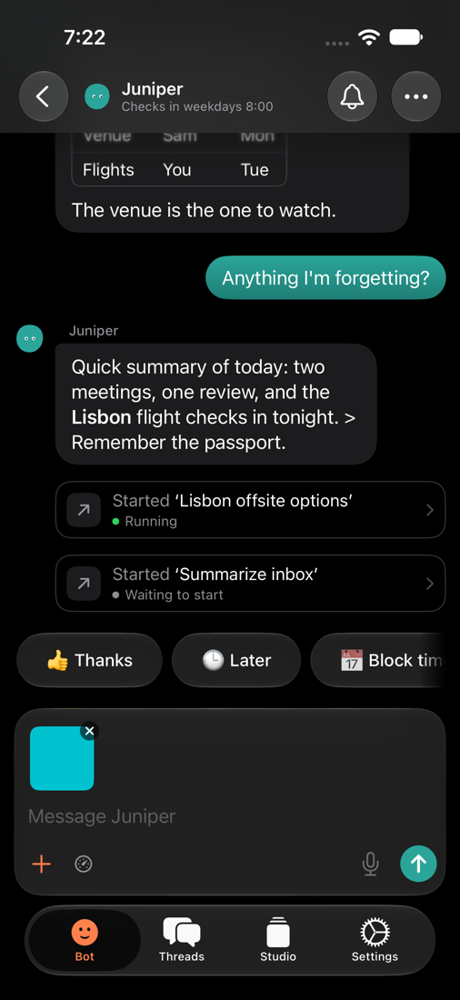 | 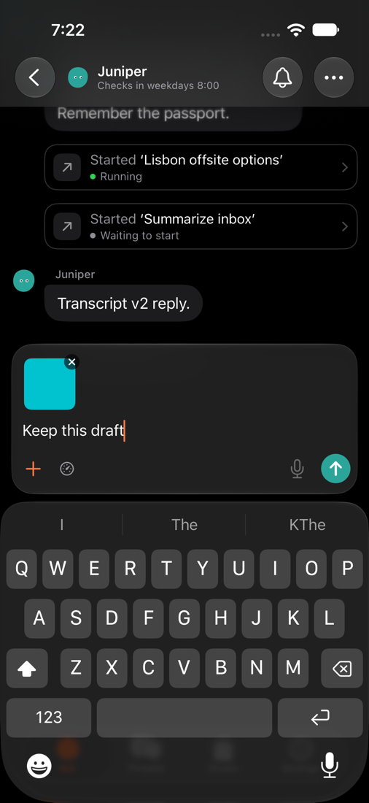 | 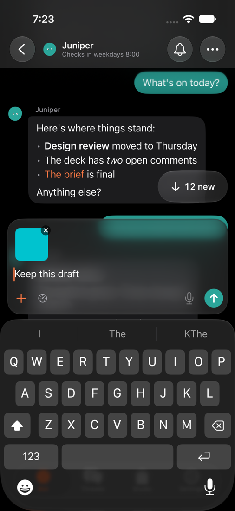 |
| Duo outer screen | 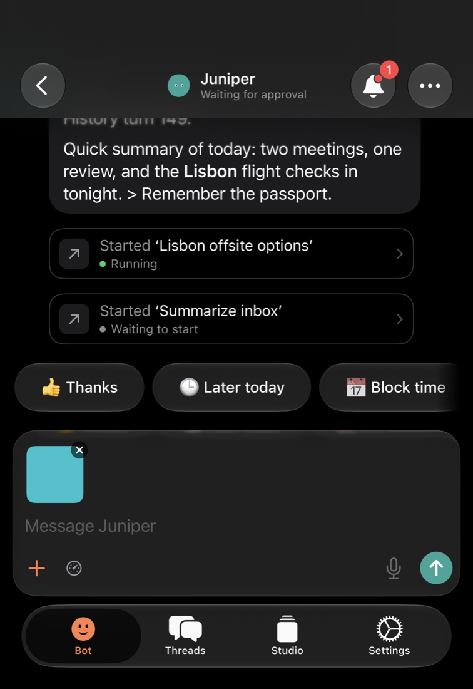 | 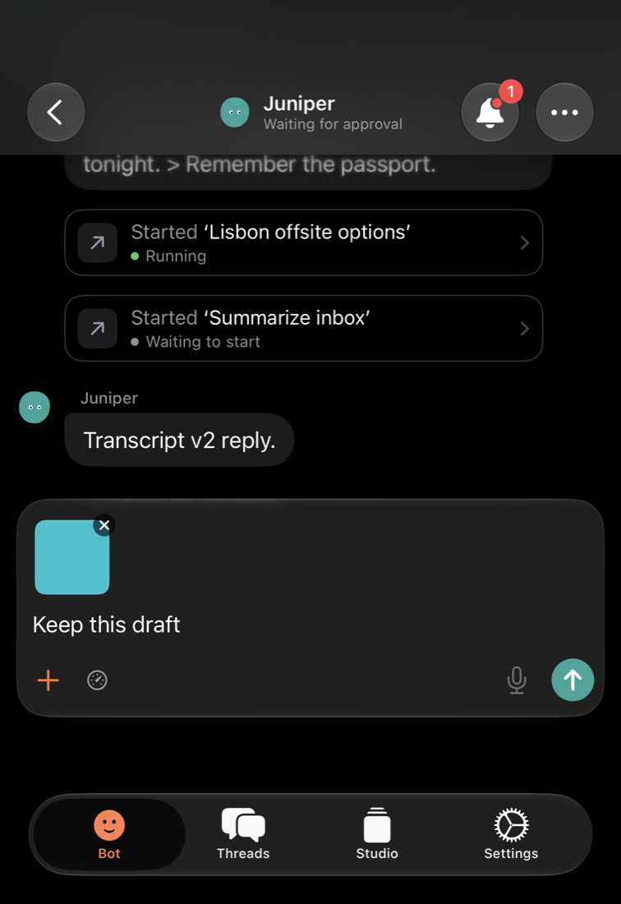 | 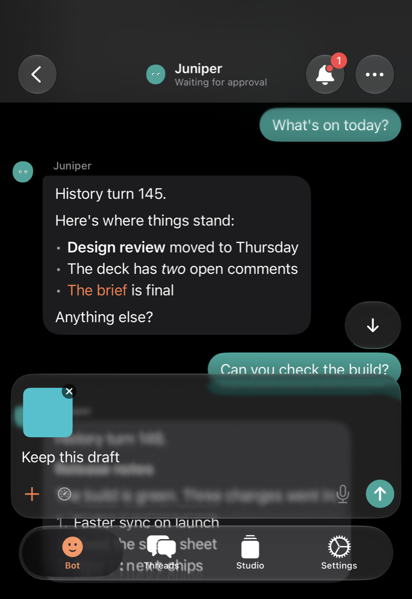 |
| Duo inner, split | 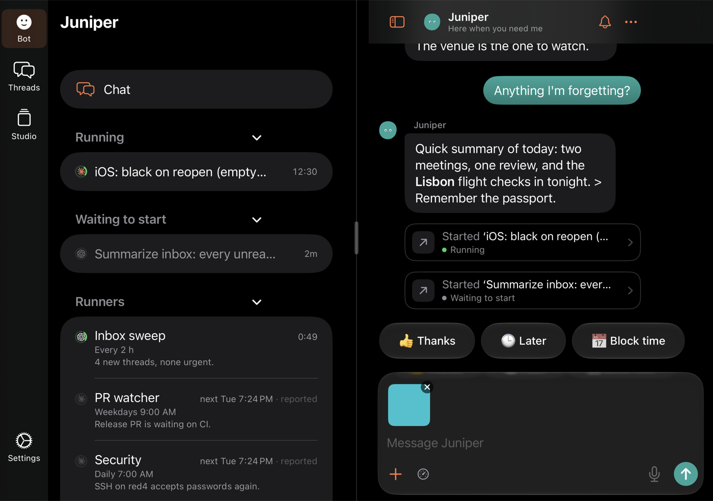 | 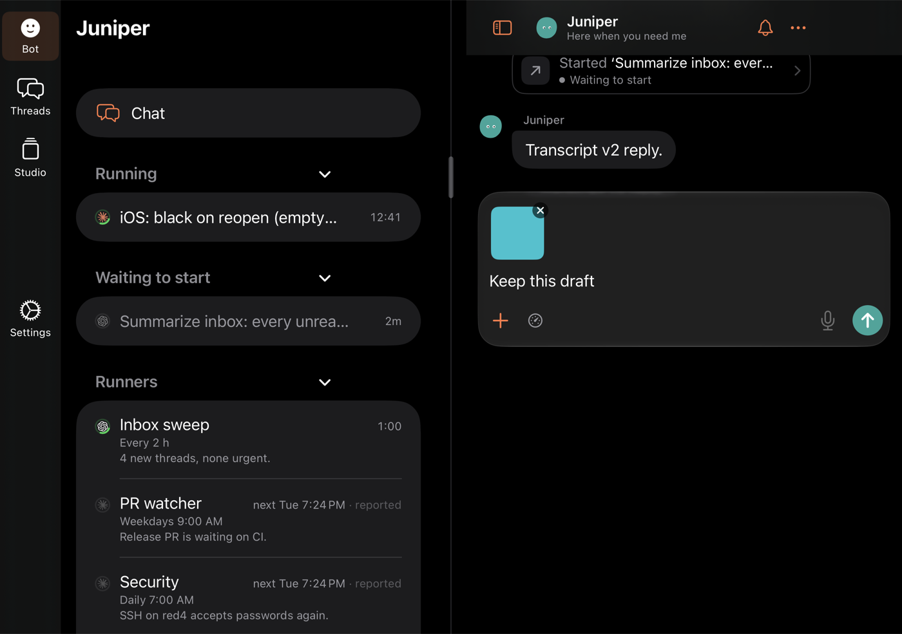 | 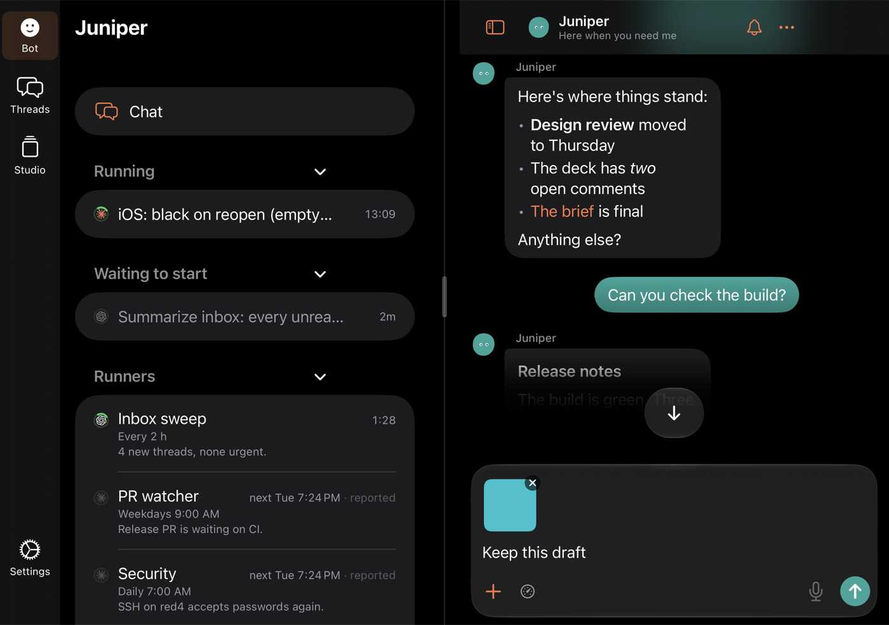 |
| Duo inner, full width | 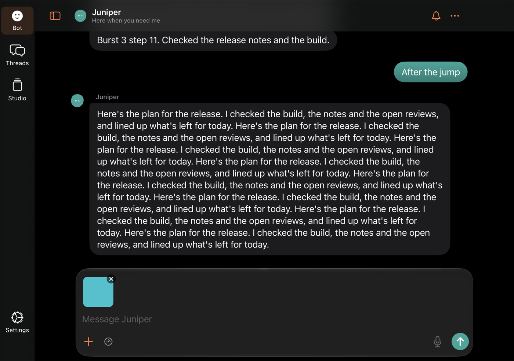 | 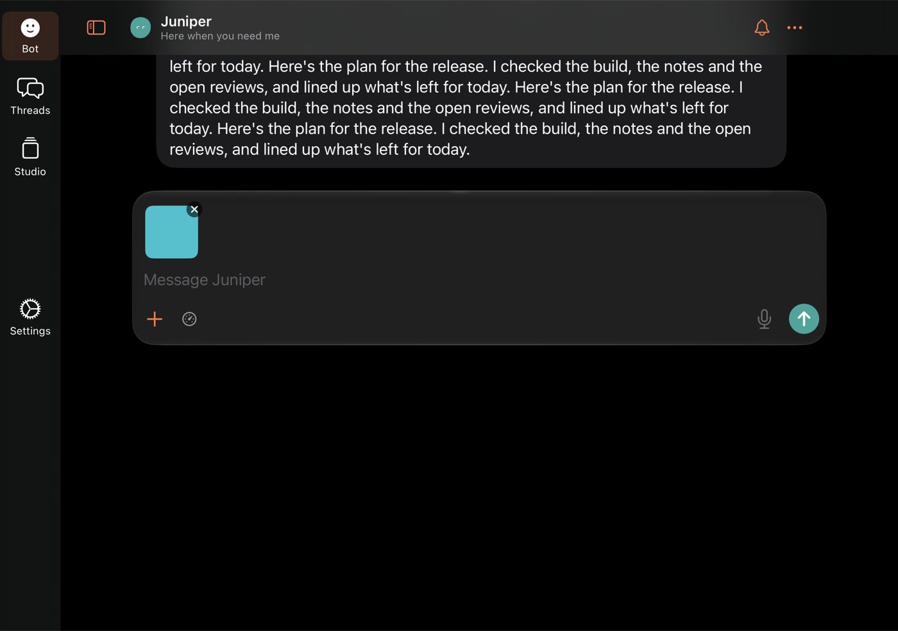 | |

A thread on the inner screen's split: [split](duo-split-thread.png). On the
outer screen: [outer](duo-outer-thread.png).

## Known gaps

- **Replay edge cases after the row-height fix.** The checks fail on 6 of the
  phone's 158 steps, all in the harness's instant 6,000 pt jumps through rows
  that haven't measured yet:
  - three rows 3 to 11 pt off their measured height;
  - one 24 pt anchor drift;
  - one rest window with 8 layout passes and nothing written.

  The UI tests in the real app pass. To do next.
- Not wired on the new path yet:
  - the Duo `transcript-<id>` content probe used by `DuoSplitComposerUITests`;
  - the older UI suites (`TranscriptPastEndUITests` and the rest), which run
    the old path only.
- A question card appearing while reading doesn't jump to the end. The old
  path did; this follows the "only the reader changes following" rule, and
  the pill counts the card.
- iOS's two-app split on the Duo's inner screen can't be driven in the
  simulator. The resting-edge rule for it is untested on a device.
