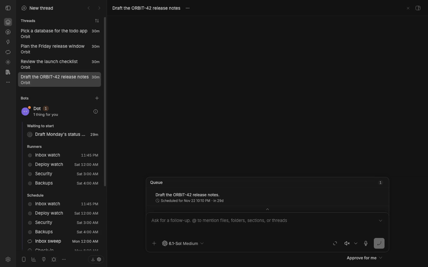
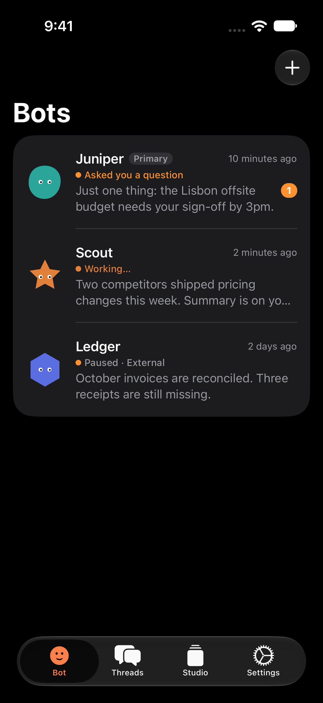

# Needs you: the Bot is the triage layer

Branch `bb/needs-you-meaning-clearing-reason-claude-thr_nuz8fqhxwf`, on top of
`origin/main` (`c8cbc412`). Not shipped.

Patrick's report: "Security · Runner" sat in the Bot sidebar's **Needs you**
with no way to clear it, and nothing in it needed him. His direction after the
first fix (a reason line, auto-clearing and Mark handled):

> needs you under bots shouldn't be a thing? The bot should be handling it all.

So this branch removes Needs you. The Bot triages, and the Bot's own row is
the only place that asks for Patrick's attention.

## The model

1. **The Bot is the triage layer.** Runner reports, urgent alerts, failures
   and the questions its threads ask go to the Bot. It handles them, or tells
   Patrick in its own chat. Patrick never triages runners directly.
   - An urgent `runner_report` still posts its line into the Bot's chat and
     pushes to the phone. Its agent-only note now asks the Bot to triage:
     "if you can handle it yourself, do. If the user must act, tell them in
     one or two short lines what happened and what to do. If it needs
     nothing from them, reply exactly [PASS]" (`TRIAGE_NOTE`,
     `src/runners.ts`).
   - "Stopped after failing" lines (auto-resume past its cap, for automations
     and for threads) carry the same kind of note (`STOPPED_NOTE`,
     `server.ts`): fix it if you can, tell the user if they must act, else
     [PASS].
   - The Bot's instructions say so, inside the existing 800-character
     budget: "You triage: reports, alerts and your threads' questions come
     to you. Your chat is the user's inbox: post only what changed or needs
     them (a thread waiting on them: what it needs, linked); …"
2. **No Needs you section** in the Bots sidebar or in Bot info → Activity,
   on desktop or iOS. `bot_activity` no longer has `needsYou`.
3. **The one signal is on the Bot's row**: `attention` (`src/bot-attention.ts`)
   is set while the Bot's own chat has something waiting on Patrick:
   - a pending question or approval in the chat, until it's answered;
   - Bot replies he hasn't read (newer than the chat's `lastReadAt`, not
     empty and not `[PASS]`), until he reads the chat.

   It has a reason, a count and a time: "Asked you a question", "Waiting for
   approval", "1 thing for you", "2 things for you". `bot_activity` returns
   it, and `bot_attention { botId }` returns it alone, for Bot rows that
   aren't expanded.
4. **Runner rows show state only**: running, next …, quiet, reported, failed,
   paused, offline. No attention flag of their own. A runner whose last run
   failed shows "failed"; the Bot decides whether to bother Patrick.
   `RunnerView.urgent` and `bot_runner_seen` are gone, and a migration clears
   every existing urgent flag (`UPDATE bot_runners SET urgent = 0`).
5. **Threads the Bot started that wait on a question or approval** are the
   Bot's. They show under **Running** by their state: the waiting mark,
   "waiting" on the right, and `waitingFor` ("Waiting for an answer",
   "Waiting for approval") in the tooltip and in Bot info. The Bot's
   `bot_activity` tool lists them as "Waiting on an answer (yours to handle,
   or bring to the user)".
6. **Mark handled is dropped**, with `bot_needs_you_dismiss` and
   `bot_needs_you_restore`. Nothing needs it: the badge clears when Patrick
   reads or answers the Bot's chat.

## Desktop

- **Bot row** (the expanded Bot): a dot on the avatar, the count beside the
  name, and the status line says why ("1 thing for you") in place of what
  the Bot is doing. The tooltip reads "Dot: 1 thing for you".
- **Reading clears it**: while the Bot's current chat is the open thread and
  the page is visible, Studio marks it read (`threads.markRead`) each time
  something new waits there. In the staged BB, opening the hidden Bot chat
  didn't update its `lastReadAt` by itself, so Studio doesn't rely on BB for
  this. iOS marks a thread read when it's viewed.
- **Other Bots' rows**: the same dot, count and tooltip, from
  `bot_attention` (polled every 30 s).
- **Running**: a thread held by an approval or question shows as waiting.
- **Bot info → Activity**: no Needs you. Running shows "waiting for
  approval" / "waiting for an answer" on such a thread.

## iOS

- **Activity sheet**: no Needs you, no swipe or menu. When the Bot needs
  Patrick, the sheet starts with a "<Bot> · Asked you a question" row and its
  count; tapping it goes to the chat. Running lists the waiting thread with
  its `waitingFor` as a muted second line.
- **Bell badge**: counts `attention.count`, and VoiceOver reads the reason.
- **Duo sidebar**: the Chat row shows the reason and count.
- **Bots list**: each row gets a dot, the reason as its status line and a
  count, from `bot_attention`.
- **Runners**: state only; an urgent report reads "reported".

## Checked live on a staged BB

Stable BB 0.47.0 from `scripts/staged-bb.mjs`, seeded on `c8cbc412`, then
this branch's Studio installed into the same instance:

- Seeded Bot replies nobody had read: `attention` "2 things for you".
  `bb thread read` on the Bot's chat cleared it.
- A runner "Security" reported urgent "SSH on red4 accepts passwords again".
  With the triage note, the Bot replied "SSH on red4 has accepted passwords
  again since this morning. Restore key-only SSH access and check what
  re-enabled password authentication." That made "1 thing for you". When the
  same report came again, the Bot replied `[PASS]`: it had already told him.
- A runner "Backups" reported urgent "Last night's red4 backup failed: the
  backup disk is full." The Bot escalated it: "1 thing for you".
- The thread "Rotate the ORBIT-42 deploy key" asked a question. It shows
  under Running as "Waiting for an answer", and Patrick got no Needs you.
  **Gap:** the Bot replied `[PASS]` to BB's notice about it (see the
  decisions below).
- Runner rows: Deploy watch and Security show "reported", with no flag.
- Opening the Bot's chat from its row cleared "1 thing for you" (the clip
  below).

## Renders

Desktop: before is Studio at `c8cbc412`, installed from GitHub; after is this
branch, installed into the same staged instance. Dark and light, at 2x.
`render.mjs` in this folder makes both:
`node docs/needs-you/render.mjs before|after`. The after views open a project
thread, not the Bot's chat: an open chat counts as read, so the badge would
clear.

| View | Before | After |
|---|---|---|
| Bots sidebar, dark |  |  |
| Bots sidebar, light |  |  |
| Bot info → Activity, dark |  |  |
| Bot info → Activity, light |  |  |

The badge clearing when the Bot's chat is opened (dark, the whole window):
[read-clears.mp4](after/read-clears.mp4), and as a GIF:

iOS (dark, demo fixture `-qaBotAttention`, `UITests/BotAttentionCaptureUITests.swift`):

| View | Before | After |
|---|---|---|
| Phone, Activity |  |  |
| Duo |  |  |
| Phone, Bots list | n/a |  |

## Tests

- `src/bot-attention.test.ts`: reasons and counts; only unread replies that
  aren't `[PASS]`; approval beats question; what a waiting thread says.
- `src/bot.test.ts`: attention from a question in the Bot's hidden chat,
  until answered (and `botAttention` alone); from unread replies, until the
  chat is read; a thread held by an approval is in Running with
  `waitingFor` and gives no attention; runner threads stay out of Activity;
  the triage line is in the Bot's instructions.
- `src/runners.test.ts`: urgent posts the line with `TRIAGE_NOTE` and pushes;
  the runner keeps no flag; Studio's own alert likewise.
- `src/migrations.test.ts`: the migration clears urgent flags.
- `src/ui/bot/BotHome.test.tsx` (also: the open Bot chat is marked read only
  while something waits), `workspace.test.ts`,
  `ProviderStatusMark.test.ts`, `Runners.test.tsx`: no Needs you group; the
  Bot row's dot, reason, count and tooltip; another Bot's row from
  `bot_attention`; the waiting thread under Running; runner tones without
  urgent.
- iOS: `BotThreadsTests`, `BotRowStateTests`, `BotChatTests`, `BotTests`
  (attention decoding, `waitingFor` in Running, runners without urgent,
  `bot_attention` scoped by `botId`). Full `BBStudioTests`: 350 tests,
  1 skipped, 0 failures.

## Needs Patrick's decision

1. **The Bot doesn't reliably bring its threads' questions to him.** BB tells
   the Bot "@thread … completed: Waiting for your vault selection", and the
   staged model replied `[PASS]` twice, even with the new instructions. If
   the Bot doesn't escalate, the question waits unseen: it shows only as
   "waiting" under Running. Options:
   - (a) leave it to the Bot's instructions and model;
   - (b) when a thread the Bot started starts waiting on Patrick, Studio
     sends the Bot an agent-only nudge to answer it or escalate it;
   - (c) count such threads in the Bot's badge directly ("Its thread asks
     you a question").

   I'd pick (b). It keeps the Bot as the triage layer.
2. **Unread replies count as "things for you".** That includes replies to
   Patrick's own messages that he hasn't read yet, so the badge works as an
   unread count for the Bot's chat. The Bot's chat rule ("post only what
   changed or needs them, else [PASS]") is what keeps this meaningful.
3. **iOS chat header**: it still says "Needs you" for the chat's own pending
   questions, not `attention.reason`. Should it show the reason too?
4. **iOS widgets and the watch complication** count BB-wide threads with
   pending questions, from BB's thread list, not the Bot. Should they switch
   to the Bot's attention?
5. **The waiting mark differs**: iOS gives a thread waiting on an answer an
   amber ring, desktop the muted "waiting" ring. One should change to match.
6. **Older Studio with this iOS build**: iOS no longer reads `needsYou`, so
   waiting threads from an older Studio show nowhere on iOS.
7. **Reloading or reinstalling Studio cancels a pending `design_ask`
   question** (seen while staging). That's BB's plugin-interaction
   behaviour, not this change.
8. **README screenshots** `bot.png` and `bot-runners.png` still show Needs
   you. They need a capture run from a pushed commit
   (`scripts/capture/captures/bb-studio-bot.mjs` is updated for it).
