# Needs you: what it means, how it clears, and why each item is there

Branch `bb/needs-you-meaning-clearing-reason-claude-thr_nuz8fqhxwf`, rebased
onto `origin/main`. Commits: see "Commits" at the end.

Patrick's report: "Security · Runner" sat in the Bot sidebar's **Needs you**
with no way to clear it, and nothing in it needed him. The cause: a runner's
`runner_report` at level `urgent` set `bot_runners.urgent = 1`, and only
`bot_runner_seen` cleared it. The desktop called that only when the runner's
row in Bot info → Runners was clicked. Reading the thread, answering it, a
later quiet run, or the row in Needs you itself never cleared it, and there
was no way to dismiss it.

## What "Needs you" means now

Needs you lists an open question or decision for the user, not "something
raised attention once". The rules live in `packages/bb-studio/src/needs-you.ts`
and `Bots.activity()` (`src/bot.ts`).

| Item | Stays while | Clears when | Reason line |
|---|---|---|---|
| A thread with a pending interaction | the question or approval is open | it's answered (BB's interactions say so, even before BB's thread list catches up), or the user marks it handled | `Asked you a question`, `Waiting for approval`, or `Waiting for your answer` (a plugin's form) |
| A runner's urgent report | the user hasn't seen or answered it | (a) the runner's thread is read after the report (`lastReadAt >= urgent_at`); (b) the user sends a message in that thread; (c) a later run reports log or tell, or finishes ([PASS]) without a new urgent report; or the user marks it handled | `Urgent report: <first 8 words>…` |
| Studio's own urgent report for a runner (its automation passed the auto-resume cap) | as above | as above | `Failed: <first 8 words>…` |
| Automations or threads Studio stopped resuming (one entry, the Bot's chat) | the user hasn't read the Bot's chat since the latest alert | the Bot's chat is read after the latest alert, the alert ends (the automation is back on), or the user marks it handled | `Failed`, or `N failed` |

How (b) and (c) tell runs apart: when a runner reports urgent, Studio saves
the event sequence of the turn request that made the report
(`bot_runners.urgent_turn`). Later events are newer:

- a `client/turn/requested` from the user (`isUserRequest`, and not a runner
  run's own "Run of the runner …" prompt) is a reply;
- a turn request followed by `turn/completed` is a later run that finished.
  A later urgent report moves `urgent_turn` past it, so a run that reports
  urgent again keeps the item, with the new text.

A log or tell from the same run as the urgent report doesn't clear it (before,
no later report cleared it at all). Without a saved turn (BB didn't answer),
the report's time is the line.

Clearing happens on the server when Activity is read (the sidebar polls every
15 s, iOS on its refreshes), so desktop, iOS, the watch and the Bot's own
`bot_activity` tool agree.

## Mark handled

An explicit clear for every item, on desktop and iOS:

- **Desktop sidebar** (Bots list → Needs you): a ✕ appears on hover (and on
  keyboard focus), with the tooltip "Mark handled". Right-click the row for
  **Open** and **Mark handled**. The row leaves at once; a toast says
  "Marked handled: <title>" with **Undo**. A failed call puts the row back
  and says why.
- **Desktop Bot info → Activity → Needs you**: the same ✕, menu and toast.
- **iOS** (Bot → Activity): a trailing swipe action and a context-menu item,
  both "Mark handled", with an Undo banner. See iOS below.

On the server, `bot_needs_you_dismiss { botId, threadId }`:

- for a runner's thread: the urgent flag clears (as `bot_runner_seen`);
- for anything else: Studio records the item's current signal (its pending
  interaction ids, and for the Bot's chat the latest alert time) in
  `bot_needs_you_handled`. The item stays out until that signal changes:
  a new question on the same thread, or a new failure, brings it back.

`bot_needs_you_restore { botId, threadId }` is Undo: the runner's flag is set
again (its report is kept), or the record is deleted.

## Reason line (design)

Each Needs you row shows its reason as a second line: 11 px, muted, one line,
truncated. The first line keeps the 13 px title, and the mark keeps the
"Waiting for you" state from the row-state spec (still `--warning` ring,
docs/ui-redo/C/REDO.md). The age sits on the right of the first line; on hover
it gives way to the ✕, so the row doesn't grow sideways. A Needs you row is
44 px tall instead of 28 px. Only Needs you rows get the second line; every
other group keeps its 28 px rows. The row's native tooltip is the title and
the reason.

## Renders (desktop)

All desktop renders come from a staged BB (stable BB 0.47.0,
`scripts/staged-bb.mjs`, its own data directory and ports) with the seeded Bot
"Dot": "Rotate the ORBIT-42 deploy key" asks a question, and the Deploy watch
runner raised an urgent report on its second run. **Before** is Studio at
`c8cbc412` (main), installed from GitHub. **After** is this branch's Studio,
installed into the same instance from a copy of the branch. The runner's
urgent flag came from the before build, so it has no saved report time; its
reason comes from its last report, and only Mark handled or a later run
clears it. `render.mjs` in this folder makes them:
`node docs/needs-you/render.mjs before|after [view,...]`. Images are at 2x.

| View | Before | After |
|---|---|---|
| Bots sidebar, dark | 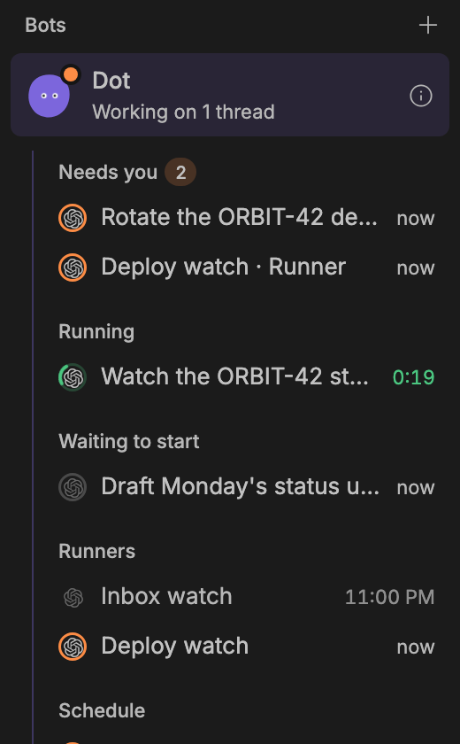 | 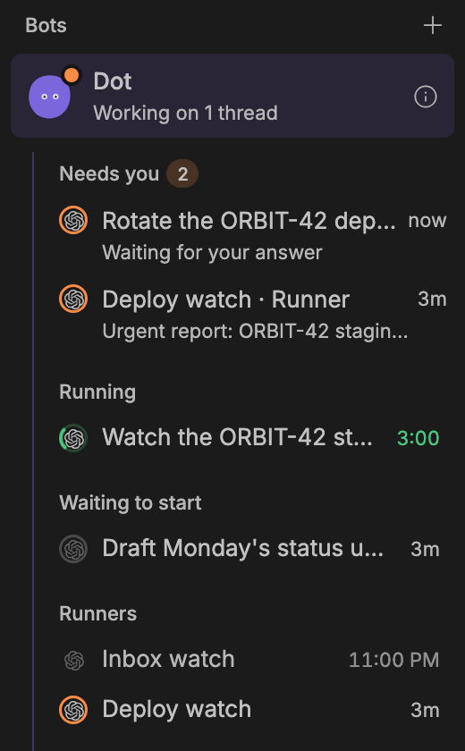 |
| Bots sidebar, light | 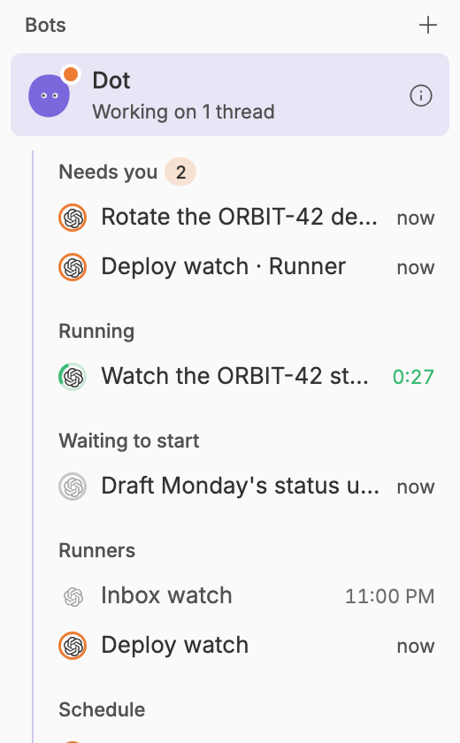 | 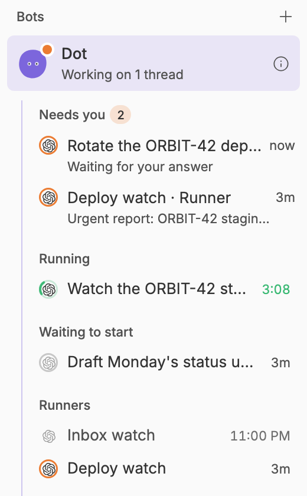 |
| Bot info → Activity, dark | 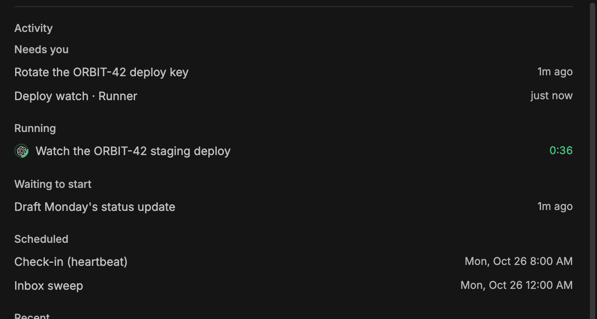 | 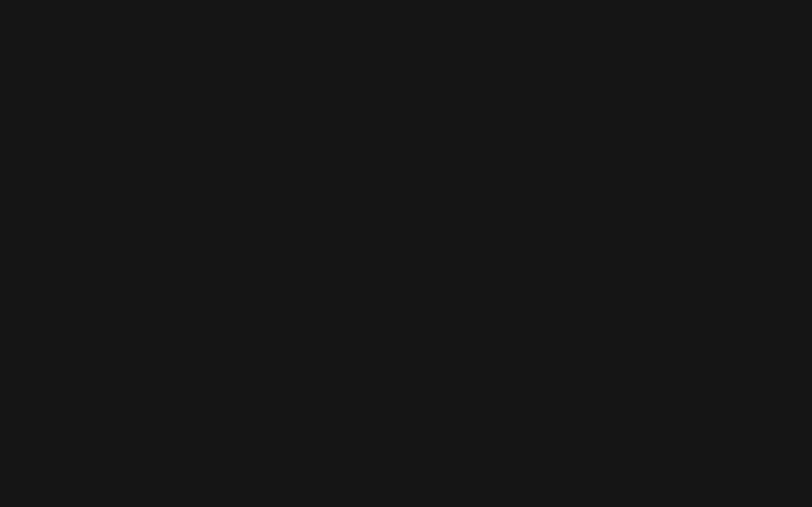 |
| Bot info → Activity, light | 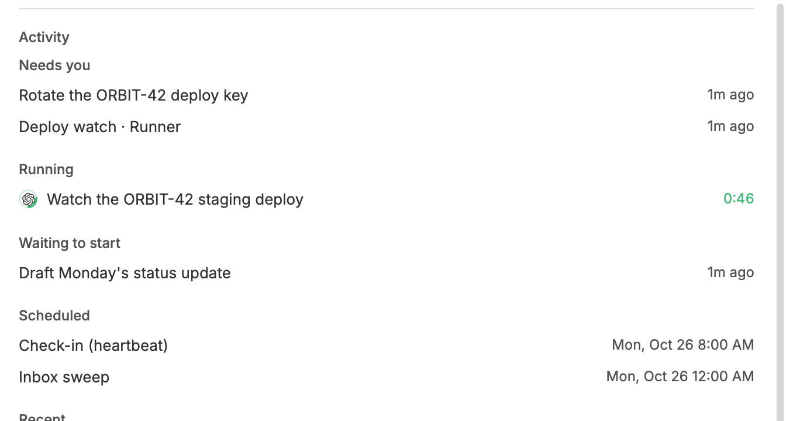 | 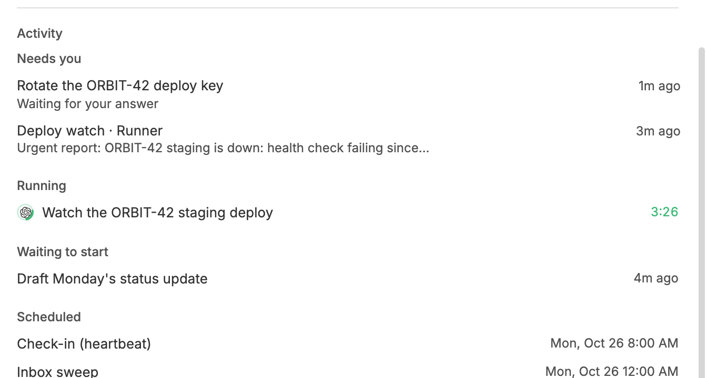 |
| Hover: ✕ and its tooltip, dark | n/a | 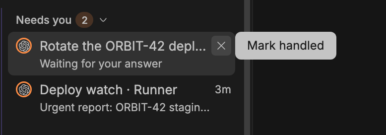 |
| Hover: ✕ and its tooltip, light | n/a | 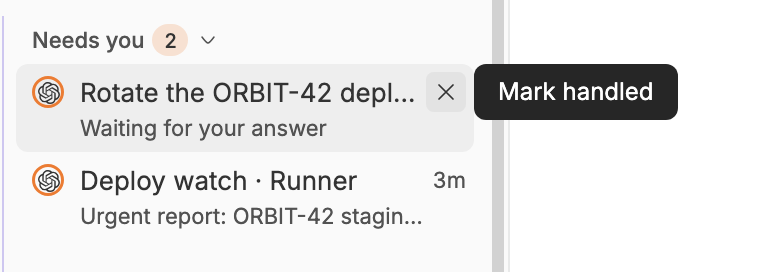 |
| Right-click menu, dark | n/a | 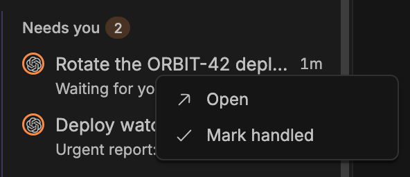 |
| Right-click menu, light | n/a | 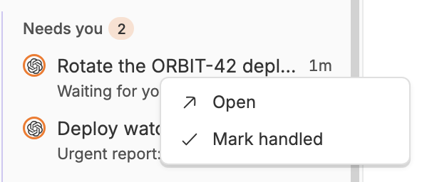 |

Mark handled, the toast, Undo, and the row coming back (dark, the whole
window, against the staged server): [dismiss-undo.mp4](after/dismiss-undo.mp4),
and the same at half size as a GIF:

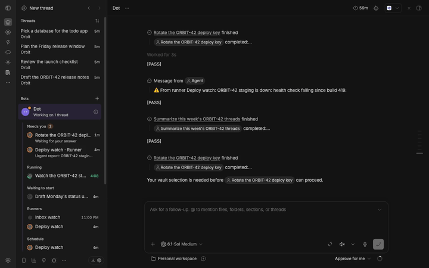

## Checked live on the staged BB

With this branch's Studio installed in the staged BB, from its CLI and RPCs:

- Deploy watch's urgent report (flagged by the old build) cleared when the
  runner's next run finished with nothing to report (rule c). Flags from
  before this change use the last urgent report's time.
- A new runner "Security" that reports urgent on each run:
  - first run: in Needs you, `Urgent report: SSH on red4 accepts passwords again.`;
    `bb thread read` on its thread cleared it (rule a);
  - second run: back in Needs you; a message from the user in its thread
    cleared it (rule b);
  - third run: back; `bot_needs_you_dismiss` cleared it and
    `bot_needs_you_restore` brought it back.
- The clip above is the desktop ✕ and Undo against the same server.

## iOS

Bot → Activity (`iOS/Bot/BotThreadsSheet.swift`, `Shared/BotThreads.swift`):
each Needs you row shows its reason as a second line (caption, secondary, one
line). Mark handled is a trailing swipe (checkmark, accent colour), a
context-menu item and a VoiceOver action. The row leaves at once, the RPC
runs, then Activity refreshes. A "Marked handled · Undo" capsule stays for
5 seconds. A failed call puts the row back and shows the error under the
group. Demo mode (`-qaNeedsYou`) seeds the three items below;
`UITests/NeedsYouCaptureUITests.swift` makes the renders. Dark mode; Duo is
the 951×669 window on the iPad simulator.

| View | Before | After |
|---|---|---|
| Phone | 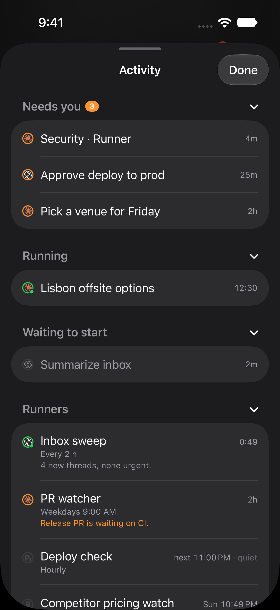 | 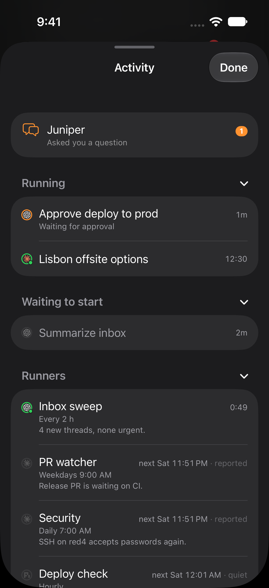 |
| Duo | 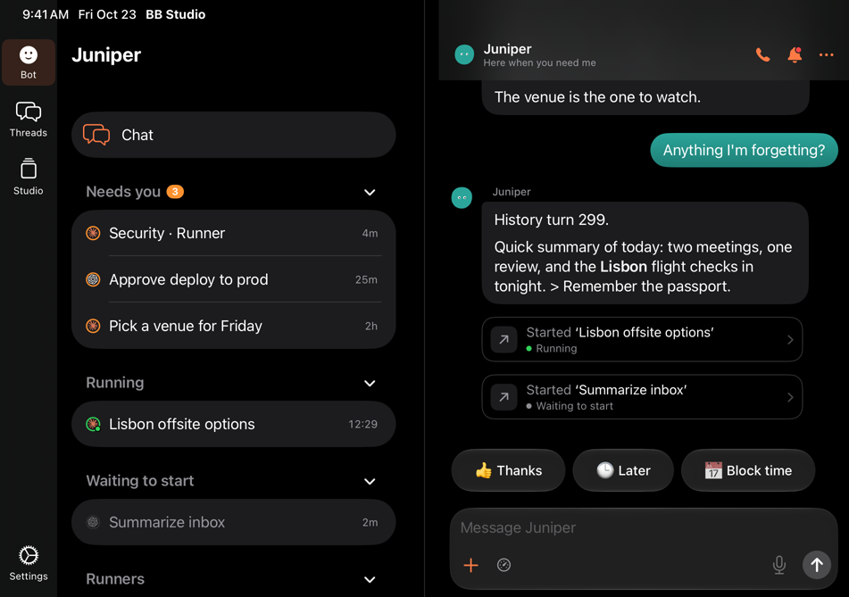 | 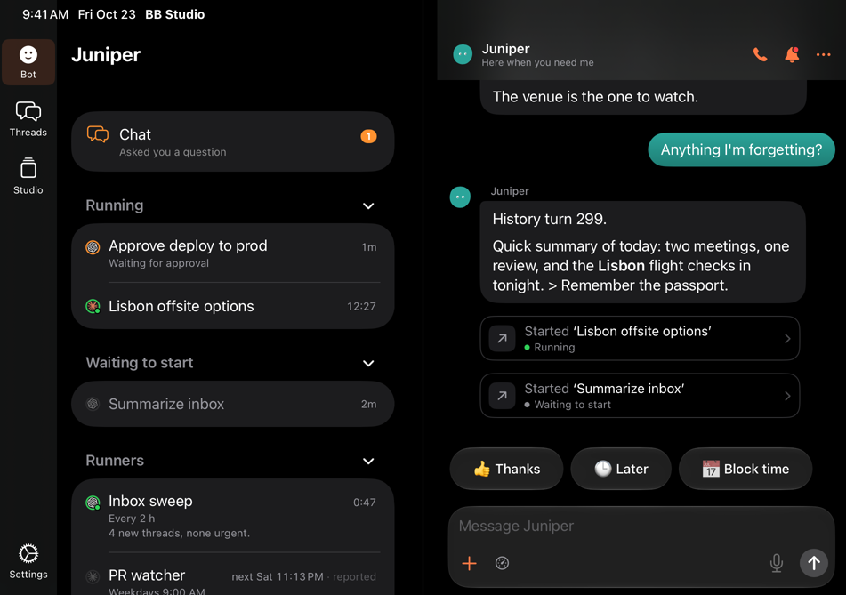 |
| Phone, swipe | n/a | 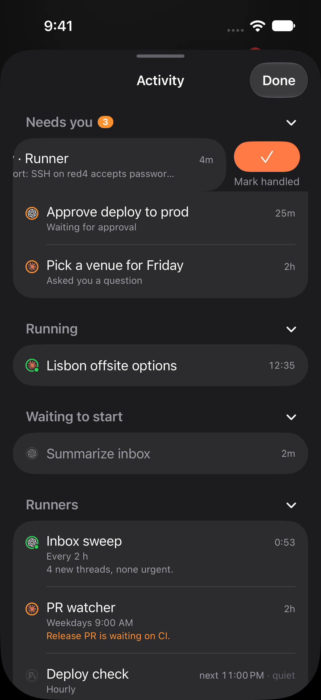 |

Swipe, Mark handled and Undo on the phone: [dismiss-undo-phone.mp4](ios/dismiss-undo-phone.mp4).

## Tests

- `src/needs-you.test.ts`: reason text, first words, and the settle rules
  (read, reply, a run prompt sent as the user isn't a reply, later run, the
  urgent run's own completion isn't a later run, no saved turn).
- `src/runners.test.ts`: the same run's log keeps the flag and a later run's
  tell clears it; read, reply and a later [PASS] run each clear it through
  `needsYou`; a new urgent report keeps it with its new text; Studio's own
  report reads `Failed: …`; old flags use the last report's time; seen and
  unseen.
- `src/bot.test.ts`: question and approval reasons; Mark handled hides until
  a new question; Undo; an answered question leaves before BB's list catches
  up; a failure alert's reason, read rule and Mark handled until the next
  alert; urgent runners through `needsYou`, `seen` and `unseen`.
- `src/ui/bot/BotHome.test.tsx`: reason lines, ✕, the context-menu item,
  the toast's Undo, and a failed dismiss in the sidebar; reason and ✕ in Bot
  info's Activity.
- iOS `BotThreadsTests`: reason decoding, hiding until the server drops an
  item, Undo, failure and expiry. Full `BBStudioTests`: 353 tests, 1 skipped,
  0 failures.

## Needs Patrick's decision

1. **Failure alerts clear when you read the Bot's chat.** The lead asked for
   the read rule on attention-only items. The entry for automations Studio
   stopped resuming opens the Bot's chat, where its line is, so reading that
   chat after the alert clears it. If the chat is open when the alert arrives,
   it never shows. The automation stays off and its row in Schedule and Info
   still says so. The other option: keep these alerts until the automation is
   back on or you mark them handled.
2. **The Bot's own chat isn't in the sidebar's or iOS's Needs you list.** Both
   lists show only threads the Bot started (`relation: "started"`). So a
   failure alert, or a question in the Bot's own chat, shows only in Bot info →
   Activity (as "Its chat"), and the badges can count one more than the list
   shows. This was already true before this change.
3. **Undo lasts 5 seconds on iOS** (sonner's default on desktop). It may be
   short for VoiceOver users.
4. **Reloading or reinstalling Studio cancels a pending `design_ask`
   question** (seen while staging). It leaves Needs you because it's no
   longer pending. That's BB's plugin-interaction behaviour, not this change.
