# UI redo B: iOS app (not the unfolded Duo layout)

Branch `bb/ui-redo-b-claude-thr_yrqxctt3qt`. All renders are dark mode from
owned simulators: iPhone 18 Pro and iPad Pro 13-inch (M5), iOS 27.0. The Duo
renders are the 951×669 Duo window on the iPad simulator (`-qaDuoColdWide`).
"Before" is the branch base plus the debug harness; "after" is this branch.
Each before and after pair comes from the same capture test and fixtures.

## How the renders were made

`apps/ios/UITests/ErrorStatesCaptureUITests.swift` drives each state in the
real app and writes PNGs. The data is local (`-qaBotDemo`, plus the new
`-qaStateDemo dictation|related` and `-qaOutboxUnreadable`), and the server
is a closed local port, so every error is a real "Can't reach BB" from
`BBClient`. Nothing reaches a real server.

```sh
TEST_RUNNER_BBGO_STATES_OUT=/tmp/shots TEST_RUNNER_BBGO_STATES_TAG=after- \
  xcodebuild test -scheme BBStudio -destination id=<sim> CODE_SIGNING_ALLOWED=NO \
  -only-testing:BBStudioUITests/ErrorStatesCaptureUITests
```

`TEST_RUNNER_BBGO_STATES_MOTION=reduced` captures the Reduce Motion look, and
`TEST_RUNNER_BBGO_STATES_HOLD=<s>` keeps the Bot rows on screen for
`simctl io recordVideo`.

## Bot sidebar row states (shared spec, done first)

Follows `bot-row-states-spec.md` and C's field names (`running`,
`runningSince` on runners; `runningSince` on `bot_activity` threads). Both
fields are optional, so an older Studio shows no runner as running and no
clock. Commit `cfbf4601`.

| State | iOS row |
|---|---|
| Running (thread or runner mid-run) | 2 pt green quarter arc on a faint track, one turn per 1.6 s; right side ticks `0:42`, `12:05`, `1:02:10` from `runningSince` (the age when BB can't tell) |
| Reduce Motion | still full green ring plus a 6 pt live dot at the bottom right; the clock still ticks |
| Waiting for you (needs you, queued, urgent runner) | still amber ring; the age |
| Failed (thread, or a runner's last run) | still red ring; a thread says `failed` in red; a runner says `next Sat 9:57 PM · failed` with `failed` in red |
| Runner between runs | mark at 45% opacity and greyscale, hairline ring; `next 11:00 PM · quiet` or `· reported`, the outcome muted (desktop's `runnerLastRun` rules) |
| Paused runner or automation | dimmed like idle; `paused` |
| Recurring (Schedule) | dimmed mark with the repeat glyph; `next Mon 8:57 PM` or `paused` |

Sizes match desktop: a 16 pt box, an 11 pt logo, a 1.5 pt ring at r=7.25 and
a 2 pt arc at r=7. Only running marks move. The right-hand text no longer
truncates; the name does. VoiceOver says "Running for 12 minutes", "Next run
11:00 PM, last run quiet", "Paused" or "Failed". The rules live in
`Shared/BotThreads.swift` (`BotRowState`, `BotRowTime`, `BotRunner.rowState`)
and are covered by `BotRowStateTests`.

| Surface | Before | After | Reduce Motion |
|---|---|---|---|
| Phone, Running |  |  |  |
| Phone, every runner state |  |  |  |
| Duo 951×669, top |  |  |  |
| Duo 951×669, Runners |  |  |  |

The running animation: [phone (MP4)](bot-rows/phone-running.mp4) ·
[Duo (MP4)](bot-rows/duo-running.mp4)

 

## Floating thread composer

Commit `b1df0b88`. Every thread's composer now matches the Bot chat's: a
Liquid Glass shape (24 pt corners) with a clear field, 12 pt from the sides
and 8 pt above the safe area. The full-width grey bar behind it is gone, so
the transcript scrolls under the composer to the bottom edge, on the phone and
in the unfolded Duo's thread page. Keyboard handling is unchanged: the
composer rides on the keyboard. Jump to latest keeps its place above the
composer, and shelf cards stack above it as before. The Duo test's
safe-area checks pass for the composer on the Bot and Threads pages: inside
the safe area, and 8 pt above the bottom safe-area edge.

| State | Before | After |
|---|---|---|
| Phone, at the latest message |  | 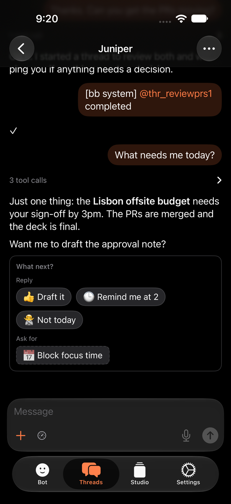 |
| Phone, scrolled up (Jump to latest) | 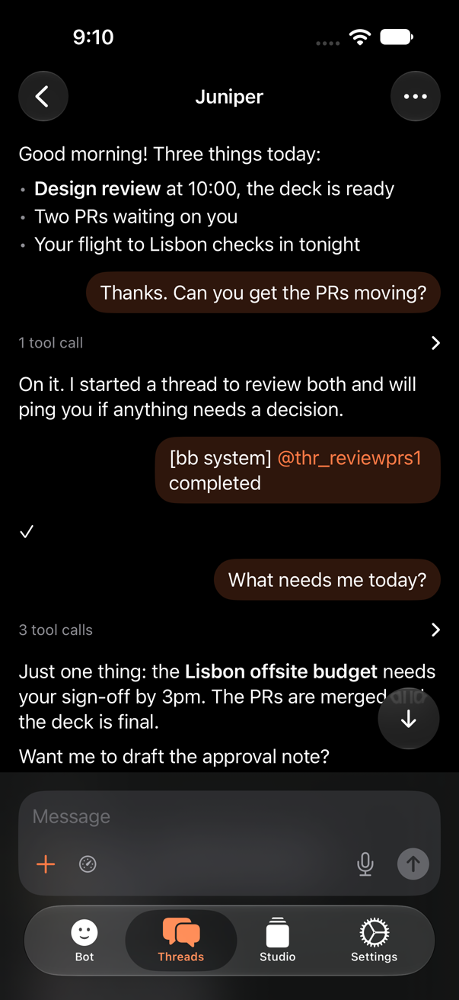 | 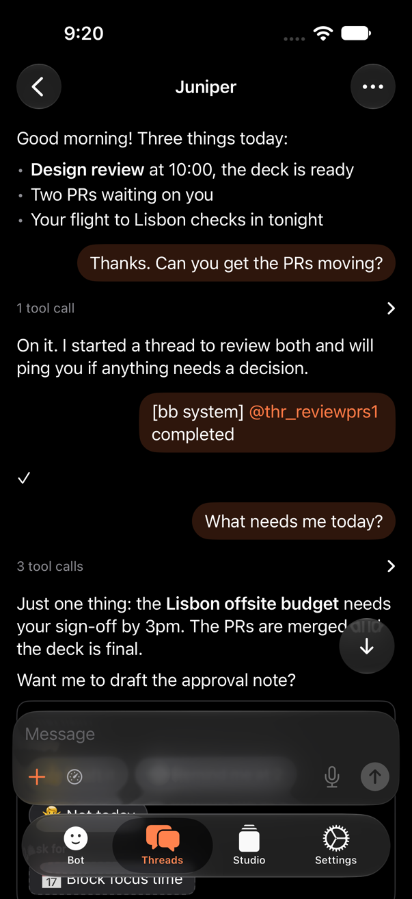 |
| Phone, keyboard up | 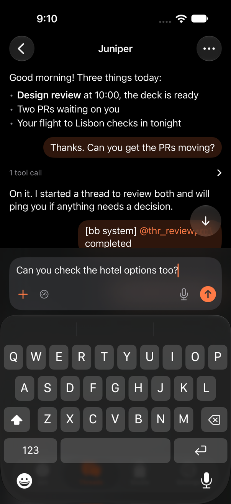 | 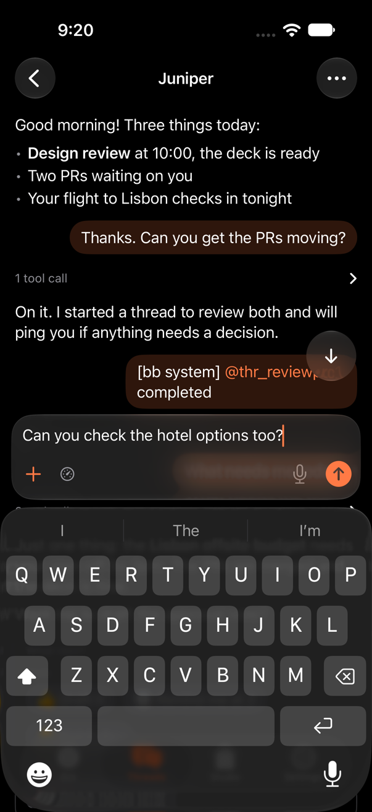 |
| Phone, with a shelf card | 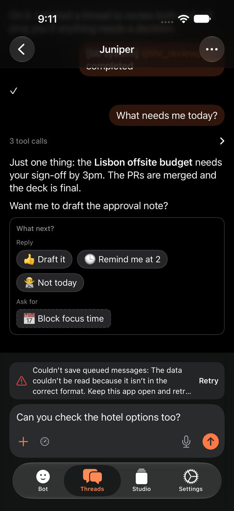 | 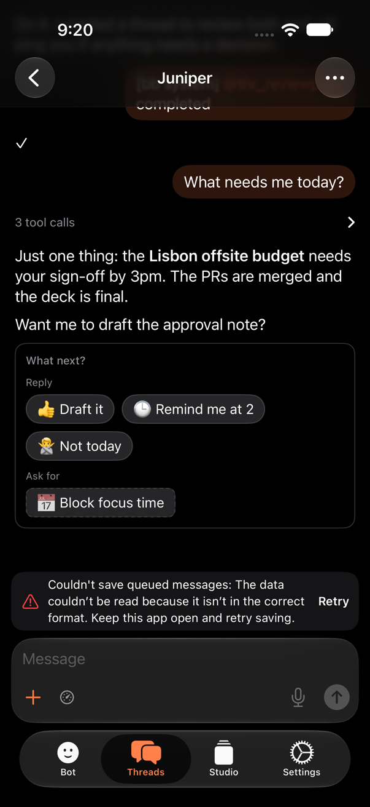 |
| Duo 951×669, at the latest message | 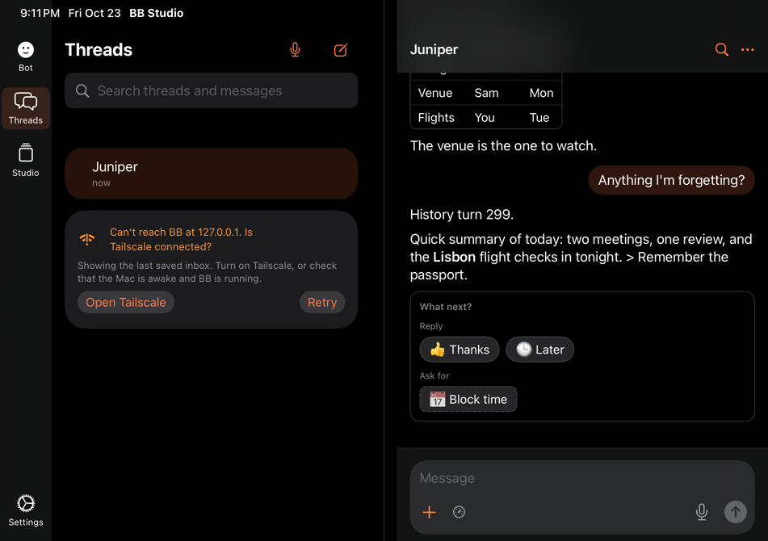 | 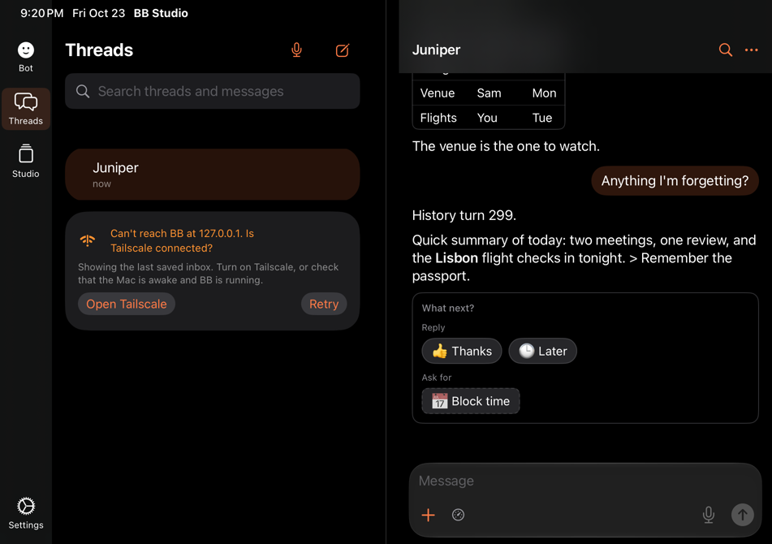 |
| Duo 951×669, scrolled up | 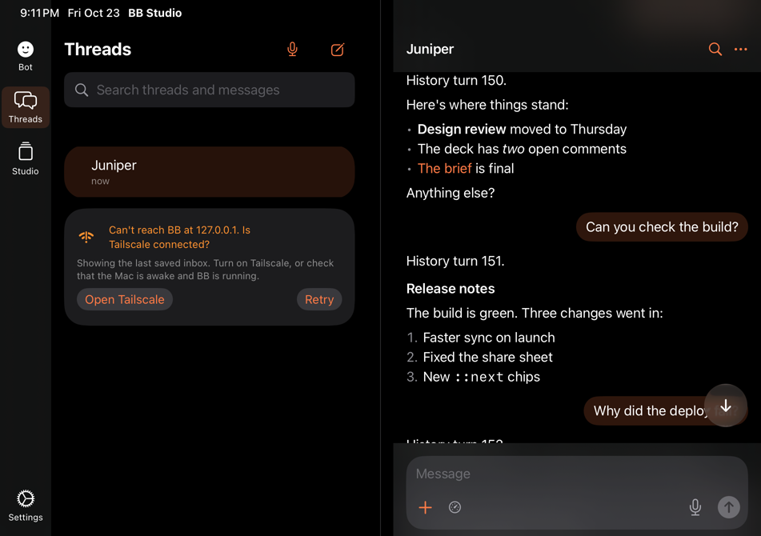 | 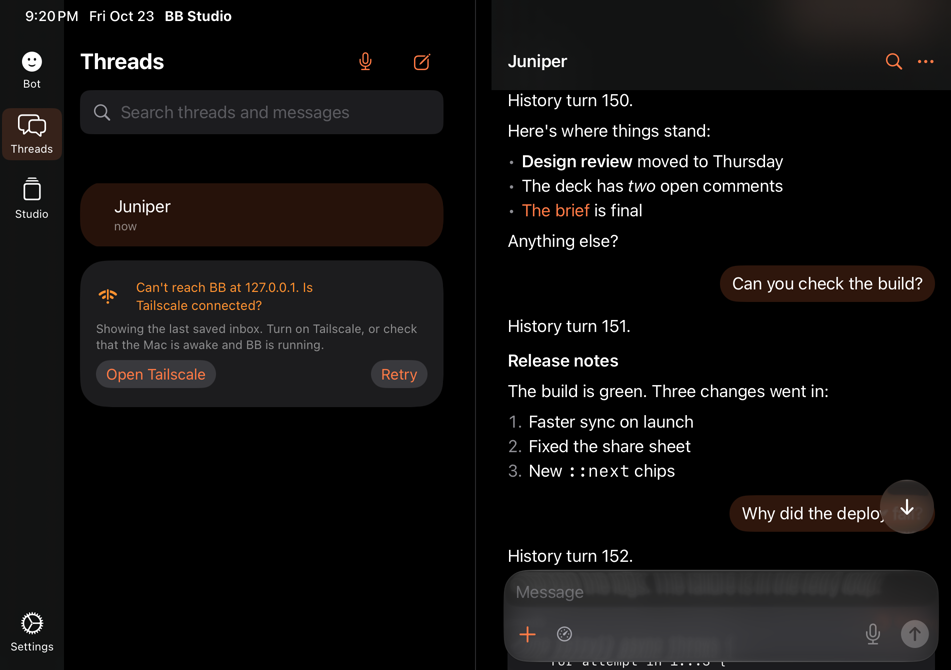 |

## Provider logos in Bot rows

Commit `2505cb74`. The 11 pt logo slot in each Running and Runners mark now
shows the provider's real logo instead of the sparkle. The artwork is BB's
own, the same file desktop's `ProviderIcon` draws: `logoUrl` in
`/api/v1/system/execution-options` points at
`/api/v1/system/providers/<id>/logo`. Those are SVGs drawn as a mask in the
text colour. iOS can't draw SVG at runtime without a web view, so the files
for Codex, Claude Code, Pi and opencode (fetched from a staged BB) are
bundled as vector template images in `Assets.xcassets/ProviderLogos`. Each is
tinted with the provider's `strings.iconTint` (Codex has none, so it uses the
text colour). Other providers keep the neutral sparkle. Rows read the
`providerId` that `bot_activity` and `bot_runners` already send. The ring, its
sizes and the dimming are unchanged. A new provider needs its SVG added to
the catalog and a line in `ProviderLogo.known`.

| Surface | Before (sparkle) | After | Reduce Motion |
|---|---|---|---|
| Phone, Running |  | 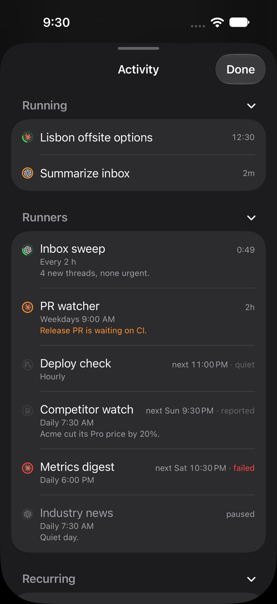 | 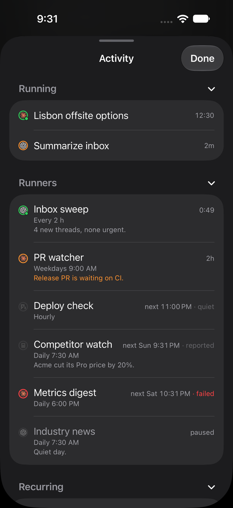 |
| Phone, every runner state |  |  | 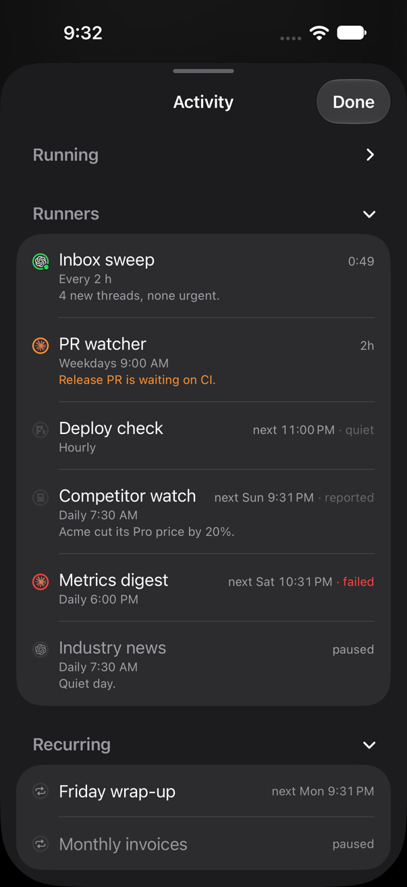 |
| Duo 951×669, top |  | 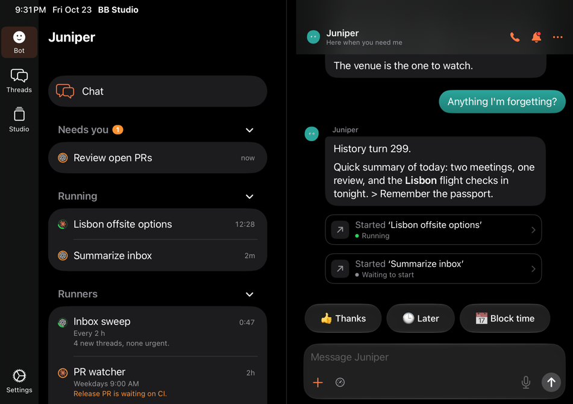 |  |
| Duo 951×669, Runners |  |  | 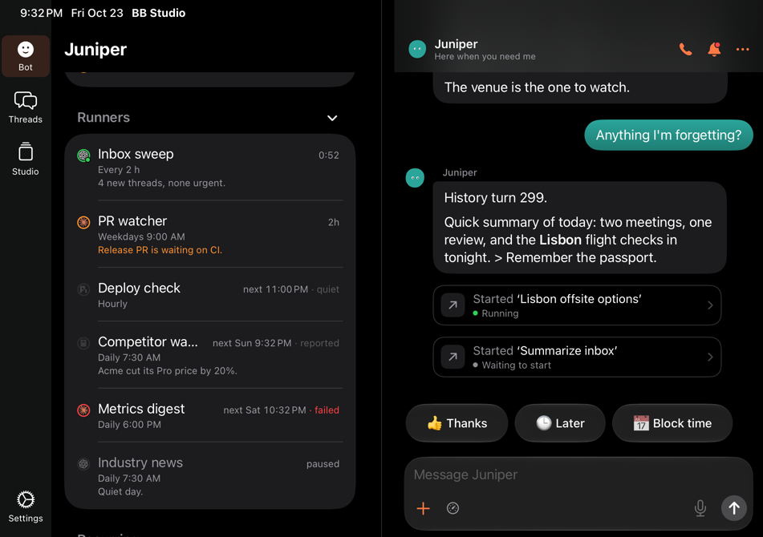 |

## Item chat when the project's defaults can't be read

Commit `a9c9708b`, following up 8c64c3c7. Chat About This no longer fails when
reading the project's default settings fails. It starts the chat with the
standard settings and shows the app's brief notice: "Couldn't read this
project's default settings. The chat uses the standard ones." The notice
lasts 4 seconds and doesn't block touches. A cancelled start still starts
nothing. `UnavailableReadTests` covers the fallback, the normal path (no
notice) and cancellation.

| Asking | After a failed defaults read |
|---|---|
| 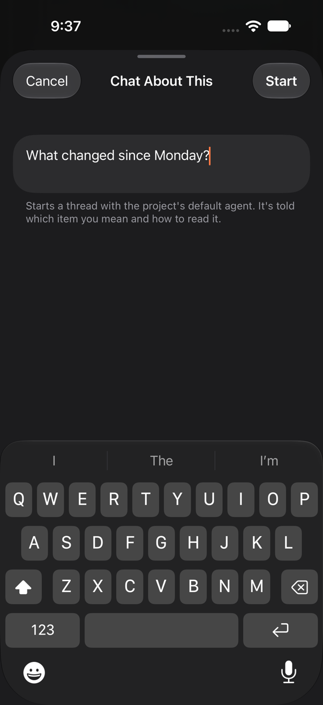 | 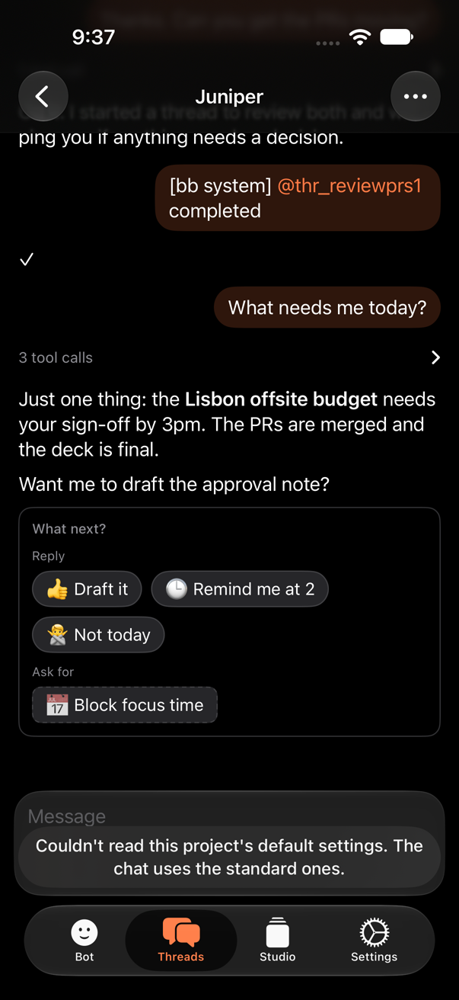 |

## Redone changes

| Change | Codex SHA | What I changed | Before | After |
|---|---|---|---|---|
| Outbox save error and Retry saving (ThreadView) | 21f27c3a (redo `0f527b39`) | The error was a translucent full-width red box over the transcript, with centred orange "Retry saving". On iPad it sat on top of the Bot's header text, so neither could be read. It is now a shelf card above the composer, like "The last turn failed": a red icon, the message (up to 3 lines) and a Retry button. The message no longer ends in "format.." (doubled period). It shows once, even when the failed send also set the thread error. |   |   |
| Stop failure on the phone | 1d94e533 (redo `0f527b39`) | Thread errors (a failed Stop among them) were a low-contrast red capsule floating over messages, dismissed only by an undiscoverable tap. Now a glass toast with a red warning icon, primary text, and a 28 pt dismiss button; tapping still dismisses it. On iPad it is capped at 560 pt and centred. While Stop's request is out, the button shows a spinner instead of looking unchanged. |   |   |
| Stop failure on the Watch | 1d94e533 (redo `c43d0e25`) | The error went into `status`, which shows in grey at the very bottom of the list, below the reply field and quick replies, far from the Stop button. It now shows in red under "Working…" while the thread still runs (it falls back to `status` once the thread has ended). The row says "Stopping…" while the request is out, and the Stop button has a 32 pt target and a label. No Watch render: there is no Watch UI test target, and the view needs the phone relay. | n/a | n/a |
| Dictation send error (Talk) | f11bc45c (redo `35181866`) | The error was a centred red line squeezed between the buttons, and Send changed its label to "Sending…". Send now spins like "Save as Page" next to it, and the error (Save as Page's too) is a leading red line with an icon. The text stays in the editor, so it can be tried again. |   |   |
| Comment reply drafts kept until sent (Studio Related) | 1e5c605e (redo `0665260d`) | **Behaviour bug, not only visuals.** Cancel and Send were plain buttons in one List row, and in a List a tap on that row runs both. So tapping Send also ran Cancel, which wiped the draft this change was meant to keep. The before render shows it: after the failed send the field and the text are gone. Also, the field sat at the bottom of the section, cut off from the comment, and its buttons were under the keyboard. Now: every action is borderless, so each does only its own job. "Reply" turns into "Cancel" on that comment. The field sits at the end of the comment's thread, with the arrow send button the Pages comments use (a spinner while sending). A failed reply's error sits above the field and scrolls into view over the keyboard. Comments also show author and age like Pages comments, and replies are indented under their comment. |   |   |
| Same, iPad | 1e5c605e | As above. |  |  |
| Bot screen leftovers removed | ee716414 | Checked, no change needed. Removing "Waiting for your approval" leaves the Skills sheet with the learning toggle and its footer, the skills, and Archived, all evenly spaced. |  |   |

Unit tests for the behaviour of each change (`OutboxPersistenceTests`,
`ThreadStopTests`, `DictationSubmissionTests`, `RelatedReplyTests`,
`BotTests`) are unchanged and pass.

## Review only

| SHA | What it does | Visual notes |
|---|---|---|
| 8c64c3c7 | Keeps "unavailable" reads and RPC decoding errors instead of turning them into empty results (BBClient, Dashboards, Pages, StudioChat) | No view code. One visible effect: Studio item chat (`startStudioChat`) now fails with an error when the project's defaults can't be read, where it used to start with default settings. Worth a look if item chats start failing on flaky connections. |
| 01513dc8 | Percent-encodes search and timeline query values | No UI. |
| f7bfd8a0 | Pages ignores a page-tree load that a newer load superseded | No visual change. The loading state ends only when the newest load finishes, which is right. |

## Not changed and worth noting

- `DuoEdgeToEdgeUITests.testSurfacesReachEdgesWhileControlsStaySafe` and
  `DuoQuickRepliesUITests.testRepliesClipAtComposerAndKeepSystemSafeAreas`
  fail here with or without the composer change. The first reaches its
  Studio step, after the composer checks pass, and needs a QA server with
  Studio items. The second waits for the quick-reply overflow hint.
- `PlanReviewSheet` still uses the old red capsule for its error. It could use
  the new `ErrorToast`.
