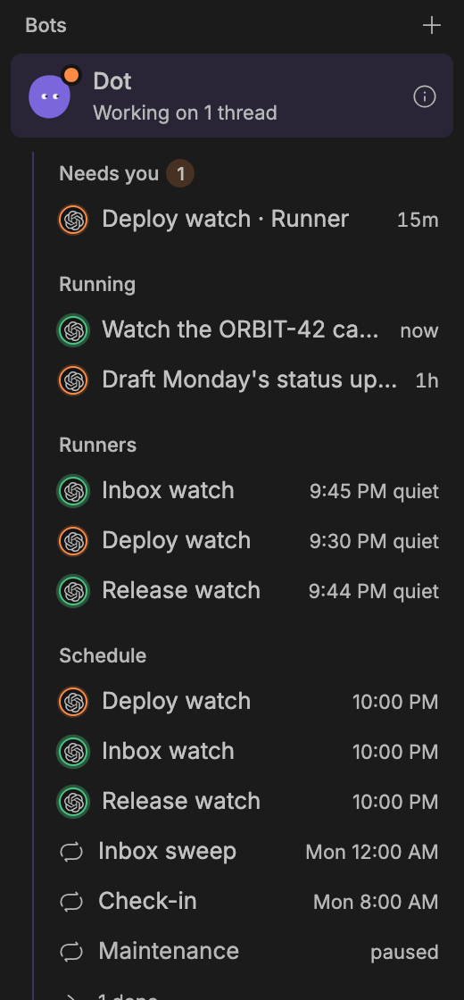
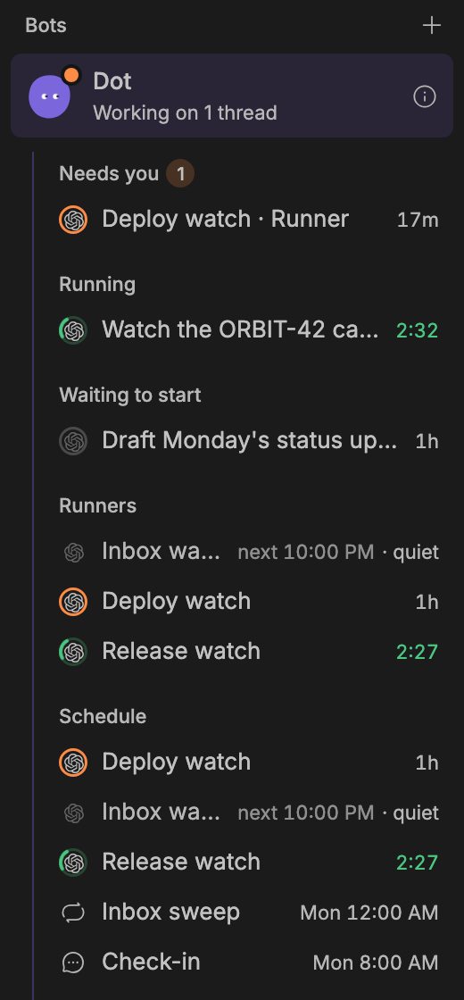
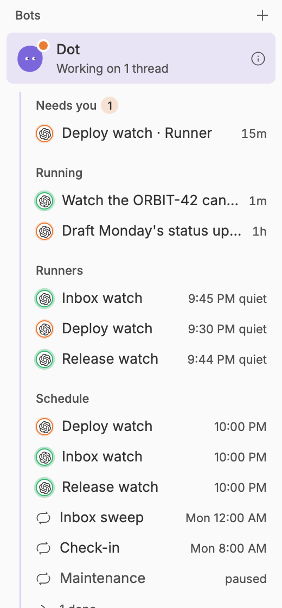
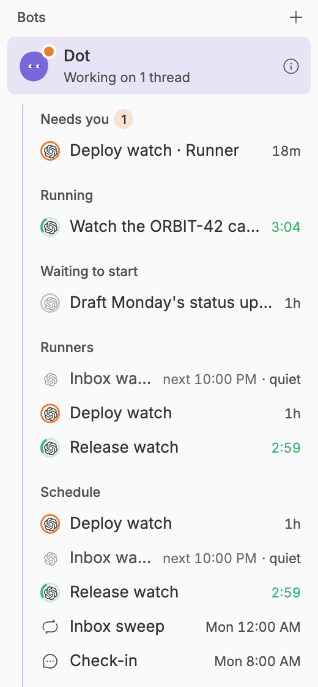
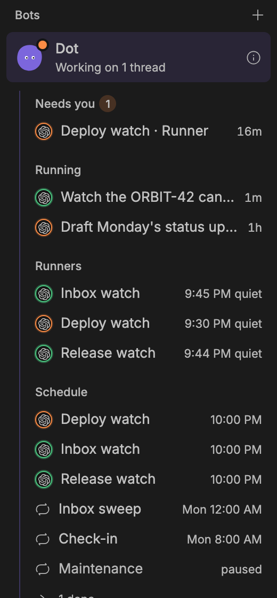
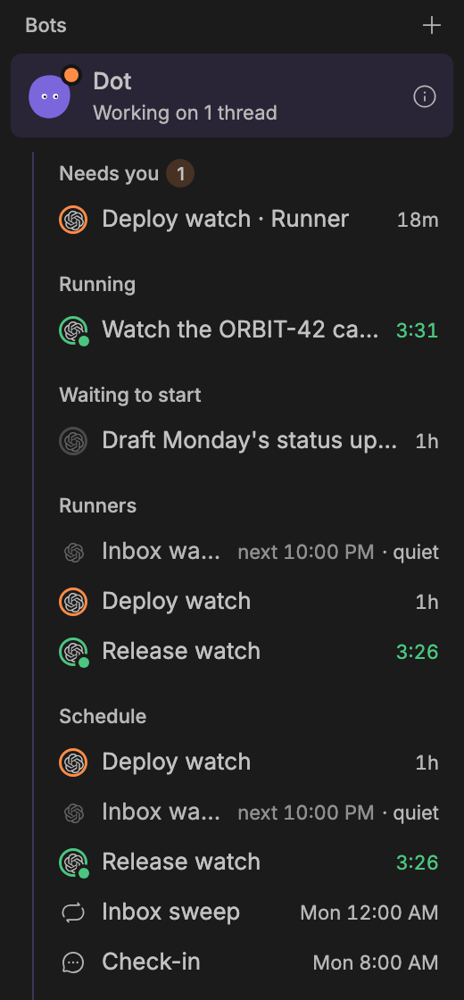
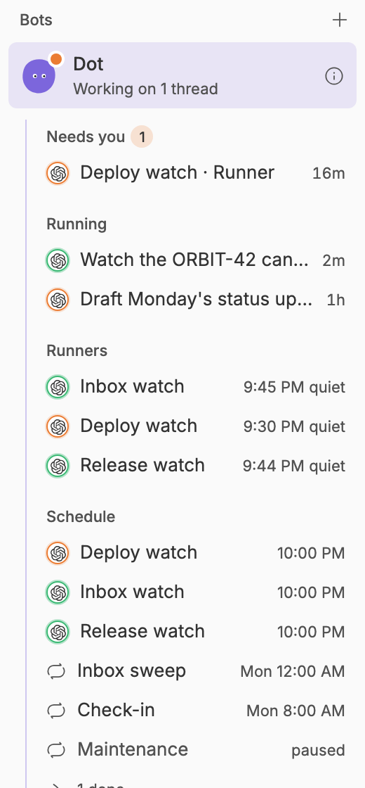
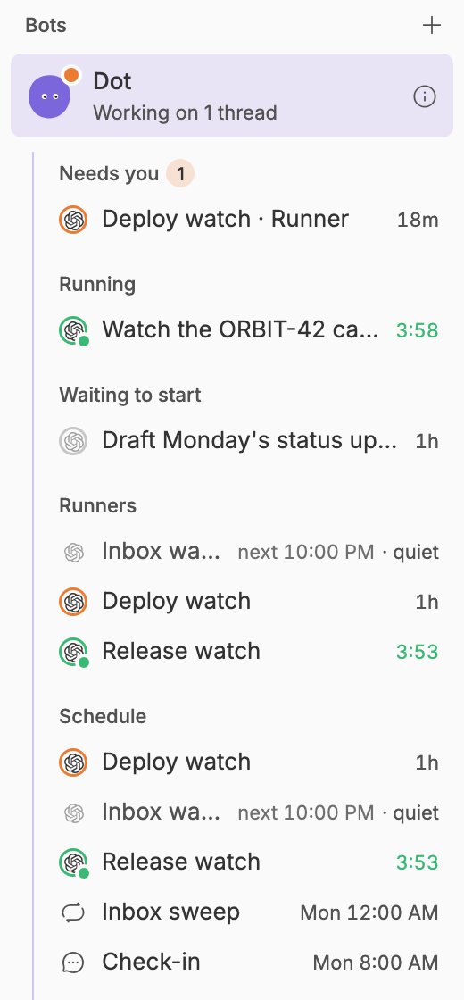
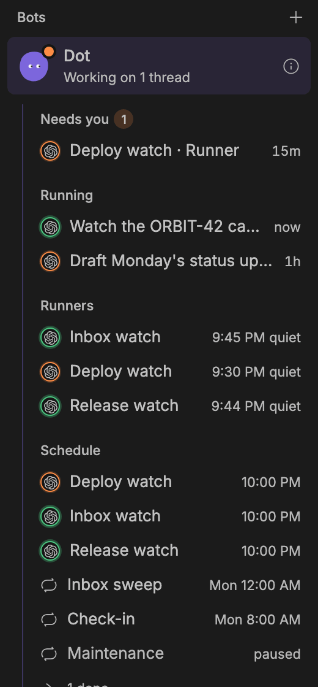
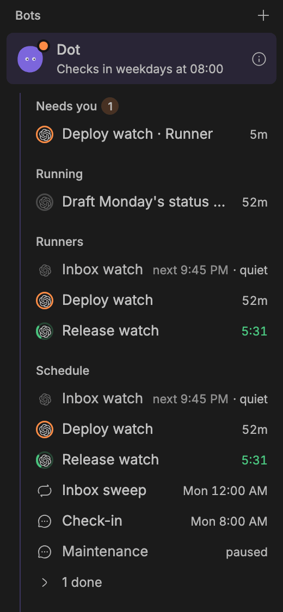

# Bot UI redo (surface C, desktop)

Codex made these Bot UI changes. This redo keeps their behaviour and tests
and fixes the visuals against Studio's existing design language: the
sidebar's own Threads section, Bot info's other sections (Automations,
Runners), and the kit's button, badge and dialog styles.

All renders come from a staged BB (stable BB 0.47.0, `scripts/staged-bb.mjs`)
with the same seeded data. **Before** is Studio at `1de68e82` (main), installed
from GitHub. **After** is this branch's Studio, installed into the same
instance from a copy of the worktree. `render.mjs` in this folder makes both:
`node docs/ui-redo/C/render.mjs before|after [view,...]`. Images are at
1440 px wide, dark and light; the running views are at 2x.

Two views use stubbed data, the same for before and after:

- **Move to machine** stubs `bot_runner_machines` and `bot_runner_preflight`
  in the page. A staged BB has no second machine. The stubbed messages are
  the pre-flight's own strings (`src/runner-machines.ts`).
- **Maintenance** stubs `bot_maintenance_get`. On stable BB 0.47 a real dry
  run stops with `this.deps.sdk.environments.pullRequest is not a function`
  (see "Needs Patrick's decision").

## Row states: running now vs scheduled (shared spec, desktop and iOS)

This follows `bot-row-states-spec.md` from the lead thread. iOS (worker B)
mirrors it. It applies to the rows under Running, Runners and Schedule in the
Bot sidebar, and to Bot info's Runners and Activity → Running.

| State | When | Logo | Ring | Right-hand text |
|---|---|---|---|---|
| Running | a thread is working now, or a runner is mid-run | full colour | a quarter-circle arc in `--success`, 2 pt stroke, turning once every 1.6 s (linear), over a 1.5 pt track at 25% | elapsed time, ticking each second: `0:42`, `12:05`, `1:02:10` (green) |
| Waiting for you | the thread needs the user; a runner's urgent report is unopened | full colour | still, `--warning`, 1.5 pt | the age, as before (a runner: its report's age) |
| Failed | the thread or the runner's last run failed | full colour | still, `--destructive`, 1.5 pt | `failed` in red (threads); runners show `next … · failed` |
| Waiting to start / machine offline | queued thread; runner whose machine is offline | dimmed (45%, greyscale) | hairline, muted at 30% | the age; runners show `offline` in amber |
| Scheduled / idle | a runner between runs; a finished thread | dimmed (45%, greyscale) | none | runners: `next 5:15 PM · quiet` (`· reported`, or `· failed` in red); threads: the age |
| Paused | a paused runner | dimmed (45%, greyscale) | none | `paused` |

- **Sizes**: the mark is a 16 pt box. The logo is 11 pt, centred. The ring is
  drawn inside the box: a 1.5 pt circle at r = 7.25; the running arc is a
  2 pt stroke at r = 7 with a dash of 11 and a gap of 33 (a quarter of the
  circle), rounded caps. Row height (28 pt) and alignment don't change.
- **Reduced motion**: the arc is hidden; the track becomes a full, still
  green ring, and a 6 pt green "live" dot sits at the logo's bottom-right,
  outlined 2 pt in the sidebar colour. The clock still ticks.
- **Only running rows move.** The old status ring pulsed on every active runner.
- **Time format**: `next` uses Schedule's format, the time if today, else the
  weekday and time (`Thu 9:32 PM`).
- **Spoken labels**: `Running for 12 minutes`, `Next run 5:15 PM, last run quiet`,
  `Paused`, `Failed`, `Waiting for you`, after the provider name.
- **Data** (new, optional fields): `running` on each runner (its thread is
  starting, active or stopping) and `runningSince` (ms) on runners and on
  `bot_activity` `inProgress` threads (the open timeline turn's start). A runner
  counts as running only when `running && state == "active"`. Urgent beats
  running. With no `runningSince`, show the ring without a clock.

### Running-state renders (Bots list, 2x)

Seeded state: Watch the ORBIT-42 canary is a thread the Bot started that
runs for ten minutes, and Release watch is a runner whose every run takes
ten minutes; both are caught mid-run. Deploy watch has an unopened urgent
report. Inbox watch is between runs. Draft Monday's status update is queued:
it now sits under Waiting to start, not Running.

| | Before | After |
|---|---|---|
| Dark |  |  |
| Light |  |  |
| Reduced motion, dark |  |  |
| Reduced motion, light |  |  |
| Motion (5 s) |  |  |

Before, every runner pulsed a green ring whether it was running or not,
and the time beside it was the last run, which read as the next one. After,
only the running thread and Release watch move and count up (`2:32`). Idle runners are grey and
say `next 9:45 PM · quiet`. Deploy watch is amber with its report's age.
