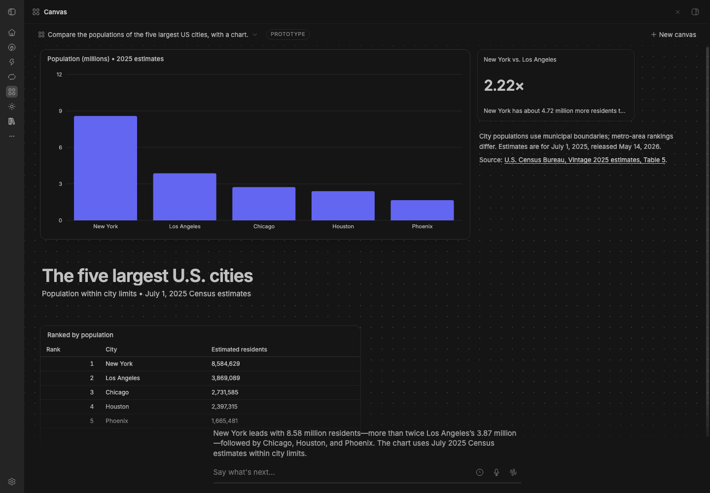

# Canvas (prototype)

Part of BB Studio. A canvas is a board an agent talks on, like someone at a
whiteboard. It isn't a transcript. Each turn, the agent edits the board to
show what matters now: it adds, changes and removes charts, numbers,
tables, captions and generated widgets. Every change animates, so you can
see what moved. You never arrange the board.

Canvas is its own plugin and is off unless you install it. It needs
Studio.

## Staged preview



The canvas page in a staged BB, after one real agent turn on the staged
BB's default provider: the agent built the board with the canvas tools,
and its short reply is the caption line at the bottom.

## Use it

Open **Canvas** in BB's rail, or go to `/plugins/canvas/canvas`. Type what
you want to look at. The chat is one faint line at the bottom: the agent's
latest reply, a text field, Talk's dictation mic, a history peek and the
hands-free button.

- **Text:** each message goes to the canvas's thread. A message sent while
  the agent works waits its turn.
- **Dictation:** the mic dictates into the field with Studio's Talk.
- **Hands-free voice:** starts Studio's hands-free voice speaking for the
  canvas. The voice edits the board while it talks, and passes deeper work
  to the canvas's thread, which edits the board when it's done.

## How it works

- **The agent** is an ordinary BB thread, hidden, in your personal
  project, on your normal BB provider. Canvas makes it when you start a
  canvas. The thread is the canvas's memory; you see the board.
- **The board** is in this plugin's own database: one per canvas thread,
  with a short log of what changed in each turn.
- **The canvas tools** (`canvas_read`, `canvas_add`, `canvas_update`,
  `canvas_remove`, `canvas_clear`, `canvas_set`) are this plugin's agent
  tools. Only canvas threads get them, with the canvas rules and the
  `canvas` skill, and each works only on the calling thread's board.
- **Items** are a headline, a caption, or one of Studio's Dashboards
  widget types: stat, line, bar, area, pie, table, list, ticker, progress,
  image, and custom HTML in a sandboxed frame.
- **Layout:** Canvas packs items by importance (1–5) and size (s, m, l,
  xl). The most important, most recently changed item is the biggest, at
  the top left. Items that don't change keep their place, and the board
  reflows for narrow windows.

## With Studio

The page reuses Studio's widget renderers, markdown and theme. They're
bundled into this plugin (`bundle/canvas-ui.js`, built by `node build-ui.mjs`),
so Canvas reads nothing of Studio's at runtime except through these:

- Studio's hands-free voice asks this plugin's `canvas.voice` and
  `canvas.voiceRun` RPCs when a session starts from a canvas thread.
- The page starts hands-free with a `bb-studio:handsfree-start` window
  event, and dictation uses Talk's `data-talk-field` events.

## Development

```sh
node build-ui.mjs   # after changing src/ui or the Studio files it uses
```

`scripts/capture/canvas-demo.mjs` records four text turns and a hands-free
turn in a staged BB.
