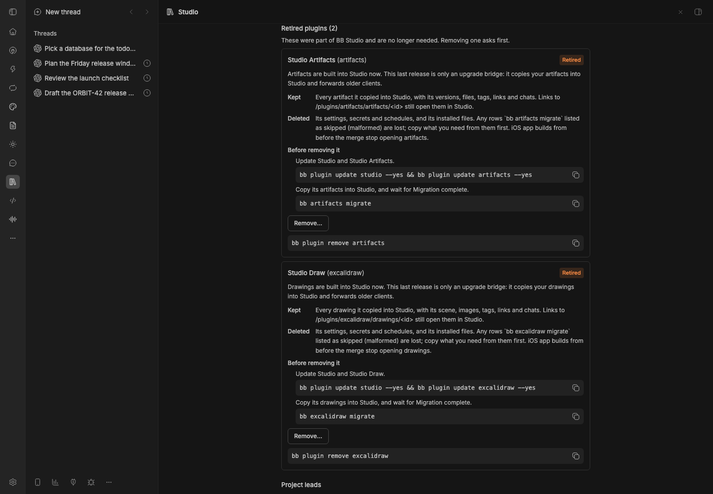

# Studio Artifacts (upgrade bridge)

> Part of **BB Studio**. See the [suite overview](../../README.md).

Artifacts are built into [Studio](../bb-studio/README.md#artifacts) now. This
last release of the Artifacts plugin (`artifacts`, version 0.2.0) is only an
upgrade bridge. BB keeps each plugin's database separately, so your artifacts
stay here until the bridge copies them into Studio.

New installs don't need it. If you had Studio Artifacts installed:

```sh
bb plugin update studio --yes
bb plugin update artifacts --yes
bb artifacts migrate        # wait for "Migration complete"
bb plugin remove artifacts  # or Studio → Setup → Retired plugins → Remove…
```

## What it does

- **Copies your artifacts into Studio.** On start it copies every artifact,
  with its versions, ids, times and files, and retries with backoff while
  Studio is missing, off or starting. `bb artifacts migrate` runs the copy now
  and reports it. A rerun sends only what's left: each copied artifact gets a
  marker. Rows that can't be copied (no versions, missing files, or a file
  Studio saved again after the update) are listed by id with the reason and
  kept here.
- **Tells Studio's Setup page when it can go.** Setup lists it under
  **Retired plugins** and blocks **Remove…** until the copy is complete.
- **Forwards older clients.** iOS builds from before the merge call
  `artifacts` RPCs and its `/content` URL. The bridge answers them from
  Studio once the copy is complete. Old `@artifact` mention pills in existing
  threads resolve through Studio too.

It has no UI, agent tools or skill. Studio registers `artifacts_save`,
`artifacts_list`, `artifacts_read`, the `artifacts` skill, the `@artifact`
mention and the `::artifact` card under the same names. BB refuses a tool name
that two plugins register. The CLI moved to `bb studio artifacts …`, because a
plugin registers only one CLI command.

Your tags, tabs, links and item chats need no copy: Studio keeps them,
and artifacts keep their `artifacts:<id>` identity.

## Staged preview



Captured from a staged BB (`node scripts/staged-bb.mjs start`) after
`bb artifacts migrate` reported Migration complete. Studio's Setup page lists
Studio Artifacts under **Retired plugins** with what removing it keeps and
deletes, the update and `bb artifacts migrate` steps, and **Remove…**
available.

## Development

```sh
pnpm --filter @bb-studio/artifacts test
pnpm --filter @bb-studio/artifacts typecheck
```

The copy is in [`src/migrate.ts`](src/migrate.ts); its tests run it against
Studio's real artifact store. Studio's side is the `artifacts.missingBlobs`,
`artifacts.importBlob` and `artifacts.importRows` RPCs in
[`packages/bb-studio/src/artifacts/server.ts`](../bb-studio/src/artifacts/server.ts).
