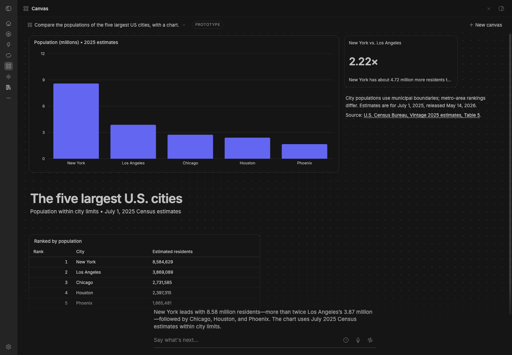

# BB Studio Canvas (prototype)

Part of BB Studio. A canvas is a board an agent talks on, like someone at a
whiteboard. It isn't a transcript. Each turn, the agent edits the board to
show what matters now: it adds, changes and removes charts, numbers,
tables, captions and generated widgets. Every change animates, so you can
see what moved. You never arrange the board.

BB Studio Canvas is its own plugin (id `studio-canvas`) and is off unless
you install it. It needs Studio. It was called Canvas (id `canvas`) until
that id clashed with another store plugin; see
[Moving from the old Canvas plugin](#moving-from-the-old-canvas-plugin).

## Staged preview



The canvas page in a staged BB, after one real agent turn on the staged
BB's default provider: the agent built the board with the canvas tools,
and its short reply is the caption line at the bottom.

## Use it

Open **Canvas** in BB's rail, or go to `/plugins/studio-canvas/canvas`. Type what
you want to look at. The chat is one faint line at the bottom: the agent's
latest reply, a text field, Talk's dictation mic, a history peek and the
hands-free button.

- **Text:** each message goes to the canvas's thread. A message sent while
  the agent works waits its turn.
- **Dictation:** the mic dictates into the field with Studio's Talk. While
  you talk, Talk's controls (timer, cancel, stop-and-insert, and a ▾ menu)
  sit in the field, as in the thread composer. The text lands in the field
  for you to edit or send; nothing is sent on its own.
- **Hands-free voice:** starts Studio's hands-free voice speaking for the
  canvas. The voice edits the board while it talks, and passes deeper work
  to the canvas's thread, which edits the board when it's done.

## How it works

- **The agent** is an ordinary BB thread, hidden, in your personal
  project. Canvas makes it when you start a canvas, on Claude Code's
  Sonnet 5.5 (`claude-sonnet-5-5`). The thread is the canvas's memory; you
  see the board. Canvases made before keep the model their thread has.
- **The model picker** in the top bar lists the providers and models BB has,
  grouped by provider, with reasoning levels when a model has more than one.
  The pick is saved per canvas and applies from the next message: another
  model from the same provider changes the thread in place; another
  provider starts a fresh hidden thread that gets the rules, the guide, the
  board and the last few lines of talk.
- **The board is one page** the agent designs for each answer: HTML and CSS
  shaped by the content (a plan runs along a timeline, a showcase is a wall
  of pictures, a comparison sits side by side). It's in this plugin's own
  database, with a short log of what changed in each turn.
- **The page** renders in a sandboxed frame the size of the board (scripts
  in an opaque origin; nothing loads from the network but https pictures),
  with the style's tokens (`--cv-*`), the kit's classes and declarative
  charts (`data-chart`: line, columns, bars, stars, US tile maps, timelines
  and more; `src/ui/kit.ts`). It scrolls when it's taller than the screen.
- **Filling the screen:** in a page the type scale grows with the screen,
  `cv-fill` is a full-height layout (header, a stretching middle row,
  footer), and `cv.viewport()` gives the screen's size. A page that stops
  short is zoomed up (at most 1.4×) as far as it still fits.
- **Motion:** the agent marks parts with `data-cv-id`. When a new version
  arrives, the frame keeps its document and morphs the page: parts with the
  same id glide (FLIP) to their new place, changed ones fade their new
  content in, new ones enter and gone ones leave from where they were. A
  part whose id changed but shows the same picture or text glides too, and
  `canvas_page` tells the agent when it renamed most parts.
- **The canvas tools:** `canvas_page` (the whole board), `canvas_patch` (one
  part by id), `canvas_read`, `canvas_style`, `canvas_image` and
  `canvas_guide`. Only canvas threads get them, with the canvas rules and
  the `canvas` skill, and each works only on the calling thread's board.
  Hands-free voice gets the same tools.
- **Pictures:** `canvas_image` returns an https address with alt text and
  its source. With an Exa API key it searches; without one it takes the
  main picture of a page the agent found (og:image, else the largest
  image). Server-side fetches go only to public http(s) addresses: each
  hop's host is resolved once, every address checked, and the connection
  pinned to that address (so a resolver can't switch it after the check),
  with a time limit and a size cap. Picture addresses lose tracking
  parameters. Stars without a source read "my pick".
- **Exa API key:** a BB secret setting on this plugin, `exaApiKey`
  (**Settings → Plugins → BB Studio Canvas**, or `bb plugin config
  studio-canvas`). It's only sent to Exa: never logged, returned or put in
  an error.
- **Styles:** Editorial (a magazine spread), Field notes (a designer's
  whiteboard) and Instrument (a control room) are token sets. The agent
  picks one per board, a style you ask for wins, and the top bar shows it.
- **Title and caption:** the canvas's title is the topic the agent names,
  else the page's first heading. The caption is the agent's reply, written
  to add what the board doesn't say; sentences that describe the board
  ("The board shows…") are dropped from it.
- **Boards from before pages** (items placed by Canvas's layout) still open
  and show as they were. The agent's next page replaces them.

## With Studio

The page reuses Studio's widget renderers, markdown and theme. They're
bundled into this plugin (`bundle/canvas-ui.js`, built by `node build-ui.mjs`),
so Canvas reads nothing of Studio's at runtime except through these:

- Studio's hands-free voice asks this plugin's `canvas.voice` and
  `canvas.voiceRun` RPCs when a session starts from a canvas thread.
- The page starts hands-free with a `bb-studio:handsfree-start` window
  event, and dictation uses Talk's `data-talk-field` events.

## Development

```sh
node build-ui.mjs   # after changing src/ui or the Studio files it uses
```

`scripts/capture/canvas-demo.mjs` records four text turns and a hands-free
turn in a staged BB. `scripts/capture/canvas-directions.mjs` runs real turns in
one canvas and saves light and dark stills after each, with the style the
agent picked. `scripts/capture/canvas-composition.mjs` runs real turns at two
window sizes, light and dark, and can pause a page's morph for a
mid-animation still.

## Moving from the old Canvas plugin

A plugin's data is keyed by its id, so canvases made under the old id stay
in `<BB data dir>/plugins/canvas/data.db`. The first time BB Studio Canvas
starts with no canvases of its own and finds that file, it copies every
canvas, item, change, history line and model choice in, keeping their ids.
Each canvas keeps its hidden thread, so old links
(`/plugins/canvas/canvas/<threadId>` becomes
`/plugins/studio-canvas/canvas/<threadId>`) and hands-free voice find it.

- It opens the old file read-only and never changes or deletes it.
- It runs once and records that it ran (`canvas_legacy_import`).
- Disable the old plugin before installing this one, so the two don't both
  run. You can uninstall the old one once you've checked your canvases.
