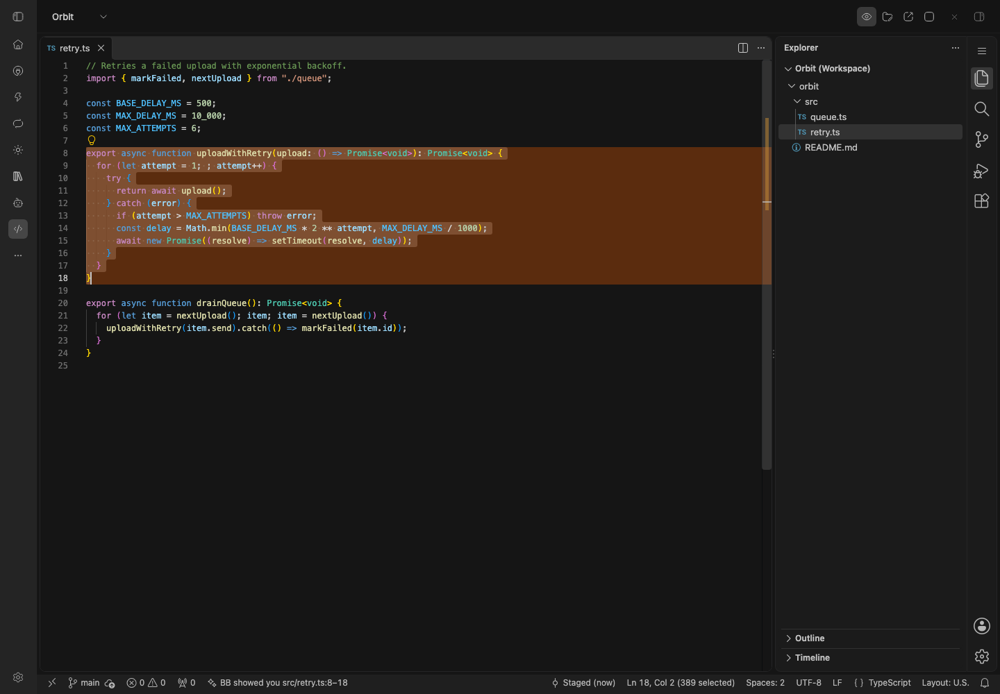

# Studio Code upgrade bridge

VS Code now runs inside [Studio](../bb-studio/). Studio owns the six `code_*`
tools and the `studio-code` skill. This 0.2.0 bridge copies existing editor data,
then forwards all 13 old RPCs to Studio's `code.*` methods. It starts no code-server.

Update `studio-code` first, then Studio, and run `bb studio-code migrate`.
The bridge retries automatically. Copies keep IDs and preserve existing Studio
rows, theme and files. Old servers must stop and exit before any copy; Studio
cannot start its replacements until the final acknowledgment. Unsaved recovery
state and stored absolute paths move with the editor. Source files stay intact.

The bridge retains only a small renderer for saved `studio-code/code` thread tabs
and an old mention resolver. Studio provides new VS Code tabs and the file opener.
SDK 0.6.37 cannot alias scoped tab identities. Reopen VS Code through Studio's +
menu before removing the bridge; removing it retires the old scoped renderer.
Old workspace URLs and item IDs continue resolving in Studio afterward.
Setup lists the bridge as retired and blocks removal until its copy completes.

See [the upgrade guide and exact staged checklist](../../docs/upgrade-studio-code.md).

## Staged preview

Historical capture of the pre-merge plugin with the seeded Orbit thread and
`src/retry.ts` selected. This change did not run a staged BB. The lead's upgrade
check will capture the same live editor from Studio using
`scripts/capture/captures/bb-studio-code.mjs`.
