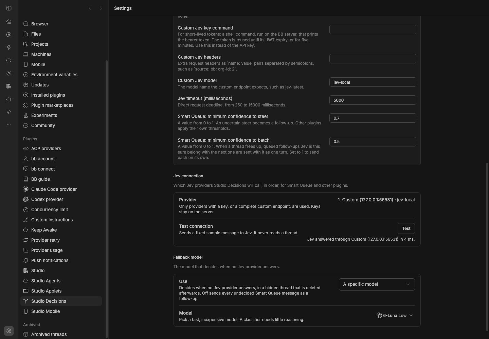

# Studio Decisions upgrade bridge

Decisions now runs inside [Studio](../bb-studio/), including Jev, the fallback model and Smart Queue.
This package keeps the `smart-decisions` plugin ID for upgrades and existing scripts.

Update this bridge first, then Studio:

```sh
bb plugin update smart-decisions
bb plugin update studio
bb smart-decisions migrate
bb studio decisions status
```

The bridge retries while Studio is unavailable. It copies `fallback` and
`recent-decisions` KV once. Studio reads ordinary settings through `getSettings`.
The bridge transfers the five secret API keys directly from its own settings
to Studio's secret settings. Only a verified server call from this bridge may
import them. Responses and logs contain no setting or secret values.
Existing Studio settings and KV values win, including explicit default choices.
A completion marker is written only after Studio acknowledges the copy.

The bridge runs no dispatch hook or classifiers. Studio waits for migration,
cleans temporary classifier threads owned by either ID, and retains standalone
`smart-queue` suppression. Every old RPC (including `studio_health`) and CLI
command forwards to Studio. New calls use `decisions.*` on `studio` and
`bb studio decisions`. Configure `decisions_<old-key>` in Studio settings.
The `smart-decisions` skill is now distributed by Studio.

Studio Setup blocks removal until version 0.5.0 or newer is enabled and the
migration is complete. Keep this bridge installed while scripts still use
`bb smart-decisions`; removing it removes that CLI alias.

## Staged preview



This is the pre-merge staged Jev connection and fallback-model settings capture.
The replacement capture definition opens Studio settings and tests a local Jev
stand-in. A fresh capture needs the lead to stage the merged, pushed commit.
