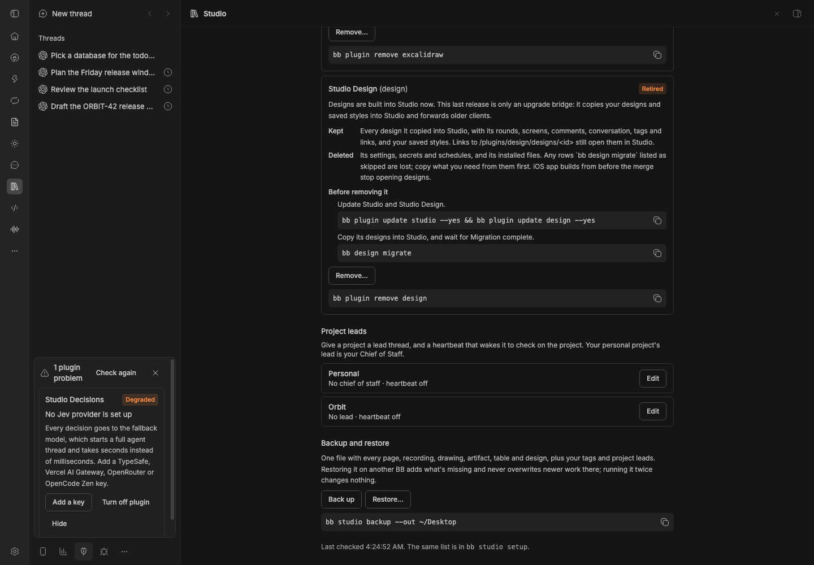

# Studio Design (upgrade bridge)

> Part of **BB Studio**. See the [suite overview](../../README.md).

Designs are built into [Studio](../bb-studio/README.md#designs) now. This
last release of the Design plugin (`design`, version 0.2.0) is only an
upgrade bridge. BB keeps each plugin's database separately, so your designs
stay here until the bridge copies them into Studio.

New installs don't need it. If you had Studio Design installed:

```sh
bb plugin update studio --yes
bb plugin update design --yes
bb design migrate        # wait for "Migration complete"
bb plugin remove design  # or Studio → Setup → Retired plugins → Remove…
```

## What it does

- **Copies your designs into Studio.** On start it copies every design, with
  its id, name, project, times, archive state, conversation, rounds, screens
  and comments, and every saved style. It retries with backoff while Studio
  is missing, off or starting. `bb design migrate` runs the copy now and
  reports it. A rerun sends only what's left: each copied design and style
  gets a marker, and Studio keeps one it already has. Rows that can't be
  copied (a malformed row, or a style whose name Studio already uses) are
  listed by id with the reason and kept here.
- **Tells Studio's Setup page when it can go.** Setup lists it under
  **Retired plugins** and blocks **Remove…** until the copy is complete.
- **Forwards older clients.** iOS builds from before the merge call `design`
  RPCs, and threads hold `/api/v1/plugins/design/http/screen` URLs. The bridge
  answers the RPCs from Studio and redirects the screen and print URLs to
  Studio's once the copy is complete. Old `@design` mention pills in existing
  threads resolve through Studio too.

It has no UI, agent tools or skill. Studio registers the `design_*` tools,
the `design` skill, the `@design` mention, the `::design` card, the
`design_ask` question form and the thread's **Design** tab under the same
names. BB refuses a tool name that two plugins register. Studio adds a CLI,
`bb studio designs …`.

Your tags, tabs, links and item chats need no copy: Studio keeps them, and
designs keep their `design:<id>` identity. Links to
`/plugins/design/designs/<id>` open the design in Studio. Review status
lives in memory, so a running review doesn't carry over.

## Staged preview



Captured before the merge from Design's own page: a design's round of two
live options on the canvas. Designs now open as Studio tabs; see
[Studio's Designs section](../bb-studio/README.md#designs).

## Development

```sh
pnpm --filter @bb-studio/design test
pnpm --filter @bb-studio/design typecheck
```

The copy is in [`src/migrate.ts`](src/migrate.ts); its tests run it against
Studio's real design store. Studio's side is the `designs.importRows` and
`designs.importStyles` RPCs in
[`packages/bb-studio/src/design/server.ts`](../bb-studio/src/design/server.ts).
