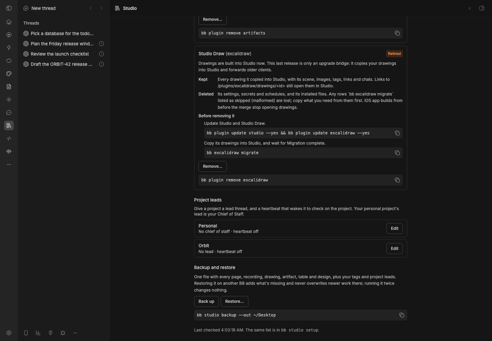

# Studio Draw (upgrade bridge)

> Part of **BB Studio**. See the [suite overview](../../README.md).

Drawings are built into [Studio](../bb-studio/README.md#drawings) now. This
last release of the Draw plugin (`excalidraw`, version 0.2.0) is only an
upgrade bridge. BB keeps each plugin's database separately, so your drawings
stay here until the bridge copies them into Studio.

New installs don't need it. If you had Studio Draw installed:

```sh
bb plugin update studio --yes
bb plugin update excalidraw --yes
bb excalidraw migrate        # wait for "Migration complete"
bb plugin remove excalidraw  # or Studio → Setup → Retired plugins → Remove…
```

## What it does

- **Copies your drawings into Studio.** On start it copies every drawing,
  with its id, name, scene (images included), project, times, template and
  archive state, and retries with backoff while Studio is missing, off or
  starting. `bb excalidraw migrate` runs the copy now and reports it. A rerun
  sends only what's left: each copied drawing gets a marker, and Studio keeps
  a drawing it already has. Rows that can't be copied (a scene that isn't
  Excalidraw JSON) are listed by id with the reason and kept here.
- **Tells Studio's Setup page when it can go.** Setup lists it under
  **Retired plugins** and blocks **Remove…** until the copy is complete.
- **Forwards older clients.** iOS builds and Pages from before the merge call
  `excalidraw` RPCs and its `/thumbnail` URL. The bridge answers them from
  Studio once the copy is complete. Old `@drawing` mention pills in existing
  threads resolve through Studio too.

It has no UI, agent tools or skill. Studio registers the `excalidraw_*` tools,
the `draw` skill, the `@drawing` mention, the `::drawing` card, the thread's
**Drawings** tab and the composer's **Drawing** entry under the same names. BB
refuses a tool name that two plugins register. The CLI moved to
`bb studio drawings …`, because a plugin registers only one CLI command.

Your tags, tabs, links and item chats need no copy: Studio keeps them, and
drawings keep their `excalidraw:<id>` identity. Links to
`/plugins/excalidraw/drawings/<id>` open the drawing in Studio. Unsaved
editor drafts in the browser's IndexedDB carry over too.

## Staged preview



Captured from a staged BB (`node scripts/staged-bb.mjs start`) after
`bb excalidraw migrate` reported Migration complete. Studio's Setup page lists
Studio Draw under **Retired plugins** with what removing it keeps and
deletes, the update and `bb excalidraw migrate` steps, and **Remove…**
available.

## Development

```sh
pnpm --filter @bb-studio/excalidraw test
pnpm --filter @bb-studio/excalidraw typecheck
```

The copy is in [`src/migrate.ts`](src/migrate.ts); its tests run it against
Studio's real drawing store. Studio's side is the `drawings.importRows` RPC in
[`packages/bb-studio/src/draw/server.ts`](../bb-studio/src/draw/server.ts).
