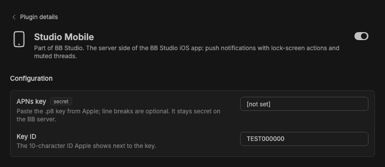

# Studio Mobile

Part of BB Studio. The server side of the [BB Studio iOS app](../../../ios/README.md).
Plugin ID: `mobile`. It:

- relays BB's push notifications to the app over APNs (`apns:` tokens), and
  forwards every other token to Expo unchanged;
- lets other plugins notify the same phones through its `notify` RPC;
- keeps muted threads in sync across devices;
- tells the app to remove notifications for threads you have read, answered,
  archived, or deleted.

It needs BB 0.45 or newer and Plugin SDK 0.6.15 or newer. For wiring and
settings, see [`skills/mobile-push/SKILL.md`](skills/mobile-push/SKILL.md).

## Notifications

- **Reply.** Finished turns (any thread's reply, including the Bot's) carry
  the `BB_REPLY` category: a Reply field that sends the text to the thread.
  Errors are plain alerts.
  Tap one to open the thread.
- **Actions.** Approval, plan, and question notifications keep lock-screen
  actions. The relay looks up the thread's pending interaction and adds it to
  the push. Actions target only that exact request.
- **Quiet completions.** A finished turn with no text, or only `[PASS]`, is not
  sent to APNs or Expo. The relay still reports success.
- **Muted threads.** A muted thread sends nothing to the app. Other
  subscribers still get it.
- **Collapse ids.** A `notify` call with `coalesceKey` sets `apns-collapse-id`,
  so pushes with the same key replace each other on the phone. Keys over 64
  bytes are hashed.
- **Payload size.** APNs rejects payloads over 4096 bytes, so the relay
  shortens a long body with an ellipsis.
- **Server identity.** Each push carries this relay's persistent server ID. The
  app checks it before opening, acting on, or clearing a notification. Update
  the relay along with the app; older notifications without an ID need manual
  review in the app.
- **Clearing.** Every minute, and shortly after a thread resumes, is archived,
  or is deleted, the relay checks the threads it notified about (for three
  days). Settled ones get a silent background push, and the app removes their
  notifications.
- **Devices.** The relay remembers each APNs device that received a push. It
  forgets a device after 30 days without one, and at once when Apple rejects its
  token for good. `notify` sends only to remembered devices, and its `sent`
  count includes only successful, unmuted deliveries.
- **Retries.** Notification tracking survives transient lookup or APNs
  failures, so the next check retries.

## Bots in notifications

`notify` takes the Bot a push is about: `botId`, `conversationId` (the
conversation it belongs to; a worker's is the conversation that started it)
and `workerId` (a worker's own thread). A conversation or worker needs its
`botId`, and a worker needs its `conversationId`. Studio passes them on every
push it sends for a Bot's thread (loops, runner reports, stopped threads,
hands-free voice).

- **Grouping.** A push with a `conversationId` is grouped by it
  (`aps.thread-id`), so a conversation and its workers stack together.
- **`needs-you`.** A new kind for a conversation that needs the user. It needs
  `botId` and `conversationId`, and `threadId` must be the conversation. It
  has no category, so no lock-screen actions.
- **Worker approvals.** Studio sends one push per approval a Bot's worker
  waits on: kind `pending-interaction`, `threadId` and `conversationId` the
  conversation that shows its card, `workerId` the worker, `interactionId` the
  approval, and the title "Bot · Conversation". The relay looks the interaction
  up on `workerId` (the given `interactionId` when set), so the push gets
  `BB_APPROVAL`. BB's own `pending-interaction` push for a worker's approval
  (no `workerId`) is dropped only on a device Studio's push for that
  interaction reached. The relay waits up to 5 seconds for Studio's push and
  sends BB's when none came, or it reached no phone. Plans, questions, threads
  Studio's `bot_push_ids` calls no worker, and a Studio that can't be reached
  keep BB's push. The conversation's notification clears only once it is read
  and the worker's approval no longer waits; a deleted worker waits on
  nothing. A Bot's reply that is only an `::approval{…}` card sends no push,
  since Studio's push already covers it. A phone mute on the worker or the
  conversation mutes it.
- **Older apps.** The app before this change reads only `threadId` and
  `serverId` and ignores `kind`, so a `needs-you` push shows as a plain alert
  and a tap opens the conversation as a thread. The new keys are extra data it
  ignores. Nothing needs updating on the phone first; Studio sends no
  `needs-you` push yet.

## Live Activities

The phone registers APNs Live Activity tokens per device (`deviceId`, 8 to 64
letters, digits and dashes, such as `identifierForVendor`) and per Bot:

- `live_activity_register({ deviceId, botId, kind, token })` → `{ ok }`.
  `kind` is `push-to-start` (the app's push-to-start token, registered for
  each Bot it wants an activity for) or `update` (the running activity's
  token). A new token replaces the old one for that device, Bot and kind.
  Register again at every launch: tokens unregistered for 30 days are dropped.
- `live_activity_unregister({ deviceId, botId?, kind? })` → `{ removed }`:
  one Bot's kind, one Bot, or every token of the device.
- `live_activity_push` → `{ sent, removed }` sends `liveactivity` pushes:
  `{ event: "start", botId, attributesType, attributes, contentState, alert?,
  staleDate? }` to the Bot's push-to-start tokens, `{ event: "update", botId,
  contentState, alert?, staleDate? }` and `{ event: "end", botId,
  contentState, dismissalDate? }` to its update tokens. Dates are Unix seconds.
  A silent update goes at priority 5, the rest at 10. A payload over 4 KB is
  refused. A token Apple rejects for good is forgotten (`removed`), and an
  ended activity's update tokens too. With no token for the Bot it sends
  nothing and needs no APNs key.

Tokens live in the plugin's SQLite database (`live_activity_tokens`, created
by the plugin's migrations), at most 64 per device and 512 in all, the oldest
dropped first. `bb mobile live-activities [--json]` lists them (device, Bot,
kind, last registered; not the tokens). Nothing in Studio calls
`live_activity_push` yet: it waits for the app's Bot Live Activity.

## CLI, RPC, and settings

- `bb mobile status [--json]` shows whether APNs is ready, the relay path, and
  the last delivery.
- `bb mobile live-activities [--json]` lists the registered Live Activity
  tokens.
- RPC: `notify`, `mute_list`, `mute_set`, `push_status`, `push_test`,
  `live_activity_register`, `live_activity_unregister`, `live_activity_push`.
- Settings (`bb plugin config mobile`): `apnsKey` (secret) and `apnsKeyId`.
  The team ID, bundle ID, APNs environment and Expo push URL are constants,
  each overridable with an environment variable on the BB host
  (`BB_MOBILE_APNS_TEAM_ID`, `BB_MOBILE_BUNDLE_ID`,
  `BB_MOBILE_APNS_ENVIRONMENT`, `BB_MOBILE_EXPO_PUSH_URL`). The old key file
  path folded into the key: a readable file's contents moved into `apnsKey`
  once. The skill file describes each one.
- Push status and **Send a test push** are in Studio's settings, under Phone
  notifications. The plugin has no frontend, so Studio draws that section and
  asks this plugin through `push_status` and `push_test`. (Stable BB draws
  plugin sections on its own Mobile page only for the machine-access plugin.)
- No agent tools.

## Install and build

```sh
cd packages/bb-studio-mobile
npm install
npm test
bb plugin build .
bb plugin install .
```

## Staged preview



The plugin's settings page in a staged BB (`node scripts/staged-bb.mjs start`)
shows its two settings: the APNs key (secret) and its Key ID. The staged BB
was upgraded from the previous version with a key ID and an unreadable test
key file path set: the key ID carried over and the key reads `[not set]`. No
private APNs key or device token is staged for the capture.
