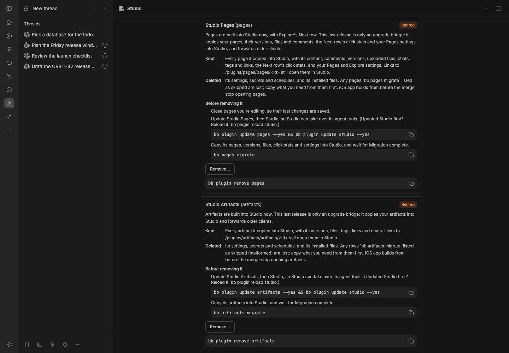

# Studio Pages (upgrade bridge)

> Part of **BB Studio**. See the [suite overview](../../README.md).

Pages are built into [Studio](../bb-studio/README.md#pages) now, with
[Explore](../bb-studio/README.md#explore) and its Next row. This last release
of the Pages plugin (`pages`, version 0.2.0) is only an upgrade bridge. BB
keeps each plugin's database, settings and files separately, so your pages,
their versions and uploaded files, the Next row's click stats and your Pages
settings stay here until the bridge copies them into Studio.

New installs don't need it. If you had Studio Pages installed, in this order
(moving from several separate add-ons at once? Follow
[docs/upgrade-unified-studio.md](../../docs/upgrade-unified-studio.md)
instead):

1. Close pages you're editing, so their last changes are saved.
2. Update both, Pages first:

   ```sh
   bb plugin update pages --yes
   bb plugin update studio --yes
   ```

   In that order Studio takes over the `pages_*` agent tools when it starts.
   BB lets only one plugin register a tool name, so a Studio that starts
   while the old Pages still holds them runs without them (its status says
   `tool "pages_read" is already registered by plugin "pages"`) until it's
   reloaded: `bb plugin reload studio`. If Pages was installed at a pinned
   commit, `bb plugin update` leaves it alone; see the upgrade guide for
   moving a pinned install.

3. Copy, and wait for "Migration complete":

   ```sh
   bb pages migrate
   ```

4. Check your pages in Studio (`bb studio pages list --all`, or the library
   filtered to pages), then remove the bridge:

   ```sh
   bb plugin remove pages   # or Studio → Setup → Retired plugins → Remove…
   ```

## What it does

- **Copies your pages into Studio**, oldest first. For each page it sends
  the uploaded files Studio doesn't have yet (one per call, up to 15 MB
  each), then its saved versions, then the page: its id, title, icon, place
  in the tree, project, times, archive and template state, its live content
  (the Yjs state, which holds its comments) and Markdown copy, its chats,
  request history and checklist hand-offs. Pages go in batches of 100 or
  8 MB of content, and a larger page goes alone, so a long-edited page never
  holds up the rest. Files a page links to by the old
  `/api/v1/plugins/pages/http/files` address point at Studio's
  `/api/v1/plugins/studio/http/pages/files` in the copy. A rerun sends only
  what's left: each copied page gets a marker, and Studio keeps one it
  already has. Malformed pages are listed by id with the reason and kept
  here.
- **Copies the Next row's click log.** Explore kept it in `explore.db`
  beside this plugin's database; the bridge copies it once, so
  `bb studio pages explore stats` keeps your history.
- **Copies your settings once.** **Saved versions per page** and Explore's
  four settings (Next row, things to explore, quick replies, preferred quick
  replies) go to Studio's settings, except any you already changed in
  Studio. They show here as "(moved to Studio)" only so the bridge can read
  them.
- **Retries on its own.** On start it copies, retrying with backoff while
  Studio is missing, off or starting. `bb pages migrate` runs the copy now
  and reports it.
- **Tells Studio's Setup page when it can go.** Setup lists it under
  **Retired plugins** and blocks **Remove…** until the copy is complete.
- **Forwards older clients.** iOS builds from before the merge call `pages`
  RPCs; threads and pages hold `/api/v1/plugins/pages/http/files` URLs. The
  bridge answers the RPCs from Studio and redirects the file, upload and
  Mermaid URLs to Studio's once the copy is complete. Old `@page` mention
  pills in existing threads resolve through Studio too.

It has no UI, agent tools, commands or skill. Studio registers the page
editor, the thread's **Pages** tab, the header link back to a page, the
`::page` card, the `pages_*` tools, the `pages` and `explore` skills, the
`@page` mention and the Next row under the same names. BB refuses a tool name
that two plugins register. The CLI moves to `bb studio pages …`, and
`bb pages explore stats` to `bb studio pages explore stats`.

Your tags, tabs, links, item chats and backups need no copy: Studio keeps
them, and pages keep their `pages:<id>` identity. Links to
`/plugins/pages/pages/<id>` open the page in Studio.

## Staged preview



Captured from a staged BB (`node scripts/staged-bb.mjs start --ref 6f85cdb2`,
every old add-on installed pinned to that pre-merge commit) after following
[the upgrade guide](../../docs/upgrade-unified-studio.md): pages with a
comment thread, two saved versions, an uploaded file and an embedded drawing,
a Next row click and changed Pages settings, made with the 0.1.0 plugin, then
`bb pages migrate` reported Migration complete. Studio's Setup page lists
Studio Pages under **Retired plugins** with what removing it keeps and
deletes, the close-pages, update and `bb pages migrate` steps, and
**Remove…** available. Recapture with `BB_CAPTURE_ONLY=pages-bridge`.

## Development

```sh
pnpm --filter @bb-studio/pages test
pnpm --filter @bb-studio/pages typecheck
```

The copy is in [`src/migrate.ts`](src/migrate.ts). Studio's side is the
`pages.missingFiles`, `pages.importFile`, `pages.importSnapshots`,
`pages.importRows`, `pages.importSettings` and
`explore.importNextSuggestions` RPCs in
[`packages/bb-studio/src/pages/server.ts`](../bb-studio/src/pages/server.ts)
and [`import.ts`](../bb-studio/src/pages/import.ts).
