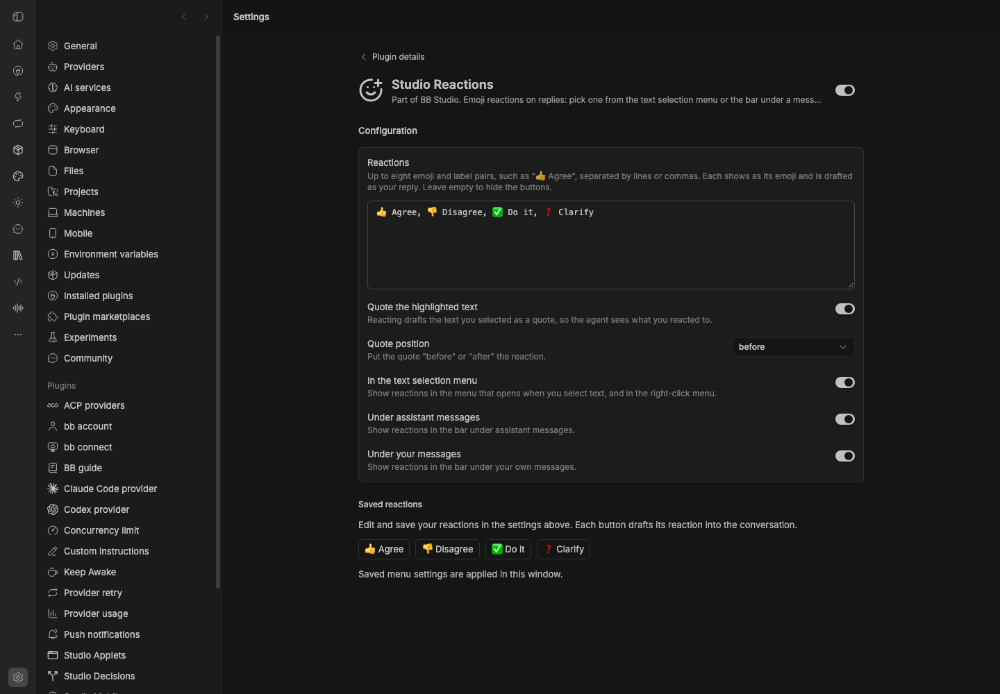

# Studio Reactions

> **Studio Reactions** is part of **[BB Studio](../../README.md)**. It works on its own and doesn't need the Studio collection.

Emoji reactions on replies, in the text selection menu and the bar under each
message. Its plugin id is `emoji-react`.

Select text in a reply. The floating selection menu (next to "Add to chat")
shows one emoji button per reaction. Click one and the composer gets a draft,
then focus:

```
> <the highlighted text>

👍 Agree
```

Buttons show the emoji only. The draft uses the full item text. An item can be
just an emoji (`🚀`); then the draft is that emoji.

The draft goes to the composer for the message's thread, in the main view or a
split. If that thread has none open, a new-thread composer takes it. Another
thread's composer never does. With no usable composer, a toast asks you to open
the thread's composer.

**Quote position.** With `before` (default) the quote comes first, then the
reaction. With `after` the reaction comes first, then the quote. If you
already typed a draft, `after` puts the reaction between your text and the
quote.

## Quick replies from the agent

Studio Reactions no longer asks agents to suggest reactions. Studio Pages'
[Next row](../bb-studio-pages/README.md#next-row) offers quick replies instead;
set them with **Explore: Offer quick replies** and **Explore: Preferred quick
replies** in Pages' settings. Older replies that end with a
`::reactions{items="…"}` line still render it as reaction buttons, so the raw
line never shows while the plugin is enabled.

## Staged preview



Captured from a staged stable BB at commit `6f85cdb`. The native settings
form is the only reaction editor. It shows the default reaction list (Agree,
Disagree, Do it, Clarify), quoting before the reaction, and all three location
toggles enabled. The saved preview below confirms these menu settings are
applied in this window.

## Settings

Edit these in BB's settings form for the plugin, or with the CLI.

| Setting | Key | Default |
| --- | --- | --- |
| Reactions: up to 8 `emoji label` items, separated by lines or commas. Empty removes the buttons. | `emojiItems` | `👍 Agree, 👎 Disagree, ✅ Do it, ❓ Clarify` |
| Quote the highlighted text | `quoteSelection` | on |
| Quote position: `before` or `after` the reaction | `quotePosition` | `before` |
| In the text selection menu (and the right-click menu) | `showInSelectionMenu` | on |
| Under assistant messages | `showInAssistantBar` | on |
| Under your messages | `showInUserBar` | on |

If all three location toggles are off, no reactions show.

```sh
bb plugin config emoji-react set emojiItems "👍 Agree, 👎 Disagree, ✅ Do it"
bb plugin config emoji-react set quotePosition after
bb plugin config emoji-react set showInUserBar false
bb plugin reload emoji-react
```

The plugin has no CLI commands of its own and no agent tools.

Message menus read the settings once when the plugin's frontend loads. The
**Saved reactions** section previews the stored list and says whether this
window still uses older settings; **Reload window to apply** refreshes the
menus without disabling the plugin. Other open windows update on their next
reload.

## How it works

- `app.tsx` registers one `messageAction` per reaction. It reads the settings
  synchronously at setup (the default list if the server is unreachable).
- The kit's `ComposerBridge` registers each mounted composer, and
  `composerFor(threadId)` picks the one to draft into.
- `src/action-decoration.ts` swaps the plugin's icon for the emoji in message
  bars and removes it from the selection menu. It targets only this plugin's
  actions and restores everything when the plugin generation ends.
- `server.ts` defines the settings. `src/smart-reactions.ts` parses legacy
  `::reactions` lines, which `app.tsx` renders as buttons.

## Develop

```sh
bb plugin install .    # register
bb plugin dev          # watch loop: rebuild + reload on save
pnpm typecheck
pnpm test
pnpm build             # self-contained dist/
```
