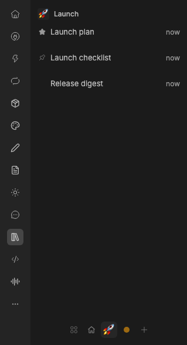
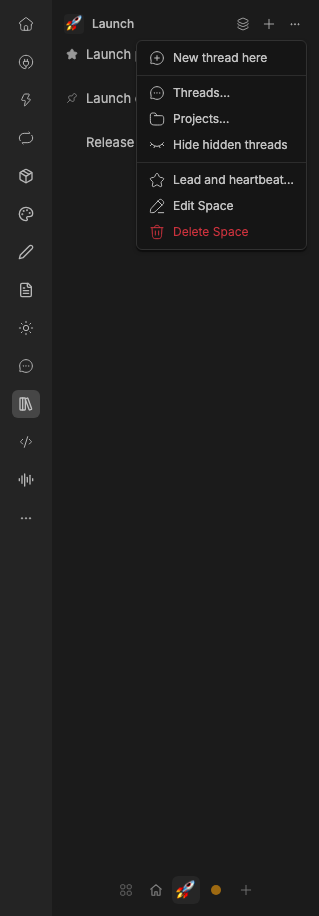

# Studio Sidebar

> **Studio Sidebar** is part of **BB Studio**, a suite of plugins for writing, talking, drawing, and keeping what your agents make. See the [suite overview](../../README.md).

Studio Sidebar replaces BB's thread list with one organized by
[Studio](../bb-studio) Space. Its plugin id is `thread-list-plus`. It needs
Studio, BB 0.45 or newer and Plugin SDK 0.6.15 or newer.

## Install

Install the plugin in BB, then choose **Studio Sidebar** in **Settings →
Appearance → Sidebar → Thread list provider**. BB's own Thread List plugin
stays installed, for its project, section and machine views.

## Features

- **Studio sections above your threads.** A Studio app can add a section at
  the top, in the same scroll area. (Studio hides its tabs section here: open
  items live in Studio's own tabs.)
- **One Space at a time**, like Arc. Studio's own **Spaces** section steps
  aside while this list shows.
- **Switcher.** A row of dots at the bottom of the list. The first, a grid,
  is **All**: every Space stacked in Studio's order, each collapsible by its
  heading. Then Home (the default Space) and one dot per Space (its emoji, or
  a dot in its colour). Hover for the name; **+** makes a new Space. An amber
  mark on a dot or heading means a thread there needs you.
- **Switch Spaces** with **⌃⌥←** and **⌃⌥→** (not in text fields) or a
  horizontal two-finger swipe over the list. Opening a thread from elsewhere
  shows its Space. The choice is a synced preference.
- **Inside a Space**, top to bottom: the **lead**, with a star instead of a
  status dot; pinned threads, in pin order, with a pin; then the other
  threads, those that need you first, then newest. Sub-threads nest under
  their parent and fold with the chevron. Threads in no Space belong to Home.
  The Chief of Staff (Home's lead) stays at the top of every other Space.
- **Two-line rows.** Line one: a status dot (amber needs you, green working,
  red unread error, blue unread result; none when read and idle), the title,
  and the age, or a **Needs you**, **Failed** or **Done** pill. Line two: the
  thread's latest progress from Studio, muted, red for a failure and amber
  when blocked. Click to open; ⌘/Ctrl-click or middle-click opens a split.
- **Space heading.** On hover, **Browse** searches the Space's Studio items
  and archived threads together; **+** starts a thread in the Space's default
  project or makes a Studio item of any kind; **⋯** has **New thread here**,
  **Threads…**, **Projects…**, **Lead and heartbeat…**, **Edit Space** and
  **Delete Space**.
- **Thread menu** (right-click or the hover **⋯**): Open in split, Pin,
  Mark as read or unread, Rename (inline), Copy link, **Move to Space**,
  **Promote** (Space lead or Chief of Staff), Hide, Archive and Delete. A lead
  has no Archive or Hide; remove it as lead first.
- **Move to Space** by menu, or by dragging a thread onto a Space's heading or
  its dot in the switcher. A thread belongs to one Space; leads don't drag.
- **Hidden threads.** **Hide** takes a thread and its sub-threads out of its
  Space. The Space's **⋯** offers **Show N hidden threads** until the window
  reloads, and **Hide hidden threads** to put them away again; a shown one
  offers **Unhide**. Pinned threads, the open thread and leads always show.

## CLI and settings

`bb thread-list-plus prefs list | get <key> | set <key> <json> | reset <key>`
reads and changes the preferences: `currentSpace`, `hiddenThreads`,
`collapsedThreads` and `collapsedSpaces`. For example
`bb thread-list-plus prefs set currentSpace '"all"'`. `prefs list --json` also
reports `organizationMode` as `space`, for clients that ask. The plugin
defines no agent tools and no `settings.define` entries.

## Staged preview



Captured from the sidebar of a staged BB (`node scripts/staged-bb.mjs start`),
with Studio Sidebar as the thread list provider. The capture creates two Spaces, Launch (🚀) and Research, and adds
"Launch plan", "Launch checklist", and "Release digest" to Launch, and "Paper
notes" and "Atlas weekly sync" to Research. It makes Launch plan the Space's
lead and pins Launch checklist, then shows Launch. The live check verifies
that only Launch shows, with its threads and emoji, that the lead comes first
with a star and the pin next with a pin, that every row has its status dot,
and that the switcher lists All, then Launch before Research, with Launch
current.



The hidden-threads capture hides "Release digest" from its row's right-click
menu, checks that it leaves Launch, shows it again from Launch's **⋯**
(**Show 1 hidden thread**), and leaves that menu open on **Hide hidden
threads**.

## Development

```sh
pnpm --filter @bb-studio/thread-list-plus typecheck
pnpm --filter @bb-studio/thread-list-plus test
```

`src/model.ts` holds the pure logic (Space placement, layout, row states, the
switcher's order, hidden threads); `src/studio.ts` talks to Studio's RPCs
(`spaces`, `space_of_threads`, `space_lead`, `space_set_lead`, `spaceMembers`,
`spaceTree`, `thread_lines`) and this plugin's preferences.
