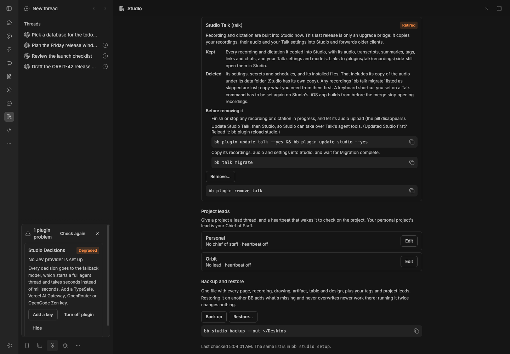

# Studio Talk (upgrade bridge)

> Part of **BB Studio**. See the [suite overview](../../README.md).

Recording and dictation are built into [Studio](../bb-studio/README.md#recordings)
now. This last release of the Talk plugin (`talk`, version 0.2.0) is only an
upgrade bridge. BB keeps each plugin's database, settings and files
separately, so your recordings, their audio and your Talk settings stay here
until the bridge copies them into Studio.

New installs don't need it. If you had Studio Talk installed, in this order:

1. Finish or stop any recording or dictation in progress, and wait for the
   pill to go away (its audio has uploaded). The recorder is in the Talk
   plugin until it's updated.
2. Update both, Talk first:

   ```sh
   bb plugin update talk --yes
   bb plugin update studio --yes
   ```

   In that order Studio takes over the `talk_*` agent tools when it starts.
   BB lets only one plugin register a tool name, so a Studio that starts
   while the old Talk still holds them runs without them (its status says
   `tool "talk_make_notes" is already registered by plugin "talk"`) until
   it's reloaded: `bb plugin reload studio`.

3. Copy, and wait for "Migration complete":

   ```sh
   bb talk migrate
   ```

4. Check your recordings in Studio (`bb studio recordings list`, or the
   library filtered to recordings), then remove the bridge:

   ```sh
   bb plugin remove talk   # or Studio → Setup → Retired plugins → Remove…
   ```

## What it does

- **Copies your audio into Studio.** Each segment's file under
  `<dataDir>/plugins/talk/audio/` goes to Studio's own folder
  (`<dataDir>/plugins/studio/talk/audio/`) in 4 MB pieces read from disk one
  at a time, so a long recording never sits in memory. Studio writes each
  piece durably and keeps a file only once its size and SHA-256 match, so a
  copy that stops (Studio restarting, a crash) resumes where it stopped, and
  a file Studio already has is never sent again. Before copying anything it
  checks that Studio's disk has room for what's left plus 256 MB, and stops
  with a clear message if not. The originals stay here; removing the plugin
  deletes them.
- **Then the recordings.** Each recording goes with its id, title, kind,
  status, project, thread, times, archive state, summary, notes page and
  segments with their transcripts and cleaned text. A piece the old plugin
  hadn't transcribed yet stays pending, and Studio transcribes it. A
  dictation whose audio had expired comes over without audio, as it was. A
  rerun sends only what's left: each copied recording gets a marker, and
  Studio keeps one it already has. Malformed rows are listed by id with the
  reason and kept here.
- **Copies your settings once.** Replace built-in dictation, segment length,
  auto-title, automatic summaries, the hold-to-talk key, dictation audio
  retention and the three model choices go to Studio's settings, except any
  you already changed in Studio. They show here as "(moved to Studio)" only
  so the bridge can read them.
- **Retries on its own.** On start it copies, retrying with backoff while
  Studio is missing, off or starting. `bb talk migrate` runs the copy now
  and reports it.
- **Tells Studio's Setup page when it can go.** Setup lists it under
  **Retired plugins** and blocks **Remove…** until the copy is complete.
- **Forwards older clients.** iOS builds from before the merge, and a
  browser tab still running the old recorder, call `talk` RPCs; threads hold
  `/api/v1/plugins/talk/http/audio` URLs. The bridge answers the RPCs from
  Studio and redirects the audio, transcript and audio-export URLs to
  Studio's once the copy is complete. Old `@recordings` mention pills in
  existing threads resolve through Studio too.

It has no UI, agent tools, commands or skill. Studio registers the recorder
and pill, the composer microphone, hold-to-talk, dictation fields, the
`talk_*` tools, the `talk` skill, the `@recordings` mention, the
`::recording` card and the *Talk:* commands under the same names. BB refuses
a tool name that two plugins register. The CLI moves to
`bb studio recordings …`.

Command ids are scoped by plugin, so the commands are Studio's now: a
keyboard shortcut you set on *Talk: Start or finish dictation* (or the other
two) has to be set again. Your tags, tabs, links and item chats need no copy:
Studio keeps them, and recordings keep their `talk:<id>` identity. Links to
`/plugins/talk/recordings/<id>` open the recording in Studio. Audio set aside
in the browser (unsent pieces) carries over: Studio reads the same browser
store and shows it as a banner in its library filtered to recordings.

## Staged preview



Captured from a staged BB (`node scripts/staged-bb.mjs start`) after
`bb talk migrate` reported Migration complete for a recording with spoken
audio made with the 0.1.0 plugin. Studio's Setup page lists Studio Talk
under **Retired plugins** with what removing it keeps and deletes, the
finish-recordings, update and `bb talk migrate` steps, and **Remove…**
available. Recapture with `BB_CAPTURE_ONLY=talk-bridge`.

## Development

```sh
pnpm --filter @bb-studio/talk test
pnpm --filter @bb-studio/talk typecheck
```

The copy is in [`src/migrate.ts`](src/migrate.ts); its tests run it against
Studio's real recording store and audio import. Studio's side is the
`recordings.missingAudio`, `recordings.importAudio`, `recordings.importRows`
and `recordings.importSettings` RPCs in
[`packages/bb-studio/src/talk/server.ts`](../bb-studio/src/talk/server.ts)
and [`server/import.ts`](../bb-studio/src/talk/server/import.ts).
