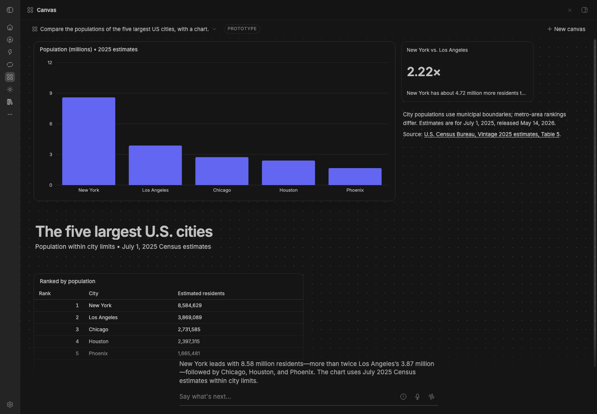

# BB Studio Visual Chat (prototype)

Part of BB Studio. Visual Chat is a chat where the agent answers on a board
(a canvas), like someone at a whiteboard. It isn't a transcript. Each turn, the agent edits the board to
show what matters now: it adds, changes and removes charts, numbers,
tables, captions and generated widgets. Every change animates, so you can
see what moved. You never arrange the board.

BB Studio Visual Chat is its own plugin (id `studio-visual-chat`) and is off
unless you install it. It needs Studio. It was BB Studio Canvas (id
`studio-canvas`), and before that Canvas (id `canvas`); see
[Moving from BB Studio Canvas](#moving-from-bb-studio-canvas).

## Staged preview



The canvas page in a staged BB, after one real agent turn on the staged
BB's default provider: the agent built the board with the canvas tools,
and its short reply is the caption line at the bottom.

## Use it

Open **Visual Chat** in BB's rail, or go to `/plugins/studio-visual-chat/canvas`. Type what
you want to look at. The chat is at the bottom: the agent's latest reply
over a composer drawn like BB's own. That's a rounded box with a multi-line
field, and under it a row with the model, the versions, a history peek,
Talk's dictation mic, the hands-free button and a round send button.

- **Text:** each message goes to the canvas's thread. Enter sends and
  Shift+Enter starts a new line. A message sent while the agent works waits
  its turn.
- **No attachments yet:** the composer has no attach control, because a
  canvas message is text only (`canvas.send`).
- **The chat picker** (the chat's name, top left) lists your chats and has a
  search field. ↑ ↓ and Enter pick a chat. Esc clears the search first; a
  second Esc closes the picker.
- **Dictation:** the mic dictates into the field with Studio's Talk. While
  you talk, Talk's controls (timer, cancel, stop-and-insert, and a ▾ menu)
  sit in the field, as in the thread composer. The text lands in the field
  for you to edit or send; nothing is sent on its own.
- **Hands-free voice:** starts Studio's hands-free voice speaking for the
  canvas. The voice edits the board while it talks, and passes deeper work
  to the canvas's thread, which edits the board when it's done.

## Its own window

In a BB that can open plugins in windows of their own (the BB Studio desktop
app), Visual Chat is also an app window. Its page keeps its address but is
off the rail and out of the command palette
(`experimental_hideFromNavigation: true`). Stock BB refuses that field, so
there the page stays on the rail.

- Open it with **Open in window** in the page's header (it shows the chat on
  the page; the page's root shows your last chat), from BB Studio's launcher
  (Option+Space; type "visual", "canvas" or "board"), or **Visual Chat: Open
  window** in the command palette.
- **No global shortcut by default.** The launcher replaces the old ⌥⇧V. To
  have one, set **Settings → Plugins → BB Studio Visual Chat → Window
  shortcut** (written like `Control+Alt+V`); it then shows and hides the
  window from any app. A stored `Alt+Shift+V` (the old default) counts as
  none. To use that key on purpose, write it as `Shift+Alt+V`.
- **One header row, which is the title bar.** The window has no system title
  bar. On macOS the traffic lights sit at the left of the header, followed by
  the chat picker; **Open thread in BB**, **New chat** and **?** are on the
  right. The model is in the composer's row only, as in BB. Drag the row to move the window. A browser popup
  keeps the browser's frame and the row starts at the left edge.
- It opens on your last chat, where you left the window and at that size
  (never smaller than 560×420).
- **Open thread in BB** shows the chat's thread in BB's main window.
- The quick card's **Expand** opens the chat in the window.
- **Shortcuts** (Ctrl for ⌘ on Windows and Linux); **?** lists them:

  | Key | Does |
  | --- | --- |
  | ⌘N | New chat |
  | ⌘K | Switch chat: opens the chat picker with its search focused |
  | ⌘L | Focus the message box |
  | ⇧⌘O | Open thread in BB |
  | ⌘W | Close the window |
  | Esc | In a search field: clear it, then close it |

  They work only in the window. On the page in BB's main window those keys
  stay BB's; only the Esc rule applies there too.
- The window's composer has no dictation mic and no hands-free button.
  Both are Studio's and run in BB's main window, which this window is not
  part of. Use them on the quick card, or type.

On stable BB there is no window and no **Open in window**: Visual Chat is
its page in the rail, as described above.

## Quick card

For a quick question from anywhere in BB, press **⌃⇧Space** (Ctrl+Shift+Space
on Windows and Linux), or run **Visual Chat: Ask** from the command palette. A
card opens over the page, bottom right, with the field focused. Until you
move it, it never covers a composer: it sits above a thread's composer, below
the home page's one near the top, or beside or shorter when neither fits; with
no composer it ends a little above the window's bottom. Type and
press Enter, and the board streams into the card. Press the shortcut again,
or Esc, to close it.

- **A fresh chat each time.** Every summon starts a new chat. Each chat is an
  ordinary canvas, so it's in the chat list and on the full page too, and
  closing the card never loses anything.
- **‹ ›** in its header page through the chat's versions. Past the first
  version, ‹ goes to the chat before it in the list, so on a fresh card ‹
  brings back the last chat. Past the newest chat, › starts a new one. ← and
  → do the same while the field is empty.
- **Expand** opens the same chat on the full page and closes the card.
- **Esc** closes the card when focus is inside it. It doesn't close the card
  while the field holds a draft or dictation is on, and it never reaches
  BB's own Esc (back).
- **Drag** the header to move the card, and drag any edge or corner to
  resize it. Each window remembers the card's place and size (a new window
  starts from the last one saved), and the card stays on screen when the
  window resizes. Until you resize it, it takes about 40% of the window.
- It's a non-modal dialog: focus moves into the field on open and back where
  it was on close. While closed, it renders nothing and takes no keys.
- **The shortcut** doesn't clash with BB's defaults (⌘K is BB's thread search,
  ⌘⇧P the palette) or Studio's (⌘⇧K is Studio's search). It also stays clear
  of common macOS ones: ⌘Space (Spotlight or Raycast), ⌥Space (the ChatGPT
  and Claude apps) and ⌘⇧Space (1Password's Quick Access). Rebind it in
  **Settings → Keyboard**.

## How it works

- **The agent** is an ordinary BB thread, hidden, in your personal
  project. Visual Chat makes it when you start a canvas, on Claude Code's
  Sonnet 5.5 (`claude-sonnet-5-5`). The thread is the canvas's memory; you
  see the board. Canvases made before keep the model their thread has.
- **The model picker** (in the composer's row, the one place the model is shown) lists the providers and models BB has,
  grouped by provider, with reasoning levels when a model has more than one.
  The pick is saved per canvas and applies from the next message: another
  model from the same provider changes the thread in place; another
  provider starts a fresh hidden thread that gets the rules, the guide, the
  board and the last few lines of talk.
- **The board is one page** the agent designs for each answer: HTML and CSS
  shaped by the content (a plan runs along a timeline, a showcase is a wall
  of pictures, a comparison sits side by side). It's in this plugin's own
  database, with a short log of what changed in each turn.
- **The page** renders in a sandboxed frame the size of the board (scripts
  in an opaque origin; nothing loads from the network but https pictures),
  with the style's tokens (`--cv-*`), the kit's classes and declarative
  charts (`data-chart`: line, columns, bars, stars, US tile maps, timelines
  and more; `src/ui/kit.ts`). It scrolls when it's taller than the screen.
- **Filling the screen:** in a page the type scale grows with the screen,
  `cv-fill` is a full-height layout (header, a stretching middle row,
  footer), and `cv.viewport()` gives the screen's size. A page that stops
  short is zoomed up (at most 1.4×) as far as it still fits.
- **Motion:** the agent marks parts with `data-cv-id`. When a new version
  arrives, the frame keeps its document and morphs the page: parts with the
  same id glide (FLIP) to their new place, changed ones fade their new
  content in, new ones enter and gone ones leave from where they were. A
  part whose id changed but shows the same picture or text glides too, and
  `canvas_page` tells the agent when it renamed most parts.
- **The canvas tools:** `canvas_page` (the whole board), `canvas_patch` (one
  part by id), `canvas_read`, `canvas_style`, `canvas_image`,
  `canvas_images` and `canvas_guide`. Only canvas threads get them, with the canvas rules and
  the `canvas` skill, and each works only on the calling thread's board.
  Hands-free voice gets the same tools.
- **The page streams:** for a new or rewritten page, the agent writes the
  page first, in its reply, as one fenced html block (`` ```html ``,
  optionally with `style=… title="…"`), then in the same response looks up
  every picture in one `canvas_images` call, and when that returns replies
  with only the caption. BB writes a reply's text to the thread's event log
  as it's generated (`item/agentMessage/delta`); tool input doesn't stream,
  which is why the page goes in the reply and not in `canvas_page`. On
  Claude Code, reply text that follows a tool result reaches the log in one
  burst of about 2,000 characters, so the page comes before any tool call. While a canvas thread
  works, the server polls its log (`threads.events.list` after the last
  seq, every ~180 ms), assembles the text, takes the growing html block,
  repairs it (a half tag, attribute, entity or comment is dropped, a half
  `<style>` keeps its finished rules, a half `<script>` is dropped, open
  elements are closed) and publishes it over realtime, at most about 6
  times a second (`src/stream.ts`). The page reveals each `data-cv-id` part
  once its element is closed, with a short entrance; an open part with no
  finished part inside stays hidden (in a `cv-wall`, a pulsing tile holds
  its place), and an open part that holds finished parts shows them.
  Finished parts stay as they are on screen while the rest arrives, and
  found pictures go into the streamed cards as soon as `canvas_images`
  returns. The moment the html block closes, it's committed as the page
  and the turn's version, as `canvas_page` would make it, and the board is
  final: the finished page lands on the streamed one with no flash, and
  pictures that arrive after it fade into their cards in place. A
  follow-up on a board that already shows a page doesn't clear it: each
  part the new page has finished that's on the board too takes its new
  content in place, and the finished page then morphs from the board
  (parts glide, enter and leave). When the
  thread goes idle, the caption (the reply's words outside the block) and
  anything that changed since (pictures, patches) fill in that same version;
  idle never adds a second one. If the turn ends without a closing fence
  (or the final text is missing), what arrived is committed at idle,
  repaired; with no html at all the board stays and the reply is
  the caption.
- **Which way a page goes up:** a new or rewritten page is the html block in
  the reply; `canvas_patch` changes one part; `canvas_page` is for a message
  from the hands-free voice (the voice reads the reply back, so that reply
  is only the caption). Older boards, versions and the voice tools work as
  before.
- **Building blocks:** `data-block="card"` (a picture with its title,
  rating with source and a line), `stat` (a big figure with its evidence),
  `step` (a timeline row), `side` (a comparison column), `quote` and
  `placeholder`, declared in a few `data-*` attributes the kit expands, in
  the containers `cv-wall`, `cv-steps` and `cv-sides`. They're optional.
- **Embeds:** a real map, video or song. The page marks an empty placeholder
  (`<div data-embed="map" data-q="retro game stores near 10604" data-cv-id="map">`;
  also `point` with `data-lat`, `data-lon` and `data-label`, `youtube` with
  `data-id`, and `spotify` with `data-kind` and `data-id`), and Visual Chat's
  own UI frames the real thing over it (`src/ui/embeds.ts`). The page frame
  itself still frames nothing. Visual Chat builds each URL from those fields
  for four fixed origins (Google Maps' keyless `output=embed` search, the
  OpenStreetMap export embed with a marker, youtube-nocookie and Spotify), so
  a URL from the agent is never used. Each embed has its own sandbox
  (`allow-scripts allow-same-origin allow-popups allow-presentation`, never
  top navigation; its origin isn't BB's), and loads lazily once its part is
  committed, never while it streams. The page reports where each placeholder
  sits as it scrolls, resizes, zooms or gets a new version. The embeds are
  clipped to the board, hide while parts glide, fade back in, and keep their
  frame (no reload) while the part and its URL stay the same.
- **Webpage parts:** `<div data-embed="page" data-url="https://…" data-cv-id="…">`
  shows a webpage, but only one whose URL came from the user in this chat, or
  from the agent's own web fetch or web search results in the turn that put it
  on the board (the thread's event log, compared as normalised URLs). A link
  that only appears inside a fetched page doesn't count, and an unverified URL
  shows only "Link not verified"; a URL verified once stays verified for the
  chat (`src/webpage.ts`, `canvas.webpage`). The server then GETs the page once
  (public addresses only, as for pictures) and caches it for a day: a page
  without X-Frame-Options and with no closed `frame-ancestors` is framed over
  the placeholder with sandbox `allow-scripts allow-same-origin` (no popups,
  forms, downloads or top navigation) and no referrer; any other gets a link
  card from its OpenGraph title, site, summary and https picture. Most big
  sites refuse framing (GitHub, Reddit, X, Stack Overflow, the news sites);
  Wikipedia, docs sites and small blogs allow it. Both have an **Open** button
  that hands the URL to BB's `openUrl` when clicked: BB's browser beside the
  board on desktop when links open in BB, else the external browser. Nothing
  opens by itself, and nothing reads the page back to the agent. The framed
  page runs in BB's window session, not the Browser's signed-in one.
- **Pictures:** `canvas_images` looks a batch up in one call, in parallel;
  `canvas_image` finds one. Each returns an https address with alt text and
  its source. A query goes to Exa when an Exa API key is set, else to
  Wikipedia (its search API, then the best article's page image); a pageUrl
  takes that page's main picture (og:image, else the largest image). Found
  pictures are cached for a day, in memory and in the plugin's database.
  Each picture goes into the card whose `data-cv-id` is its key, on the
  page at once (so a draft shows them) and on every later version, so the
  agent never writes picture addresses into the page.
  Server-side fetches go only to public http(s) addresses: each
  hop's host is resolved once, every address checked, and the connection
  pinned to that address (so a resolver can't switch it after the check),
  with a time limit and a size cap. Picture addresses lose tracking
  parameters. Stars without a source read "my pick".
- **Exa API key:** a BB secret setting on this plugin, `exaApiKey`
  (**Settings → Plugins → BB Studio Visual Chat**, or `bb plugin config
  studio-visual-chat`). It's only sent to Exa: never logged, returned or put in
  an error. Without it, pictures come from Wikipedia.
- **Tool loading on Claude Code:** Claude Code defers every plugin tool
  behind its tool search unless `ENABLE_TOOL_SEARCH` says otherwise, which
  cost each turn a ToolSearch round. On its own threads only, Visual Chat
  sets `ENABLE_TOOL_SEARCH=auto` (through the SDK's
  `bb.providers.experimental_contributeEnv`), so tools load up front while
  their definitions stay under 10% of the context window, and Studio gives
  these threads none of its tools. Above the threshold Claude Code defers
  them after all; the instructions then name the exact `select:` query.
- **Styles:** Editorial (a magazine spread), Field notes (a designer's
  whiteboard) and Instrument (a control room) are token sets. The agent
  picks one per board, a style you ask for wins, and the top bar shows it.
- **BB's theme:** the board, the quick card and the page chrome use BB's
  theme tokens: background, foreground, card, muted text, border, fonts and
  radius (`src/theme.ts`, read live by `src/ui/bb-theme.ts`). So a board
  matches BB in light, in dark and in any palette, such as Nord or Dracula.
  A style is an accent layer on top: its type, its accent colour, its
  highlighter and its rules. It never brings its own background. Accents,
  chart series and good, bad and warning colours are fitted to BB's
  background, at 4.5:1 for text and 3:1 for marks. Charts lead with BB's
  primary colour when it has a hue. Otherwise they lead with the style's
  accent. The page frame and custom-item frames get the resolved tokens, and
  they restyle in place when BB's theme changes.
- **Title and caption:** the canvas's title is the topic the agent names
  (the fence line's `title`, or `canvas_page`'s), else the page's first
  heading. The caption is the reply's line after the html block; with
  `canvas_page` the agent sends it as `caption`, so it shows with the page,
  and its reply repeats it (the reply wins if it differs, and it's what a
  voice reads back). The caption is written to add what the board doesn't say;
  sentences that describe the board ("The board shows…") are dropped from
  it.
- **Versions:** each turn's finished board is saved as a version: its
  page, style, title, the message that led to it and the caption (a page
  still streaming and mid-turn patches aren't versions; a streamed page is
  saved when its block closes and completed at the turn's end). ‹ › and "3 / 7" beside the chat
  line page back and forward, with the same glide, and so do ← and → while
  the field is empty; hovering shows each version's message. A message
  sent from an old version continues from it: the board goes back to that
  version, the agent is told so, and the new version comes after the
  others, which stay. The last 50 are kept per canvas. A canvas from before
  versions starts with its board as it was as version 1 (a board of items
  shows as it was). `canvas_read` says when the user is looking at an old
  version.
- **Boards from before pages** (items placed by the old layout) still open
  and show as they were. The agent's next page replaces them.
- **One renderer, two hosts:** the frame document (its CSP, the boot script,
  the kit with morph, streaming and when page scripts run), the page poster
  and the embed overlay's logic (placement from the frame's rect reports,
  built embed URLs, webpage checks) are framework-free
  (`src/ui/renderer.ts`). The desktop page draws with them in React
  (`src/ui/page-frame.tsx`); the iOS app draws with the same code through a
  small DOM host (`src/ui/renderer-host.ts`), which `node build-ui.mjs` builds
  into one classic script, `bundle/canvas-renderer.js`. `canvas.renderer`
  serves it with its version (the first 16 hex of its SHA-256, so the same
  build always has the same version); a caller that sends the version it has
  gets no text back while it's current.
- **The user's screen:** a client that knows it (the iOS app) sends
  `client: { kind, width, height }` with `canvas.create` and `canvas.send`
  (`kind`: `phone`, `duo-folded`, `duo-unfolded` or `desktop`; the board's
  size in points). The agent gets one agent-only line with the message, such
  as "The user is on a phone, ~466×678: compose to stack cleanly below
  700px.", and the guide says what to do with it. The desktop page sends none.

## With Studio

The page reuses Studio's widget renderers, markdown and theme. They're
bundled into this plugin (`bundle/canvas-ui.js`, built by `node build-ui.mjs`),
so Visual Chat reads nothing of Studio's at runtime except through these:

- Studio's hands-free voice asks this plugin's `canvas.voice` and
  `canvas.voiceRun` RPCs when a session starts from a canvas thread.
- The page starts hands-free with a `bb-studio:handsfree-start` window
  event, and dictation uses Talk's `data-talk-field` events.

## Development

```sh
node build-ui.mjs   # after changing src/ui or the Studio files it uses; also builds bundle/canvas-renderer.js
```

`scripts/capture/canvas-demo.mjs` records four text turns and a hands-free
turn in a staged BB. `scripts/capture/canvas-directions.mjs` runs real turns in
one canvas and saves light and dark stills after each, with the style the
agent picked. `scripts/capture/canvas-composition.mjs` runs real turns at two
window sizes, light and dark, and can pause a page's morph for a
mid-animation still. `scripts/capture/canvas-stream-timing.mjs` runs one
prompt in new canvases on a real model and times the first visible content,
the first real card, the final page and the turn, with the model's rounds,
and can record the page building. `scripts/capture/canvas-demo-video.mjs`
records one real four-turn conversation, typed into the field, with no
cuts, and notes which parts each follow-up kept, added and removed. `scripts/capture/visual-chat-quick-video.mjs` records the quick card in
real use (summon from a thread, ask, Esc, summon again, ‹, Expand) and takes
stills over a thread in light, dark and a narrow window.

## Moving from BB Studio Canvas

A plugin's data is keyed by its id, so canvases made under BB Studio Canvas
stay in `<BB data dir>/plugins/studio-canvas/data.db` (and ones from the
first Canvas plugin in `<BB data dir>/plugins/canvas/data.db`). The first
time Visual Chat starts with no canvases of its own, it copies every canvas
in from the BB Studio Canvas file, or, when that file isn't there, from the
Canvas one: pages, items, changes, history, thread aliases, model choices
and found pictures, keeping their ids. Each canvas keeps its hidden thread,
so old links (`/plugins/studio-canvas/canvas/<threadId>` becomes
`/plugins/studio-visual-chat/canvas/<threadId>`) and hands-free voice find
it.

- It opens the old file read-only and never changes or deletes it.
- It runs once and records that it ran (`canvas_legacy_import`).
- Disable the old plugin before installing this one, so the two don't both
  run. You can uninstall the old one once you've checked your canvases.
- Settings don't move: they belong to the old plugin's id. Paste the Exa API
  key (if you use one) into BB Studio Visual Chat's `exaApiKey` setting.
