# Studio

> **Studio** is the core of **BB Studio**: pages, recordings, drawings, designs and artifacts are built in. See the [suite overview](../../README.md).

Studio opens on the collection: everything you and your agents make, including pages, Talk
recordings and dictations, drawings, designs and saved artifacts, and other plugins' items. Search across all of them, filter by
kind, project and tag, and hand any of them to an agent. Each BB project can have a lead thread
woken by a Heartbeat.

## Workspace

Studio opens on its workspace: items in tabs, without a conversation. The
Studio item list shows only as its new tab page: **+** opens it, and an item
opened from it takes its place, as in a browser. Items opened from the
sidebar or Studio search open as tabs too. Drag tabs or sidebar items to a pane's edge to split; drag onto
a tab bar to move or reorder. A tab's right-click menu offers split and move
commands, and separators resize with the mouse or arrow keys. Closing a tab
keeps the item. The workspace remembers the layout locally across visits and
refreshes. An item always opens as a tab: its own address, from a card in a
chat, **Open in Pages**, a link or a typed URL, opens the tab and leaves the
address for the workspace. Old list addresses, such as a kind's (`/plugins/studio/studio/page`),
open the new tab page on that kind.
Right-click a tab for Close, Close others, Close tabs to the right, Close all in
the pane, splits, moves to another pane, Rename, and Copy link.
Double-click a tab, or press F2 on it, to rename its item. The tab row shows
the item's own tools and status, such as a page saving or a recording paused;
the tab names the item, so its title isn't repeated, and Chat isn't offered.
Each tab row carries the active item's tools, such as Chat, beside its tabs.
With one pane, the tab row takes BB's title bar, so the item sits under a
single bar. Open items live here as tabs.
**Studio sidebar**: on the Studio panel, BB's sidebar shows Studio's list
in place of its thread list (thread list provider `studio/studio-items`,
"Studio (Studio)" in Settings → Appearance; it switches to the Bot's list
on leaving, see Bot). **+** at the top is Studio's New menu. Below
it, **All items** and each enabled kind (Setup → Kinds) with its item count,
then **Saved views**, **Tags** (with their colors and counts), **Pinned**
(pinned tabs) and **Recent** (the 15 most recently edited items). A kind,
view or tag opens the new tab page filtered by it; an item opens as a tab.
The row for the current filter or tab is highlighted, and each group
collapses from its heading.

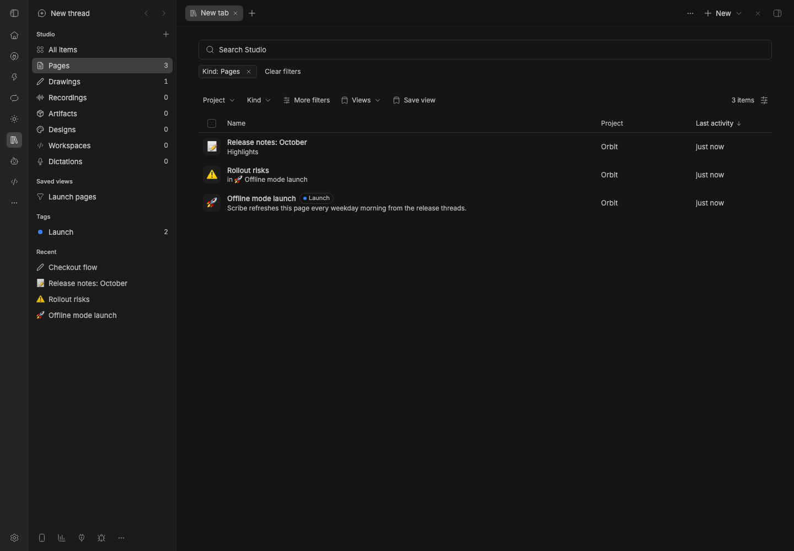

Conversation-side item views continue to work independently. At phone widths, a
pane picker shows one pane at a time while preserving the desktop arrangement.

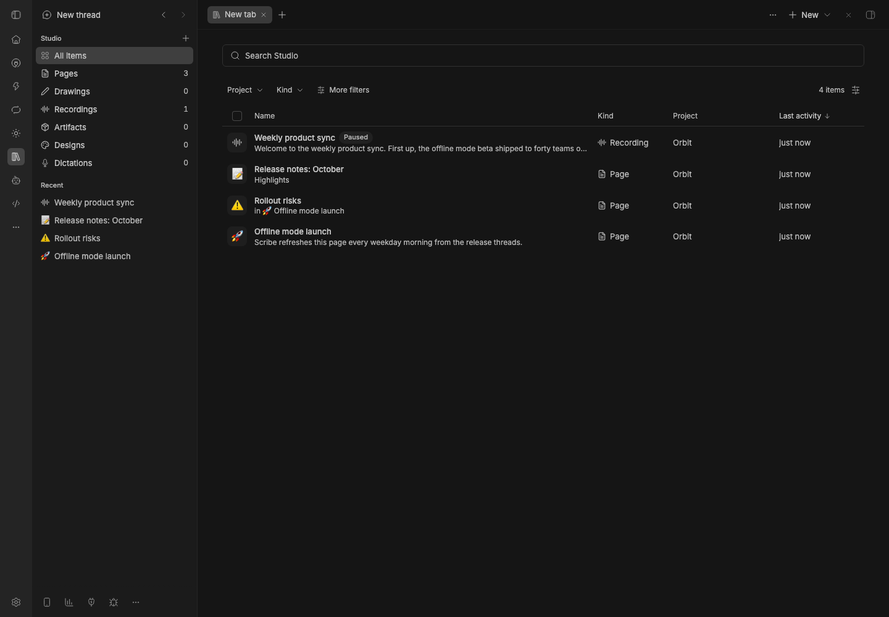

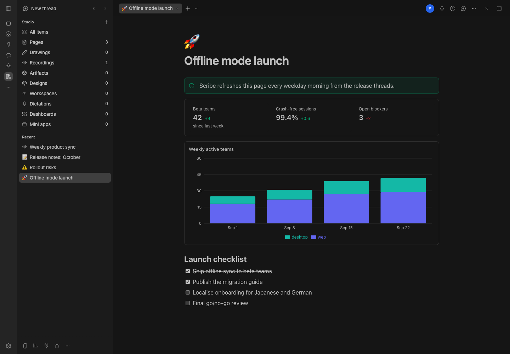

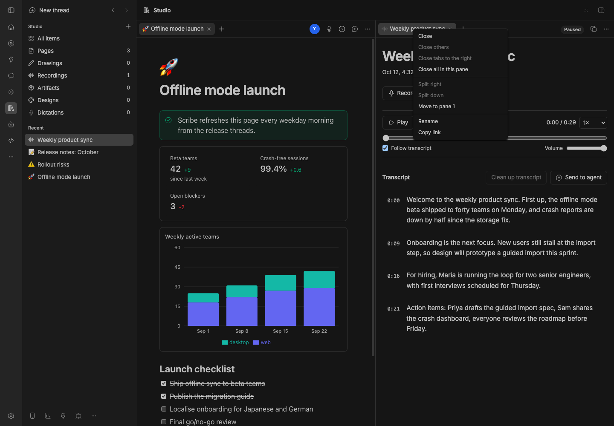

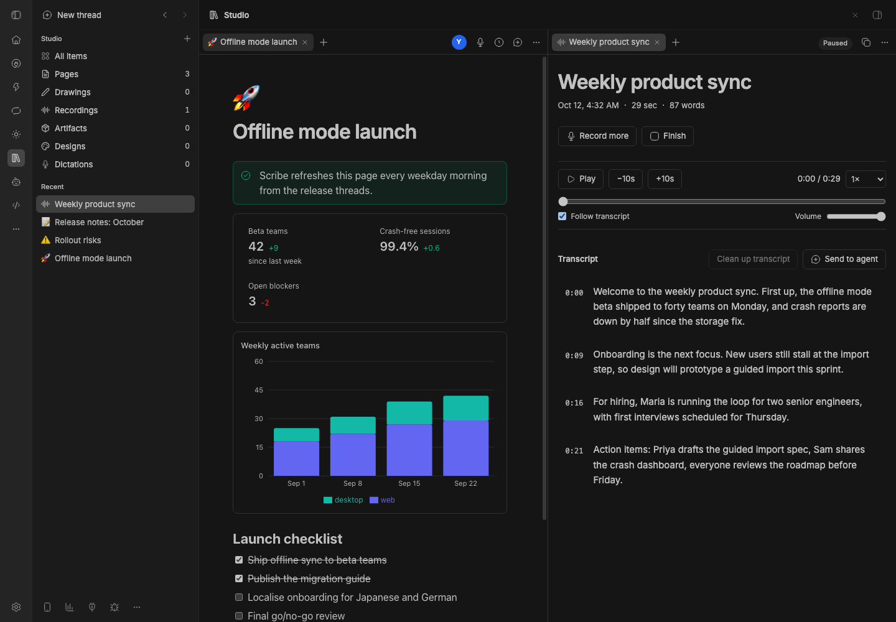

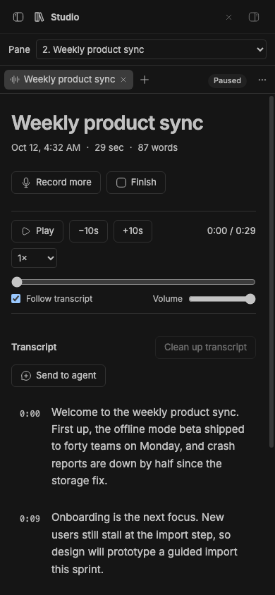

These staged captures check item opening, drag-to-split, layout restoration,
closing and reopening tabs, local editor toolbars, and title sizing after a
viewport change.

## Staged preview

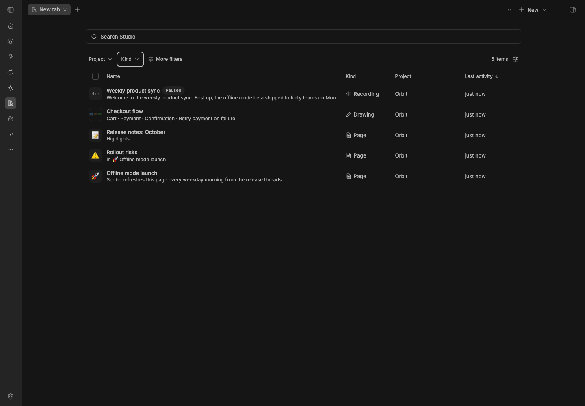

Captured from a staged BB (`node scripts/staged-bb.mjs start`): the Studio
collection as the workspace's new tab, a list with search and compact Project and
Kind menus above it.
Tags and Status are available under **More filters**. The rows show
a paused Talk recording, a drawing and three Orbit pages.

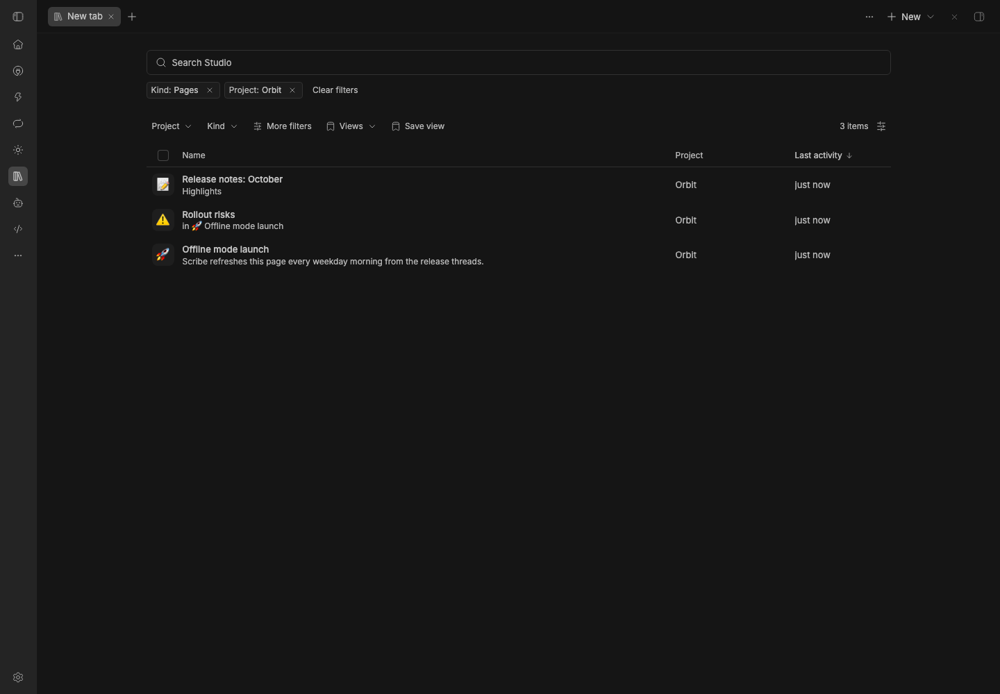

Selected filters appear below search, each with a remove button and an explicit
Include/Exclude menu. Clearing search keeps the filters; **Clear filters** keeps
the search text. **Save view** remembers the query, and **Views** appears once a
view exists. Query syntax such as `kind:page` still completes in search.

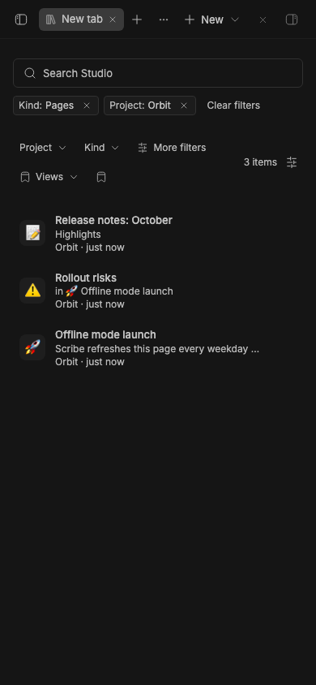

The same controls work at phone width. Both captures check menu selection,
a stored plural filter, text search, exclusion, project filtering, and saving
and reopening a view.

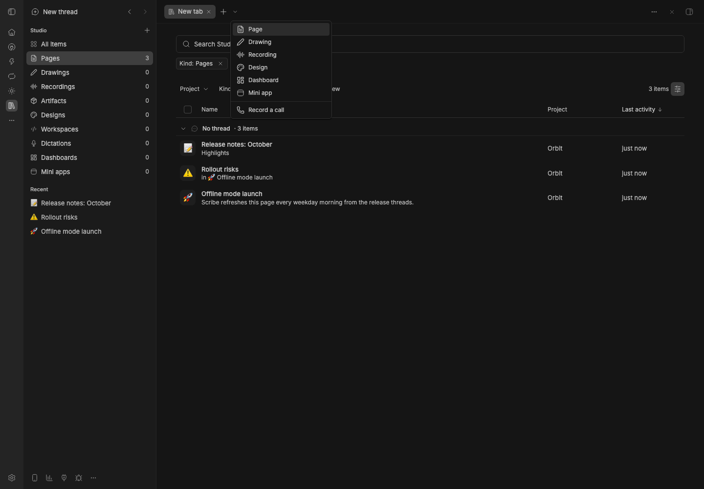

The New menu stays open to every available kind with a Pages filter active.
The capture checks that Drawings and Pages filters offer the same menu as the
unfiltered collection.

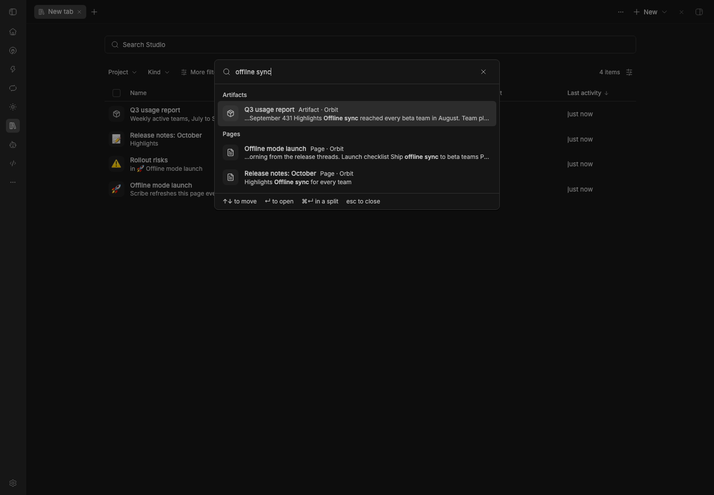

Studio search (Cmd/Ctrl+Shift+K) over the same staged project, searching
"offline sync": an HTML artifact and two pages match on their title or
content, each showing the matching text with the match in bold.

## Pages

Pages are built into Studio: collaborative documents you write together with
your agents, in a Notion-style block editor with live multiplayer editing,
comments, charts, embeds, version history and ordinary agent chats. They used
to be the separate Studio Pages plugin (`pages`). Pages keep that id as their
namespace (`pages:<id>`), so tags, tabs, links, chats and backups carry over.
A page opens as a Studio tab at `/plugins/studio/studio/pages/<id>`; links to
`/plugins/pages/pages/<id>`, in threads, pages, skills and BB's own
instructions, open the same tab. The library filtered to pages is their
collection. If you still have the old plugin, see
[docs/upgrade-unified-studio.md](../../docs/upgrade-unified-studio.md).

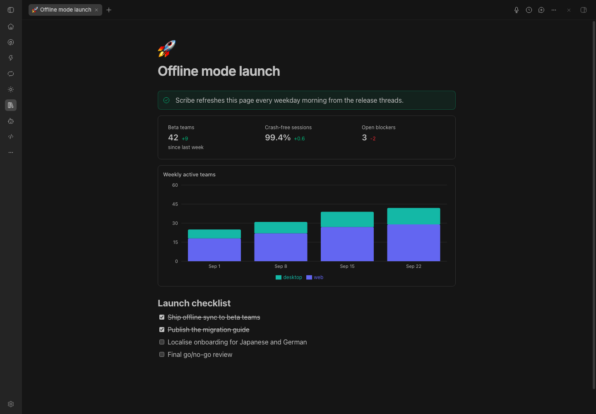

A seeded "Offline mode launch" page, opened from its old
`/plugins/pages/pages/<id>` address, lands as a Studio tab: a tip callout, a
stats block, a stacked bar chart of weekly active teams and a launch
checklist, with Dictate, Version history, Comments and the page menu in the
tab's row. Captured in a staged BB (stable BB 0.46.0). Recapture with `BB_CAPTURE_ONLY=pages`.

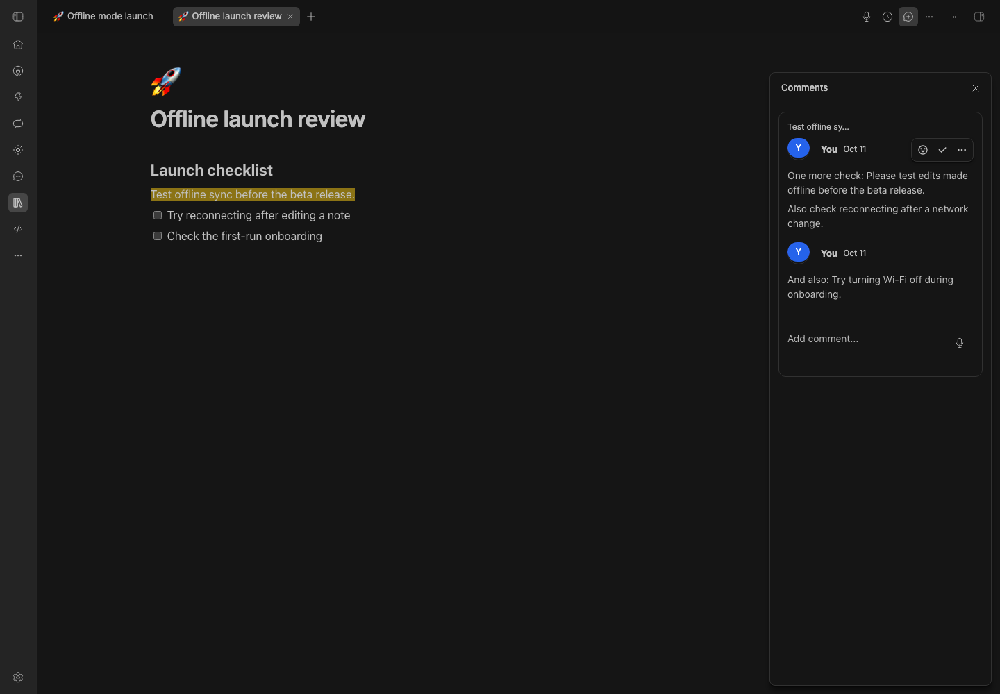

An anchored comment and a reply, both dictated through Talk into the comment
drafts and saved explicitly; the page body is unchanged. The microphone also
fits the [phone comment sheet](assets/pages-comments-mobile.png). Recapture
with `BB_CAPTURE_ONLY=pages-comments`.

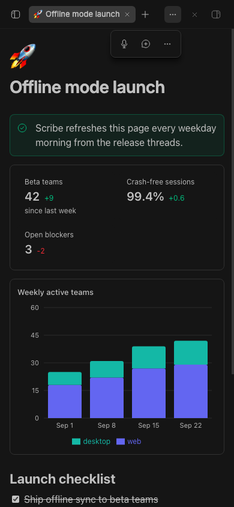

The compact page header at 390 pixels, with **Item actions** open.

### What you get

- **A block editor.** Built on [BlockNote](https://www.blocknotejs.org): type
  `/` for headings, lists, checklists, toggles, quotes, code, tables, images,
  video, audio, files, and the custom blocks below. Blocks can be dragged,
  nested, and turned into other types. Markdown shortcuts work as you type.
- **Live collaboration.** Every page is a Yjs document synced over a
  WebSocket. Agents edit the same document from the server, so their
  changes stream into your editor, with cursors, while you keep typing.
- **Code and diagrams.** Code blocks are syntax-highlighted for about
  twenty languages, in light and dark. A `mermaid` block renders its
  diagram; click it to edit the source.
- **HTML blocks.** An `html` block runs its HTML, CSS, and scripts in a
  sandboxed frame (no access to BB, its cookies, or storage) that grows to
  fit its content. Click its label to edit the source.
- **A card in the agent's reply.** When an agent creates or changes a page,
  its reply shows the page's card (`::page{id="…"}`). The card shows the
  page's text inline, read-only, and updates as the page changes. The chevron
  hides or shows the text; the choice is remembered for every Studio card.
  Click the title or the arrow to open the page in a **Pages** tab in the
  thread's workbench, beside the chat. Where there's no workbench, it opens
  in the main area.
- **In a thread's workbench.** The **Pages** tab lists the thread's pages
  (the ones made or changed in it, and the page it was started from), then
  the project's recent ones. **New** makes a page in the thread's project and links it to
  the thread in Studio. A page opens in its live editor, with a link to the
  full page.
- **Custom blocks.** Callouts, charts (bar, line, area, pie), stat rows, and
  embed cards for links, BB threads, and other pages. Paste a link on an
  empty line to turn it into a card; web links fetch their title,
  description, and preview image.
- **Studio embeds.** The `/` menu's Studio group embeds a drawing, artifact,
  or recording, picked by search, or makes a new drawing in the page's
  project and embeds it.
  Embeds stay live:
  - a recording plays in the page, with its summary, decisions and
    transcript; click a line to play from there;
  - a drawing is an inline whiteboard: it shows the drawing, and **Sketch**
    (or a double-click) adds a pen, an eraser and five colors. Strokes save
    to the Studio drawing as ordinary Excalidraw elements, merged with
    other edits, so **Open drawing** shows them in the full editor. `/whiteboard`
    makes a new drawing in the page's project and opens it ready to draw.
    Pages draws the scene as plain SVG and doesn't load Excalidraw;
  - an artifact shows its content (images, HTML, PDFs, code, text).

  Pasting a link to a Studio item embeds it too.
  Charts and stats are edited as JSON, which makes them easy for agents to
  write.
- **Mentions.** Type `@` to mention another page, a BB thread, a
  Studio item, or a date. Page and thread mentions open where they point.
- **Comments.** Select text to comment on it. Threads show in a floating
  card where you can reply, react, edit, and resolve. Agents can read, start,
  reply to, and resolve threads. Clients without the editor, like the BB
  Studio phone app, use Studio's `pages.comments`, `pages.commentBlocks`,
  `pages.commentCreate`, `pages.commentReply` and `pages.commentResolve` RPCs,
  which write as you.
- **Pages in the library.** Studio's library filtered to pages
  (`/plugins/studio/studio/pages`) lists every page, with search over titles
  and content, filters, a project filter, and sorting and grouping from
  **Display**. **New → Page** opens a blank page as a Studio tab.
- **Projects and nesting.** Pages belong to a project or are global, and
  nest to any depth, with a breadcrumb back up. Give a page an emoji icon,
  move it, archive it, or delete it from its ⋯ menu.
- **Chat about a page.** **Chat** opens beside the page, in a split: the
  page's linked thread, or a new conversation with the page as context.
  **Choose conversation…** picks another. Sending starts an agent thread in
  the page's project.
- **Version history.** Pages saves a version before an agent's first
  edit in a while. You can save one yourself and restore any version, and the
  current page is saved before a restore.

### Dictation

Talk is built into Studio too, so you can dictate into a page:

- The **Dictate** button at the top right, or **Dictate** in the `/` menu, starts Talk. Press
  **Stop dictation** or ✓ in Talk's pill to finish, and the transcript goes in
  at your cursor. Blank lines in the transcript start new paragraphs. If you
  haven't clicked into the page yet, the text goes at the end.
- *Talk: Start or finish dictation* from the command palette works while the
  cursor is in a page.
- If you finish while you're somewhere else, Talk keeps the text. Its **Go
  back** button reopens the page, and the text is added when the page loads.

Talk does the recording, transcription, and durability. Pages only marks the
editor as a Talk dictation field and inserts the text Talk hands it.

### Checklists and agents

A checklist item is a unit of work. **Hand to agent** (in the item's ⋮⋮
menu, or `/hand to agent` on the item) starts a thread in the page's project
with the item as its prompt and a mention of the page. Pages puts a mention
of that thread at the end of the item, labelled with the thread's state:
**Agent · starting**, **working**, **needs input**, **replied**, **failed**,
**archived** or **deleted**. Click it to
open the thread. Check the item off yourself after reviewing; the agent is
told not to.

### Notes from the composer

When a message grows into meeting notes, **Expand to page** in a thread's
composer (the ⤢ button beside the microphone) moves the draft into a temp
page and opens it in the thread's side panel, beside the chat.

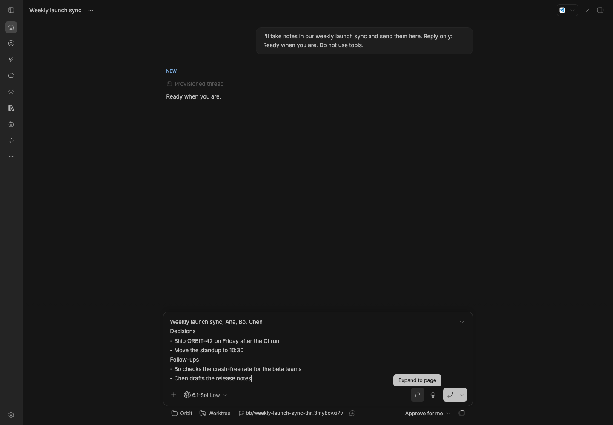

Notes typed in the composer of a staged "Weekly launch sync" thread, with the
pointer on **Expand to page**.

- **Where it goes.** The page is tagged **Notes** in Studio, in the thread's
  project, titled like "Notes · Oct 13, 2:05 PM · Weekly launch sync" (the
  time in your time zone). Studio records the thread it came from, and lists
  the page with that thread.
- **The draft moves.** Once the page holds the text, the composer is cleared,
  so there's only one copy and nothing is sent by accident. Each typed line
  stays its own paragraph and `- ` lines stay one list. Attachments stay in
  the composer. With a note already open, Expand adds the draft to the end
  of it instead of starting another.
- **Nothing is lost.** The page is saved to BB as it's made, and typing in it
  autosaves like any page. When you come back to the thread, a **Notes in
  progress** chip above the composer reopens it.

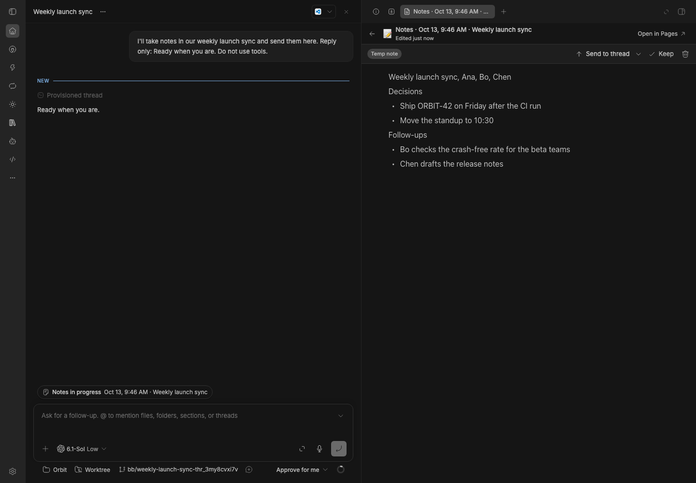

After Expand: the note open in the side panel with the draft's lines, the
composer empty, and the **Notes in progress** chip above it.

While the page is a temp note, its header (in the side panel and in Pages)
has three done actions:

- **Send to thread** sends the page's Markdown as your message. A note over
  8,000 characters goes as a link to the page and "Summarize these notes"
  instead, with the content for the agent. The ⌄ menu picks either one.
- **Keep** asks for a title and keeps the page.
- **Discard** asks first, then deletes the page.

A sent or kept note stays tagged Notes as an ordinary page, so your meeting
notes collect in one place; it's no longer a temp note, and the chip goes.

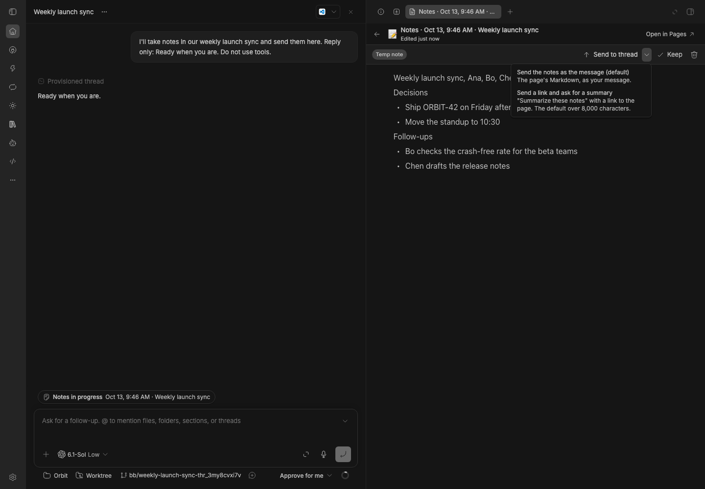

The note reopened from the chip after a reload, with Send's menu open: the
notes as the message (the default for this length), or a link and a request
to summarize. Captured in a staged BB (stable BB 0.46.0). Recapture with
`BB_CAPTURE_ONLY=pages-notes`.

The iOS app can do the same over Studio's `notes.*` RPC methods:
`notes.create` (text and a thread; adds to the open note), `notes.forThread`,
`notes.forPage`, `notes.send` (`auto`, `content` or `summarize`),
`notes.keep` and `notes.discard`.

### For agents

Agents get eight tools: `pages_list`, `pages_read`, `pages_create`,
`pages_edit`, `pages_comments`, `pages_comment`, `pages_comment_reply`, and
`pages_comment_resolve`. `pages_read` returns Markdown with a block id on the
line before each block, and `pages_edit` applies small operations against those ids. An
agent can then change one checklist item or paragraph without overwriting
what you are typing.

The same actions are available from the CLI (`bb pages …` before the merge):

```sh
bb studio pages list [--all]
bb studio pages show <page-id|title> [--ids]
bb studio pages create <title> [--global] [--markdown <text>]
bb studio pages append <page-id|title> <markdown…>
```

[skills/pages/SKILL.md](skills/pages/SKILL.md) documents the tools, the
Markdown extensions (charts, stats, HTML, embeds, callouts, mentions), and the agent
workflows.

### Storage

In **Settings → Studio**, **Saved versions per page** controls history
retention. The default is 50. Set 1 to 1000 to keep that many versions, or 0
to keep all. Lowering the limit removes older versions when that page next
saves a version. Existing pages use the new limit without a restart.

Pages, versions, uploads, notes' threads (`page_notes`), and historical requests live in Studio's SQLite
database in the BB data directory. Uploads are limited to 15 MB each and are
served back at `/api/v1/plugins/studio/http/pages/files`; a page saved before
the merge, with `/api/v1/plugins/pages/http/files` addresses in it, shows its
files from Studio too. Live editing syncs over Studio's `/pages/sync`
WebSocket. The editor (BlockNote, Yjs, Mermaid, Shiki, Recharts) loads the
first time a page opens, not with Studio; the server loads pdf-lib only for a
PDF export.

BlockNote's menus and toolbars are styled with Tailwind classes that live in
`node_modules`, which `bb plugin build` doesn't scan. `blocknote-tailwind.txt`
lists them so the build generates them. After upgrading `@blocknote/shadcn`,
run `pnpm tailwind:blocknote` (and `pnpm css:blocknote` for the stylesheet).

### Backup

Pages are the `pages` section of `bb studio backup` (see
[docs/backup.md](../../docs/backup.md)), as they were with the separate
plugin, so older backups restore into Studio. A backup holds each page's
content with its comments, the Markdown copy, saved versions and uploaded
files, plus its title, icon, place in the tree, template and refresh settings,
and whether it is archived. Page request history, page chats and checklist
hand-offs are left out, because they point at BB threads that won't exist on
another BB. A page that is open in an editor or has unsaved changes is not
overwritten on restore: it is reported as failed with a reason, and restoring
again after you close it picks it up.

## Explore

Explore is experimental. Agents end answers that read code with a few things they noticed **Along the way**; clicking one drafts "💬 Tell me more" about it so the agent explains it in the thread. It ran inside the Studio Pages plugin and moved into Studio with it: Studio keeps the Next row's click log in its own database. The CLI is `bb studio pages explore stats` (`bb pages explore stats` before the merge).

Explore's settings appear in **Settings → Studio** with an **Explore:** prefix (keys `explore_next`, `explore_explore`, `explore_quickReplies`, `explore_replyItems`, as before): **End replies with a Next row** (on), **Suggest things to explore** (on), **Offer quick replies** (on), and **Preferred quick replies** (`👍 Looks good, 🔁 Try another way, ❓ Explain more`). They apply to agent sessions started after the change.

### Next row

With **Explore: End replies with a Next row** on (the default), agents end a reply with one compact **What next?** card instead of separate lines. Each row has a short label saying what its buttons are for; hover a label for more:

- **Reply**: quick answers to this message, when it asks you something. Turn them off with **Explore: Offer quick replies**; the agent prefers the ones in **Explore: Preferred quick replies** when they fit. Clicking a reply or a request drafts it for you to send.
- **Ask for**: things the agent offers to do next, such as "📄 Write this up as a page" or "🧵 Start a thread to fix the retry bug".
- **By the way**: what the agent noticed along the way, told back to you in plain sentences: "I noticed the new endpoint retries without waiting between tries. If the server is down, it will get hammered." Each has **Tell me more**, which drafts "💬 Tell me more: <note>" so the agent explains it right there in the thread. Notes marked 🐛 also have **Fix this**, which drafts a request to fix it.

The agent writes it as one line, and any group can be left out:

```
::next{reply="👍 Ship it|🧪 Add tests first" btw="🐛 I noticed the new endpoint retries without waiting. If the server is down, it will get hammered." do="📄 Write up the plan as a page"}
```

Studio logs each suggestion once when it's shown and counts its clicks. The log keeps the last 180 days (at most 50,000 suggestions). `bb studio pages explore stats [--days 30]` prints how often each kind (reply, do, fix, more for Tell me more; older logs also have explore, for the removed Visual explainer) is clicked and the most-clicked labels, so the instructions can be tuned from real use. Older replies with `::explore` or `::reactions` lines, or `explore` items in `::next`, still render.

## Artifacts

Artifacts are built into Studio: the images, pages, reports and files your
agents make, kept with every version. They used to be the separate Studio
Artifacts plugin (`artifacts`). Items keep that id as their namespace
(`artifacts:<id>`), so tags, tabs, links and chats carry over. If you
still have the old plugin, see [docs/upgrade-unified-studio.md](../../docs/upgrade-unified-studio.md).

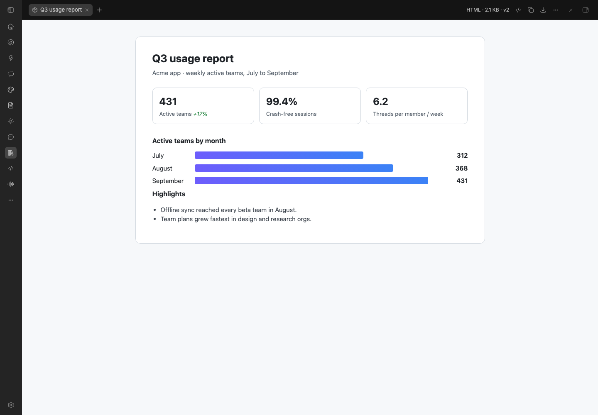

Captured from a staged BB after the merge: the seeded HTML report "Q3 usage
report", saved twice from a staged thread's workspace, open as a Studio tab
at version 2 (`HTML · 2.1 KB · v2` in the tab row, with Source, Copy,
Download and the ⋯ menu) in its sandboxed frame. Recapture with
`BB_CAPTURE_ONLY=studio-artifacts`, which also checks that the old address
opens it as a tab.

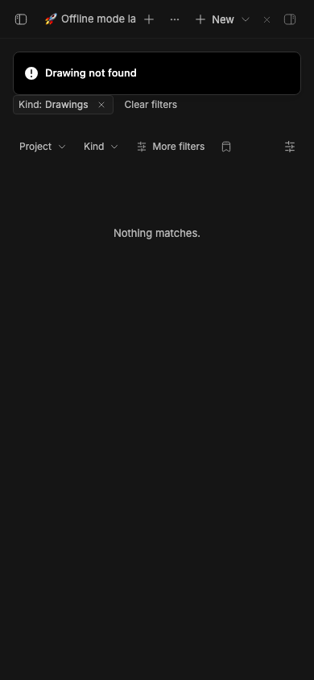

The same viewer at 390 pixels wide as a Studio tab, with **Item actions**
open. The tab row shows only the viewer's own tools; Chat appears where the
artifact opens outside the workspace, such as beside a thread. Recapture
with `BB_CAPTURE_COMPACT_HEADERS=1 BB_CAPTURE_ONLY=artifacts-compact-header`.

- **In the library.** Artifacts list next to pages, recordings and drawings,
  with type, size and version columns, image thumbnails, projects, archive,
  move and delete. Artifacts have no collection page of their own:
  `/plugins/studio/studio/artifacts` opens the library filtered to the
  Artifact kind. Studio search matches titles, descriptions and the text of
  text files up to 1 MB (HTML by its words). Studio can't create an artifact;
  they come from threads.
- **Viewer** (`/plugins/studio/studio/artifacts/<id>`, loaded the first time
  one opens). Images fit the window, and a click shows actual size. HTML runs
  in a sandboxed frame, PDFs open in the browser's viewer, and audio and video
  play with seeking. Markdown renders as a document. Code and text use BB's
  source viewer (first 2 MB). Other files offer a download. The header has an
  editable title, the artifact's chat, Copy, Download, and a menu with Open
  source thread, Save as page, Versions, Move to and Delete. Select text or
  drag over an image to **Send to thread**.
- **Save from a thread.** **Artifacts** in the thread panel launcher lists the
  files the latest reply created, changed or generated, the thread's storage
  files, and what the thread already saved. Nothing is saved automatically.
- **Agent tools and skill.** `artifacts_save`, `artifacts_list` and
  `artifacts_read`, and the `artifacts` skill. A saved artifact comes back as
  `::artifact{id="art_…"}`, a card with an inline preview that opens the
  viewer beside the chat. `@artifact` mentions give the agent the artifact's
  details and, for text up to 1 MB, its contents.
- **Commands.** `bb studio artifacts save <path> [--title <title>]
  [--description <text>]`, `list [--thread]`, `show <id>`,
  `export <id> [path] [--force]` and `delete <id>`. A plugin registers one CLI
  command, so the old `bb artifacts …` moved under `bb studio`.
- **Limits.** 25 MB per file. A version is keyed on its source thread and
  path; unchanged bytes add no version. Saving reads only from the thread's
  workspace or thread storage.

Files are stored as BLOBs in Studio's SQLite database. Contents come from
`GET /api/v1/plugins/studio/http/artifacts/content`. Every response except a
real PDF carries a `sandbox allow-scripts` CSP, so HTML gets an opaque origin
and can't call BB's API with your session.

## Drawings

Drawings are built into Studio: [Excalidraw](https://excalidraw.com) scenes
you sketch with your agents. They used to be the separate Studio Draw plugin
(`excalidraw`). Items keep that id as their namespace (`excalidraw:<id>`), so
tags, tabs, links and chats carry over. If you still have the old plugin, see
[docs/upgrade-unified-studio.md](../../docs/upgrade-unified-studio.md).

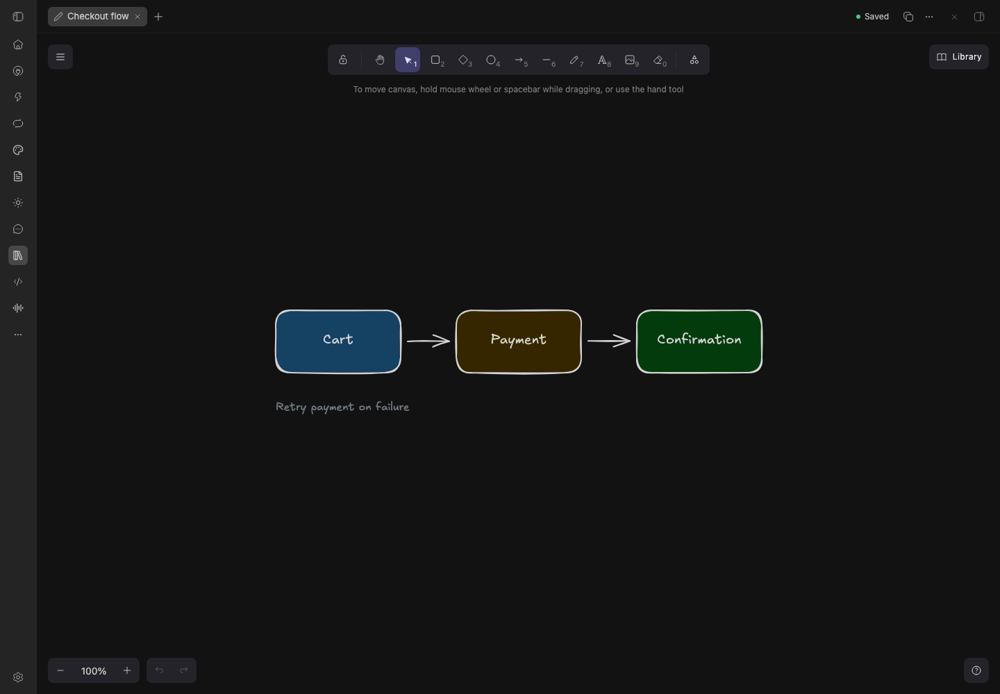

The seeded "Checkout flow" drawing open in the Excalidraw editor as a Studio
tab, with sync status, Copy image and the ⋯ menu in the tab row: Cart,
Payment and Confirmation boxes joined by arrows, with a "Retry payment on
failure" note. Recapture with
`BB_CAPTURE_ONLY=excalidraw`, which opens it from its old
`/plugins/excalidraw/drawings/<id>` address and checks that it lands as a
Studio tab.

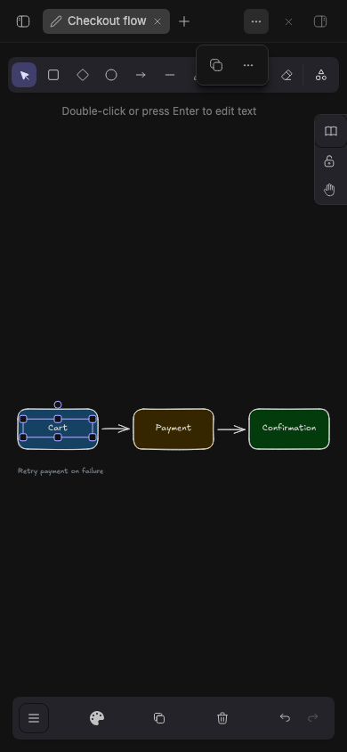

The same editor at 390 pixels wide as a Studio tab, with **Item actions**
open. Recapture with
`BB_CAPTURE_COMPACT_HEADERS=1 BB_CAPTURE_ONLY=draw-compact-header`.

- **In the library.** Drawings list next to pages, recordings and artifacts:
  thumbnails, projects, search over the words on a drawing, archive, move,
  delete, duplicate, templates and **Copy text**. Drawings have no collection
  page of their own: `/plugins/studio/studio/drawings` opens the library
  filtered to the Drawing kind.
- **Editor** (`/plugins/studio/studio/drawings/<id>`). Excalidraw loads the
  first time a drawing opens, not with Studio. It autosaves as you work. The
  header has an editable name, sync status, the drawing's chat, copy image,
  and a menu with **Download PNG**, Move to and Delete. The editor follows
  BB's active theme.
- **Card in the agent's reply.** When an agent makes or changes a drawing,
  its reply shows a card (`::drawing{id="…"}`) with the picture, name and
  element count. It opens the drawing in the thread's **Drawings** tab beside
  the chat, or in Studio without a workbench.
- **Thread tab.** **Drawings** lists the drawings made or changed in that
  thread, then the project's recent ones. **New** makes one in the thread's
  project and links it to the thread. In the editor, **Attach** adds the
  drawing to the conversation as an image. So does the composer's `+` menu,
  **Drawing**. Neither sends a message.
- **Agent tools and skill.** `excalidraw_list_drawings`,
  `excalidraw_get_drawing` (elements, app state, a text summary, and image
  files without their data; scenes over about 400,000 characters come back
  as element ids), `excalidraw_create_drawing` and `excalidraw_update_drawing`
  (upserts and deletes up to 500 elements by id; only the elements you send
  change), and the `draw` skill. `@drawing` mentions give the agent the scene.
- **Live co-editing.** Keep a drawing open and ask an agent to change it. Your
  editor shows its edits live, and the agent's next read sees yours. Edits
  merge per element; two edits to the same element resolve by Excalidraw's
  `version`, higher wins. Deletions travel as tombstones (pruned after 30 days).
- **Commands.** `bb studio drawings list`, `create <name>`,
  `show <id> [--raw]`, `rename <id> <new-name>`, `delete <id>`,
  `merge <id> <scene-file.json>` (an elements array or a full scene, with its
  image files) and `remove-elements <id> <element-id…>`. A plugin registers
  one CLI command, so the old `bb excalidraw …` moved under `bb studio`.
- **Export.** **Download PNG** in the editor renders in your browser. Studio's
  item menu exports PNG, SVG or the `.excalidraw` JSON, drawn on the server
  with Excalidraw's fonts (resvg's WebAssembly build loads on the first PNG).
  Embedded images are drawn if each is under 1.5 MB and all under 4 MB.

Scenes are stored in Studio's SQLite database in Excalidraw's save-file
format. The editor autosaves after a 1.2 second pause, in order, retries a
failed save up to three times, then shows **Retry save**. Unsaved scenes are
also kept in this browser's IndexedDB: on reopening, **Recover draft** merges
one only if the server copy hasn't changed; otherwise **Save as copy**,
**Download draft** or **Discard draft**. Thumbnails come from
`GET /api/v1/plugins/studio/http/drawings/thumbnail`, an SVG with a CSP that
runs nothing.

## Designs

Designs are built into Studio: UI prototypes and slide decks you design with
your agents. A design is a set of rounds; each round holds a few options, and
each option is one self-contained HTML screen. They used to be the separate
Studio Design plugin (`design`). Items keep that id as their namespace
(`design:<id>`), so tags, tabs, links and chats carry over. If you still have
the old plugin, see [docs/upgrade-unified-studio.md](../../docs/upgrade-unified-studio.md).

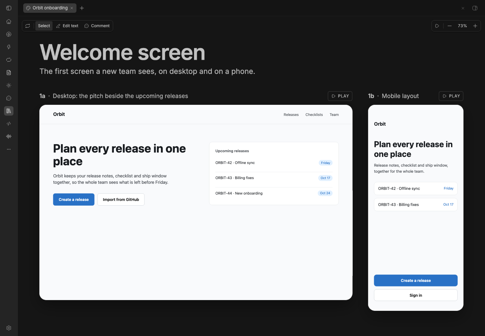

The seeded "Orbit onboarding" design: one round, "Welcome screen", with two
live options side by side, `1a` (desktop) and `1b` (phone), and the floating
pills for Reload, **Select** / **Edit text** / **Comment**, Present and zoom.
Recapture with `BB_CAPTURE_ONLY=design`, which opens it from its old
`/plugins/design/designs/<id>` address and checks that it lands as a Studio
tab; the prototype and deck captures do the same.

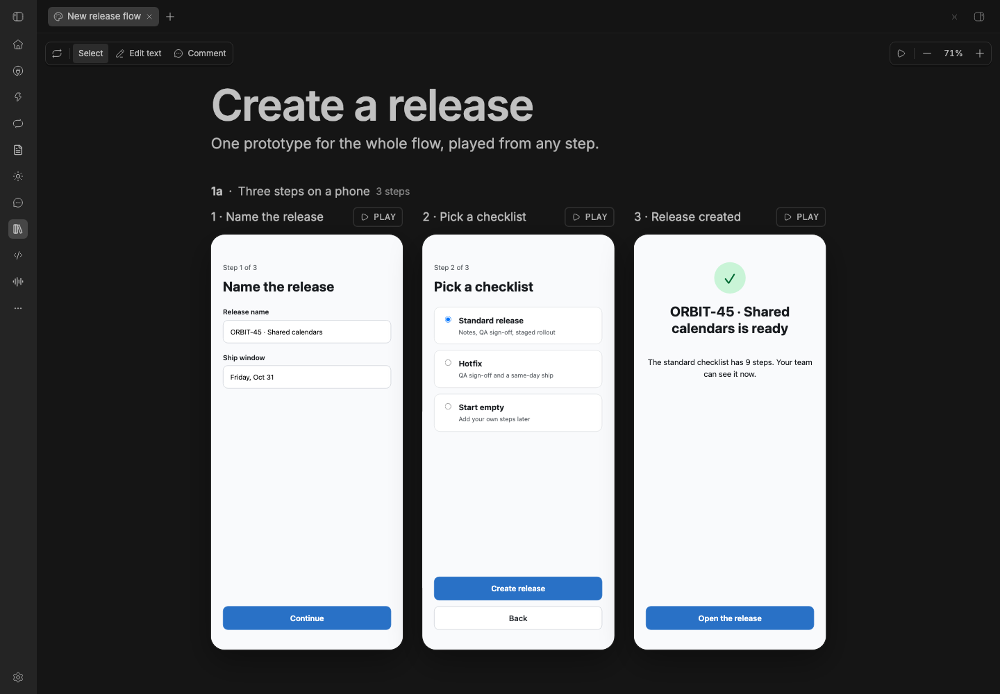

The seeded "New release flow": one mobile prototype that declares three
steps, splayed into one live frame per step.

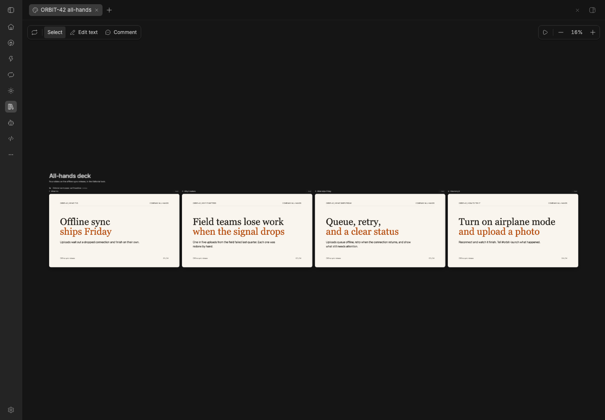

The seeded "ORBIT-42 all-hands" deck: one `slide` screen whose four steps are
its slides, laid out in a row.

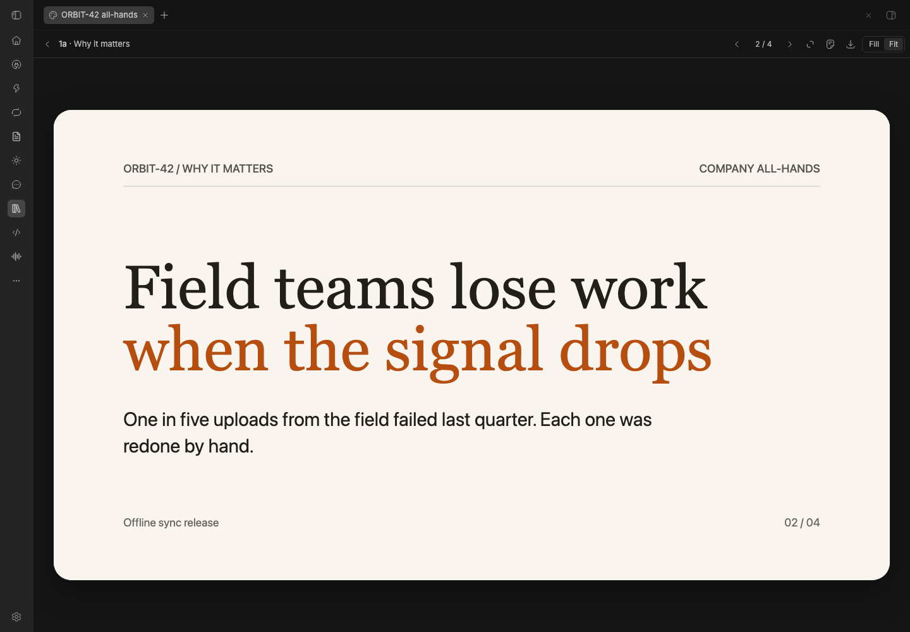

The same deck presented with Play and moved on with →: "Why it matters",
"2 / 4", **Full screen**, **Export PDF**, **Download HTML** and Fit/Fill.

- **In the library.** Designs list next to pages, recordings, drawings and
  artifacts: create, move, rename, duplicate, archive, delete and export
  (each screen's HTML). Designs have no collection page of their own:
  `/plugins/studio/studio/designs` opens the library filtered to the Design
  kind.
- **Canvas** (`/plugins/studio/studio/designs/<id>`; old
  `/plugins/design/designs/<id>` links open here). Drag the background or hold
  Space to pan; pinch, or hold ⌘ and scroll, to zoom. Rounds stack newest
  first. Each option is a live frame at its real size (desktop, tablet,
  mobile, slide, square, story, A4, Letter, email, or any `WIDTHxHEIGHT` from
  200 to 4000 px a side). Screens update as the agent writes them. A
  multi-step prototype declares its steps with a `bb-design-steps` meta tag
  and shows one frame per step.
- **Slide decks.** The agent shows 2–3 directions first, then writes the deck
  as one `slide` screen whose steps are its slides. **Play** presents it
  (←/→, Space, Page Up/Down, Home, End, **Full screen**, **Export PDF**,
  **Download HTML**).
- **Edit text and comments.** In **Edit text** mode, click text on a screen
  and type over it; the change is written into the screen's HTML. In
  **Comment** mode, pin a note to an element; **Send to agent** posts it, with
  the element's selector and markup, to the design's thread.
- **Card in the agent's reply** (`::design{id="…"}`) with the newest round's
  first screens. It opens the design in the thread's **Design** tab beside
  the chat; opened without a design, the tab lists the thread's designs.
- **Questions.** `design_ask` shows a form in the thread (choices, multi,
  short answers, 1–5 scales, each with "Decide for me"); the answers return
  as the tool's result.
- **Reviewer.** `design_ready` starts a reviewer agent in a hidden thread
  beside the design's own. It loads each screen at its size with Browser
  Automation, checks layout, errors and the design rules, and reports back
  only when something needs work, in the design's thread. After 3 such
  reviews in a row, automatic review pauses until you edit, comment or ask.
- **Agent tools and skill.** `design_list`, `design_create`, `design_rename`,
  `design_read`, `design_ask`, `design_ready`, `design_write_screen`,
  `design_edit_screen`, `design_comments`, `design_resolve_comments`,
  `design_save_style` and `design_styles`, and the `design` skill. `@design`
  mentions give the agent the design's rounds and options.
- **Commands.** `bb studio designs list`, `show <id>` (rounds, screens and
  open comments as JSON), `html <id> <screen>`, `rename <id> <new-name>` and
  `delete <id>`.

Designs, rounds, screens, comments and saved styles are stored in Studio's
SQLite database. Frames load from
`GET /api/v1/plugins/studio/http/designs/screen`, whose response carries a
sandbox CSP, so a screen gets an opaque origin with no access to BB.
`bb studio backup` includes each design with its rounds, screens and
comments; saved styles aren't in backups yet.

## Dashboards

Dashboards are built into Studio: live tiles, charts, tables and feeds on a
responsive grid, which you and your agents build together. Items are
`dashboards:<id>` and open at `/plugins/studio/studio/dashboards/<id>`.

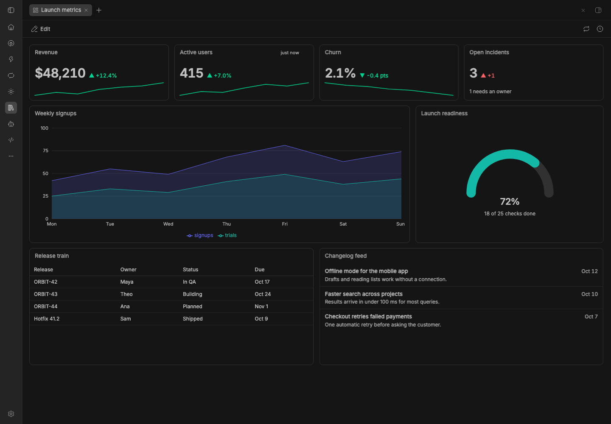

The seeded "Launch metrics" dashboard as a Studio tab in a staged BB, in
view mode: four stat tiles with deltas and sparklines (churn and incidents
count down as good, so the extra incident is red), "Active users" pushed a
moment ago, an area chart of weekly signups and trials, a custom gauge
widget running in its sandboxed frame, a table and a changelog feed.

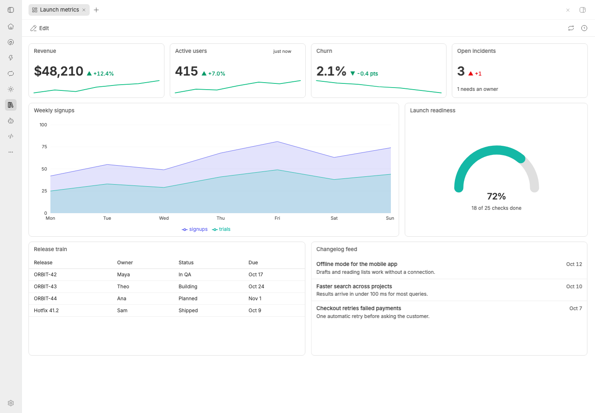

The same dashboard in BB's light theme.

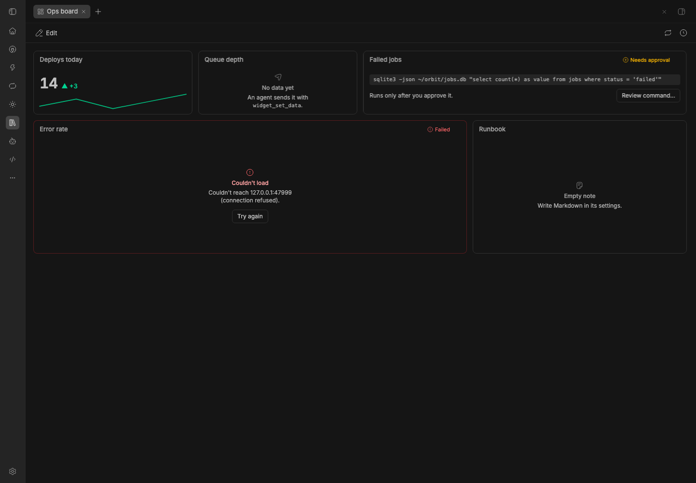

Tiles with nothing to show yet: a push tile waiting for an agent's data, a
script waiting for approval (its command, and **Review command…**), a URL
that couldn't be reached (the reason, and **Try again**), and an empty note,
next to a working stat. A new dashboard offers **Add widget**:

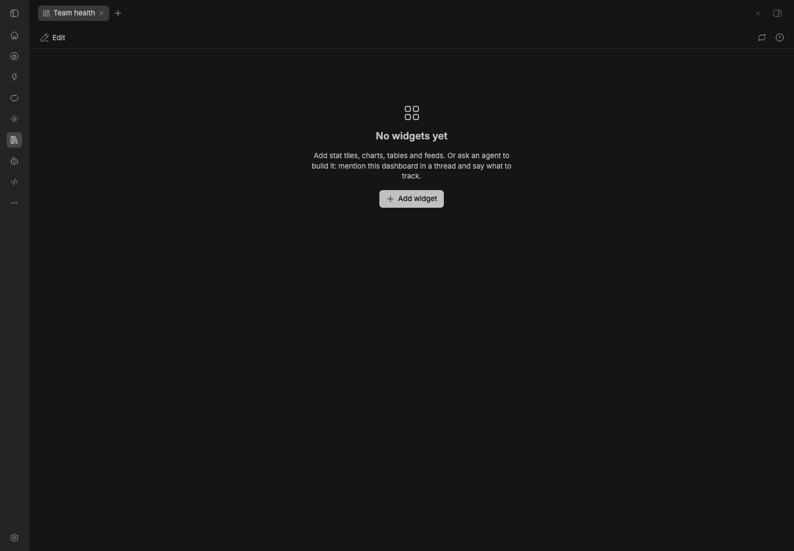

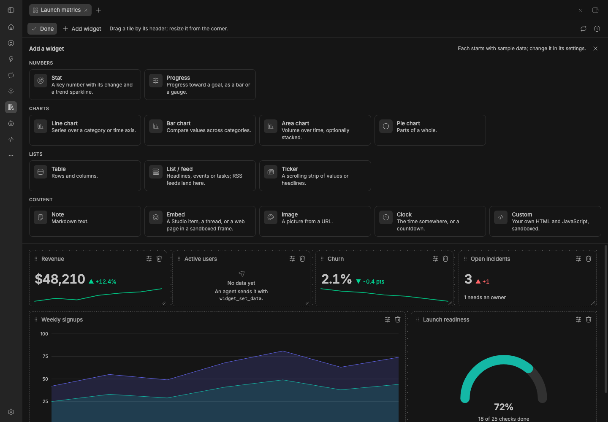

Edit mode: dashed tiles with a drag handle, settings and remove in each
header and a resize corner, over a faint dot grid, with the widget picker
grouped into numbers, charts, lists and content.

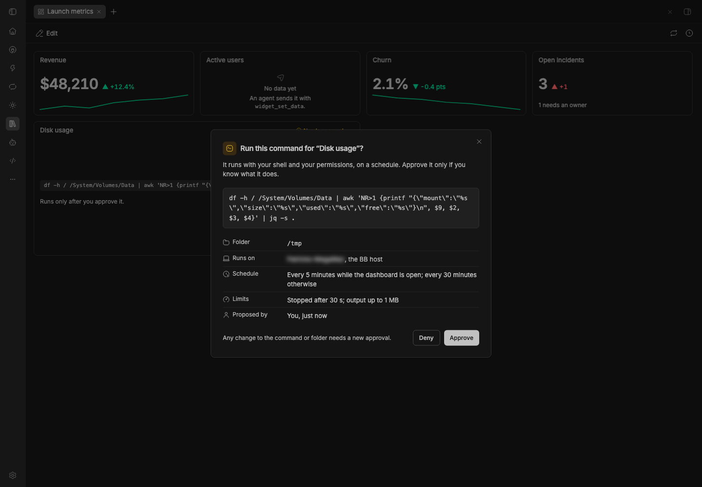

The approval dialog for a proposed script (the BB host's name is blurred
for this README). Recapture all six with
`BB_CAPTURE_ONLY=dashboards,dashboards-light,dashboards-empty,dashboards-states,dashboards-edit,dashboards-approval`;
the captures check every tile and its state, the chart, the custom widget's
sandbox, the edit-mode handles and picker groups, and that the dialog shows
the full wrapped command with Deny focused, after a forged approve is
refused.

- **In the library.** Dashboards list next to pages and drawings, with
  search over their names, widget titles and notes, tags, Move to,
  archive, duplicate, templates and **Export → Dashboard JSON**.
  `/plugins/studio/studio/dashboards` opens the library filtered to them.
  **Setup → Kinds** turns them off (their data stays; nothing refreshes).
- **The grid.** [react-grid-layout](https://github.com/react-grid-layout/react-grid-layout)
  2.3.0 (MIT), 12 columns wide, 8 below 1100 px and 4 below 700 px. **Edit**
  lets you drag tiles by their header, resize them from the corner, **Add
  widget** (each starts with sample data) and open each widget's settings:
  title, type, options and data source. **Done** goes back to viewing. In
  view mode each tile's header shows when it updated (or that it failed or
  waits for approval), and its **⋯** menu refreshes it, opens its settings,
  reviews or revokes its script, or removes it.
  Layouts save per breakpoint. The clock button lists the last 20 versions;
  restoring one keeps the current one in history.
- **Widgets.** Stat (value, delta and sparkline), line, bar, area and pie
  charts (Pages' chart colors), table, list or feed, ticker, Markdown note,
  embed (a Studio item, a thread, or a web page in a sandboxed frame),
  clock or countdown, image, progress bar or gauge, and custom widgets. All
  follow BB's light and dark themes.
- **Data.** Each widget reads one source:
  - *Static*: JSON stored on the widget (256 KB).
  - *URL*: JSON or RSS/Atom, fetched by Studio's server (so no CORS):
    http and https only, at most 5 redirects, 2 MB, 15 s. Private and
    localhost addresses work: it's your machine.
  - *Script*: a shell command on the BB host that prints JSON or text. It
    runs only after you approve its exact command and folder in the
    dashboard; the approval is pinned to their SHA-256, so any change needs a
    new approval. Agents can propose a script but can't approve one. 30 s
    and 1 MB per run. See [Script approval](#script-approval).
  - *Push*: an agent sends data with `widget_set_data`, or a script with
    `bb studio dashboards set-data <id> <widget> '<json>'`. Never polled.

  URL widgets refresh at most every 60 s and scripts every 5 minutes, and
  only while a dashboard is open in a BB window (each sends a heartbeat every
  30 s); otherwise every 30 minutes. **Refresh** fetches now, at most every
  10 s per widget. Studio keeps the last good value with its time and the
  last error, so a tile shows "Updated 2m ago" or what went wrong, still
  with its last data.
- **Custom widgets.** HTML, CSS and JavaScript in an iframe with
  `sandbox="allow-scripts"` (no same-origin) and a CSP with
  `connect-src 'none'`, like Pages' HTML blocks. Studio posts
  `{data, options, theme, size}` to it (also `window.bbWidget` and the
  `bbwidget` event); it may post back `{height}`. Agents save reusable types
  to your library with `widget_define`, or give one widget its own HTML.
- **Agent tools and skill.** `dashboard_create` (with widgets in one call),
  `dashboard_list`, `dashboard_read` (a readable summary with ids, sources,
  values and errors), `dashboard_edit` (`add`, `move`, `resize`, `remove`,
  `update`; all or nothing), `widget_define` and `widget_set_data`, all
  checked with zod and capped in size, and the `dashboards` skill.
  `@dashboard` mentions give the agent the summary.
- **Commands.** `bb studio dashboards list`, `show <id>` and
  `set-data <id> <widget-id> <json>`.
- **Backup.** `bb studio backup` saves dashboards, their layouts, pushed
  data and your widget library. Fetched data is fetched again, and script
  approvals are never restored: a restored script waits for you.

### Script approval

**Review command…** on a waiting script opens the approval dialog: the exact
command in full, the folder it runs in, the BB host's machine name, the
schedule ("Every 15 minutes while the dashboard is open; every 30 minutes
otherwise"), the 30 s and 1 MB limits, and who proposed it (you, or an agent
and its thread). **Deny** has the focus. An approved script shows a quiet
"Approved" line with **Revoke** in its settings.

BB's plugin RPC can't tell the app from the `bb` CLI or a request from an
agent's shell, so approval is a handshake the dialog makes. Opening it asks
Studio for a one-time nonce (`dashboards.requestApproval`), which Studio
issues only while a BB window shows the dashboard. **Approve** sends it back
with the command's SHA-256 (`dashboards.approveScript`). A nonce approves
that one command on that one widget, once; it isn't accepted in the dialog's
first 0.75 s, expires after 5 minutes, and dies with Deny, a newer dialog,
a restart, or any change to the dashboard while the dialog is open. Other
plugins are refused, and agents have no tool for either step.

This stops an agent that calls `approveScript` directly, replays an old
approval, or changes the command after you've seen it. It doesn't stop a
process with shell access that deliberately scripts both steps the way the
dialog does: on your machine that process already runs as you. Keep agents
you don't trust out of a full-access shell.

Dashboards live in Studio's SQLite database: `dashboards`,
`dashboard_widgets`, `dashboard_layouts` (one per breakpoint),
`dashboard_widget_types` (the library), `dashboard_data` (value, fetched
time, error), `dashboard_script_approvals`, `dashboard_script_proposals`
(who wrote each command) and `dashboard_versions`. A dashboard holds at most
60 widgets.

## Recordings

Talk is built into Studio: long-form, durable dictation and recording. It
saves audio as you speak and transcribes it with the voice service in
**Settings → AI services** (your ChatGPT subscription through Codex by
default). Every dictation and recording becomes a titled, searchable item you
can link to and @-mention. It used to be the separate Studio Talk plugin
(`talk`). Recordings keep that id as their namespace (`talk:<id>`), so tags,
tabs, links and chats carry over. If you still have the old plugin, see
[docs/upgrade-unified-studio.md](../../docs/upgrade-unified-studio.md).

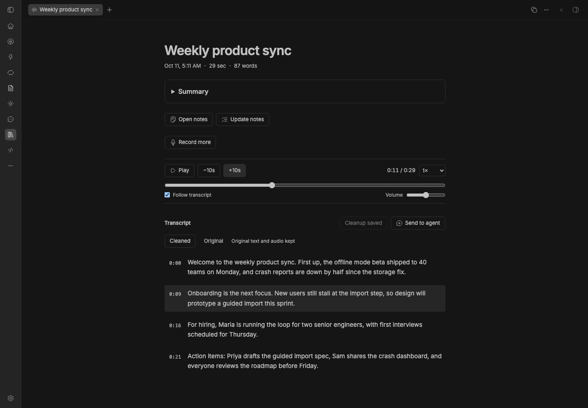

A seeded "Weekly product sync" recording, opened from its old
`/plugins/talk/recordings/<id>` address, lands as a Studio tab. Its audio was
spoken with macOS `say`, uploaded in two sessions and transcribed by BB's
voice service; the capture then makes a summary, a saved cleaned transcript
and a notes page, plays the audio, seeks to the second section and pauses.
Recapture with `BB_CAPTURE_ONLY=talk-page`.

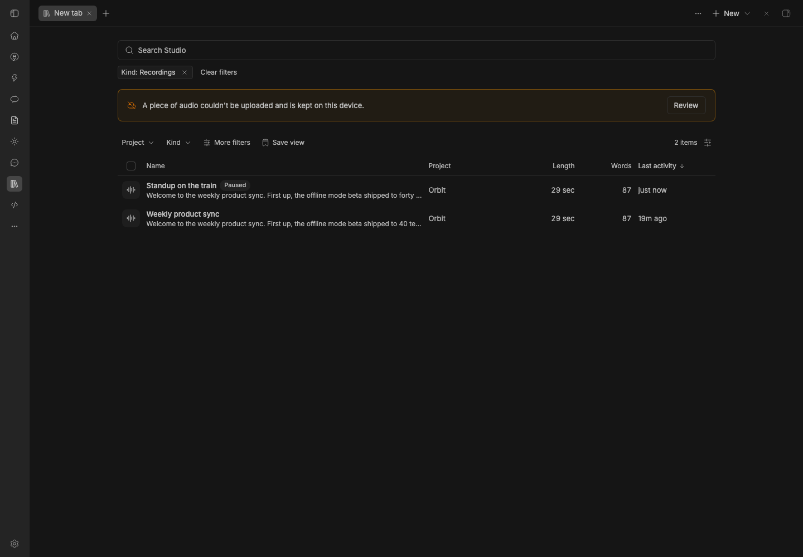

Studio's library filtered to recordings, with the banner for audio this
device kept because the server refused it (a piece set aside in the browser's
store by the capture). **Review** opens
`/plugins/studio/studio/recordings/unsent` as an "Unsent audio" tab, where each piece can be retried,
downloaded or discarded. Recapture with `BB_CAPTURE_ONLY=talk-unsent`.

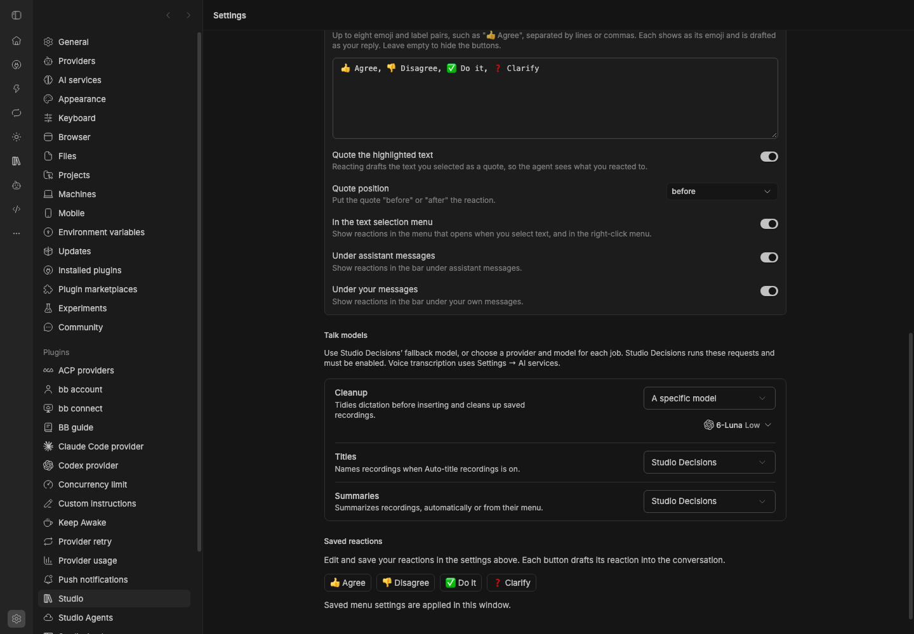

Studio's settings page: Talk's settings, with the
segment length and hold-to-talk key the staged user set,
and **Talk models** with Codex's 6-Luna for cleanup and Studio
Decisions for titles and summaries, chosen through the real controls.

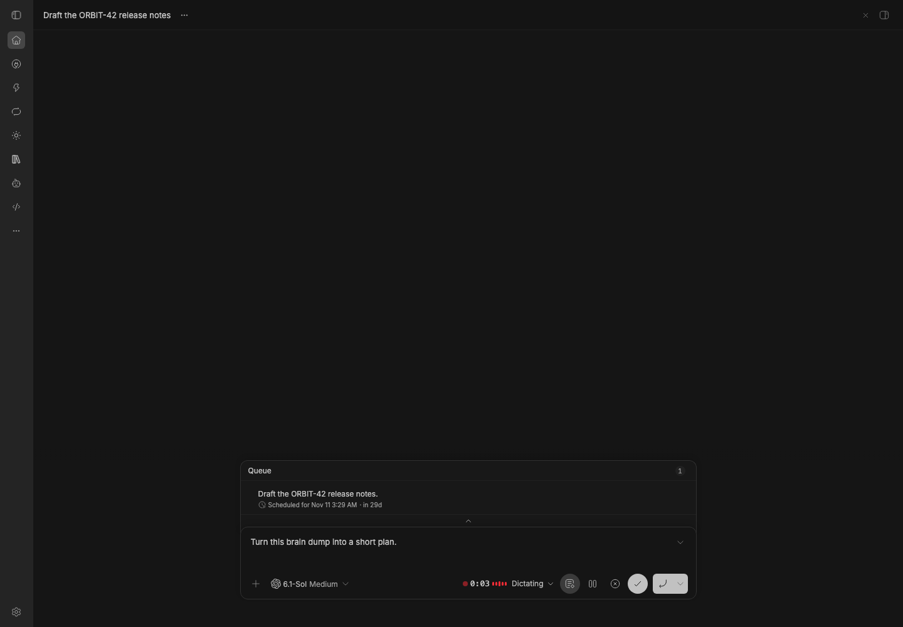

The composer's microphone dictating with Talk: timer, level meter, cleanup
toggle, pause, cancel and finish in place of the microphone.

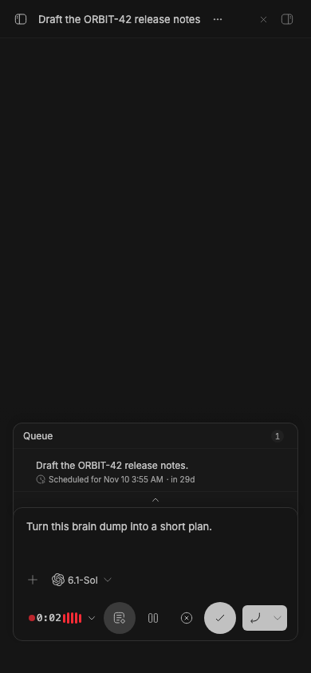

At a 390-pixel viewport the controls use a second toolbar row.

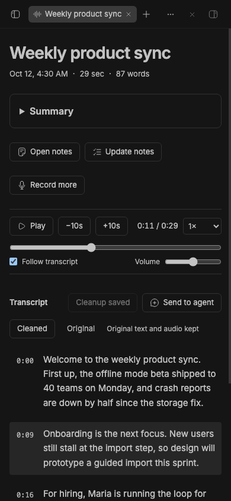

The staged recording at a 390-pixel viewport.

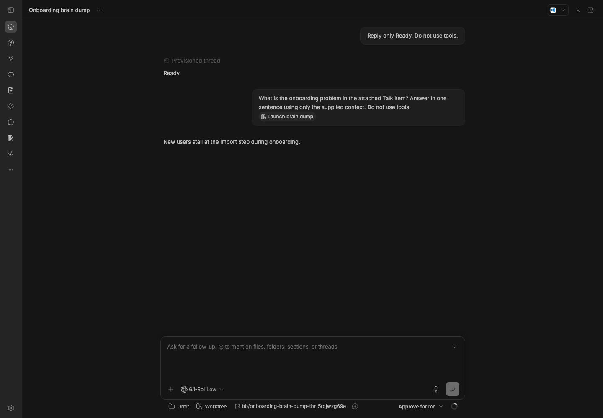

A dictated message with a clickable **Launch brain dump** mention of its
saved source.

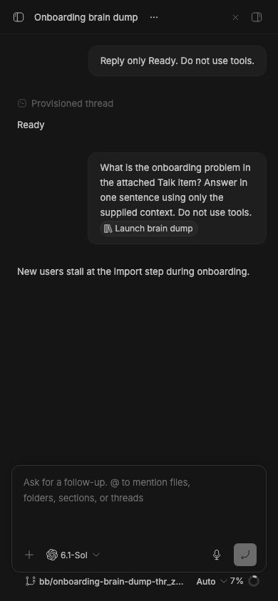

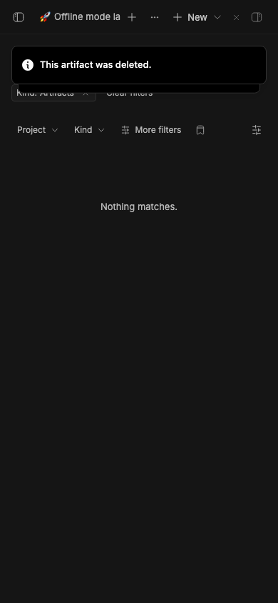

The compact recording header at 390 pixels, with **Chat** and **Item actions**.

### What you get

- **Replaces built-in dictation.** The composer's microphone starts a Talk
  dictation. Pressing it again, or ✓ in the pill, stops recording, waits for
  the transcript, and types it into that composer. ✕ stops without inserting.
- **The source stays with the message.** Chat dictation adds a native Talk
  mention beside the text, attaching the saved item for the agent. Click the
  pill in the sent message to open the original Studio item. The reference
  survives finishing away from the thread and returning later. **Keep as a
  recording** preserves it. Dictation into document fields inserts the text as usual.
- **One dictation, one thread.** While Talk is dictating, the mics in other
  threads are dimmed. Pressing one says where the dictation is, with a **Go
  back** button. The thread being dictated into shows a mic in the sidebar.
- **Finish from anywhere.** Press ✓ from another thread and Talk holds the
  text. It types the text into the dictation's thread when you go back. BB
  keeps unsent composer text on the device, so Talk can't safely write into a
  thread that isn't open. A Studio or page new-conversation composer also
  holds its dictation until you go back to it. **Go back** returns to the
  thread or composer the dictation came from, in the main view or a split.
- **Hold to talk.** Hold Right Option (or the key set in settings) by itself
  to dictate into the focused composer or field, and let go to insert. A
  quick tap does nothing, and Option+key shortcuts and AltGr characters still
  type as usual.
- **Clean-up before inserting.** Talk asks Studio Decisions to drop filler
  words and false starts, and to fix punctuation, without rewording. The
  dictation keeps the raw transcript. Turn it on or off with the ✦ button on
  the dictation pill; the choice is kept per device. If Decisions is missing,
  slow, or returns something that isn't a clean-up, Talk inserts the text as
  spoken.
- **Dictation in other plugins.** Plugins can mark a text surface as a
  dictation field, as Pages does for its editor. Talk
  dictates into it with the same pill, durability, and **Go back** handling
  as a composer. *Talk: Start or finish dictation* works in a focused field.
- **Recordings as spoken notes.** **New → Recording** in any Studio menu (the
  sidebar, the library, or Quick Open) starts one in that
  project and opens its page in the main pane, as a new page would. The
  command *Talk: Start or stop a recording* records for as long as you
  need without inserting anywhere. Use recordings for brain dumps, ideas,
  personal notes, or meetings. **Send to agent** opens a thread with the
  recording attached; mentions include its saved cleaned version when available.
- **A card in the agent's reply.** An agent can show a recording with
  `::recording{id="rec_…"}` on its own line: the summary and the first lines
  of the transcript, read-only. Clicking the title or the arrow opens the
  recording's page.
- **Clean up a recording.** **Clean up transcript** on a finished recording
  creates a saved cleaned version while retaining the original transcript and
  audio. Switch between **Cleaned** and **Original**; copy and text downloads
  use the version shown. Cleanup works section by section, so long recordings
  keep their audio alignment. If it stops, press the button again to continue.
- **Audio playback.** Play or pause, scrub across the recording, skip 10 seconds,
  change speed, and adjust volume. Click a timestamp or transcript section to
  play from there. Highlighting follows the audio; **Follow transcript** keeps
  the current section visible. Timing is per audio section, rather than per word.
- **Dictations stay in the background.** Every dictation is saved in case
  something goes wrong, but Studio's All view leaves them out. Pick
  the **Dictations** filter, or search, to find one. Recordings you start
  from Studio show up as usual.
- **Keep a long dictation as a recording.** After a dictation of five
  minutes or 800 words, a toast offers **Keep**. **Keep as a recording** on
  the dictation's page does the same. It moves the dictation out of the
  background and gives it a title; you can summarize it from its page. The text is still
  inserted.
- **Dictation audio expires.** After a day, a dictation's audio is
  deleted and its transcript is kept. Recordings keep their audio. A
  dictation with a piece still waiting or failed keeps its audio.
- **In the library.** Recordings and dictations list in Studio's library
  next to pages, drawings, designs and artifacts: search, filter to
  recordings or dictations, sort by title, date, length or word count, and
  tick rows to start one thread that mentions them all, copy their
  transcripts as one document, or delete them together. There is no
  Recordings page of its own: `/plugins/studio/studio/recordings` opens the
  library filtered to recordings, and audio this device kept unsent shows as
  a banner there.
- **Dictation at its input.** While its chat input is on screen, a dictation's
  compact controls replace the mic. Expand to read the transcript and it
  becomes a floating pill. Collapse it to dock again. Navigating away also
  floats the controls; returning to the input docks them. Each new dictation
  starts collapsed. Dictation into other plugins' fields uses the floating pill.
- **A pill that follows you.** Recordings and dictations away from their input
  use a small overlay at the top of the window. It stays
  put as you move between threads and pages. Everything else stays clickable.
  Drag it anywhere in the window and it stays there, even after a reload.
  Away from where you started, a back arrow returns you to that thread or
  recording. Click a recording's pill to open its page in the main view. Expand the pill to read the transcript as it arrives; the pill
  remembers whether you left it expanded or collapsed.
- **Streaming transcript.** Audio is cut into pieces of about 25 seconds at
  natural pauses. Each piece is transcribed as soon as it is uploaded, so text
  appears while you are still talking.
- **Linkable and mentionable.** Each recording opens as a Studio tab at
  `/plugins/studio/studio/recordings/<id>` (old `/plugins/talk/recordings/<id>`
  links open there too). It shows up in the composer's @ menu, and
  mentioning it gives the agent its transcript. Its **Chat** button opens the
  linked thread in a split beside the recording.
- **Auto titles.** Studio Decisions uses its configured fallback model to
  title each recording from its transcript. If Decisions is missing or reports
  that no model is available, Talk uses the transcript's first words and the
  recording date. Titles update as the transcript grows and never replace a
  title you typed.
- **Optional summary.** Choose **Generate summary** in the recording menu
  for a concise paragraph covering the recording's main ideas. It works for
  brain dumps, personal notes, ideas, conversations, and meetings. Enable
  **Automatically summarize recordings** in settings to summarize when a
  recording finishes. Saved summaries stay collapsed until you open them and
  can be regenerated.
- **Notes pages.** On a finished recording, **Make notes** writes a Studio
  Page with a short summary, the decisions made, and the action items as a
  checklist, so you can hand any item to an agent from the page. The page
  links back to the recording, and the recording shows **Open notes**.
  Running it again shows **Update notes** and rewrites the same page: Pages
  saves a version first, and action items you checked off or handed to an
  agent keep their state. Notes use the Summaries model through Studio
  Decisions. Long transcripts are read in parts of about 30,000 characters
  and combined; past six parts, the page says the notes cover the first part.
- **Exports.** Download a finished transcript as Markdown or plain text, or
  download its original audio segments together as a tar archive.
- **Agent tools.** `talk_list`, `talk_read`, and `talk_search` let agents find
  and read bounded portions of recordings and summaries. `talk_make_notes`
  makes or updates a recording's notes page.
- **Mobile layout.** The pill, recording pages, and composer mic all work in
  the BB mobile app, with larger touch targets on small screens.
- **Commands.** *Talk: Start or finish dictation*, *Talk: Start or stop a
  recording* and *Talk: Pause or resume* are Studio commands now. A keyboard
  shortcut set on the Talk plugin's command has to be set again on Studio's
  (BB keys custom shortcuts by plugin).
- **CLI.** `bb studio recordings list [--query <text>] [--json]`,
  `show <id> [--json]`, `transcript <id> [--cleaned] [--offset <chars>] [--limit <chars>]`
  and `notes <id> [--json]`. The bundled `talk` skill documents them for
  agents.

### Durability

- **Saved on the device.** Every few seconds, audio goes into IndexedDB.
  Audio leaves the device store only after the server confirms it is on disk
  (written to a temp file, fsynced, then renamed). While local writes succeed,
  reload/crash recovery keeps committed chunks; the current few-second chunk
  can still be lost.
- **Local storage failure.** Capture stops and keeps the full affected segment
  in this window. Retry saving or download it before closing. If the window
  closes first, that memory-only audio cannot be recovered. Before capture starts,
  Talk writes and reads back a small recovery marker; it refuses capture if this
  fails. The marker remains conservative if later audio and metadata writes both
  fail. On return, interrupted capture requires acknowledgement of a potentially
  missing tail before continuing with saved audio; automatic insertion stays off.
  Clearing browser data can still remove both the audio and its recovery marker.
- **Survives reloads.** Saved chunks stay available after reload. Review an
  interrupted capture before resuming it in a new session; the transcript starts
  a new paragraph. Download uploaded audio remains available before completion.
- **Offline.** While offline, audio keeps saving locally. It uploads with
  backoff when the connection returns.
- **One capture at a time.** A Web Lock makes sure only one window captures.
  Every window shows the pill. Other windows leave the capturing window's
  unsaved audio alone, and upload it only once that window is gone.
- **Refused pieces don't block the rest.** If the server rejects a piece as
  invalid, Talk keeps its audio on the device, says so, and uploads the
  pieces after it. A recording or dictation with a refused piece stays
  paused, and a dictation isn't inserted, since its text would have a gap.
  Retry or discard the piece, then finish it from its page. **Unsent audio** (the toast's *Review*, or the notice on
  the recording's page and the banner in Studio's library filtered to recordings) lists what the device kept:
  retry each piece or all of them (after a Talk update, say), download one
  as an audio file, or discard it. A laptop that sleeps mid-recording doesn't count the
  sleep as recorded time.
- **Deleting.** A recording that a window is still capturing can't be
  deleted. Stop it first.
- **Interrupted recordings.** If a capture stops reporting for two minutes,
  for example because the laptop closed or the app was killed, the recording
  is marked *Interrupted*. **Resume recording** on its page continues it, and
  **Finish** ends a paused or interrupted recording no window is capturing.
  Finish waits until none of its audio is left on this device.
- **Failed transcription.** Failed pieces retry with backoff for about nine hours.
  If the voice service is off, they retry every 10 minutes. **Retry** requeues
  pieces that gave up and retries waiting ones at once. When a dictation you
  finished hits a failure, the pill says *Transcription failed*, shows the
  service's error, and offers **Retry**. Talk inserts nothing until every
  piece is transcribed, so a failure never leaves a gap in the text. Audio is
  never discarded because of a failure.
- **Empty recordings aren't kept.** A dictation or recording that finishes
  with no words is deleted along with its audio, and Talk says so. This
  covers a mic tapped by accident, silence, and noise. A recording with a
  failed piece is kept, because a retry may still find speech.

### Settings

| Setting | Default | Effect |
| --- | --- | --- |
| Replace built-in dictation | on | The composer mic starts Talk. Off restores BB's one-shot dictation. |
| Segment length (seconds) | 25 | Target piece length, 8–60. Shorter pieces show text sooner. |
| Auto-title recordings | on | Titles recordings from their transcripts. |
| Automatically summarize recordings | off | Summarizes on completion; the recording menu can summarize on demand. |
| Cleanup model | Studio Decisions | Provider, model, reasoning, and supported service tier for dictation and saved-transcript cleanup. |
| Titles model | Studio Decisions | Model for automatic recording titles. |
| Summaries model | Studio Decisions | Model for automatic and on-demand summaries, and for notes pages. |
| Hold-to-talk key | Right Option (Alt) | Key to hold for dictation: Right Option, Right Command, Right Control, or Off. |
| Keep dictation audio (days) | 1 | Deletes a finished dictation's audio after this many days. 0 keeps it. |

They are on Studio's settings page: **Settings → Studio**, with **Talk models** below them. Open **Talk models** for the three model choices. Each job can follow Studio Decisions
or use **A specific model**, selected with BB's provider and model picker.
Choices apply to the next request and persist across devices and restarts.
Studio Decisions must be enabled to run either choice. Existing cleaned text,
titles, and summaries stay as saved. Voice transcription is configured in
**Settings → AI services**.

### Dictation fields for other plugins

Other plugins can use Talk without importing its code. The contract is plain
DOM, defined in [src/talk/ui/fields.ts](src/talk/ui/fields.ts):

- **Mark the field.** Put `data-talk-field="<key>"` on the element that wraps
  the text surface, with a key that stays the same across reloads, for example
  `pages:pg_123`. Add `data-talk-field-label` with a name for toasts, such as
  `“Launch plan”`.
- **Start or finish.** Dispatch a bubbling `bb-talk:toggle` event from inside
  the field. If Talk is already busy elsewhere, it shows where instead.
- **Receive the text.** Talk dispatches a cancelable `bb-talk:insert` event
  on the field, with the detail `{ text }`. Insert the text and call
  `preventDefault()`. If no field takes it, Talk keeps the text and delivers
  it once the field has been back on screen for a moment. Text whose field
  hasn't come back within three days is dropped, with a toast; it's still in
  Talk recordings.
- **Go back.** Talk dispatches a cancelable `bb-talk:open-field` on `window`,
  with the detail `{ field }`. The plugin that owns the key navigates to it
  and calls `preventDefault()`. If no plugin does, for example because the
  owner was disabled, Talk copies the waiting text to the clipboard instead.
- **Show state.** While Talk is loaded, `<html data-bb-talk>` is `idle`,
  `dictating`, or `busy`. `data-bb-talk-field` names the field being dictated
  into, and `data-bb-talk-phase` holds the capture phase. `bb-talk:state`
  fires on `window` when any of them change. If `data-bb-talk` is missing,
  Talk isn't installed, so hide dictation controls.

### Limitations

- **First-message context.** Stable BB expands a Talk mention into its saved
  transcript on follow-up messages. A thread's first message keeps the dictated
  text, native mention, and source link; the agent can read the saved item with
  Talk tools.
- **Mic swap can break.** BB has no API for replacing its microphone. A
  content script claims presses on the composer's "Start voice input" button.
  If BB changes that markup, the mic falls back to built-in dictation. Talk
  stays reachable from its commands and Studio.
- **Held text stays on the device.** A dictation finished away from its
  thread or Studio composer waits on the device you dictated on. A main
  new-thread dictation without a Studio route is copied to the clipboard
  after you leave that page. Either way, the dictation is also in Studio's library.
- **Mobile backgrounding.** On mobile, the microphone stops when the BB app
  goes to the background. Talk resumes when the app returns, or shows
  **Resume** when the system needs a tap first.
- **Voice service required.** Transcription needs BB's voice service turned
  on. Audio recorded without it is kept and transcribed once it is available.
- **Speaker labels.** BB's current voice transcription API returns text only.
  Talk does not assign speaker labels without a diarization result.
- **Summaries.** They need Studio Decisions and its configured fallback
  model. If generation fails, use **Generate** or **Regenerate** in the
  recording menu after the model is available.
- **Notes pages.** They need Studio Decisions. Updating
  notes replaces the page's text with fresh notes; restore an earlier version
  from the page's history to get your edits back.
- **Backup and restore.** BB Studio backups include every recording: its
  title, transcript, summary, segment audio (hard-linked when possible) and the
  id of its notes page. Restoring is safe to repeat and never overwrites a copy
  that is newer here or a recording still being recorded or transcribed. A
  restored recording comes back finished, with pieces that were not
  transcribed marked failed so **Retry** can pick them up. It does not keep the
  BB thread it was started from. The notes page reconnects when the backup
  restores the same page; otherwise **Update notes** finds or makes it again.
- **Personal project threads.** Titling runs hidden agent threads in BB's
  Personal project.

Recordings, segments and transcripts are stored in Studio's SQLite database;
segment audio is in `<dataDir>/plugins/studio/talk/audio/<recording>/`. Audio
plays from `GET /api/v1/plugins/studio/http/recordings/audio`. The Studio
provider exports a recording's transcript as Markdown, its audio segments, or
both (`markdown`, `audio`, `bundle`); recordings can't be duplicated, since
copying the metadata without its audio would make a misleading recording.

## Reactions

Emoji reactions on replies, in the text selection menu and the bar under each
message. They were the Studio Reactions plugin (`emoji-react`); Studio has
them built in now (`src/reactions/`).

Select text in a reply. The floating selection menu (next to "Add to chat")
shows one emoji button per reaction. Click one and the composer gets a draft,
then focus:

```
> <the highlighted text>

👍 Agree
```

Buttons show the emoji only. The draft uses the full item text. An item can be
just an emoji (`🚀`); then the draft is that emoji. The draft goes to the
composer for the message's thread, in the main view or a split; with no
usable composer, a toast asks you to open the thread's composer.

**Quote position.** With `before` (default) the quote comes first, then the
reaction. With `after` the reaction comes first, then the quote. If you
already typed a draft, `after` puts the reaction between your text and the
quote.

Older replies that end with a `::reactions{items="…"}` line still render it
as reaction buttons. Agents no longer write it; the [Next row](#next-row)
offers quick replies.

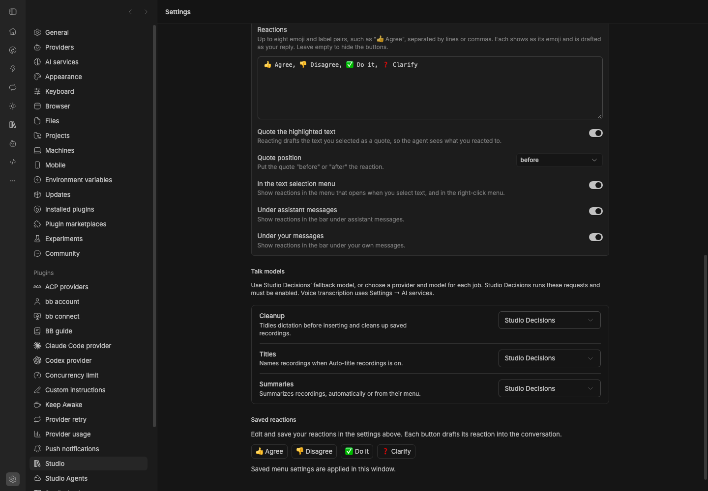

Captured from a staged BB: Studio's settings page with the default reaction
list (Agree, Disagree, Do it, Clarify), quoting before the reaction, all three
location toggles on, and the **Saved reactions** preview saying the menu
settings are applied in this window. Before it, the capture checks that the
seeded agent reply's message bar shows the four reactions as emoji.

| Setting | Key | Default |
| --- | --- | --- |
| Reactions: up to 8 `emoji label` items, separated by lines or commas. Empty removes the buttons. | `emojiItems` | `👍 Agree, 👎 Disagree, ✅ Do it, ❓ Clarify` |
| Quote the highlighted text | `quoteSelection` | on |
| Quote position: `before` or `after` the reaction | `quotePosition` | `before` |
| In the text selection menu (and the right-click menu) | `showInSelectionMenu` | on |
| Under assistant messages | `showInAssistantBar` | on |
| Under your messages | `showInUserBar` | on |

```sh
bb plugin config studio set emojiItems "👍 Agree, 👎 Disagree, ✅ Do it"
bb plugin config studio set quotePosition after
```

Message menus read the settings once when Studio's frontend loads. The
**Saved reactions** section previews the stored list and says whether this
window still uses older settings; **Reload window to apply** refreshes the
menus. Other open windows update on their next reload.

**Moving from Studio Reactions.** On its first start with `emoji-react`
installed, Studio copies that plugin's settings once (a KV marker records
it), skipping any you already changed in Studio. Then remove the old plugin
from **Setup → Retired plugins** or with `bb plugin remove emoji-react`;
while both are installed, each shows its own buttons.

## What you get

Everything opens in BB's main view, as a tab in Studio's workspace. ⌘/Ctrl-click an item or thread link, or choose **Open in split** from
its menu, to open it in a split instead. Right-click any Studio item or
thread link, anywhere, for **Open**, **Open in split**, **Copy reference**
(**Copy link** for a thread) and **New thread with this**. Item and collection
headers have an **Open in split** button. An editor you leave stays
open in the background, so it's as you left it when you come back.

- **One collection** (sidebar → Studio): every add-on's items in one list,
  with search over titles and content, filters by kind, project and
  tag, and an Archived view. **Display** groups the list by kind, project
  or tag (collapsible) and
  sorts it by name, kind, project, created or last activity, either way; both
  choices are remembered. The column you group by drops out. Drawings show thumbnails;
  recordings show their length and word count. Background kinds, such as Talk's dictations, stay
  out of All; the Kind menu and search still show them.
- **Search from anywhere.** Cmd/Ctrl+Shift+K (or **Studio: Search everything**
  in the command palette, Cmd/Ctrl+Shift+P) opens a quick-open box over any
  page. Studio indexes titles and text from current add-ons, then searches BB threads live. The palette also has recent items and commands for creating items, opening Studio, handing work to an agent and opening threads. Titles match as you type; each add-on also searches its content —
  page text, transcripts, drawing text, artifact files, table rows — and the row shows the text that matched. With nothing typed
  it lists recently changed items. ↑↓ and ↵ open one.
- **Tags** group items across add-ons: a page, a drawing and a table can all
  be tagged "Launch". Tag from an item's ⋯ menu or the selection bar, filter
  by tag (or Untagged) from the tag menu, and click a chip to filter by it.
  The tag menu also renames and deletes the active tag.
- **Bot.** Your always-on agent (it replaces the Chief of Staff): a name, a
  drawn avatar, and a workspace of its own (the **Bot** rail item): its
  Info page, a Bots list in BB's sidebar with the threads it started, and its
  chat as a normal BB thread. See [Bot](#bot).
- **Project leads.** A BB project can have a lead thread, which a
  Heartbeat wakes on a schedule; the personal project's lead is your Bot.
  Set them in Setup under **Project leads**. BB's own sidebar groups
  threads by project. See [`docs/project-leads.md`](../../docs/project-leads.md).
- **Shared actions**: select items (shift-click for a range) to start a
  **New thread** that mentions them, move them to a project, archive, or
  delete. Actions an add-on defines, like Talk's "Copy transcripts" or Draw's
  "Copy text", appear when the selection is all that kind.
- **New ▾** creates any kind an installed add-on offers, in the current
  project. It always opens the full menu, even with a kind filter active.
- **One entry.** Studio's ⋯ menu can hide other plugins' sidebar rows, so
  Studio is the only entry for content. Studio Code is a tool, not content:
  its workspaces aren't a Studio kind, its links open Code's own page, and
  Studio drops saved tabs that point at them.
- **The BB Studio theme**: the app icon's colors for all of BB, light and
  dark. Teal-black and pale-teal surfaces, a coral accent, teal file paths.
  Pick **BB Studio** in Settings → Appearance, or run `bb theme set
  plugin:studio:bb-studio`.
- **Automations tab.** In a thread's side panel, **+ → Automations** lists the
  automations that wake that thread: the name, the schedule in words (such as
  "Every 30 min" or "Weekdays 9:00"; other crons show as written), when it
  runs next, and the last run's result or error. A switch pauses or resumes
  one, and **Edit** opens it in Automations. The tab refreshes when it opens
  and every 30 seconds while it's visible. If BB's Automations plugin is off
  or doesn't answer, the tab says Automations are unavailable.
- **Automations badge.** A thread that automations wake shows a clock with
  their count in its header; click it to open the Automations tab. It uses
  BB's experimental thread header slot, so Studio still loads without it.
- **For agents**: the `studio_list_items`,
  `studio_tag_items`, `studio_delete_items` and
  `studio_move_items` tools, the `bb studio` CLI, and a `studio` skill. With
  `studio_workspace`, `studio_open_items` and `studio_close_tabs` an agent sees
  the tabs you have open in the BB window you're using, opens items beside
  them, and closes tabs.

```sh
bb studio list [query…] [--all] [--kind <kind>] [--query <text>] [--tag <tag>] [--json]
bb studio tags
bb studio move <item-link|plugin:id>… --project <name|id|global>
bb studio providers
bb studio health [--json]
bb studio reindex
```

## Bot


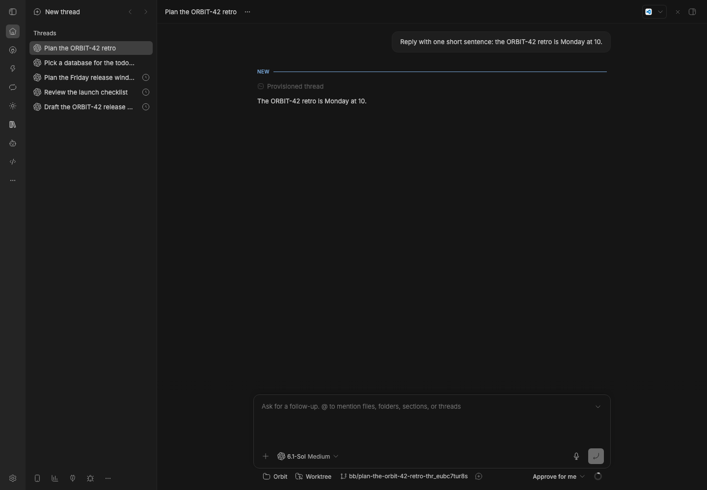


![The Deploy watch runner's thread, opened from the Runners group as BB's thread page, the Bots list still beside it: its job prompt and first run, then an automation run, each ending [PASS] (their runner_report calls fold into Worked for)](assets/bot-runner-thread.png)

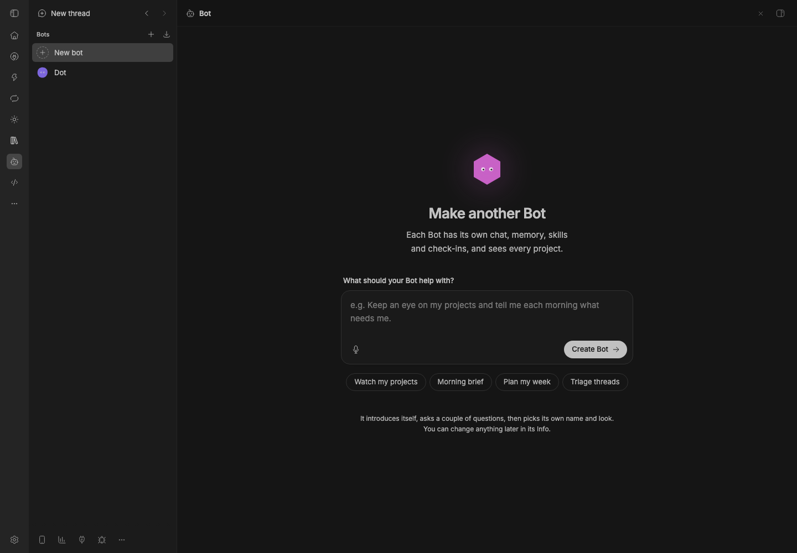


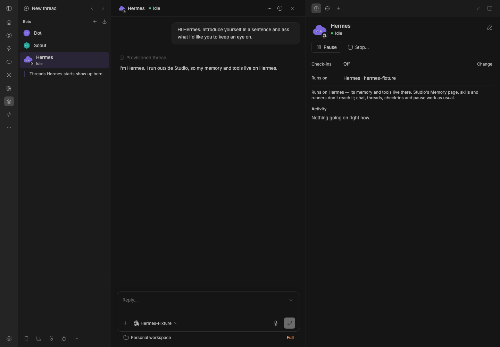

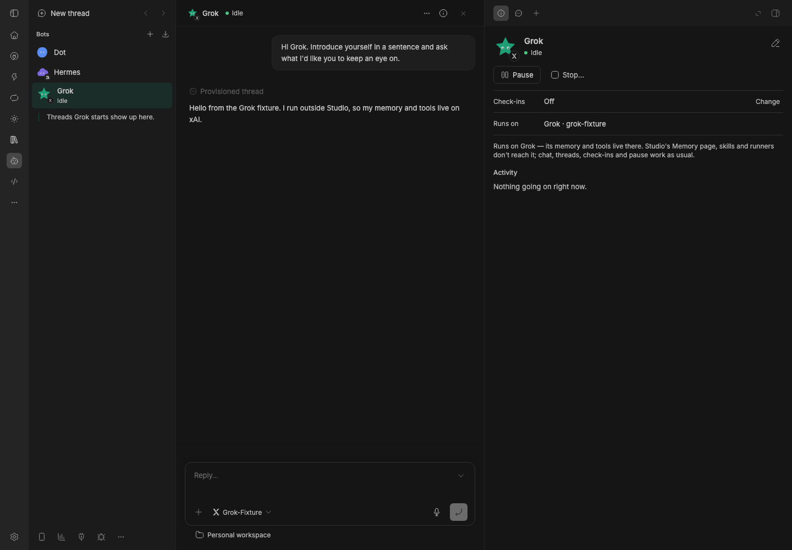

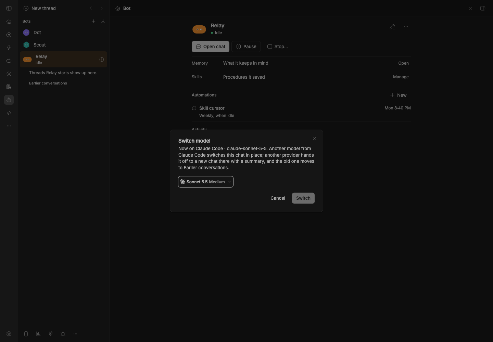

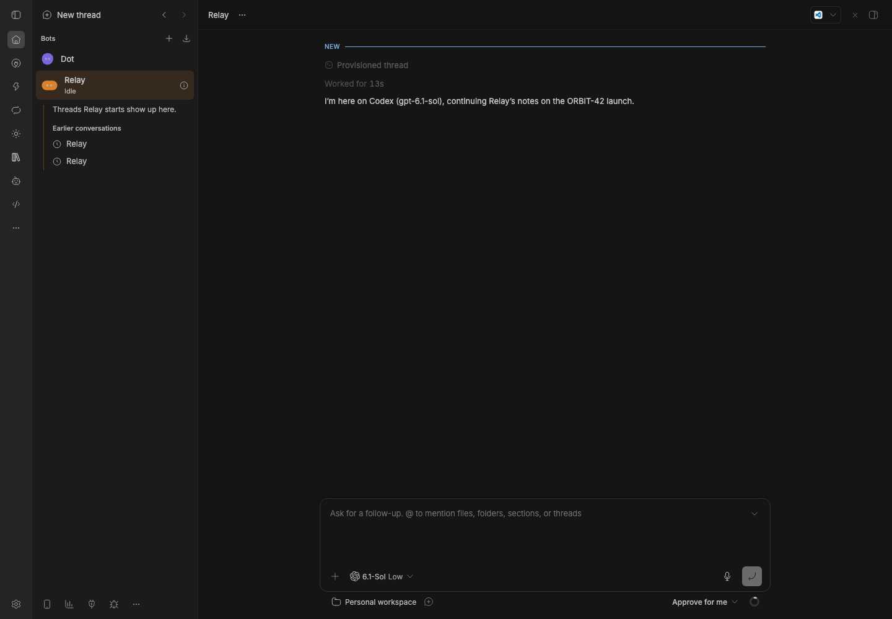


The Bot is your always-on agent, modelled on ChatGPT's dots. It replaced
the Chief of Staff: an existing Chief of Staff became the Bot, named "Chief
of Staff", with the same thread and check-ins; rename it from its page.

- **Workspace**: the Bot page lives under the Studio panel
  (`/plugins/studio/studio/bot`); the rail has no Bot item, since the Bots
  list is always in the sidebar. The bare page opens the last Bot thread you had open in this window: the bot's chat, or a
  runner or worker thread you opened from the Bots list (kept in session
  storage beside the sidebar mode, updated on every thread page shown in
  **bots** mode). With none, or once that thread is gone, it opens the
  primary bot's chat; with no bot, or a bot without a chat, it shows the
  create flow or the bot's Info. The redirect replaces the history entry, so
  Back doesn't bounce to it, and the Bots list stays. A bot's **Info** has
  its own address, `/plugins/studio/studio/bot/<botId>` (the primary's too), which
  its **ⓘ** opens, with **Open chat**; it is also the **Bot info** panel tab
  beside a bot's thread. Its chat isn't
  embedded: it opens as BB's normal thread page, so it has everything a
  thread has, plugin message actions (Studio's reactions) and **Reply in
  side chat** included. With no bot yet, or on **New bot**, the page is the
  create flow, and the first message opens the new bot's chat.
- **Sidebar**: on every page but the Studio panel, BB's sidebar shows
  Studio's list in place of its thread list: **Bots** on top, then
  **Threads**, every top-level thread as a two-line row (status dot, title
  and age, or a **Needs you** or **Failed** pill; the project's name on the
  second line), pinned first and then newest, with no per-project sections.
  Sub-threads and hidden threads stay out of **Threads**; **+** beside it
  starts a new thread, and ⌘-click or middle-click opens a row in a split.
  The list is Studio's thread list provider `studio/bot` ("Bot (Studio)" in
  Settings → Appearance). Under **Bots**, every bot (the primary first) with
  its avatar, tinted in its color; the selected one opens into the
  threads it started: **Needs you**, **Running** (a thread that is running
  or queued, or has one below it), **Runners**, **Schedule** (automations
  that wake it, other than its check-in), **Recent**, **Side threads** (on
  its replies), and **Earlier conversations** (its
  handoff chain, closed by default). A thread another of its threads started
  nests under that one, at any depth (`bot_activity` returns each thread's
  `parentId`). A row opens the thread as a BB thread in the main pane; a
  bot's row opens its chat the same way, and the Bots list stays. On a
  bot's thread the expanded bot is the thread's owner. Each bot's **ⓘ**
  (shown on hover; always on the expanded one) opens its Info: beside the
  chat as the **Bot info** panel tab when one of its threads is open, else
  its Bot page. When a bot's chat (or an earlier conversation of it) opens,
  **Bot info** opens beside it once; if you close it, it stays closed until
  you open the chat again. Closed groups are remembered on this device.
- **Switching the list**: BB's `sidebar.threadListProvider` preference is
  global. Each window keeps a sidebar mode in session storage, so a reload
  keeps it: **studio** on the Studio panel (`studio/studio-items`, see
  Workspace), **bots** (`studio/bot`) everywhere else. Entering a Studio
  list remembers your own choice (in this device's storage). With several
  windows, the window you use decides: a window re-applies its mode when
  its route changes or it gains focus.
- **New bot**: **+** next to **Bots** makes a new bot (BB's own **New
  thread** row stays above the list; BB always shows it). **New bot** opens
  `/plugins/studio/studio/bot/new`: the same welcome as a first bot (Make another
  Bot), and **Create Bot** makes it as "New bot" and opens its chat, where it
  sets itself up.
- **Several bots**: the first bot is the **primary**: the personal project's
  lead (the Chief of Staff before it), the one the iOS app shows, and the one
  agent tools act on outside a bot's thread. Each further bot has its own
  thread in the personal project (not a lead; a handoff moves it too), Memory
  page, skills, runners and check-ins. Its check-ins are its own automation
  on its thread (`Studio project heartbeat bot:<id>`). Every bot has the same
  powers: it sees every project. The page shows the selected bot's Info at
  `/plugins/studio/studio/bot/<botId>` (the bare page shows the primary's only when
  it has no thread to open);
  its runners, check-ins, Memory and skills are that bot's. In a bot's own
  thread its tools act on that bot.
- **Info**: a bot's Info page (`/plugins/studio/studio/bot/<botId>`), and the **Bot info** tab in a thread's side panel
  (a thread panel action, so BB's panel launcher offers it on every thread;
  on a thread no bot owns it shows "Not a Bot thread"). It has the
  bot's avatar, name and live status (Working on N threads, Checks in …,
  Idle, Paused, Stopped), **Edit profile**, ⋯ (Edit profile, Memory, Skills,
  Check-ins, Switch model, Pause / Resume, Stop…), **Open chat** (not on the
  chat itself), Pause / Resume and Stop, Memory, Skills, Automations and
  Activity: **Needs you**, **Running**, **Waiting to start**, **Scheduled**
  (its check-in and automations, with the next run) and **Recent** (the
  last three, then Show all). A thread clicked in the Bots sidebar,
  Activity or Needs you opens as a normal BB thread in the main pane.
- **Edit profile**: a drawn avatar (one of nine shapes with two eyes, in one
  of twelve colors, or **Match the name**), or an emoji, its name, and a
  Description: a sentence or two on its role ("You are my chief of staff."),
  which it's told. **Advanced** lists its skills. A Bot made before drawn
  avatars shows its emoji until you pick a shape; the emoji stays for older
  clients.
- **Image avatar** (`src/bot-avatar.ts`, table `bot_avatar_images`): a Bot
  can draw its own with `bot_avatar_generate({ prompt })`, and you can
  **Upload…** one (PNG, JPEG, WebP or GIF, up to 4 MB) in Edit profile. The
  row of images there (**Drawn**, then its last five, newest first) picks one
  at once; **Revert** goes back to the avatar the last change replaced (the
  drawn one included), and again flips forward. The image shows in the Bots
  list, Info and the chat greeting, and in the iOS app; it's served at
  `/api/v1/plugins/studio/http/bots/avatar?bot=…&image=…` (the URL names the
  image, so it caches for good), and the drawn avatar shows while it loads
  or if it fails. Generation uses the first configured provider: **OpenAI**
  `gpt-image-1` at low quality (about 1¢ an image), then **xAI**
  `grok-2-image` (about 7¢). Keys come from Studio's secret settings
  (**Bot avatars: OpenAI API key**, **Bot avatars: xAI API key**), else
  `OPENAI_API_KEY` or `XAI_API_KEY` in the BB server's environment. With
  neither the tool fails with "Image generation isn't set up: …" before any
  call. A runner can't change its Bot's avatar.
- **Self-managed profile**: a Bot can change its own name, description
  (role), emoji, and drawn shape and color with `bot_profile_update`, from
  its own thread only, and draw its avatar with `bot_avatar_generate`.
  `bot_set` called from a Bot's threads counts as the Bot's edit too. Every
  such edit lands in `bot_profile_changes`, an append-only table (triggers
  refuse updates and deletes): who, when, from which thread, the field, the
  old and the new value. Info's Activity lists them under **Profile
  changes** ("Changed by Dot · description: … → …") with **Revert**, which
  restores the old value and records the revert; the iOS Edit profile sheet
  shows the same list. What's the user's alone (pause, resume, stop,
  delete, model and provider, reasoning, permission mode, turning check-ins
  on or off) isn't in the tool's schema, which rejects unknown keys, and
  `Bots.selfEdit` refuses it as well.
- **Chat**: the Bot's current thread, opened as BB's own thread page, so it
  is exactly any thread: the same timeline, composer, message actions, side
  chat, queued messages, questions and approvals inline. Threads it handed
  off from are under **Earlier conversations** in its sidebar (`bot_chain`,
  which the iOS app also reads for its history).
- **Quiet**: the Bot is told its chat is your inbox. With nothing new (a
  check-in with nothing to report, a notice that a thread it started
  finished fine, an automation result like `[PASS]`) it replies exactly
  `[PASS]`, never a "✓". The iOS app hides it and Studio Mobile sends no
  push for it, but on desktop BB's thread page still shows it as text: the
  plugin SDK can't restyle assistant messages yet (docs/silent-output.md). On check-ins it does the checks itself or reuses the
  worker thread it used before instead of starting a new one each time.
  BB's own "thread completed" notices for threads it started still show in
  the chat: the plugin SDK has no way to turn them off. Recurring work goes
  to runners instead, which post none (below).
- **Starting out**: with no Bot yet, the page is a welcome with one
  question, **What should your Bot help with?** (ideas fill it in), and
  **Create Bot**. See No Bot yet below.
- **Automations** (`src/automations.ts`, table `bot_automations`; Info,
  iOS ⋯ → Automations): one list of what wakes a Bot, four kinds.
  - **Check-in**: wakes the Bot's own thread with a short instruction on a
    schedule; have several (Morning brief 8:00, Evening wrap-up 18:00). The
    Bot's original check-in (its project heartbeat) is listed first as
    **Check-in**, schedule and automation unchanged; its instruction stays
    the Memory page's `## Check-in` section, and it takes one repeating
    cron. Turning it off keeps its schedule.
  - **Reminder**: one message to the Bot's thread at a time (BB's one-shot
    trigger); done once it ran.
  - **Watcher**: a script BB runs on the server host on a schedule that
    wakes the Bot only when it prints something (see **Watchers** below).
  - **Runner**: the runners below, in the same list.

  Check-ins and reminders may pick a cheaper model and reasoning on the
  Bot's provider for routine runs. Every wake-up prompt ends with the
  `[PASS]` rule (docs/silent-output.md). Each row shows the schedule in
  words, the next run and its state; open it for the instruction or script,
  recent runs with what came of each (BB's `automations_runs`), Pause /
  Resume, Run now, Edit and Delete. A bot with none only wakes when you
  write. The Bot has `automation_list`, `automation_create`,
  `automation_update`, `automation_pause`, `automation_resume`,
  `automation_run_now` and `automation_delete` ("in 2h check the deploy" is
  a reminder); `runner_*` still work.

  **Turned off by BB** (`src/auto-resume.ts`, table
  `automation_auto_resumes`): BB turns an automation off after its runs
  fail, even for a passing reason. Studio turns a runner's automation, the
  Bot's check-in or a check-in or watcher back on when every failed run
  since the last good one was transient: the host daemon disconnected or
  restarted, the connection to the host was lost, the provider stopped
  sending progress, or the target thread was "unavailable … or not
  runnable" while it still exists, not archived or deleted (`threads.get`,
  hidden threads included). It leaves off what you paused (no failed last
  run, paused in BB after the failure, or paused through Studio's Pause or
  Stop), anything of a paused or stopped Bot, reminders, and automations
  whose target thread is gone or archived. Each resume logs a line,
  "Resumed after BB turned it off (host disconnected) — 1 of 3 today": a
  runner's last report (log level), or a check-in's or watcher's last
  outcome and runs. At most three resumes per automation in a rolling 24
  hours; past that it stays off and goes to the owning Bot's **Needs you**
  with a phone push and one line in its chat (the urgent `runner_report`
  path), once per failure, until it's on again. Studio checks at startup,
  on the five-minute sweep and shortly after a runner's or Bot's thread
  goes idle or fails; the plugin SDK has no automation events.
  ![Info's Automations in a staged BB: Dot's original Check-in (weekdays 8:00), the Skill curator (weekly, when idle) and Evening wrap-up, the Check the deploy reminder, the Release watch watcher opened with its script, Pause, Run now, Edit, Delete and its two runs (a manual run that woke Dot with "ORBIT-42 v1.4.0 is out on the release page", then Nothing new), and the Inbox watch and Deploy watch runners with their last reports; the Bots sidebar lists the reminder and the evening check-in under Recurring](assets/bot-automations.png)

- **Schedule editor** (`src/ui/bot/ScheduleEditor.tsx`, compiled by
  `src/schedule.ts`): presets, weekday chips, several times a day, every N
  minutes or hours within an active window, quiet hours (runs inside are
  skipped, across midnight too), an end date, the timezone, and a raw cron.
  BB takes one cron per automation, so a schedule compiles to as few crons
  as express it exactly: times that share a minute merge (`0 8,18 * * *`),
  others split (8:00 and 18:30 are two), and Studio keeps them together as
  one automation. More than eight is refused. The end date isn't a cron
  field: Studio pauses the group once the day has passed in its timezone.
  The preview shows the words and the crons.
- **Schedules in words**: wherever the Bot UI would show a raw cron
  (Automations, Runners, Scheduled), `describeCron` in `src/schedule.ts`
  says it in plain English: `5 7,17 * * *` is "Daily 7:05 AM and 5:05 PM",
  `0 */2 * * *` "Every 2 hours", `0 7,12,17,22 * * *` "4× daily: 7 AM, 12,
  5, 10 PM", `0 9 * * 1-5` "Weekdays 9:00 AM", `30 8 * * 1` "Mondays
  8:30 AM", `*/15 * * * *` "Every 15 minutes". A timezone other than this
  machine's is named ("(London time)"). Anything else (a day of the month,
  a month) shows as "Custom: <cron>".

  
- **Memory**: one Studio page per Bot, "<name>'s Memory" in the personal
  project, made the first time it's needed (its thread starts, or
  **Memory** in the ⋯ menu). Its top section, `## Check-in`, is what the Bot
  looks at on each check-in; the rest is what it remembers. The Bot keeps
  it short and edits it with the Pages tools; you can edit it too. The Bot
  is told only the page's id, not its text, and the check-in prompt says:
  read the page, do its `## Check-in`, and stay silent unless something
  matters.
- **Skills**: when the Bot learns a reusable procedure it saves a skill with
  `bot_skill_write` (name, one-line description, Markdown steps) and fixes
  one in place with `bot_skill_patch` (exact text → new text). Only the
  Bot's thread has these: they live in Studio's `bot_skills` table. Its
  instructions list each skill's name and one-line description, and it
  loads the full skill with `bot_skill_view` (`bot_skill_list` lists them).
  Writes and patches return advisory notes, never blocking: a body that
  reads like a log of one session (dates, PR numbers, "we tried"), one over
  about 8,000 characters, or a name close to another skill's. BB
  selects plugin skills only from a plugin's manifest, so a skill a plugin
  makes at runtime can't be a native per-thread skill. **Skills** (⋯, or
  Edit profile → Advanced) has **Share**, which moves the skill to BB's user skills
  (`<BB data dir>/skills/<name>/SKILL.md`, scope `bb-user`; see
  `bb skill list`), where every agent finds it; it refuses a name that's
  already there. **Delete** removes it. See "Skills that learn" below.
- **Skills that learn** (`src/skill-learning.ts`; after Hermes Agent's
  background review and curator). A Studio bot reviews its own work in the
  background and keeps its skills current. External bots learn on their own
  provider, so none of this runs or shows for them.
  - **Counting.** When the bot's thread goes idle (`thread.idle`), Studio
    reads its new events (`threads.events.list` after the last sequence it
    counted). A `turn/completed` whose turn had any tool item
    (`commandExecution`, `toolCall`, `mcpToolCall`, `fileChange`, ...)
    counts as a tool turn; a `client/turn/requested` from the user counts as
    a user turn. A `bot_skill_write`, `_patch` or `_delete` call resets the
    tool count. The first look at a thread only takes a baseline, so old
    history never trips it.
  - **Review.** When either count reaches the interval (10 by default) and
    the bot is active and idle, Studio forks its thread (`threads.fork`,
    hidden, so no notice reaches the bot), switches the fork to the cheapest
    model of the same provider (a price in the model's description, else a
    name like haiku or luna; or the model you pick) and sends it a review
    prompt: lessons, not logs; one skill per kind of task; merge a repeated
    lesson into one rule; fix wrong lines in place; your corrections and
    "remember this" first; facts about you go on the Memory page. It has
    only the skill tools plus `pages_read` and `pages_edit`, and replies
    `[PASS]` when there's nothing to save. When it goes idle Studio records
    the result ("Saved 1 skill", "Nothing to save") and archives the fork.
    One review per bot at a time; a new turn in the bot's thread, Pause or
    Stop stops it, and so do 20 minutes. Review forks stay out of Activity.
  - **Curator.** Weekly, once the bot's thread has been idle for 2 hours:
    a skill unused for 30 days (not loaded or saved) becomes stale, for 90
    days archived. Archived skills leave the bot's list but are kept;
    **Restore** brings one back. Pinned skills are exempt; nothing is
    deleted. It's listed in Automations as **Skill curator** (Pause, Run
    now). With **Curator merges overlapping skills** on (off by default) it
    also starts a fork that merges overlapping skills.
  - **Approval.** With **Review skills before saving** on, a review's
    writes wait in Skills with a line diff and **Approve** / **Reject**.
  - **Settings** (Skills, ⋯ or Edit profile → Advanced): **Learn from
    work** on or off, every N turns, review model, approval, the last
    review's result with **Review now**, pins, and a collapsed **Archived**
    list. iOS: the Skills sheet has Learn from work, approvals, pins (swipe)
    and Archived with Restore.

  
- **Recall**: `bot_history_search` searches BB's thread search, keeping
  only the Bot's threads (its handoff chain and threads it started).
- **Phone**: questions and approvals it, or a thread it started, raises push
  with Answer / Approve as before; every finished turn, the Bot's messages
  included, now pushes with **Reply**, which sends to the thread
  (`BB_REPLY`, see the Mobile plugin).
- **Threads it started**: BB's thread metadata names the thread that made
  each thread. A thread whose `sourceThreadId`, `parentThreadId` or
  `lifecycleOwnerThreadId` is the Bot's thread, or a thread it handed off
  from, counts. `originPluginId` only names a plugin, so it isn't used.
- **Pause** turns check-ins, reminders and watchers off; the Bot is told
  it's paused and gets no Studio tools but its own. **Resume** turns back on
  exactly what Pause or Stop turned off. **Stop** (confirmed) pauses it, stops the running threads it spawned
  itself, and pauses automations that wake it and its runners. A spawned
  thread is a BB child of the Bot's thread (`parentThreadId`) or one that
  archives with it (`lifecycleOwnerThreadId`); a fork or "continue in new
  thread" only has `sourceThreadId`, is often your own work, and keeps
  running. Resume after Stop turns back on exactly the automations and
  runners Stop paused, not ones that were already off; if one fails, the
  Bot stays stopped and Resume retries the rest. Nothing is deleted.
- **Side threads** (`src/bot-side-threads.ts`, `src/ui/bot/reply-in-thread.ts`,
  `src/ui/bot/SideThreads.tsx`; table `bot_side_threads`; `bot_side_threads`,
  `bot_side_threads_for_bot`, `bot_side_thread_open`). Slack-style threads on
  the Bot's replies, built on BB's side-chat plugin: start one with its
  **Reply in side chat** on a reply. Studio matches each side chat of a Bot's
  chat to the reply it quotes, and draws "💬 2 replies · 5m" under that
  reply itself (nothing the Bot writes), which opens the newest side chat.
  The Bots sidebar lists them under **Side threads**. A side chat runs as the
  Bot but can't change it: the Bot tools that would refuse there. It isn't
  the Bot's work either, so it stays out of Activity and Stop. On iOS a
  reply's menu has Reply in Thread, which starts a side chat the same way
  (or forks the chat itself when side-chat is off), and shows the same row.
- **Prompt cache** (`src/bot-cache.ts`, prices in `src/bot-prices.ts`;
  tables `bot_cache_settings`, `bot_cache_pings`, `bot_cache_banner_off`).
  Claude Code caches a Bot chat's history for an hour; each send then reads
  it at a fraction of the input price, and once it expires the next send
  writes it all again at 2x. Studio **warms** each Bot's own chat (not its
  runners or the threads it started, which run on their own schedules): when
  the chat is idle, above the size threshold and still warm, it sends a tiny
  ping about every 55 minutes after the last turn or ping. Warming stops
  after the idle cutoff with no message from you (pings, check-ins and
  Studio's notices don't count), in provider overage (the cache lasts
  5 minutes there), outside waking hours (the host's local time), while the
  Bot is paused or stopped, and while the chat is busy. Your next message
  resumes it. An expired cache isn't pinged (that would pay the write your
  next message pays anyway), and nothing is sent in the first 5 minutes
  after Studio starts. Only Claude models are warmed; OpenAI's cache can't
  be kept for an hour, so those chats only get the estimates.
  - **What you see**: the ping is an agent-only message, so BB shows no user
    row, and it tells the Bot to reply exactly `[PASS]`. That reply still
    shows on the desktop (BB has no way to hide a core message row); the
    iOS app hides `[PASS]` replies. BB marks a chat unread when a turn
    ends, so Studio marks it read again if it was read before the ping;
    the Mobile relay sends no push for `[PASS]`. The send carries
    `pluginSubmission` `{ pluginId: "studio", data: { kind: "cache-keepalive" } }`
    for `message.dispatch` hooks; Smart Queue only holds human sends to busy
    threads and pings only go to idle ones. Learn from work doesn't count a
    ping as a user turn, a ping doesn't stop a running review, and the skill
    curator's 2-hour idle wait ignores pings.
  - **Header chip** on a Bot's chat: **Warm · 42m** (minutes left),
    **Cold** or **Warming off**, with why, the next ping, the costs, a
    warming switch and **Compact now…** in its menu. The iOS app shows the
    same line, small, beside the Bot's status.
  - **Cold-send banner**: on a cold Bot chat above the threshold, the
    composer says "Cache expired — next send re-reads ~N tokens (~$X)" with
    **Dismiss** and **Don't show for this thread**. Studio never suggests
    compacting; **Compact** is a manual action in Bot info and the chip's
    menu.
  - **Settings** (Bot info → Prompt cache, `bot_cache_set`): warming on or
    off (on), size threshold (100k tokens), idle cutoff (3 hours), waking
    hours (7:00–23:00). Bot info shows "Warming ≈ $0.07/h" from the price
    table. RPCs: `bot_cache_state` (`threadId`, or `botId` for its chat),
    `bot_cache_set`, `bot_cache_banner_hide`, `bot_cache_compact`.
  - **Economics, honestly**: warming pays a cache read an hour; letting it
    go cold pays one 2x write when you come back. With a read at 0.1x input
    that breaks even around 20 idle hours (about 17 with pings every
    55 minutes), so a few hours of warming while you're around is cheap
    insurance, and warming overnight isn't worth it, hence the idle cutoff
    and waking hours. A 300k-token chat on Claude Opus 5.5 ($4 input,
    $0.20 cache read): warming ≈ $0.07/h, a warm send ≈ $0.06, a cold send
    ≈ $2.40. Opus 5.5's read is 0.05x, so there it breaks even nearer
    35 hours. On a subscription these are usage against your limits, not
    dollars billed. Update `src/bot-prices.ts` when prices change.
- **No Bot yet**: the page is a centered welcome, **Meet your Bot**, with
  one question, **What should your Bot help with?** (ideas such as **Watch
  my projects** and **Morning brief** fill it in; Talk can dictate it).
  **Create Bot** (or Enter) makes it as "Chief of Staff", a drawn blob,
  starts its chat in your personal project and opens that as BB's thread
  page with the Bots list. Its first message is the setup (`bot_create`'s
  `setup`, `setupPrompt` in `src/bot.ts`): what you asked for, and to
  introduce itself, ask a couple of questions, then pick its own name,
  description and look with `bot_profile_update`, and offer a check-in.
  Leaving the question empty is fine: it asks. The Bots sidebar shows a
  **Your first bot** row until it exists, and the iOS app has the same
  flow. Its
  instructions come from Studio's agent configuration for its thread, not a
  first message, so its title isn't the instructions.
- Its thread is an implementation detail. A handoff (`thread_handoff`)
  moves the Bot to the new thread. It is the personal project's lead, so it
  sees every project.
- RPCs: `bot_list`, `bot_get`, `bot_create`, `bot_set` (name, avatar emoji, shape, color, role), `bot_avatar_history`,
  `bot_avatar_use` (an image id, or null for the drawn avatar), `bot_avatar_revert`, `bot_avatar_upload` (base64),
  `bot_profile_changes`, `bot_profile_revert` (a change id), `bot_set_thread`,
  `bot_set_run` (check-ins), `bot_pause`, `bot_resume`, `bot_stop`,
  `bot_activity`, `bot_memory`, `bot_chain` (its thread and the ones it
  handed off from, oldest first), `bot_checkin_preset` (`morning`,
  `evening`, `working` or `off`), `bot_skills`, `bot_skill_write`, `bot_skill_share`,
  `bot_skill_delete`, `bot_skill_pin`, `bot_skill_restore`, `bot_learning`,
  `bot_learning_set`, `bot_learning_review`, `bot_skill_curate` (`dryRun`
  lists what it would change), `bot_skill_pending_resolve`, and the runner RPCs below. Each takes an optional
  `botId` (the primary when absent); `bot_create` makes the primary first,
  then additional bots. Agent tools: `bot_get`, `bot_set`, `bot_avatar_generate`, `bot_pause`,
  `bot_resume`, `bot_stop`, `bot_activity` (`bot_pause` and `bot_stop` work only
  in the Bot's own chat or its handoff chain; threads it started, its runners
  and other threads are refused and the user uses Studio → Bot); only the Bot's thread also gets
  `bot_profile_update`, `bot_skill_list`, `bot_skill_view`, `bot_skill_write`, `bot_skill_patch`,
  `bot_skill_delete` and `bot_history_search`.
- **Watchers**, for script authors. Studio creates a BB script automation
  (bash, sh, node or python3; timeout up to 15 minutes; working directory
  the automation's storage by default, so files like `last.txt` persist
  between runs). The contract:
  - Exit 0 and print the finding to **stdout**: Studio posts it to the
    Bot's thread as "Watcher <name>: <output>" (first 1,500 characters) with
    a note carrying the watcher's instruction, and the Bot wakes. Point a
    watcher at a runner and the runner wakes instead.
  - Print nothing, or end with a line `{"wakeAgent": false}`: nothing
    happens, no tokens. BB records the run as skipped.
  - Exit non-zero or time out: nothing happens; the run shows as failed
    with its first stderr line. Use it for errors, not for "no change".
  - Keep your own state (the last value seen) in a file; print only what's
    new. Stderr never wakes anyone.

  How it works: BB runs scripts without an agent and tells plugins nothing
  when a run ends, so Studio reads each active watcher's recent runs once a
  minute (`automations_runs`) and posts each new one with output once. The
  script needs no bb CLI, token or callback.
- **Runners** (`src/runners.ts`, table `bot_runners`): automated sub-agents
  so the Bot's chat isn't flooded. A runner is one long-lived thread with a
  name, a job (a short instruction), a schedule (an automation that wakes
  its own thread; the heartbeat's cadences and cron), a state (active or
  paused), its last run and its last report. The Bot makes one with
  `runner_create` when a task becomes recurring; its first run starts at
  once, and each scheduled run's prompt carries the job.
  - **Quiet by default**: a runner never writes to the Bot's chat. It
    reports with `runner_report({ level, summary })`, a tool only runner
    threads get: `log` stays in its thread and the Bot's Info; `tell` posts
    one line, "From runner <name>: …", into the Bot's thread (a message
    sent from the runner's thread, with an agent-only note telling the Bot
    not to answer it); `urgent` is a tell plus **Needs you** and a phone push
    (Studio Mobile's `notify`, `turn-finished` on the Bot's thread, so the
    lock screen has **Reply**). A run with nothing to report ends without a
    message and produces nothing.
  - **No child notices**: BB posts "child completed / failed / needs
    attention" into a thread's `parentThreadId` (any non-fork child) and
    "ownership assigned / removed" when that parent changes;
    `sourceThreadId` and `lifecycleOwnerThreadId` post nothing, but a
    lifecycle owner is immutable and archives its dependents with it (a
    handoff archives the Bot's old thread). So runner threads are spawned
    with no parent or owner, tagged `pluginMetadata: { runner, bot }`, and
    `bot_runners` groups them under the Bot. They're kept out of Activity's
    thread lists; an urgent report puts the thread in Needs you until you
    open it.
  - **Not in BB's thread list**: a runner belongs to its Bot, so its thread
    lives only under the Bot (Runners) and is hidden from BB's main Threads
    list. Runners are spawned with `visibility: "hidden"`; an adopted thread
    (a project lead, say) is hidden when adopted; runners from before are
    hidden once at startup (`bot_runners.hidden`, retried if BB refuses). BB
    keeps a hidden thread out of its sidebar, thread search, mention
    suggestions and unread attention, and its subagents inherit it; the
    thread still opens from Studio, runs its automation and takes messages.
    Deleting a runner makes its thread visible again (an adopted one back in
    the list, a Studio-made one in BB's archive). Check-ins, reminders and
    watchers spawn no threads: they wake the Bot's thread (or a runner's) or
    run a script.
  - **Every other thread a Bot uses** (`src/bot-owned.ts`) is hidden the
    same way, so BB's main list keeps only the threads you made. That is the
    Bot's own chat and handoff chain, hidden as soon as the Bot gets it (a
    new Bot, Make this my Bot, a handoff to a new thread or model) and by
    the sweep below; threads its chain spawned at any depth (`parentThreadId` or
    `lifecycleOwnerThreadId`; a fork the user made is theirs), and every
    thread an automation starts when the Bot's chain or a thread it owns
    created that automation (`createdByThreadId`), transitively. A child the
    Bot spawns that sets up its own automation is the Bot's, and so is each
    run's new thread. `thread.created` hides a child of a known Bot thread
    at once; a sweep at startup, every five minutes and just after an
    automation's run finds the rest (`automations_overview`, then
    `automations_runs` for each run's thread, or the run's `[bb automation
    due:<id>]` first message when it's older than the runs page). They stay
    in the Bot's Activity and Recent, which list hidden threads
    (`includeHidden`) except hidden forks (side chats, skill reviews); the
    Bot's chat is its Activity's own thread and opens from the Bots list.
    Studio records each thread it hid (`bot_hidden_threads`) and hides a
    thread only once, so one you show again in BB, the Bot's chat included,
    stays visible. A hidden thread has no unread dot or attention in BB, so
    a question the Bot asks in its chat reaches you through Activity's
    **Needs you** (Studio reads its pending interactions). BB's thread
    search skips hidden threads, so the Bot's history search does too.
  - **Sidebar**: a **Runners** group (status dot, next run; hover for the
    schedule and last report). A click opens the runner's thread as a
    normal BB thread.
  - **Info**: a **Runners** section with each runner's schedule and last
    report, **Pause**/**Resume**, **Run now** (the automation's run),
    **Edit** (name, job, schedule with the heartbeat's fields) and
    **Delete** (confirmed: its automation is deleted, its thread archived).
    **New runner** makes one.
  - **Adopt as runner**: Info lists threads the Bot started (or whose
    automation its thread created) that an automation wakes. Nothing
    changes until you click **Adopt**: the thread is registered, its
    automation and schedule stay, one reporting note is appended to the
    automation's prompt (runner_report instead of `[PASS]` or messaging the
    Bot), and the thread is unnested from the Bot (BB posts one "removed"
    notice, then none) and hidden from BB's thread list. Deleting an adopted
    runner only lets it go: the note is removed and the thread is visible
    again.
  - Pausing a runner pauses its automation; **Stop** on the Bot pauses every
    runner. RPCs: `bot_runners`, `bot_runner_create`, `bot_runner_update`,
    `bot_runner_pause`, `bot_runner_resume`, `bot_runner_run_now`,
    `bot_runner_delete`, `bot_runner_seen`, `bot_runner_adopt`. The Bot's
    tools: `runner_create`, `runner_update`, `runner_pause`,
    `runner_resume`, `runner_delete`, `runner_list`, `runner_run_now`.
- **External bots** (**Import bot**, the ⤓ beside **+** over the Bots list):
  a bot whose thread runs on an external agent through
  [Studio Agents](../bb-studio-agents/README.md): Hermes, OpenClaw, Grok or
  the experimental Dot. The dialog lists those providers with their state
  from Studio Agents' `health` RPC (Ready, Not configured, Offline, Needs a
  key, Not installed) and links to Studio Agents settings when none is
  ready. Pick one, its model (OpenClaw: its Gateway agent), a name, shape
  and color, and its **Permissions** (only the modes the provider supports;
  Accept edits by default, Grok is Full access only), all for its first
  thread; `bot_create` with `external: { providerId, model, permissionMode }`
  starts that thread (`bot_external_providers` lists the choices with their
  `permissionModes`). Your first bot is always a Studio bot.
  - **What works**: its chat, the Bots sidebar, sub-threads, Needs you,
    check-ins (Studio's automation sends its thread the check-in message),
    Pause, Resume and Stop. Its avatar carries the provider's logo.
  - **What doesn't**: Studio's Memory page, bot skills, runners and the
    `bot_*`/Studio tools can't reach a remote agent, so the bot gets none:
    Info and its ⋯ menu say "Runs on Hermes — its memory and tools live
    there.", and `bot_memory`, `bot_skill_write`, `bot_runner_create` and
    `bot_runner_adopt` refuse an external bot. Its instructions only say who
    it is. A Studio backup doesn't carry the provider yet: a restored
    external bot comes back as a Studio bot.
- **Model is the thread's**: a bot follows its current thread, and the
  provider and model are that thread's (`bot_get` reads them off BB). BB keeps
  a thread on one provider for life: `threads.update` changes only its model
  and reasoning level, and BB's composer (in the bot's chat too) picks models
  within the thread's provider, with no hook for a plugin to intercept. So
  another provider is the Bot's ⋯ menu → **Switch model…**, BB's own
  provider/model picker bound to the generic
  `thread_handoff_to_model({ threadId, providerId, model, reasoning? })`: the
  same provider (Opus → Sonnet) switches the thread in place
  (`change: "in-place"`); another (Claude → Codex) hands it off
  (`change: "handoff"`, "Handing off to Codex…") through the project-lead
  handoff: a new thread there gets a summary of the old one and its
  permission, the old one is archived and shows as Earlier conversation, and
  a bot's chain, check-in and runners follow. It works on any thread. Nothing
  is stored on the bot. The primary bot leads with Studio's tools, so it
  can't move to an external provider.
- **Kind follows the current thread's provider**: an external provider
  (Studio Agents) makes it an external bot, any other a Studio bot with
  Memory, skills, runners and bot tools (`provider_id` only caches the
  provider for synchronous reads).
- **Backup**: a Studio backup includes the Bot (name, avatar, shape, color,
  role, state, Memory page id) and its skills; they're restored only on a BB without a Bot. The
  Memory page itself comes back with Pages.
- No per-action rules or approval gates: the Bot works like any agent. `chief_of_staff`,
  `chief_of_staff_set` and `chief_of_staff_set_run` remain as deprecated
  aliases for one release.

## How it works

- Some kinds are built into Studio (Artifacts so far; see
  [`docs/merging-add-ons.md`](../../docs/merging-add-ons.md)). They implement
  the same provider contract in-process, keep the plugin id they had as add-ons,
  and open under Studio's one panel. Other add-ons reach them through Studio's
  `provider.call`.
- Add-ons implement the Studio provider contract (`studio_describe`,
  `studio_list`, `studio_search`, `studio_create`, `studio_move`,
  `studio_archive`, `studio_delete`, `studio_action`) from
  [`@bb-studio/kit`](../bb-studio-kit), and publish them for RPC discovery.
  Studio finds them with `bb.sdk.plugins.experimental_discoverRpc` and calls
  them with `callRpc`. Any plugin can join the suite this way.
- Studio keeps an FTS5 index of item titles and `studio_read` text. `studio_changed` updates changed items; `bb studio reindex` rebuilds the index. The `searchAll` RPC returns ranked items and thread matches with snippet ranges.
- An add-on tells Studio when its items change (`studio_changed`); Studio
  relays that over realtime and the open collection refetches.
- A stopped or failing add-on shows up as unavailable instead of breaking the
  collection.
- Studio stores tags, open tabs, saved views and project leads itself, keyed by
  `<plugin id>:<item id>` where items are involved, so add-ons don't need to
  know about them. Tags on items an add-on no longer lists are
  dropped. Each add-on owns its data, editors, tools, CLI and mentions.

See [`docs/studio.md`](../../docs/studio.md) for the design.

## Setup

**Studio → Setup** (`/plugins/studio/studio/setup`) is the one place to set up
BB Studio. It lists every add-on from this repository's marketplace with its
one-line description and status: **Installed**, **Not installed**, **Turned
off**, **Needs setup** or **Broken**, with its health checks under it.

- **Install** and **Install all** install missing add-ons from the
  `bb-studio` marketplace, and **Turn on** enables one that's off. Install all
  skips Studio Mobile, which only the iOS app needs. Each action shows the
  same CLI command with a Copy button, for when it fails.
- If BB doesn't know the `bb-studio` marketplace yet, the page shows
  `bb marketplace add git:github.com/patleeman/bb-studio@main` first.
- **Retired plugins** shows `studio-tables` and `emoji-react` (Studio
  Reactions, built into Studio now) if they're installed: why it is
  retired, what removing it keeps and deletes. **Remove…** asks before it
  removes anything.
- **Kinds** turns built-in kinds on and off and picks who opens and creates
  each; see [Kinds](#kinds).
- Problems with plugins outside BB Studio are listed at the bottom.

`bb studio setup` prints the same status, the retired plugins and the
commands left to run; `--json` prints the whole summary.

## Kinds

**Setup → Kinds** lists the kinds built into Studio: pages, drawings,
recordings and dictation, artifacts, designs and dashboards.

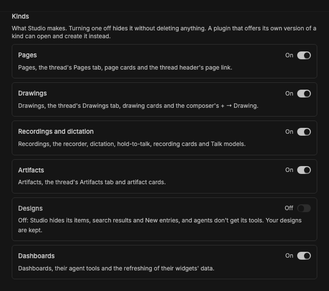

Captured from a staged BB: the Kinds section of Studio's Setup page with
Designs turned off for the shot. Each kind shows what it covers and its
On/Off switch; the off one says its designs are kept. No plugin in the
staged BB replaces a kind, so no "Open and create with" menu shows.

- **On/Off.** Off hides the kind: Studio's collection, search and New menus
  leave its items out, agents don't get its tools or instructions, and its
  thread tab, composer entries and reply cards go away. Nothing is deleted;
  turning it back on restores everything.
- **Open and create with** shows when another plugin offers its own version
  of the kind (see [Replacing a built-in kind](#replacing-a-built-in-kind)).
  Choose Studio, that plugin, or Automatic: your choice wins, else a single
  replacing plugin, else Studio. The chosen one gets the New entries
  (Studio's New menu, Quick open's New commands, the composer's + entry) and
  agents are told to make new ones there. Items already made with the
  built-in keep opening in Studio.

When it applies:

| What | When |
| --- | --- |
| Collection, search, New menus, Quick open | At once |
| Agent tools and instructions | From each thread's next session start or resume; a running session keeps what it has |
| Thread tabs, composer entries, reply cards, the recorder | After a window reload (Setup offers **Reload window**) |

No `bb plugin reload studio` is needed. Turning recordings off stops the
recorder and dictation in the window after its reload; recordings already
transcribing finish on the server.

### Replacing a built-in kind

A Studio provider (`studio_describe` version 2) may declare that one of its
kinds stands in for a built-in kind with `replaces`, set to `page`,
`drawing`, `recording`, `artifact`, `design` or `dashboard`:

```ts
studio_describe: () => ({
  pluginId: "notion-pages",
  version: 2,
  panel: null,
  kinds: [{
    id: "notion-page",
    label: "Notion page",
    plural: "Notion pages",
    icon: "FileText",
    replaces: "page",
    create: { mode: "rpc" },
    capabilities: { create: true, move: false, archive: false, delete: true, rename: true, duplicate: false, export: false, comments: false, versions: false, links: true },
    mentionProviderId: null,
    columns: [], actions: [], canArchive: false, blurb: "Pages in Notion.",
  }],
}),
```

The field is optional, so older providers are unaffected. Your kind keeps
its own id and items; Studio only routes New to it when it's chosen (or the
only replacement) and offers New on your kind only then.

## Backup and restore

`bb studio backup [--out <file|folder>]` saves every Studio item into one
`.zip`. That covers pages, recordings with their audio, drawings, artifacts,
designs, and Studio's tags, project leads, views, links, comments and
versions. `bb studio restore <file>` shows what would change, and `--yes`
restores it. Restore matches each item by its original id, so running it
again changes nothing, and it never overwrites a copy that is newer here.
Projects are matched by path or name; items whose project isn't on the BB
become global items. The Setup page has the same **Back up** and **Restore…**
actions; restoring there shows the dry run and asks before it changes
anything. [docs/backup.md](../../docs/backup.md) describes the file format,
what's left out and how conflicts are handled.

## Plugin health

Studio checks every enabled plugin when it starts and every 3 minutes after
that. It reads two things:

- **BB's own status for every plugin.** A plugin that needs setup, stopped
  with an error, doesn't work with this BB version, or has a background
  service that keeps restarting.
- **Plugins' own checks.** A plugin can publish `studio_health` with
  `registerHealth` from `@bb-studio/kit/health`. It reports problems only the
  plugin can see, like a missing API key. Each problem has a fix link, which
  defaults to the plugin's settings page. Studio Decisions reports a missing
  or failing Jev provider and an unavailable fallback model.

The **Plugin health** item in the sidebar footer lists the problems. It opens
by itself when a problem you haven't seen is found twice in a row, 30 seconds
apart, so a plugin that's only reloading doesn't open it. It closes by itself
once those problems are fixed or hidden, or with its close button. Each problem has three
actions: **Fix** opens the place to fix it, **Turn off plugin** disables the
plugin, and **Hide** hides it until it changes or goes away and comes back.
**Open plugin setup** goes to the Setup page, which also shows hidden
problems and what passed. `bb studio health` prints every plugin's problems
and exits 1 when a problem isn't hidden.

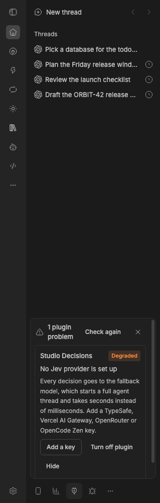

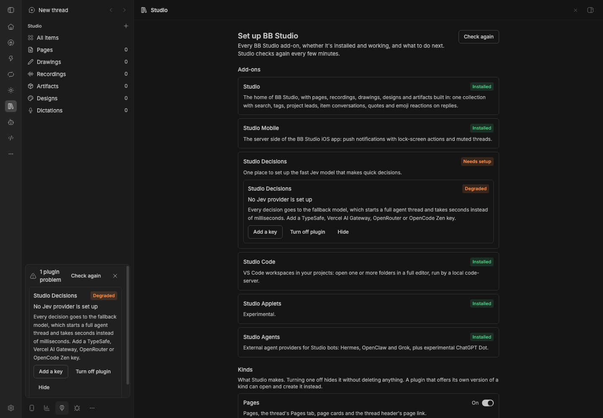

## Development

```sh
pnpm typecheck
pnpm test
bb plugin build .
```

`@bb-studio/kit` is a `file:../bb-studio-kit` dependency. Keep
`package-lock.json` current (regenerate it in a clean clone, not the pnpm
workspace), because BB's Git install runs `npm install` from it.

## Templates and export

Pages and drawings can be saved as templates from an item's menu. The New menu lists those templates.

The hub offers `duplicate`, `setTemplate`, `instantiateTemplate`, `templates`, `exportItem`, and `exportBulk` RPCs. `exportBulk` returns a base64 ZIP containing the provider's files. Individual exports use the item's menu. Template fields use `{{name}}` style variables; unknown variables remain visible.

## Item chat

Studio owns each item's **Chat** action, conversation picker, linked thread and
quotes. Everything **Chat** opens goes in a split beside the item, which stays
on screen. **Chat** opens the item's linked thread. Without one, it opens a
new-conversation composer, and sending turns that pane into the new thread.
**Choose conversation…** opens a thread picker in the same split. A new
conversation keeps the item's context, project and draft; a quote goes to its
linked thread, or opens the composer with the quote when there is none. Where
BB doesn't split (a small screen, or splits turned off), these open in the
main view. Pages keeps its page-chat history.

Old draft keys and quote storage are retained.


