# Studio

> **Studio** is the core of **BB Studio**: pages (with their whiteboards), recordings, designs and artifacts are built in. See the [suite overview](../../README.md).

Studio is built around one Bot with many conversations: the sidebar shows
one Bot at a time, its conversations with you and the workers it runs (see
[One Bot, many conversations](#one-bot-many-conversations)), and the
Library is the Bot's files. Underneath is the collection: everything you and
your agents make, including pages, Talk recordings and dictations, drawings,
designs and saved artifacts, and other plugins' items. Search across all of
them, filter by kind, project and tag, and hand any of them to an agent.

## VS Code

VS Code is built into Studio. Choose **VS Code** from a thread's right-panel
**+** menu, or open a code file to jump to its lines in that editor. Threads on
the same worktree share one editor. In the editor, ⌘K starts VS Code's own
chords; **⌘K ⌘K** or **BB: Search** opens BB's search. The six
`code_*` tools and `studio-code` skill keep their names. Each workspace uses
Studio's own code-server runtime and `code.*` RPCs. The removed thread-header
VS Code button stays absent.

[Editor usage](src/code/README.md) covers sharing, live edits and reviews.
[Workspace compatibility](../../docs/upgrade-studio-code.md) explains why old
workspace ids and links still work after the migration.

## Workspace

Studio opens on its workspace: items in tabs, without a conversation. The
Studio item list shows only as its new tab page: **+** opens it, and an item
opened from it takes its place, as in a browser. Items opened from the
sidebar or Studio search open as tabs too. Drag tabs or sidebar items to a pane's edge to split; drag onto
a tab bar to move or reorder. A tab's right-click menu offers split and move
commands, and separators resize with the mouse or arrow keys. Closing a tab
keeps the item. The workspace remembers the layout locally across visits and
refreshes. An item always opens as a tab: its own address, from a card in a
chat, **Open in Pages**, a link or a typed URL, opens the tab and leaves the
address for the workspace. Old list addresses, such as a kind's (`/plugins/studio/studio/page`),
open the new tab page on that kind.
Right-click a tab for Close, Close others, Close tabs to the right, Close all in
the pane, splits, moves to another pane, Rename, and Copy link.

### Starred

Star an item to keep it one tap away: the star in its header (pages,
whiteboards, artifacts, designs and every other item view), or **Star** in a
row's ⋯ or right-click menu. **Starred**, at the top of the Studio sidebar
with its count, opens the library on `is:starred`, newest-starred first; the
**Starred** button above the list does the same in the Studio app and in a
thread's Studio tab. Stars sync to the iOS app, survive renames and go when
the item is deleted. `bb studio starred` lists them.

### The Studio tab in a thread

A thread's side panel has a **Studio** tab (**+ → Studio**) for every
kind: pages, drawings, designs, artifacts, recordings and
dictations, and each kind an add-on registers with Studio. Each item opened
from the thread gets its own tab beside the others. It opens on Studio's
library, the same component as the Studio app's new tab, with the same
search, filters, rows and sort. **This thread** (items made or linked in it,
and the page it was started from) is its first group, a scope you can clear
with the **This thread** button. The list follows the panel's width: a table
when wide; in a narrow panel each row shows the title with kind and project
under it and the time on the right. As in the library, dictations stay out
of **All**; the kind filter and search find them.
Studio's own kinds open in place in their editor, with a back arrow to the
collection; a recording or dictation opens Talk's recording view (transcript
and playback). An add-on's item opens its page in BB's main area, as from
the library, and the tab stays on the collection; a new add-on kind appears
with its own chip without any change to Studio. **New** offers each kind that can be made and opened here,
makes the item in the thread's project and links it to the thread. The
save icon opens Artifacts' save picker for the latest reply's files. Reply
cards, **Expand to page**, and links inside an open item (a page mention, an
embed's arrow, a link in a page's text) open a Studio tab on their item
(`{ kind, id }` params), so you never leave the thread; **Open in Pages** and
⌘-click take an item to the Studio app instead. Kinds turned off in **Setup → Kinds** don't appear.
The tab remembers where you left it, per thread and per tab: switch to
another side-panel tab, reload Studio or restart BB, and it comes back on
the same item (or the collection, with its kind chip) scrolled where it was.
A card that opens the tab again on its item shows that item.
The old per-kind tabs (Pages, Drawings, Design, Artifacts) are
gone; one of them still open from before shows as unavailable, so close it
and open Studio.
Double-click a tab, or press F2 on it, to rename its item. The tab row shows
the item's own tools and status, such as a page saving or a recording paused;
the tab names the item, so its title isn't repeated, and Chat isn't offered.
Each tab row carries the active item's tools, such as Chat, beside its tabs.
With one pane, the tab row takes BB's title bar, so the item sits under a
single bar. Open items live here as tabs.
**Studio sidebar**: on the Studio panel, BB's sidebar shows Studio's list
in place of its thread list (thread list provider `studio/studio-items`,
"Studio (Studio)" in Settings → Appearance; it switches to the Bot's list
on leaving, see Bot). **+** at the top is Studio's New menu. Below
it, **All items** and each enabled kind (Setup → Kinds) with its item count,
then **Saved views**, **Tags** (with their colors and counts), **Pinned**
(pinned tabs) and **Recent** (the 15 most recently edited items). A kind,
view or tag opens the new tab page filtered by it; an item opens as a tab.
The row for the current filter or tab is highlighted, and each group
collapses from its heading.

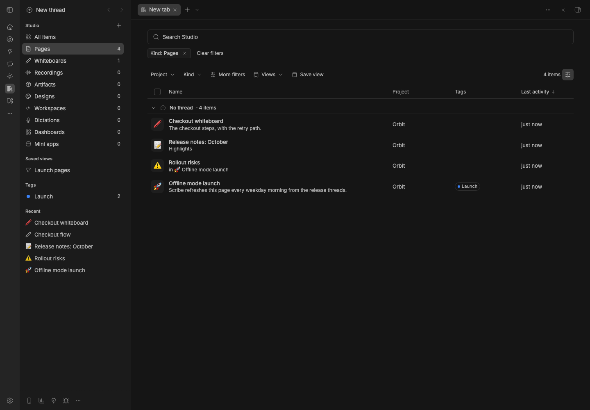

Conversation-side item views continue to work independently. At phone widths, a
pane picker shows one pane at a time while preserving the desktop arrangement.

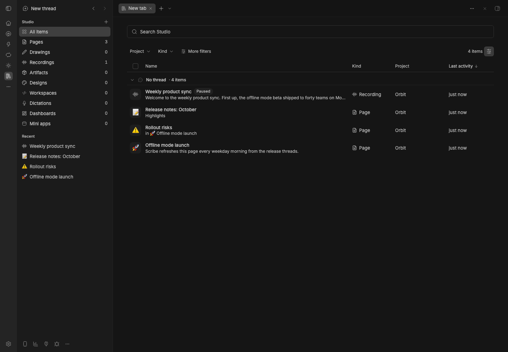

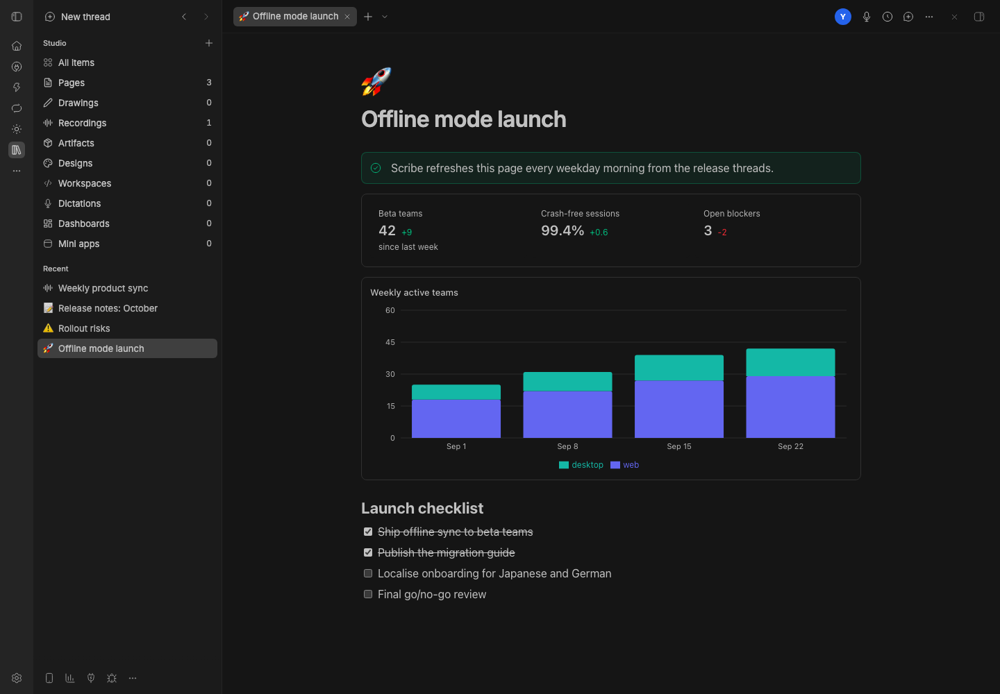

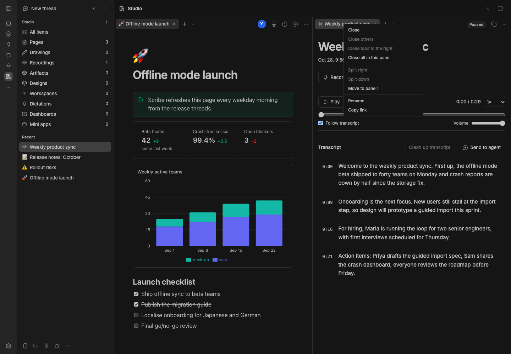

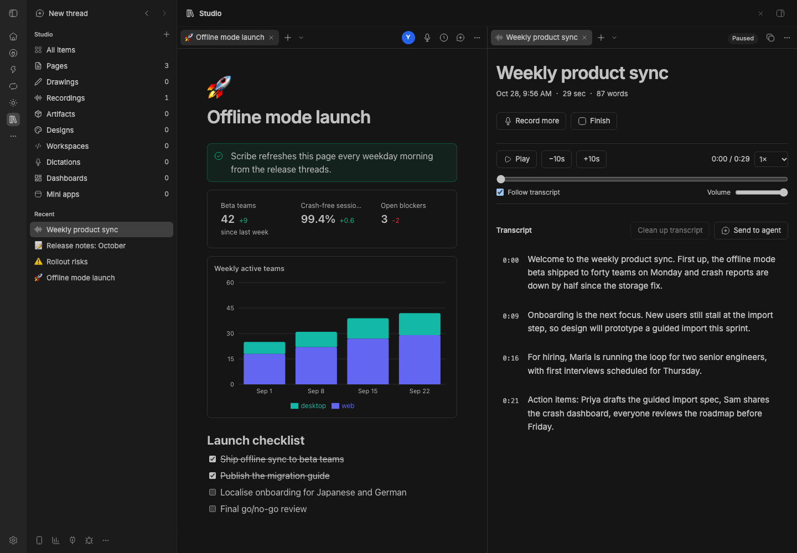

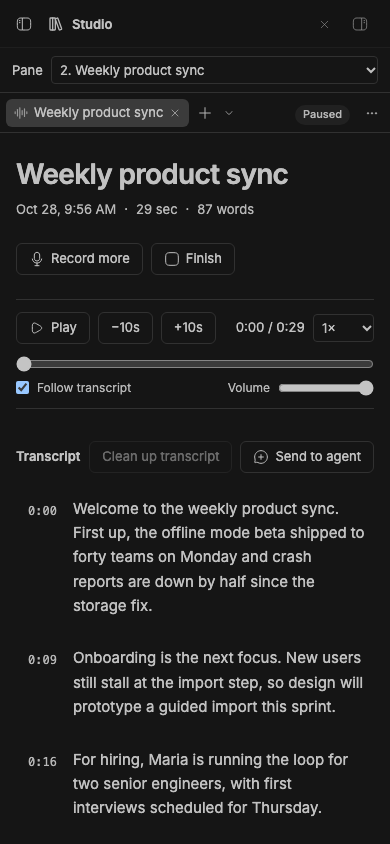

These staged captures check item opening, drag-to-split, layout restoration,
closing and reopening tabs, local editor toolbars, and title sizing after a
viewport change.

## Staged preview

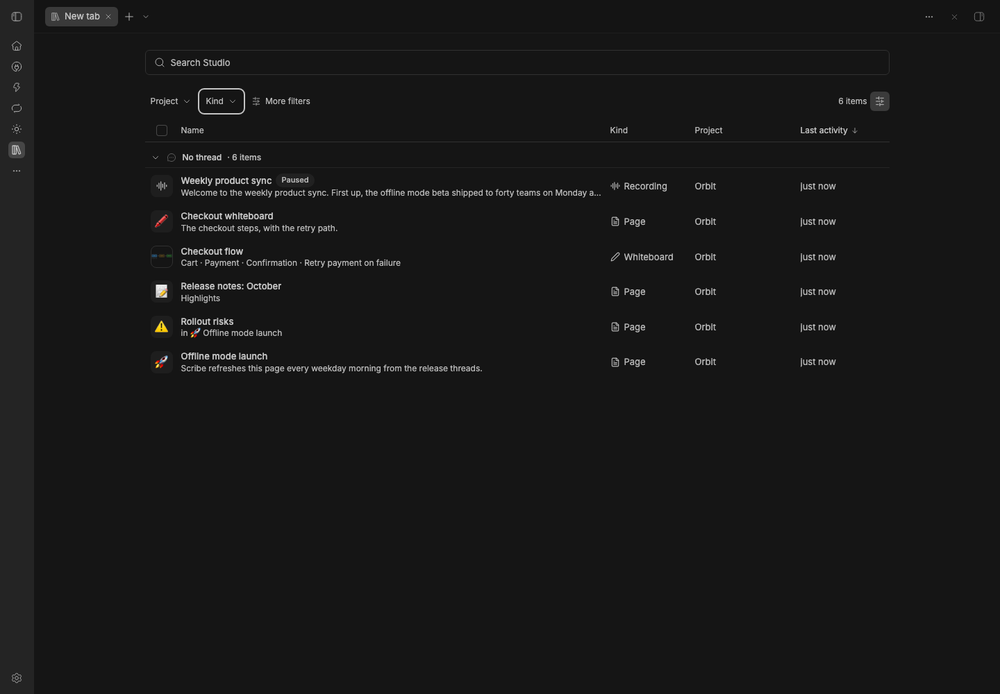

Captured from a staged BB (`node scripts/staged-bb.mjs start`): the Studio
collection as the workspace's new tab, a list with search and compact Project and
Kind menus above it. The tab strip shows **+** (new tab) with **▾** (New item)
beside it.
Tags and Status are available under **More filters**. The rows show
a paused Talk recording, the "Checkout flow" whiteboard and four Orbit pages,
including "Checkout whiteboard", the page it lives in.

### Bot sidebar provider status

These staged captures show Codex and Claude Code logos in Bot thread and runner
rows. Running work has a pulsing green ring, waiting rows use amber, failed
threads use red, and idle threads use a neutral ring.

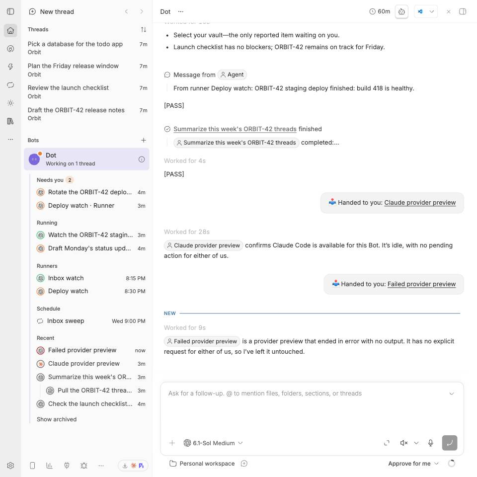

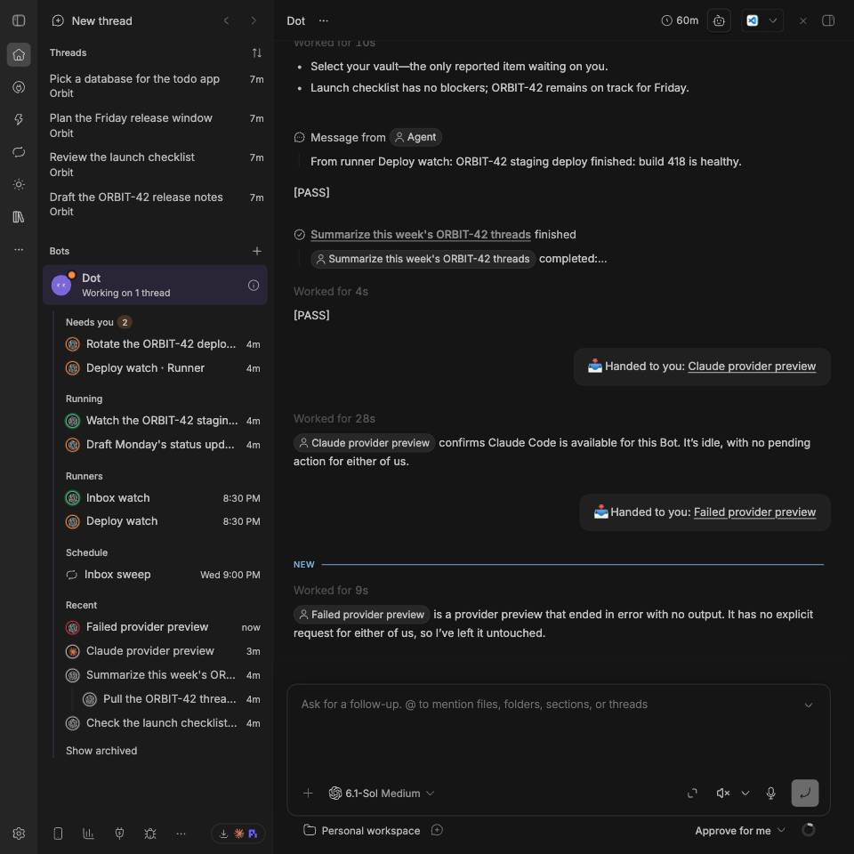

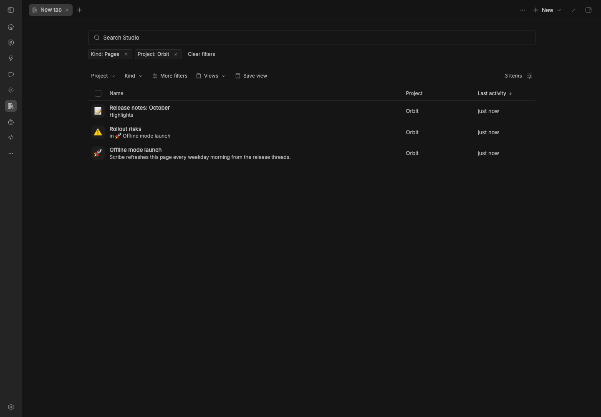

Selected filters appear below search, each with a remove button and an explicit
Include/Exclude menu. Clearing search keeps the filters; **Clear filters** keeps
the search text. **Save view** remembers the query, and **Views** appears once a
view exists. Query syntax such as `kind:page` still completes in search.

**Group by**, in the display menu beside the item count, groups the list by
Thread (the default), Project, Kind or Tag, or None for one flat table. Thread
is the thread that made the item (its first `created` link); items no thread
made go under **No thread**. Groups with the latest activity come first, the
table's sort applies inside each, and each heading collapses. An item with two
tags shows under both. The choice is kept per device; saved views keep only
the query. A **Tags** column shows each item's tag chips, with **+N** for the
rest. All items leaves out Dictations; their sidebar entry, the Kind filter
and search still show them. Studio's create tools ask agents to reuse an
existing tag, and their result lists the tags there are.

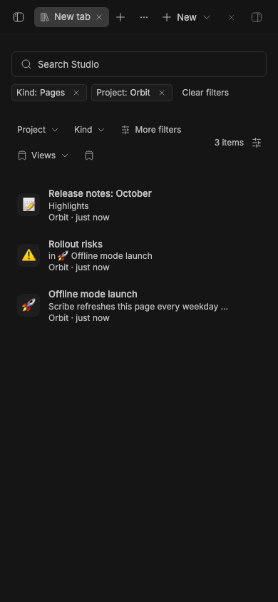

The same controls work at phone width. Both captures check menu selection,
a stored plural filter, text search, exclusion, project filtering, and saving
and reopening a view.

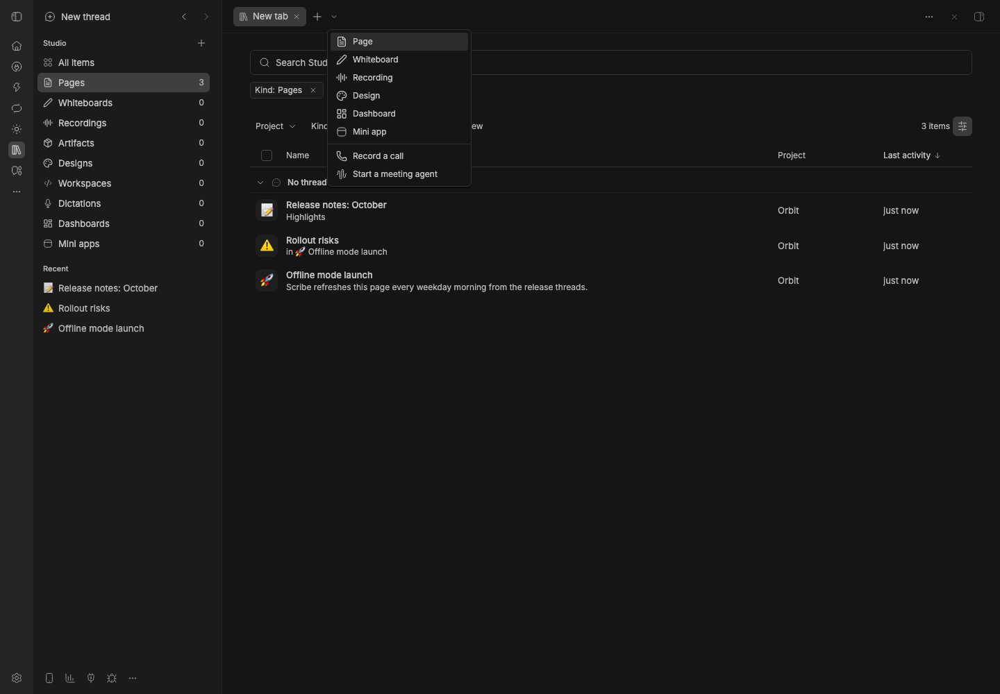

**+** in the tab strip opens a new tab; **▾** right beside it (New item) opens
Studio's New menu from any tab. It offers every kind Studio can make, with
**Whiteboard** right after Page (a new page holding one tall whiteboard,
since whiteboards live in pages), then Record a call and your templates, the
same list as the sidebar's **+** and the thread's Studio tab. New items go
into the project BB has open, or, with none open, the one the list's Project
filter picks. The new tab page keeps a New button only when the list is
empty. The capture checks that Whiteboards and Pages filters offer the same
menu as the unfiltered collection, that Whiteboard follows Page, and that
there's no Drawing entry.

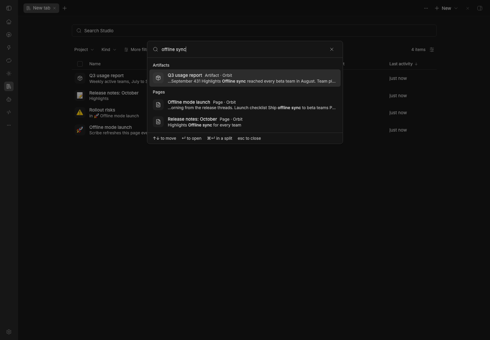

Studio search (Cmd/Ctrl+Shift+K) over the same staged project, searching
"offline sync": an HTML artifact and two pages match on their title or
content, each showing the matching text with the match in bold.

### Todos: todo cards and the Todos tab

Todos (setting **Todos**, `loopsEnabled`, off by
default) is how the Bot tracks what Patrick owes, decides, reads or waits on
([backend](../../docs/attention-router/backend.md)). The Bot posts a `::loop`
line in its chat when the scheduler releases a todo, and it renders as a card
with the todo's actions. `scripts/capture/captures/bb-studio-loops.mjs`
captures the cards, the Todos tab and the pane from a staged BB with fixed
demo todos; the screenshots aren't committed.

The Todos page (`/plugins/studio/studio/bot/<botId>/loops`) is on the Bot
pages' template: one line per todo, its title on the left and one small due
date or "when" on the right ("Overdue", "Due Fri", "When you get home",
"Since Sun", or who has it), in **Today** (out now, overdue or due today,
led by the Bot chat's pending questions and unread replies), **This week**
(the next six days), **Later** (past that, or no date) and **Waiting on
others** (a waiting todo, or one a lead or the Bot has), then **Done**,
folded. Area is a filter pill, never on a row. A row opens the todo as a tab in
the workbench beside the page (`bb://todo/loop_…`): the description, due
date, when, area, owner and source (a plan's
link), with the actions that fit it (Done, an option, Got it, Surface now,
Snooze, Hand off, Discuss, Change trigger, Drop; Nudge them; Take it back
and Open thread; Undo). **New** hands a typed line to the Bot.

The Todos pane is the same list beside the chat, in the thread's side panel,
so it stays up while you talk todos through with the Bot. Open it from the
Bot row's count in the sidebar, from a `::loops{open="pane"}` card or
"N more in Todos" in the chat, or from the side
panel's launcher. A do or read row's circle marks it done in one click (a
check on hover), and the row stays put with Undo. Each row's actions are in
its ⋯ menu, and Change trigger
opens under the row. Its header opens the full Todos tab.

To talk a todo through, pick **Discuss** in its ⋯ menu (on the Todos tab,
its Discuss button). It puts the todo in the Bot chat's draft as an `@loop`
chip without sending, so you type your question; the Bot gets the todo's
title, why and trigger when you send. You can also drag a row from the pane
into the composer: it drops the todo's `::loop` line and title as text,
which the Bot reads the same way.

With the setting off, there's no Todos tab, and every card
is a quiet line (one per morning message).

## Settings

**Settings → Plugins → Studio** starts with Studio's API keys, which BB keeps
in its secret files: OpenAI, OpenRouter, xAI, TypeSafe, Vercel AI Gateway,
OpenCode Zen and your own Jev endpoint's key. Every other setting is Studio's
own, in grouped sections below them: **Voice** (dictation and hands-free:
model, voice, backend model and monthly limit), **Recordings and calls**,
**Agent replies** (the Next row and reactions), **Threads** (Smart Queue,
resume after a restart, Todos and page history), **Windows** (the launcher's
shortcut; only in a BB with plugin windows, see [Windows](#windows)), **Jev** (the
provider, its connection test, the fallback model and your own endpoint) and
**Advanced** (Smart Queue batch confidence). Last, **Phone notifications**
shows Studio Mobile's push status and **Send a test push**. The Attention
Router's daily budget and quiet hours are on the Bot page, under **Controls →
Attention**.

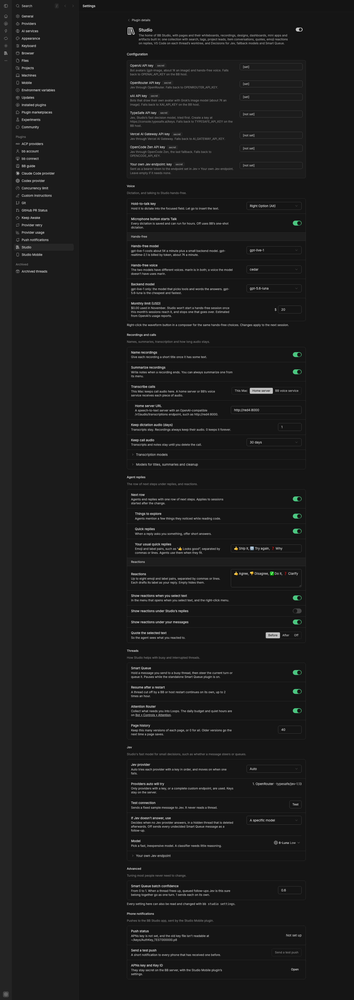

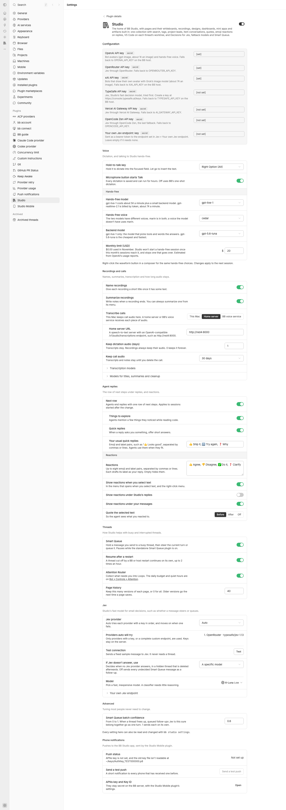

Captured from a staged BB upgraded from the previous Studio with changed
settings (voice cedar, page history 40, Home server calls, custom quick
replies), which the migration carried over. Bot → Controls → Attention:

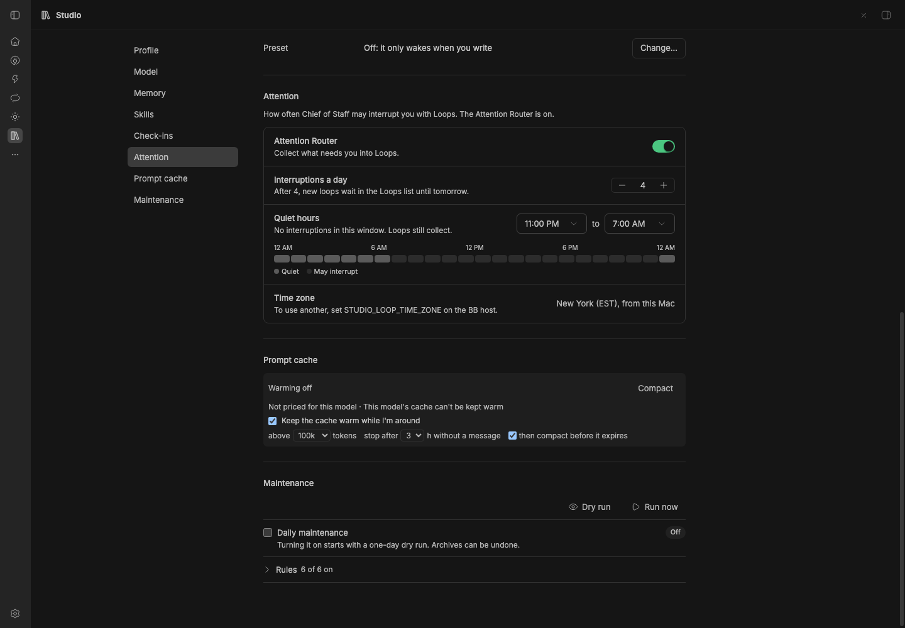

`bb plugin config studio` lists only the API keys. The rest are scriptable
with `bb studio settings`:

```sh
bb studio settings                    # every setting by section; (default) marks unchanged ones
bb studio settings get loopDailyBudget
bb studio settings set loopQuietStart 23
bb studio settings reset autoTitle    # back to the default
bb studio settings list --json
```

The keys are the ones BB's settings used. On the first load after this
change, Studio copied every changed value into its own storage once, cleared
the old **Bot avatars: OpenAI API key** (moving it only into an empty
**OpenAI API key**; never logged) and reloaded itself so BB's page dropped the
old fields. The old values stay unread in BB's table for a rollback.

Some settings became constants. A BB host can override each with an
environment variable (restart BB after setting one):

| Was | Now | Variable |
| --- | --- | --- |
| Jev: TypeSafe model | `jev-latest` | `STUDIO_TYPESAFE_MODEL` |
| Jev timeout | 5000 ms | `STUDIO_JEV_TIMEOUT_MS` (250–15000) |
| Smart Queue: minimum confidence to steer | 0.5 | `STUDIO_JEV_STEER_CONFIDENCE` (0–1) |
| Attention time zone | this Mac's | `STUDIO_LOOP_TIME_ZONE` |
| Talk segment length | 25 seconds | none |

## One Bot, many conversations

The Bot is the app (plan page "BB Studio: one Bot, many conversations").
Every thread belongs to a Bot, as a **conversation** (you and the Bot) or a
**worker** (the Bot and an agent it started). The Bot's chat is its **Main**
conversation, where reports and alerts arrive; you talk to it in any number
of other conversations; each has its own transcript and shares the Bot's
memory, skills and todos. A **fork** of a message is a conversation of its
own, at the same level, with a "forked from" link. Workers report to the
Bot; you only watch them and steer through the Bot. Workers are never
promoted to conversations.

### The record (`src/bot-threads.ts`, table `bot_threads`)

One row per thread: `bot_id`; `kind` (`conversation` or `worker`);
`is_main`; `forked_from_thread_id` with where it was cut,
`forked_from_message_id` (the message a thread was started from)
or `forked_from_turn_id` (the last turn a BB fork copied, from the fork's
`experimental_threadForkPoint`); `owner_conversation_id` (a worker's
conversation: the one whose thread spawned it, else Main); `title` (one
given in Studio, else BB's); `archived_at` (out of the sidebar, still
searchable); `finished_summary` (what a finished conversation decided, see
Finishing a conversation);
`needs_you_reason`, `needs_you_at`, `needs_you_source` (why a conversation
needs you, and who raised it); `latest`, `latest_at` (the latest reply's
first line); `source` (`backfill`, `created`, `reconciled` or `user`). Table
`bot_threads_state` keeps when the backfill ran and the current Bot.

**How a thread is placed**, first rule that fits:

1. a Bot's chat thread: its Main; an older thread of its handoff chain: an
   archived conversation of that Bot;
2. a thread on a message (`bot_side_threads`, or a side chat bb's
   side-chat plugin made, `originPluginId: "side-chat"`, mirrored from bb):
   a conversation forked from that message's conversation. This wins over
   every rule below;
3. a runner's thread: a worker owned by its Bot's Main;
4. a project's lead (not the personal project's, which is the primary Bot's
   chat): a worker of the primary Bot, owned by Main;
5. Studio's own helper threads (skill reviews, and any hidden fork Studio
   made with no lifecycle owner, such as the skill reviews mirrored from
   bb): an archived worker;
6. a fork (`originKind: "fork"` with `sourceThreadId`) you made: a
   conversation of the source's Bot, forked from it. A fork an agent or a
   tool made is a **worker** owned by the conversation that owns its source
   (else Main). BB's thread record doesn't say who made a fork, so an
   agent's is told by: a parent or lifecycle owner; `visibility: "hidden"`
   (`bb thread fork --visibility hidden`; what you start in the app is
   visible); a source that is a worker, or an agent's thread Studio has no
   row for (an archived chain of such forks, read a few levels up); or a
   source that was in a turn when the fork was made (its last
   `turn/started` or `turn/completed` event at or before the fork's
   creation is a start);
7. a thread another thread spawned (`parentThreadId` or
   `lifecycleOwnerThreadId`): a worker owned by the conversation that
   spawned it, at any depth (a worker's child belongs to the same
   conversation);
8. a thread a Bot owns otherwise (an automation's run, a thread handed to
   it): a worker owned by that Bot's Main;
9. an automation's run, or a hidden thread nobody spawned: a worker of the
   current Bot, owned by its Main;
10. anything else, a thread you started: a conversation of the **current
    Bot** (the one the sidebar shows; the sidebar tells the server with
    `bot_focus`), else the primary.

New threads are placed at `thread.created`; a spawner Studio hasn't seen is
read and placed first. Every two minutes, and 8 seconds after a new thread,
Studio applies rules 1–5 and 8 again over earlier guesses (a runner records
its thread after BB makes it; a handoff moves Main; a side chat learns its
reply). A row you changed yourself keeps its Bot and kind. BB's archive,
unarchive and delete follow; a deleted conversation's workers go to Main.

**Mirror catch-up.** The fork's importer copies bb's threads straight into
BB Studio's database, so no `thread.created` reaches Studio for them. Every
minute, and once at start, Studio reads the importer's `mirrored_threads`
(`fork-import.db`) rows changed since its last read, keeps the ones with no
`bot_threads` row, and places them by the rules above (`src/mirror-catch-up.ts`,
`readMirroredSince` in `src/mirror-live.ts`). Archived ones wait until bb
changes them again. The same pass links every conversation forked from a
message to that message in `bot_side_threads` (`linkForks`). Running it
again changes nothing.

**The backfill** runs once, 5 seconds after the first start with this
version: every thread BB hasn't archived (hidden ones too), oldest first, is
placed by the rules above. Existing standalone threads are adopted as
conversations of the primary Bot; only the **newest 50** of them (by last
activity) stay in the sidebar, and older ones come in archived: searchable
and in the Library's provenance, not listed. Threads BB has archived are
left out until they come back (then placed like a new one). Once, at the
first start with the fork rule above, forks recorded as conversations
(not by you) are placed again: the ones agents made become workers
(marker `reclassified_forks_v3` in `bot_threads_state`; it runs again where
an earlier version ran). The same pass brings back as conversations the
side chats an earlier version made workers.

**Activity time.** A row's age, its order and the recency cuts below use the
thread's latest real activity (`bot_threads.activity_at`): its last
`turn/completed`, `turn/started` or `item/completed` event, read once per
thread at the start (and for a few rows per sidebar read after that), then
moved by every turn Studio sees start, end or fail and every pending
question. BB's `updated_at` isn't used once that is known: the fork's
importer moves it when it copies a thread. A lazily filled latest line
takes the thread's activity time, not the time it was filled.

**Needs you.** A conversation needs you when it asks you something itself
(a pending question or approval), or when it was marked: by the Bot with
`bot_needs_you`, or by Studio when a worker of that conversation starts
waiting on an answer (the Bot's nudge goes to the worker's conversation, not
to Main). A worker's mark clears when the worker stops waiting; any mark
clears when you reply in the conversation after it, and when it's archived.

**Reports and alerts go to Main**: runner reports, watcher findings,
check-ins and reminders, the morning todo card, failed-thread and resume
alerts, maintenance alerts and handed-thread notes all go to the Bot's Main.
A worker's question goes to the conversation that started it. Schedule
changes made in a conversation other than Main (runner and automation
create, update, pause, resume, delete) are noted in Main with a quiet line.
BB's own completion notice for a finished child still goes to the thread
that spawned it, which is the worker's conversation.

**Every conversation is the Bot**: its instructions (plus one short line
saying which conversation it is), all of its tools (profile, skills,
history, runners, automations, pause and stop) and its skills. A thread on
a message is a conversation too, with the same tools.

**Prompt cache.** Studio warms Main as before, and another conversation
only while you wrote in it in the last two hours (no compaction before
expiry for those); idle ones go cold.

### Awareness

Every conversation knows, at the start of each turn, what the Bot's other
conversations and workers are doing. Nothing shows on screen for it.

- **Live activity** (`src/live-activity.ts`, table `live_activity`): one row
  per thread, what it is doing now: `state` (running, idle, needs-you,
  failed), its title, its latest reply's first line, its repo tag and branch,
  and when its turn started and ended. BB's thread events keep it current
  (created, active, idle, failed, a pending question, deleted); the start
  fills rows for listed threads that have none from BB's records.
- **The digest**: on a BB with the fork's per-turn context hook
  (`bb.experimental_hooks.experimental_turnContext`, feature-detected by
  name; elsewhere nothing is registered), each turn of a conversation gets
  an agent-only digest with its input, not stored in the thread. It is read
  from Studio's database only (bb waits at most 500 ms for all plugins): one
  line per other conversation of the same Bot that isn't archived and was
  active in the last 24 hours (title, thread id, working / idle / needs the
  user and why, age, latest line), and one per worker of that Bot that is
  running or waiting, or failed or finished in the last 6 hours (title,
  state, age, the conversation it works for, repo tag), each part newest
  first, at most 1,500 characters, then "…and N more" and where to look. A
  worker gets one line, the conversation it works for; a thread no Bot has
  gets nothing. For example:

  ```
  Elsewhere with the user (your other conversations and your workers, newest first; not this conversation):
  Conversations:
  - Main (thr_main) working · 1m ago
  - "Tree truncation" (trunc) needs the user: cut titles at the end or the middle? · 30m ago
  - "GORUCK return" (old) idle · 3h ago · "Return window ends Nov 15"
  Workers:
  - "Fable lead" (lead) running · 5m ago · for this conversation · bb-studio-native
  - "Codex: iOS build" (ios) failed · 2h ago · for "Main" · bb-studio
  Details: bot_activity_lookup { threadId }; the full list: bot_conversations.
  ```

- **`bot_activity_lookup { threadId }`** (agent tool, every conversation):
  one of the Bot's own threads in detail: its state, repo, needs-you, the
  conversation it works for or the workers it started, a finished
  conversation's summary, its latest reply and its last 8 tool calls (read
  from BB's events with a 2.5 s limit). Another Bot's thread is refused.

### Finishing a conversation

**Finish conversation** is in a conversation's thread menus: its sidebar
row's right-click menu and the ··· menu of its header (not Main, not a
worker, and not while it is working). It (`src/bot-finish.ts`):

1. sends one last turn into the conversation, "Finish this conversation.",
   with agent-only steps: write a summary (**Decisions**, **Left open**,
   **Made**), save it with `memory_add` (topic: the conversation's title;
   source `{ kind: "conversation", id, title }`), then call
   `bot_finish_done { summary }`. The menu reads "Finishing…" meanwhile.
2. When `bot_finish_done` arrives, the conversation is archived
   (`bot_threads.archived_at`, `finished_summary`; BB's own archive follows
   once its turn is over), and Main gets the summary from the conversation,
   with an agent-only note that has the Bot reply with the card
   `::finished{thread="thr_…"}`: "✓ Finished: <title>", its dates, the
   summary's sections, **Open the conversation** and **See in Memory**, and
   how many memory records cite it. Main's row reads "Finished “<title>” ·
   summary saved".
3. If the turn ends or fails without `bot_finish_done`, or nothing happens
   for 10 minutes, Studio finishes it with a summary made of the last three
   replies, and saves that to memory unless the Bot already saved a record
   from this conversation.

You can also ask in the conversation ("finish it"): the Bot saves the summary
and calls `bot_finish_done` itself. A finished conversation leaves the
sidebar; Search and the Library still find it, and the older list has it
under Finished. It opens read-only: "✓ Finished on <date>. Read-only." with
**Reopen** where the composer goes (back in the sidebar, unarchived in BB;
the summary stays). Finished conversations are kept indefinitely: nothing
cleans them up (the plan's open question, decided as "keep").

### The Bot sidebar

Choose **Bot (Studio)** (`studio/everything`) in Settings → Appearance or
with `bb thread-list`. It shows one Bot at a time (`src/ui/conversations`):

- **Top**, sticky: the Bot's space header (round 7, 7a), a band of its own
  with a bottom border: the avatar (36px), the name (15px, semibold), a
  status line with no model (each conversation has its own): "2 running",
  "Paused", "Stopped", "Paused · in bb" on a BB Studio copy for a Bot its
  import stopped (the Info tab's and the automations table's rule), or
  nothing; and **···**: **Edit space…**, **Default model** (bb's provider
  and model picker in a small dialog, see Default model below),
  **Archive** (the older page, `/plugins/studio/studio/conversations/<botId>`),
  then New Bot. Bot info and
  Controls are on the Info tab's Bot block (Pause, Resume and Stop in its
  icon group). Under it, the Bot's pages as rows:
  **Memory** (`/plugins/studio/studio/memory/<botId>`), **Library**
  (`/plugins/studio/studio`), **Automations** (`/plugins/studio/automations`)
  and, for the primary Bot with Todos on, **Todos**
  (`/plugins/studio/studio/bot/<botId>/loops`) with what needs you now. The
  row of the page on screen is selected. The header is clickable in the
  desktop app (no window drag).
- **Conversations**, with **+ New** (BB's own new-thread composer,
  `experimental_NewThreadComposer`, on a Studio page,
  `/plugins/studio/studio/new-conversation/<botId>/<projectId>`, seeded with
  the Bot's default model and Main's project; pick any other model before
  sending; `bot_conversation_start` makes the thread this Bot's): Main first, then the others
  by last activity, two lines each: the title (13px, medium) and its age; then its latest reply (12px,
  the ink at 55%), with a spinner while
  it works. The conversation that needs you is outlined in amber, with
  "Needs you: <reason>" on its second line. The row on screen is
  highlighted; right-click for BB's thread menu (with **Finish
  conversation**). Listed: Main always, and the others active in the last
  14 days, working, or needing you; the rest are counted in a quiet last row,
  "N older conversations".
- **Workers**: the running ones and those waiting on you (up to 30), one
  line each: a status glyph, the title (at least 60% of the row), the repo
  or worktree it runs in as a small chip (72px at most) and a short time.
  The five newest that finished (failed in the last 7 days, done in the
  last 2; workers of one title folded into one row, "×5") fold into one
  row, "N done", which opens them in place and closes them again (it opens
  by itself when the worker on screen is one of them). Older workers have no
  row: they are on the Archive page (the ··· menu); "No workers" with none. A worker
  never asks you itself: the Bot raises it in the worker's conversation.
- A worker or conversation mirrored from bb shows bb's live state (running,
  waiting for an approval or an answer, failed, done): BB Studio reads it,
  read-only, from bb's database (`src/mirror-live.ts`), since the copy here
  is always idle.
- **Archive** (the ··· menu) and the "N older conversations" row open the **Archive** in the main view
  (`/plugins/studio/studio/conversations/<botId>`), newest first: the older
  and finished conversations (finished ones with **Reopen**) and the older
  workers (a failure older than 7 days is grey, not red), one line each with
  its status and age. Search and the pills (Conversations, Workers, Failed)
  narrow it. A row opens its thread as a conversation tab in the workbench
  beside the Archive (Shift-click: a window). The row that opened it stays
  selected while it is open.
- **At the bottom**, pinned however long the lists are (the panel grows
  with its rows and the footer is sticky in BB's scrolling sidebar): each
  Bot's own icon, the shown one highlighted, an amber mark on a Bot with a
  conversation that needs you, and **+** for a new Bot. Click an icon, swipe
  sideways with two fingers on the sidebar, or press **Ctrl+Option+1**…**9**
  (**Studio: Show Bot 1…9**, BB commands you can rebind in Settings →
  Keyboard; BB keeps Ctrl+1…9 for its own "Open thread"); the whole sidebar
  switches, and the main view goes to that Bot's last-open
  conversation (else its Main). Right-click an icon for **Edit space…** and
  **Theme ›**, every theme with that Bot's checked; picking one applies it
  to that Bot.
  Opening another Bot's conversation from a link shows that Bot.
- **Edit space** opens over BB's main view (the sidebar keeps its lists and
  the Bot switcher) as one view with Close and no tabs; where BB has no main
  view to cover it opens in the sidebar in place of the lists and the
  switcher. Top to bottom: **Name**; **Icon** (Avatar, the drawn one; Emoji,
  picked in a popover; or Image, one of its generated or uploaded images,
  with **Upload…**); **Appearance**, the theme picker (see Themes: the Scene
  and Classic rows, the sliders and the effect switches); **Default model**
  (`bot_set_default_model`, only when it changed); then Reset, Cancel and
  Save on a row stuck to the bottom of the pane (of the sidebar there).
  Save or Cancel (Esc; an upload is kept). The controls are bb's own
  (vendored in `src/kit/ui`).
  A Bot's look comes only from its theme: its accent (the switcher icon's
  mark, the selection) is the theme's, and a Bot with no theme has bb's
  plain look. The old per-Bot sidebar tint (Color, Gradient, System/Light/
  Dark, Grain) is gone, with `bot_set_theme` and the `theme` field of
  `bot_get`, `bot_list` and `bot_spaces`. The column `bots.theme_json`
  stays and nothing reads or writes it, so a Bot row that still has a tint
  loads as a Bot with no tint.
- **At launch**, when the main view is BB's empty new-thread page (`/`), the
  sidebar opens the Bot's last-open conversation, else Main, once per
  window. **Studio: Show the Bot** (**⌃0**) does the same, and unfolds BB's
  sidebar if it is folded. The new-thread page stays
  only when you ask for it (**+ New**).

Nothing else is listed: no recent list, no running or runners sections, no
todo row, no projects, no badges.

### Themes

Each Bot has a theme (`bots.appearance_json`): a live WebGL scene behind
frosted glass, or a classic palette with solid surfaces. The code is
`src/theme`: the package format (`schema.ts`), the built-ins and stored
themes (`registry.ts`, table `studio_themes`), the checks (`checks.ts`), the
engine that paints the scene and maps the theme onto BB's tokens
(`engine.ts`), and the agent and CLI surfaces (`service.ts`,
`agent-tools.ts`, `cli.ts`).

- **Quick switching** (`ui/ThemePopover.tsx`, `ui/quick.ts`) applies a
  theme without opening Edit space. A Bot that already has an appearance
  keeps its effect switches, and its sliders too when the theme is the same
  one; a different theme starts at its own Intensity, Glass opacity and
  Motion (the rule `theme_apply` uses). The change shows at once and is
  written with `bot_set_appearance`.
  - **Theme** in BB's sidebar footer (a footer item, so it hides and
    reorders with the rest of that row) opens a popover: small previews in
    a **Scene** and a **Classic** group (None first, agent-made ones tagged
    **Custom**), one live as in the picker. Pointing at a preview, or moving
    to it with the arrow keys, shows that theme in the window. Click or
    Enter applies it to the Bot on screen and closes; Esc or a click
    elsewhere goes back to the theme from before.
  - **Cmd+K**: **Theme: <name>** for every theme, **Next theme** and
    **Previous theme**. The cycle runs the scene themes, the classic ones,
    then None.
  - **Ctrl+Option+T** is **Studio: Next theme** and **Ctrl+Option+Shift+T**
    is **Studio: Previous theme**, BB commands you can rebind in Settings →
    Keyboard (`plugin:studio/theme-next`, `plugin:studio/theme-previous`).
  - **Theme ›** on a right-click of a Bot's icon in the switcher.
- **The picker** is Edit space's Appearance section (design 8f): the scene themes as
  large preview cards in a wrapping grid, a **Classic** grid under it (None first)
  with each palette drawn as a small app, then **Intensity**, **Glass
  opacity** and **Motion**, the state-effect switches, **Use on every Bot**,
  and Reset, Cancel and Save. One preview runs live, the hovered card's,
  else the chosen one's; the rest show a still frame, and none runs off
  screen, under reduced motion or in a background window. All previews share
  one WebGL context. Agent-made themes sit after the built-ins in the row of
  their kind, tagged **Custom**. Choosing one runs
  the checks in the window with real GPU timing and shows the result.
- **Built-in scenes**, in the row's order: **Miami 1985** (a striped sun,
  palms, wireframe hills and a scrolling neon grid; workers are chrome
  gliders), **Event Horizon** (a ray-traced Schwarzschild black hole with a
  Doppler-beamed disk over lensed stars; workers are orbiting particles),
  **Grid** (three neon skylines in haze over a mirrored grid floor, a ring
  with ticks and a second axis, traffic trails; workers are light cycles),
  **Kyoto Garden** (a temple garden seen from the veranda: moss, a pond
  with stepping stones, a stone lantern, a maple, bamboo, a wall and a
  pagoda before misty hills, in the season and the light of the real day;
  light by day and dark by night, with a serif transcript via the
  package's optional `type.transcript`; workers are paper lanterns
  floating on the pond), **Forest** (pines, mist and fireflies; workers
  are the brightest fireflies), **Aurora Fjord** (rayed aurora curtains over
  three ranges of snowy peaks, mirrored in still water, with a snowy shore
  in the foreground; workers are fishing boats with lanterns, the shore
  glows warm when a thread needs you, and a finished run brightens the aurora)
  **Tonight's Sky** (the real night sky over your place; workers are
  satellites) and **Data City** (a 56-second glide down a narrow avenue walled
  by tall towers whose faces are scrolling columns of fine hex glyphs,
  over light-lane streets, with small panes of bars and lamps drifting past; workers
  are data packets racing along the lanes, a tower turns amber when a
  thread needs you, and a finished run sends a pulse up the tower faces). A Bot saved with the earlier Cabin Aurora theme shows
  Aurora Fjord. Sources and
  methods are in `docs/theme-credits.md`.
- **Fonts.** A theme's `type` holds the heading, body and mono font stacks,
  an optional transcript stack and an optional `headingWeight` (100 to 900
  in hundreds) for every heading outside a transcript; without it each
  heading keeps its own weight. Jost (OFL 1.1) is bundled for Miami 1985's
  headings and is loaded only when a theme's stack names it; the other
  stacks name fonts that ship with macOS. `docs/theme-credits.md` lists
  what each stack renders and the font's license.
- **Forest follows the real sky.** Its time of day comes from the
  computer's clock and the sun's elevation at a coarse place: the time
  zone's coordinates from the tz database (`zone1970.tab` or `zone.tab`),
  or a city once one is set. Its weather (clear, cloud, fog, rain, snow)
  comes from Open-Meteo, which needs no key: the server asks for the
  current weather at the place rounded to 0.1°, only while Forest is on
  screen, through the same public-address guard as link previews
  (`guarded-fetch.ts`), keeps an answer 20 minutes, waits 5 minutes after
  a failure, and keeps the last answer for 3 hours. Offline, the scene
  follows the clock alone. RPCs: `theme.weather { timeZone }` returns the
  place and weather; `theme.weather.city { city }` sets a city (looked up
  with Open-Meteo's geocoding, stored in Studio's KV as
  `theme.forest.city`) or `null` to go back to the time zone.
- **Kyoto Garden follows the real day.** Its season comes from the
  computer's date and the place's hemisphere (Forest's place: spring from
  March, summer from June, autumn from September, winter from December,
  half a year later below the equator), blended over 20 days across each
  boundary: cherry petals in spring, deep green and fireflies at night in
  summer, red maple leaves falling onto the pond in autumn, snow on the
  lantern, the branches and the ground and ice at the pond's edge in
  winter. Its light comes from the Sun's elevation there: mist at dawn,
  warm low light in the golden hour, and at night the stone lantern lit
  and the Moon at its phase mirrored in the pond. Forest's weather adds
  cloud, rain, snow and fog. The theme has a light and a dark variant and
  its driver chooses between them: light while the Sun is higher than
  −2.5°, dark below, and light again above −1°, so it turns once at dusk
  and once at dawn (`sceneVariant` in `src/theme/kyoto/scene.ts`). The
  driver keeps the scene's daylight at 0.85 or more under the light
  variant and at 0.42 or less under the dark one, and fades the scene over
  1.5 seconds when the variant turns or a preview jumps, while the engine
  crossfades the look. A scene driver's `publish` takes an optional third
  argument, the mode it wants; the engine shows that variant when the
  theme has it, whatever BB's own mode, and sends it to BB as the window's
  mode. A scene that can't be drawn shows the variant that reads on its
  fallback color. The package's `scene.backdrop.modes` gives each variant
  its own darkest and brightest backdrop, so each variant's glass is
  checked against the scenes it is shown over. `bb studio theme preview`
  prints the season, the time of day and the variant; `--date` (and
  `--time`) previews a date in local time with fair weather and `--clear`
  goes back to the clock. It is the preview Tonight's Sky reads
  (`theme.sky.preview`), so both scenes show the same moment.
- **Tonight's Sky shows the real sky.** For the place Forest uses (the
  city once one is set with `bb studio theme weather --city`, else the
  time zone's coordinates, else 40° N at the clock's offset) and the
  computer's clock, it draws 2,887 stars to magnitude 5.5 in their colors,
  the 88 constellations' lines and names, the Moon at its phase and
  position, Mercury to Saturn where they are, and the Milky Way, over a
  dark ridge and treeline with a city's glow at one side. The sky turns
  with the clock (redrawn every 15 seconds). By day it shows the day: the
  sky's color follows the Sun's altitude (night below -18°, astronomical,
  nautical and civil twilight, golden hour up to 6°, then day blue, darker
  at the zenith and paler at the horizon, with a warm band toward the Sun
  when it is low and a pink band opposite it), the Sun is drawn where it
  is with a glow and rays near the horizon, the Moon is pale, the ridge
  and treeline are daylit, the Milky Way fades, and the constellations
  stay as faint thin white lines with dimmed stars and names
  (`src/theme/tonight/daylight.ts`). The driver publishes the variant:
  light once the Sun is above -3.5°, dark once it is below -4.5°, the
  last choice in between; the package declares each variant's backdrop
  (`scene.backdrop.modes`) and denser glass for the light one. The view
  (`bb studio theme sky --view <follow|south|east|west>`, stored as
  `theme.sky.view`, default follow) puts the Sun in the open area the
  cards leave while it is above -9°, else the Moon or the brightest
  planet, else faces south; south, east and west face that way whatever
  is up. The view is also a row under the sliders in Edit space: a
  built-in theme declares options (id, label, choices) in
  `src/theme/options.ts`, the picker shows them for the chosen theme, and
  RPC `theme.options { themeId }` and `theme.options.set { themeId, id,
  value }` read and write the same setting. The open area comes from the
  engine's layout input (`src/theme/scene/layout.ts`), which a scene
  driver gets as its second argument: the window's size, the sidebar's
  width (`[data-sidebar="gap"]`) and the open side panel's rectangle
  (`aside[data-surface-tone="sidebar"]`), measured every 250 ms and taken
  once a change has held for 250 ms; a page without a side panel keeps
  the panel's last state, and nothing else on a page is read, so
  navigation never moves the scene. `openSpot` picks the largest open
  rectangle beside the 808 px transcript column with room for the Sun
  (9% of the window's width), the rightmost of equals: right of the
  transcript, or between it and an open side panel; with only a narrow
  gutter there, the gutter's middle, kept half that room off the
  window's edge; with none, 80% across. The camera eases to a new view, and a change of the preview
  time plays as a two-second time-lapse (at once under reduced motion).
  By day a finished worker is a white trail, satellites are faint and
  the star that needs you is a pale ringed dot. Events:
  a meteor shower raises the shooting-star rate around its peak and its
  meteors point away from its radiant (12 showers; the Leonids peak about
  November 17); a lunar eclipse reddens the Moon and is labelled; two
  planets within 4°, or the Moon within 6° of one, get one label with the
  separation. A finished worker is a meteor streak, an error a red one; a
  conversation that needs you is an amber star pulsing at the top. Sun,
  Moon and planets come from Astronomy Engine (MIT); the stars from the
  Yale Bright Star Catalogue and the constellation lines from d3-celestial
  (BSD-3-Clause), all bundled, nothing fetched. The stars, lines and
  labels are painted on a 2D canvas (`src/theme/tonight/paint.ts`) that the
  engine uploads as the `u_layer` texture: a scene driver's `publish` takes
  an optional picture `{ source, version }`, and the engine uploads it when
  the version changes. RPC: `theme.sky { timeZone }` returns the place, the
  preview time and the view. `bb studio theme sky` prints the Sun's
  altitude and azimuth, the phase of twilight, the view, the variant and
  what is up; `--date` previews another day or night in the window until
  `--clear` (stored in Studio's KV as `theme.sky.preview`; the window
  follows within 15 seconds).
- **Where it paints.** The scene is BB's app backdrop (the fork's
  `slots.experimental_appBackdrop`, `src/theme/backdrop.tsx`), full-bleed
  behind the whole window. For a scene theme `useAppearance()` also returns
  `layout: { cards: { gap: 10, radius: 14 } }` (one gap and one radius for
  every scene theme), and BB lays its surfaces out as floating, rounded
  glass cards with 10 px gutters where the scene shows. No card has an
  outline: BB draws a faint inner highlight and a soft shadow, and a
  theme's `glass.edge` color draws nothing. The rail sits bare on the
  scene. The sidebar is one card: Studio's sidebar (the Bot's pages, the
  conversation and worker lists, the Bot switcher at the bottom) and BB's
  footer icons under it. The header's pills float above the thread's card,
  which is the one transcript card (painted from `main`, which Studio maps
  to the `transcript` glass); the composer is a card inside its bottom
  edge, and the side panel is a card. The glass has five surfaces:
  `sidebar` (the sidebar's card, 0.14–0.2 of the canvas over the blurred
  scene), `transcript` (the thread's card and the header's pills,
  0.16–0.22, blurred 6 px; Studio's CSS, `THEME_CSS` in
  `src/theme/tokens.ts` under `html[data-studio-glass]`, also tints thread
  banners with it), `composer` (the composer, Studio's composer
  replacements and the side panel, the densest at 0.42–0.5), `main` (kept
  in theme packages; no surface uses it under a scene theme) and `hud`
  (menus, popovers, tooltips, dialogs and the palette, with a 12 px blur).
  The glass is clear enough that the scene's shapes and colors read
  through every card; the halo, not the tint, keeps text readable. A main
  view that shows no main-view thread (Memory, Library, Settings, a plugin
  page)
  keeps the `transcript` glass over its whole card. Text on the sidebar
  card, the transcript, the header and those pages carries a halo:
  `text-shadow` in the canvas color (2 px at 90% twice, then 8 px at 55%).
  A classic theme's glass is opaque, with no cards, backings or halo. The
  scene and the colors crossfade on a Bot switch; the scene pauses when the
  window isn't frontmost, holds a still frame under reduced motion and
  renders smaller on battery. A plugin window of Studio's recolors itself,
  with no scene. On a BB without the slot the main window
  keeps BB's own look; on a BB without the card layout the surfaces keep
  their full-size glass.
- **Movers stay in the open.** Cards are frosted glass, so a crisp shape
  passing under one looks cut at its edge. The engine passes the largest
  area no card covers as `u_open` and the cards as `u_cards` (sidebar,
  transcript column, side panel), both from the window's size, the
  sidebar's width and the side panel, eased; `openFade(gl_FragCoord.xy)`
  falls to zero about 4.5% of the height before any card's edge;
  `openFade(gl_FragCoord.xy, inset)` takes its own inset. Grid and Deep
  Sea use a 1.4% inset and size their subjects to the span it leaves
  (`src/theme/scene/focal.ts`): Grid's ring and light cycles, Deep Sea's
  whale, manta, fish and jellyfish fit inside it, the light cycles turn
  at its ends onto a nearer or farther row, and both scenes brighten the
  open area, not the area behind the cards. Miami's
  gliders sweep a figure-eight in the open strip, Grid's light cycles and
  Event Horizon's, Kyoto Garden's and Forest's workers stay in it, Aurora
  Fjord's boats sail the gap left of the transcript, and all of them hide
  when the area is under 160 px wide.
- **Scenes keep their mood.** `u_intensity` mixes the scene toward its
  background color (`mix(u_palette[0], col, u_intensity)`); the built-ins
  start at 0.7–0.85 (Event Horizon 0.7, Miami 0.75, Grid, Forest, Aurora Fjord, Tonight's Sky and Data City 0.8,
  Deep Sea 0.85, Kyoto Garden 0.85, which mixes toward a dark base at night), so dark scenes stay dark. Each scene puts
  its focal element beside the transcript card: the engine passes the
  card's rectangle as `u_clear` (a `vec4`: left, bottom, right, top in
  canvas pixels), computed from the window's size alone (an 808 px column
  centered right of a 320 px sidebar), so the scene never moves when you
  change pages or open a panel; a resize eases to the new spot. Miami's sun, Grid's ring and
  beacon, Kyoto Garden's maple, stone lantern and Moon, Forest's sun, moon and pond and Aurora
  Fjord's tallest peak and shore sit in
  the strip right of the card, sized to it; Miami's palms and Kyoto Garden's
  pagoda sit in the strip left of it. Event Horizon's black hole is
  large, its disk most of the window wide, with the hole behind the right
  part of the card and the disk turning so its approaching, beamed side,
  the brightest part, lies in the strip right of the card.
- **Glass opacity** scales every glass surface together, from the
  theme's own values at its default position; at 0 the gutters are clear
  and the cards keep the least glass that reads.
- **Save applies at once.** The saved appearance shows until the Bot list
  has it (or for 30 s), so the old theme doesn't flash back.
- **Checks** gate every save: text and UI contrast on every surface text
  sits on (sidebar, transcript, composer, `hud` glass) in every variant, at the
  default settings and at full intensity with no glass, on the card's glass
  over the theme's declared backdrop (its darkest and brightest blurred
  color behind text). On the sidebar and transcript cards the halo counts
  at its coverage on the edge of a 1 px stroke, the thinnest body text:
  each shadow covers `alpha × (Φ(1 px / σ) − ½)` there, with σ half its
  blur, about 55% together; text there must also reach 3:1 without the
  halo. The glass rises at run time to the least opacity that passes. The
  open gutters are measured, not gated: the report's `contrast:<mode>:main`
  line gives text and muted text there over the brightest backdrop. Also
  frame time, the scene's brightest backdrop behind text (a full-size
  frame blurred as much as its least blurred glass, read where the
  sidebar, the header row and the transcript card and composer sit in a
  1600×1000 window, so the focal element beside the card doesn't count)
  against its declared one (a built-in scene keeps its declared one), and
  a reduced-motion still. The server asks an open window to time the shader
  on its GPU (`theme_gpu_claim` / `theme_gpu_reply` on the
  `studio-theme-gpu` channel); with no window it uses a static estimate and
  the report says so.
- **Agents** have `theme_list`, `theme_create` (a full package; the tool's
  description carries the format, the shader contract and a template),
  `theme_update` (a merge; built-ins only copy, with `newId`),
  `theme_apply` (a Bot, with optional sliders and switches) and
  `theme_delete` (refused while a Bot uses the theme).
- **CLI**:

```
bb studio theme list [--json]
bb studio theme show <id>
bb studio theme template                      # a working scene package to start from
bb studio theme check --file <theme.json> [--json]   # runs the checks, saves nothing
bb studio theme create --file <theme.json>
bb studio theme update <id> --file <patch.json> [--new-id <id>]
bb studio theme apply <id|none> [--bot <id|name>] [--intensity 0-1] [--glass 0-1] [--motion 0-1] [--on workers,finished,needsYou,error] [--off …]
bb studio theme delete <id>
bb studio theme weather [--city <name> | --clear]   # Forest's place and weather (Open-Meteo); a city, or back to the time zone
bb studio theme sky [--date <yyyy-mm-dd[Thh:mm]> [--time <hh:mm>] | --clear] [--view <follow|south|east|west>]   # Tonight's Sky: the Sun, the phase of twilight, the view, the variant, the Moon, planets, meteors and events; preview a date (local time), or back to the clock; choose where it looks
bb studio theme preview [--date <yyyy-mm-dd[Thh:mm]> [--time <hh:mm>] | --clear]   # Kyoto Garden: the season, time of day and variant; the same preview as theme sky
```

### Presence

A Bot's icon is its presence (`src/presence`): a form drawn live on a
canvas in the theme's colors, changing with what the Bot is doing. It
shows in the sidebar header (36 px), the Bot switcher (24 px), the Bots
list (28 px for the selected Bot, 22 px for the others), the Bot row of a thread's
info and the theme popover.

- **Forms** (`forms.ts`): orb, tesseract (a real 4D rotation), torus
  knot, particle swarm, Möbius ribbon, polyhedron (icosahedron,
  dodecahedron, cube and octahedron, each fading into the next as a
  compound), Lorenz attractor and Klein bottle. Each has three tiers:
  under 30 px fewer points, strokes of at least 1 px and no glow; under
  70 px a middle tier; the full form above.
- **States** (`state.ts`): needs you (amber, two pulse rings) when a
  conversation or worker waits on the user; else working (one orbiting
  satellite per running worker, at most 3 at 24 px, 4 at 36 px, 6 above)
  when workers run; else thinking (faster, a shimmer sweep and a
  flickering glow, no satellites) while a turn runs; else idle (slow
  breathing). The shown Bot reads the sidebar's live rows; other Bots
  read `activity` on `bot_spaces`.
- **Colors** (`look.ts`): from the Bot's theme (its accent, then its
  palette, skipping colors that vanish on the ground; a light ground is
  drawn in darker ink with normal blending), or one custom color with a
  depth and a highlight derived from it.
- **Halo** (`halo.ts`): on a light surface (BB's mode, not the Bot's
  theme) every presence, built-in or custom, gets a CSS `drop-shadow`
  halo: a thin outline in `var(--ink)` mixed toward transparent, plus a
  glow in the palette's main color. Idle is the outline alone, thinking
  adds a pulsing glow, working a firmer outline and a faint steady glow,
  needs you an amber pulse. The halo is off on a dark surface.
  `node scripts/presence-halo.mjs <out.png> <crane.js> <lava.js> [--light]
  [--off]` renders the crane, the lava lamp and the built-ins in every
  state at 36 and 24 px on GitHub Light or Event Horizon.
- **Stored** per Bot as `bots.presence_json`: `{ form, color, motion }`.
  A Bot without one shows a default form (the tesseract for the primary
  Bot; tesseract, orb or polyhedron by id for the others). The old
  avatar, emoji and image fields stay in the table and nothing reads
  them for the icon.
- **One loop** (`loop.ts`): every presence on screen draws from one
  `requestAnimationFrame` loop. It stops while the window isn't frontmost
  or is hidden, skips a presence that is off screen, and under reduced
  motion draws one still frame.
- **Edit space → Presence**: a preview with a state switch, the same
  presence at 36 and 24 px, the form tiles, the color source and a motion
  slider (0–2×). The sidebar follows each pick while it is open.
  **Create…** sends a description to the Bot, which calls
  `presence_create`.

#### Agent-made presences

A stored presence is `{ id, name, description, code }`. The code is
plain JavaScript that declares `function draw(ctx, t, state, palette,
size)`: `t` is seconds of presence time, `state` is `{ name, workers,
clock }`, `palette` is three `#rrggbb` strings (amber in the needs
state), `size` is the picture's side in CSS px.
`bb studio presence template --guide` prints the full contract.

The code is untrusted and never runs in the app's own context
(`sandbox.ts`). Each custom presence is an `<iframe sandbox="allow-scripts">`
built from `srcdoc`, so it has an opaque origin, under
`default-src 'none'; script-src 'nonce-…'; worker-src blob:; connect-src
'none'`. Inside it, the one trusted script starts a Worker from a blob:
a preamble deletes `fetch`, `XMLHttpRequest`, `WebSocket`,
`EventSource`, `importScripts`, `Worker`, `navigator`, `postMessage`,
timers and the rest of `WORKER_BLOCKED`, then the module follows as
text. The worker draws on an `OffscreenCanvas` and hands back one bitmap
per tick. The frame ends the worker when the module throws, takes over
1.5 s to start or over 120 ms for a frame; the app replaces a frame that
doesn't start in 4 s or answer in 1.5 s. A stopped presence shows the
tesseract until it is updated, and Edit space says why.

Checks gate every save (`checks.ts`). On the source: the package's
shape, at most 20,000 characters, a top-level `draw`, no network names
(`fetch`, `XMLHttpRequest`, `WebSocket`, `EventSource`, `importScripts`,
`sendBeacon`, `Worker`, `import`, URLs…) and nothing outside the drawing
(`window`, `document`, `parent`, `self`, `eval`, `Function`,
`constructor`, timers, storage…). Then the server asks an open window
to run it in the sandbox (`presence_check_claim` /
`presence_check_reply` on the `studio-presence-check` channel): it must
start; cover at least 2% of the picture in every state at 24, 36 and
160 px; draw a 160 px frame in a 6 ms median with none over 60 ms; differ
between every pair of states at 36 and 160 px; at 24 px in the light
palette on a white ground, stand out (at least 20% away from white) on
2% of the picture in every state and differ by 2% between every pair of
states; move while idle; and draw
the same frame at the same time (the reduced-motion still). With no
window open nothing is saved.

Agent tools: `presence_list { id? }`, `presence_create { id, name,
description?, code }`, `presence_update { id, name?, description?, code?,
newId? }`, `presence_apply { form?, bot?, color?, motion? }` and
`presence_delete { id }` (refused while a Bot uses it).

```bash
bb studio presence list [--json]
bb studio presence show <id>
bb studio presence template [--guide]
bb studio presence check --file <presence.json> [--code <draw.js>] [--json]
bb studio presence create --file <presence.json> [--code <draw.js>]
bb studio presence update <id> [--file <patch.json>] [--code <draw.js>] [--new-id <id>]
bb studio presence apply <id> [--bot <id|name>] [--color theme|#rrggbb] [--motion 0-2]
bb studio presence delete <id>
```

`node scripts/presence-sandbox.mjs [draw.js]` runs a hostile module
against the sandbox in headless Chrome (network probes against a local
server, parent access, endless loops) and, with a file, that module's
checks. `scripts/presence-sheet.mjs` and `scripts/presence-picker.mjs`
render the contact sheet and the picker.

### The main view

A conversation is BB's own thread view. Its header is one row: its title
(the Bot's chat is "Main", as in the sidebar), then "with <Bot>" in muted
text (6a); renaming from the header still edits the real title (the fork's
`slots.experimental_threadHeader`; BB's own title on a BB without it).
Every header Studio draws or decorates is one row of muted text after the
title, with no pills or chips that aren't actions. Above its composer, a line shows the workers it started: a chip for
each one running or waiting on you (its title up to 240px; a click opens
it), then one "N done" chip whose menu lists the finished ones. No line
without workers.

A **worker** opens read-only (6c). Its header is one row in BB's style:
the title, then a small status dot and its state in muted text (Running,
Done, Failed, Waiting for you), then BB's ··· (the fork's
`slots.experimental_threadHeader`). Nothing sits under it. Where it runs is
in BB's Info tab (its Environment and Directory rows), and the conversation
it works for is a **From** row there (Main when it has no conversation; a
click opens it). On a BB without the header slot, one muted row under the
header (the fork's `slots.experimental_threadBanner`) says the state and
"for <conversation>" instead, and on a BB without banners that row sits
above the Ask box. Where its composer would
be, a composer-styled box, **Ask the Bot about this worker…**. Enter sends
the text to the Bot in the worker's conversation (Main when it has none),
starting with a link to the worker, and goes there. The replacement also
covers BB's question and approval stack:

- A worker waiting on a **question** offers **Answer it here** above its
  Ask box: BB's composer, with that question, comes back for that worker in
  this window.
- A worker waiting on an **approval** never brings its composer back. The
  approval shows in the conversation that owns the worker (Main when it has
  none, or when its conversation is finished) as a live card Studio draws
  itself under that conversation's header (above its composer on a BB
  without thread banners), one per approval waiting
  (`src/worker-approvals.ts`, `src/ui/conversations/ConversationApprovals.tsx`):
  the worker's title (opens it), what it asks for and its details as BB's
  own approval prompt shows them (the command, its folder, its actions, a
  session grant), and **Deny**, **Approve for this worker** (when BB offers
  its always-allow choice) and **Approve**. They resolve the worker's
  pending approval with BB's own per-thread resolution. Once it is resolved,
  here or anywhere else, the card says Approved, Approved for this worker or
  Denied for a few seconds, then goes. The conversation shows as needing you
  ("Approve: <short command>") until then. The live card doesn't depend on
  the Bot: the Bot is also told, and posts the same approval as a line,
  `::approval{thread="thr_…" id="…"}` (`ApprovalCard.tsx`); while the live
  card shows it, that line has no buttons ("Approve or deny it at the top of
  this conversation"), and afterwards it shows how it was settled.

A thread **mirrored from bb** (the fork's one-way import) is read-only the
same way, with **Take over…** in that place until it is taken over. Taking
over is never one keypress away: the button asks first ("Take over Main? It
stops following bb.", with Cancel focused, so Enter or Escape cancels), and
when BB's replaced composer leaves focus nowhere, the box takes it on its
description, after the button, so the next Tab leaves the box. A worker
that is also mirrored keeps its Ask box, with no Take over: workers are
never taken over or promoted. A conversation whose composer is replaced (Main mirrored from
bb, a finished conversation) keeps its workers line above the box. The
"What next?" quick replies aren't drawn on a thread you can't write in (a
worker, a mirror, a finished conversation). A **finished**
conversation is read-only too, with "Finished on <date>" and **Reopen**. On the fork this is
`experimental_replace` on a composer customization; on a BB without it the
same box is a composer banner and a style hides the composer's own input and
buttons.

Documents show as cards in conversations; a card, a link and a Search
result open the document in the workbench beside the conversation.

### Library

A Bot's pages (Todos, Memory, Library, Automations and the Archive) share
one template (`src/ui/bot-page`): one header row, "<Page> · <Bot>", in BB's
title bar in place of the panel's "Library" label (`src/ui/page-bar.tsx`),
where the Bot's name opens the Bot's page; then one column of the same width
on every page with a toolbar (search, filter pills, the page's menus and
**New**) and groups of one-line rows (icon and title on the left, a small
status and meta on the right). The pages are lists: a row opens its
item as a tab in the workbench beside the page, through the link router
(`src/ui/bot-page/open-row.ts`): an automation, a todo, a memory record, a
Library file, or an archived thread as a conversation tab. ⌘-click opens it
in the workbench's second pane beside a conversation (beside a page it opens
a tab, as a click does: a page's workbench has no pane API), Shift-click in
a window of its own. The page keeps its scroll position, the open item's row
is highlighted, Enter on a focused row opens it, and closing the tab returns
focus to the row. The title never shrinks; the text
after it does. An
item's header keeps its way back whole too, and an artifact's size, type,
**Show source**, **Copy** and **Download** are in its ··· menu.

Studio's nav panel is the **Library**: the Bot's files
(`/plugins/studio/studio`, `src/ui/library`). Everything the shown Bot's
conversations and workers made, newest first (with the primary Bot, also
what you made yourself). Each row has its kind, where it came from ("made in
Launch prep", "by Fable lead", "made by you", which opens that
conversation or worker) and its age. **Group by** Conversation (the
default; a worker's files sit under the conversation that started it,
newest group first), Kind or Date; a search field (titles and provenance);
**Kind** pills (All, Page, Whiteboard, Design, App, Artifact) and a
**Group by** menu button ("Group by Conversation ⌄"), not a native select. A group shows 8
rows, then "N more in <group>"; near-identical files from one source (one
thread, one kind, the same title up to a colon) are one row with "×N",
which opens the newest. Each row's meta is its kind, where it came from
(left out under its own conversation, unless a worker made it) and its age;
a conversation group's title opens the conversation. A
file opens as a tab in the **workbench beside the Library**, and the Library
stays where it is; with Shift in a window of its own; a kind with no
workbench view opens at its own address
(`/plugins/studio/studio/pages/<id>` and the other kinds' addresses still
work). An item's crumb is "Library / <title>", and its header's **Ask the
Bot about this** puts the file, as a mention, in the composer of the
conversation it is beside (else the current one, which opens). Provenance
is Studio's record of the thread whose tool made an item (`item_threads`,
role `created`); when that is a conversation (Main, mostly) and the agent
the item's first activity names is one of the Bot's workers, the worker
gets the credit.

### Search

Search is the omnibar ([The launcher and Cmd+K](#the-launcher-and-cmdk)), on
the rail and ⌘K. Studio's items also join BB's own palette results
(`slots.experimental_paletteSearch`) where BB's palette shows. Studio has no
Search page of its own.

### The workbench beside a conversation

**Tab kinds.** Everything that can be a tab beside a conversation is one
registry, `src/tab-kinds.ts`: Conversation, Worker, Bot; Page, Whiteboard,
Design, App, Artifact, Recording; Visual Chat board; Memory,
Library, Automations, Todos, Archive; VS Code; and bb's own File, Diff,
Browser, Terminal and Workflow run. Each kind has its name, icon, the tab that
shows it, its address, where its recent rows come from and whether it has a
sidebar row. The New Tab page, Recent, drag and drop, the agent's
`workbench_open` and links in replies are all made from it.
`docs/tab-kinds-audit.md` is the table of which surface reaches which kind.

**New Tab.** On the fork, the side panel's New Tab page (**+**) lists
Studio's rows in its **Recent** list with BB's own, newest first, each with
its kind and time: the newest items of every kind the Studio tab shows,
Visual Chat boards (when that plugin is installed), Bots, every Bot's
conversations and workers (never the conversation the panel belongs to), and
the Bot pages and VS Code this window opened last
(`slots.experimental_newTabItems`, `src/ui/newtab-items.tsx`; the server's
rows come from the `newtab_recents` RPC, `src/newtab.ts`; the opened pages
from `src/ui/opened-tabs.ts`). Its search box finds the same kinds
(`newtab_search`), up to eight under each kind's plural (**Conversations**,
**Whiteboards**, …); a query that names a kind ("whiteboards") lists that
kind's newest. Every row opens as a tab in that panel; a board opens as
Visual Chat's board tab.

The page's Actions are Studio's action tabs under two headings
(`experimental_newTabGroup`), titled by the kind's name. **New**:
Conversation, Page, Whiteboard, Design, App (a conversation starts
in the main view on the Bot's + New page; the rest open as a tab). **Open**:
Conversation (a picker for any thread, Bot or item), Page (the item list),
Memory, Library, Automations, Todos, Archive and VS Code. Each tooltip says
"New page" or "Open page", for bb's action search, which lists matches under
its own Actions heading. Bot, Side thread, New thread and the thread's
own Automations tab stay off the list (`experimental_showInNewTab: false`);
other controls open them.

**Drag and drop into the workbench.** Conversation and worker rows, the Bot
page rows (Memory, Library, Automations, Todos, and the Archive's "older"
row), the Bot switcher's icons, Library rows and links in replies carry the
shared drag payload, and so does every New Tab Recent and search row
(`experimental_dragItem`, which bb writes). Dropped on a pane's tab strip, the thing opens as a tab
at that place; dropped on the workbench's right edge, it opens in a second
pane; anywhere else on the panel, it opens where tabs open
(`src/ui/item-drop.ts`, `src/ui/tab-open.ts`). A click still opens as before.

**Links.** Every link to a Studio or bb entity opens through one router,
`src/links/router.ts`, built on the tab kinds registry. Each kind has a
canonical link, `bb://<kind>/<id>` (`bb://page/pg_…`,
`bb://conversation/thr_…`, `bb://memory/bot_…`, `bb://library`,
`bb://automation/<botId>:<row id>`, `bb://todo/loop_…`,
`bb://record/mem_…`), and most
have an app route (`/plugins/studio/studio/pages/pg_…`, `/threads/thr_…`);
a card directive (`::page{id="pg_…"}`) names the same target, and so do
`bb://` plus a route (`bb://threads/thr_…`), a full URL on this bb, the
older `page:` and `thread:` references and `file://` URLs. The rule is the
same everywhere: a click opens the target in the workbench of the
conversation on screen; ⌘-click (Ctrl elsewhere) a new tab in the
workbench's second pane; Shift-click a window of its own; an external http(s)
link goes to the browser setting (system or in-app). Links in replies (the
fork's `experimental_linkHandler`, with the click's modifiers), chat cards,
links in pages and on whiteboards, mini apps' `bb.open`, Cmd+K and the
launcher's rows, the Bot pages' rows and the agent's `workbench_open` all go
through it. In the
launcher and any popped-out window the rule runs in bb's main window
(`window.runInMain { kind: "link" }`). A link to something that is gone
opens a **Not found** tab with the kind, the id and the link as typed
(`links.resolve` checks a thread, item, Bot or file in one call). It is
Studio RPC: `links.resolve({ kind, id, threadId })` → `{ found, title, spec
}`, in `src/links/contract.ts` and the public contract.
`docs/link-audit.md` is the table of link source × kind and the tests behind
each cell.

**Agent tools.** The agent can arrange the workbench of its own
conversation (`src/workbench-agent`). They need the fork's
`experimental_workbench` and work only while that conversation is on screen
in BB: the tool runs on the server, publishes the call on the
`studio-workbench` realtime channel, the window showing the conversation
claims it (`workbench.claim`), runs it and answers (`workbench.reply`). No
claim within 1.5 seconds and the tool says the conversation isn't on screen.

| Tool | Input | Does |
| --- | --- | --- |
| `workbench_list` | none | The tabs with their keys, the selected one, which the agent opened, the layout, and what the user closed or changed |
| `workbench_open` | `type`: every kind of the registry the agent may open (conversation, worker, bot, page, whiteboard, design, app, artifact, recording, board, memory, library, automations, todos, archive, automation, todo, record, vscode, file, diff, url, workflow); `id`, `path` (file, diff), `line`/`endLine` (file), `url`; or `link` instead of type and id (`bb://page/pg_…`, a bb address, `::page{id="…"}`, `file:///…`, an http(s) URL); `pane` (1, 2, "new" or "window"), `index`; `focus` (default true); `force` | Opens it as a tab, or selects it if open, in that pane and place; with "window", in a window of its own. URLs need the desktop app's in-app browser |
| `workbench_close` | `key`, `force` | Closes a tab |
| `workbench_focus` | `key`, `force` | Selects a tab and shows the panel |
| `workbench_pop_out` | `key`, `force` | Opens an open tab in a window of its own, out of the workbench |
| `workbench_arrange` | `layout`: side by side, panel only, conversation only or stacked; `widthPercent` 20 to 80; `panes` 1 or 2; `paneWidths` (a ratio, such as [2, 1]); `force` | Shows or hides the panel, sets its width, collapses the conversation, makes or merges the second pane |

The workbench has at most two panes, side by side, and the conversation
stays on the left; panes don't stack, so `workbench_arrange` answers that
**stacked** isn't available. On a BB whose workbench has one pane, `pane` is
ignored (the answer says so) and `panes` is refused. The rules:

- While the user is typing in the panel, an open goes behind the selected
  tab, and a Studio tab (thread, page, whiteboard, design) gets a "• " before
  its title until the user selects it; a focus, closing the selected tab or
  closing the panel is refused, and no second pane is made.
- Studio remembers, per conversation, the tabs the agent opened and the
  layout it set (in memory, until Studio restarts). A tab the agent opened
  that the user then closed or moved out of the panel isn't reopened, a
  panel the user closed stays closed (opens go behind), and a layout setting
  the user changed isn't changed back, unless the call passes
  `force: true`, which agents pass only when the user asked.
- A window of its own (`pane: "window"`, `workbench_pop_out`) is BB's "Open
  in new window": pages, whiteboards, designs, apps, conversations and other
  plugin tabs, and files pop out; terminals, browser tabs, Info, Diff, New
  Tab and fixed tabs are refused. While the user types in the panel the tab
  stays in the workbench. A tab in a window has left the workbench, so it
  doesn't count as one the user closed.

## Rail

BB's rail holds only global things (round 7): Threads, Search, Skills,
Plugins, Settings. Studio adds nothing to it. Its pages are nav panels with
BB's `experimental_hideFromNavigation: true`: a route, and no rail icon,
More entry, Customize row or command palette entry. They are the Library and the Bot's pages
under it (`studio/studio`: Memory, Bot info, Controls, Todos, Archive),
Automations (`studio/automations`) and VS Code (`studio/vscode`); Visual
Chat's page is off the rail too. The Bot sidebar's page rows open them. Only
the BB Studio fork gets the field: stock BB refuses a nav panel with an
`experimental_` field it doesn't know, which drops the plugin's whole
frontend, so there Studio leaves it out and its pages show on the rail
(`src/stock-bb.test.ts`). Once per install Studio also hides
BB's Automations (built in and its plugin's page: the Bot's Automations page
lists what runs) and shows BB's Search, with BB's own rail preference
(`src/rail-arrangement.ts`); the user can change either back in Customize.
The Bot list asks for the fork's `experimental_hideSidebarHeader`, so the
Bot header is the top of the sidebar and BB's "New conversation" row is
gone (the Bot's **+ New** is beside Conversations). In the desktop app's
title bar layout the traffic lights, back, forward and the sidebar toggle
stay where BB has them; in the browser layout back and forward move to the
start of the main view's header and the toggle stays.

**Automations** is the sidebar Bot's page (7b), on the Bot pages'
template: one list of every automation that belongs to the Bot
(`bot_automation_table`, see **Automations table** below), with search,
kind pills and **New**; switching Bots switches it. Each row is one line:
its name with Active, Paused, Paused · in bb or Off, then its Kind, When
and Last run columns under one header row. Paused, disabled and finished
ones stay listed; active ones come first, then by name. A row opens the
automation as a tab in the workbench beside the page
(`bb://automation/<botId>:<row id>`): a Studio automation shows its detail
(Pause or Resume, Run now, Edit, Delete, recent runs); a bb automation
shows what it does, with **Open in bb** for bb's own automation page while
bb's automations plugin is on. One that is in bb, and any whose detail
Studio can't load, is read-only: what it does and its thread.
The Bot page keeps the week.

**VS Code** opens the workspace you used last, as a page titled "VS Code ·
<its name>" (`/plugins/studio/vscode/<id>`); with none whose folder is still
there, a picker of your workspaces and projects
(`/plugins/studio/vscode/choose`). The page says when VS Code is starting or
couldn't start (with Retry and Choose another workspace), and its ··· menu
has **Share editor context with agents**. Beside a thread, VS Code is the
thread's own **VS Code** tab.

Main tabs, the Explorer and the Activity panel are gone, and so are their
rail icons. Studio closes the fixed Bot tabs main tabs kept in every
workbench, once (`src/ui/bot/retire-fixed-tabs.tsx`). The Explorer's folders
and automatic filing stay underneath (`src/explorer`, tables `folders` and
`filing`), with no view; `explorer_list` and `explorer_file` are registered
but no longer given to agents.

### Drag and drop

Everything that can be dragged in Studio carries the same payload, "an
item": a thread, a document or a tab (`src/kit/app/item-drag.ts`; the type is
`application/x-bb-item`, the one BB writes for its side panel's tabs, and
BB's `experimental_writeDragItem` and `experimental_readDragItem` are used
where it has them). The drag also carries the item's address as a link, so a
drop on another app gives a link.

- **What can be dragged**: a Bot sidebar row, a Search result, a card or a
  link to a thread or a Studio item in a transcript or anywhere else, and, on
  a BB that writes the payload, a workbench tab.
- **Where it can be dropped**: in a page's body (a bar under the block: a
  mention, or an embed card for a whiteboard, artifact, recording or mini
  app), and, on a BB with `slots.experimental_itemDrop`
  (`src/ui/item-drop.ts`), on BB's workbench (opens there), on a composer (a
  mention pill where the fork has `insertThreadMention` and
  `insertMention`, else the link "New thread with this" writes) and on the
  main view (opens there; a workbench tab moves there).
- Files from Finder drop on a page (the editor uploads them).

[docs/dnd-audit.md](docs/dnd-audit.md) has the whole table, source by
target.

### Conversations and workers: the API

Studio's RPC (`/api/v1/plugins/studio/rpc/<method>`, the contract in
`src/bot-threads-contract.ts`), for the desktop app now and the iOS app
later. The iOS app's existing calls (`bot_get`, `bot_attention`,
`bot_side_threads`, `bot_side_thread_open` and the rest) are unchanged and
keep working against Main. Every change publishes Studio's realtime channel
(`studio-changed`).

**Realtime: `bot-threads-changed`.** When a Bot's conversations, workers,
needs-you marks or presence change, Studio publishes a plugin signal on
BB's `/ws` (`bb.realtime.publish`, so every connected client gets it with no
subscription):

```json
{ "type": "plugin-signal", "pluginId": "studio", "channel": "bot-threads-changed",
  "payload": { "botId": "bot_…", "changes": ["conversations", "workers", "needs-you", "presence"] } }
```

It carries no data: refetch `bot_threads_view({ botId })` and `bot_spaces`.
`changes` is never empty and lists only what changed, in that order.
Changes within 250 ms are merged into one signal per Bot; a thread moved
between Bots signals both.

| Change | Sent on |
| --- | --- |
| `conversations` | a conversation started (+ New, `bot_ask`), forked, recorded or moved; its turn starting, ending or failing; Finish asked, done or reopened; renamed or archived; Main's second line |
| `workers` | a worker made, moved, archived or deleted; its turn starting, ending or failing; its approval or question raised or resolved |
| `needs-you` | a conversation marked or cleared (`bot_needs_you_set`, `bot_needs_you`, a worker's raise and its resolution, Patrick replying, Finish); a question or approval pending in a conversation |
| `presence` | `bot_set_presence` or `bot_set_appearance` (and the agent tools that call them) |

A Bot's presence state (idle, thinking, working, needs you) follows from
`bot_spaces`' `activity` and `needsYou`, so `conversations`, `workers` and
`needs-you` cover it. The payload's schema is under `events` in
`contracts/studio.schema.json`; Swift has `Studio.Channel.bot_threads_changed`
and `Studio.BotThreadsChangedEvent`. After a reconnect (`connected`), refetch
once, since signals sent while the socket was down are lost.

- `bot_spaces({})` → `{ bots: Space[], currentBotId: string | null }`. A
  `Space` is `{ id, name, avatar, shape, color, primary,
  mainThreadId, needsYou }`, the primary first; `needsYou` is true when one
  of its conversations needs you (its dot is amber).
- `bot_threads_view({ botId? })` → `{ botId, conversations: Conversation[],
  workers: Worker[], hiddenWorkers, hiddenToday, olderConversations }` for
  one Bot (the current one without `botId`). `Conversation` is `{ threadId,
  title, isMain, forkedFrom: { threadId, messageId, turnId, title } | null,
  projectId, updatedAt, latest, running, needsYou: { reason, at } | null,
  mirrored }`, Main first, then by last activity. `Worker` is `{ threadId,
  title, status: "running" | "needs-you" | "failed" | "done",
  ownerConversationId, ownerTitle, projectId, updatedAt, tag, branch,
  mirrored, sameTitle }`: waiting and running first, then the five newest
  finished, `sameTitle` > 1 when the row stands for that many finished
  workers of one title (it is the newest). `mirrored` is true for a thread
  mirrored from bb and not taken over: its `running`, `needsYou` and
  `status` are bb's live state. Only recent ones are listed (see The Bot
  sidebar): `olderConversations` counts the conversations left out,
  `hiddenWorkers` the workers no row stands for, `hiddenToday` those of
  them that finished in the last 24 hours.
- `bot_threads_older({ botId? })` → `{ botId, conversations: Conversation[],
  workers: Worker[], finished: { threadId, title, finishedAt, summary }[] }`:
  what `bot_threads_view` leaves out (including a folded row's older
  namesakes), newest first, and the finished conversations, newest first
  (up to 200).
- `bot_thread_info({ threadId })` → `{ info: Info | null }`. `Info` is `{
  threadId, botId, botName, kind: "conversation" | "worker", isMain, title,
  forkedFrom, owner: { threadId, title } | null, status, waitingOn: "approval" |
  "question" | null, startedAt, tag, branch, archivedAt, finishedSummary,
  finishing, needsYou, projectId, workers: { threadId, title, status }[] }`:
  a worker's conversation, state, what it waits on and when it started; a
  conversation's workers the sidebar would list (running or waiting first,
  then failed in the last 7 days and done in the last 2; up to 12). A conversation is finished when
  `archivedAt` and `finishedSummary` are both set; `finishing` is true while
  it writes its summary. A thread Studio hasn't seen is placed on the spot;
  null for one no Bot has.
- `bot_focus({ botId })` → `{ ok }`: the Bot the sidebar shows; the next
  thread you start is its conversation.
- `bot_conversation_start({ botId, request })` → `{ threadId, projectId }`:
  the Bot's **+ New**. `request` is BB's new-thread request as
  `experimental_NewThreadComposer` submits it (`{ projectId, providerId,
  model, reasoningLevel, permissionMode, serviceTier?,
  executionInputSources, environment, input, sendAt? }`); a client seeds its
  composer with the Bot's `defaultModel` (`bot_get`). The thread starts on
  the request's model and is recorded as that Bot's conversation (its own
  call: no later rule moves it).
- `bot_set_default_model({ botId, providerId, model, reasoning? })` → `{
  bot, run }`: what the Bot's new conversations start on. It switches no
  thread. Refused for a provider BB doesn't have, and for one of the other
  kind (an external provider for a Studio Bot, or the reverse).
  `bot_get` and `bot_list` return it as `defaultModel: { providerId, model,
  reasoningLevel, modelName } | null`.
- `thread_model({ threadId })` → `{ model: { providerId, model,
  reasoningLevel, modelName } | null }`: what a thread runs on now, read off
  BB (its composer changes it), with the display name.
- `bot_worker_ask({ threadId, text })` → `{ conversationId, projectId }`:
  sends `text` to the Bot in the worker's conversation (Main when it has
  none), after a link to the worker. Refused for a thread that isn't a
  worker.
- `bot_worker_approval({ threadId, interactionId })` → `{ worker: { threadId,
  title, projectId }, approval: Approval | null }`: a worker's approval, for
  its card. `Approval` is `{ id, state: "pending" | "resolving" | "approved" |
  "approved-session" | "denied" | "gone", title, short, lines: string[],
  decisions: ("deny" | "allow_for_session" | "allow_once")[] }`; null when
  that interaction isn't an approval (a question, a plan review) or is gone.
- `bot_conversation_approvals({ threadId })` → `{ approvals: { worker: {
  threadId, title, projectId }, approval: Approval }[] }`: the approvals the
  conversation's workers wait on now, oldest first (Main: also the workers
  with no conversation or a finished one); the live cards. Empty for a
  thread that isn't a conversation.
- `bot_worker_approval_resolve({ threadId, interactionId, decision })` → `{
  approval: Approval | null }`: approves or denies it through BB's own
  resolution. Refused when it no longer waits or BB doesn't offer that
  choice; a second call after it was resolved changes nothing.
- `bot_thread_update({ threadId, title?, archived? })` → `{ ok }`: renames a
  conversation (null: BB's title) or archives it or brings it back. Main
  can't be archived.
- `bot_needs_you_set({ threadId, reason })` → `{ ok }`: marks a
  conversation as needing you with a reason, or clears it (null).
- `bot_finish({ threadId })` → `{ state: "finishing" | "finished" |
  "reopened" }`: starts Finish (see Finishing a conversation). Refused for
  Main, a worker, an archived conversation and one that is working.
- `bot_reopen({ threadId })` → `{ ok }`: a finished conversation back in the
  sidebar, unarchived in BB; its summary stays.
- `bot_finished({ threadId })` → `{ finished: { threadId, botId, title,
  summary, startedAt, finishedAt, records, memoryHref, archived } | null }`:
  what Main's card shows; `records` counts the memory records that cite the
  conversation, `archived` is false once it was reopened.
- `bot_library({ botId? })` → `{ botId, items: File[] }`. A `File` is `{
  pluginId, id, title, kind: "page" | "whiteboard" | "design" | "app" |
  "artifact" | "other", type, href, updatedAt, createdAt, madeIn: { threadId,
  title, kind, conversationId, conversationTitle } | null }`, newest first;
  `madeIn` is null for what you made yourself.

Agent tools, in every conversation: `bot_conversations` lists the Bot's
conversations (Main first, with fork links, what's working and what needs
you) and its workers (status, conversation, repo); `bot_threads_list` is
the same (it listed side threads, which are conversations now);
`bot_needs_you({ reason })` marks the conversation it runs in as needing you
(null clears; a worker is refused); `bot_activity_lookup({ threadId })` gives
one conversation or worker in detail (see Awareness); `bot_finish_done({
summary })` finishes the conversation it runs in (refused in Main and in a
worker).

## Windows

In a BB that can open plugins in windows of their own (the BB Studio desktop
app), Studio has two kinds: the launcher and an item in a window of its own. On stable BB none of this shows, and Studio works as before.

### The launcher and Cmd+K

One omnibar (`src/launcher/ui/Omnibar.tsx`) runs in two places: **⌥Space**
opens it in the launcher window over any app, and **⌘K**, **⇧⌘P** and the
rail's **Search** open it in BB's palette dialog in place of BB's own palette
(the fork's `slots.experimental_commandPalette`). Both share the results,
the ranking (`src/launcher/rank.ts`) and the rows. ⌥Space is the only
system-wide shortcut Studio takes by default; the launcher closes when you
click elsewhere.

Results come in groups, the group with the best match first:

- **Open <address>**: a typed URL or domain (`example.com`,
  `localhost:5173`), first. Cmd+K opens it in BB's browser; the launcher asks
  the main window to.
- **Ask <Bot>: "…"**: anything typed. A sentence (three words or more that
  don't start an app or action's name) puts it first; otherwise it is last.
  **Enter** sends it to the current conversation (Cmd+K: the one on screen,
  else the shown Bot's last one; the launcher: the current Bot's Main, shown
  in BB's main window). **⇧Enter** starts a new
  conversation of that Bot with it, on the Bot's default model.
- **Conversations and files** (**Recent** with nothing typed): every kind in
  the tab kinds registry (conversations, workers, pages, whiteboards,
  designs, apps, artifacts, recordings, boards, Bots, Bot pages,
  VS Code), found by title and by Studio's search. They open as the registry
  says: a conversation in the main view, an item beside the conversation on
  screen; **⌘Enter** in a split. The launcher opens them in the main window.
- **Apps**: BB Studio (launcher only), VS Code, Visual Chat when it is
  installed, and any app another plugin registers.
- **Actions**: New conversation, Ask the Bot, New page, **Switch to <Bot>**
  for each other Bot.
- **Commands**: every BB command `experimental_useAppCommands()` lists (app
  commands, plugin commands, plugin pages, servers), with its shortcut. From
  the launcher they run in the main window.
- **Settings**: BB's settings pages, **Studio settings: <section>**, and a
  row for each of Studio's on/off settings, with its state; Enter turns it
  on or off.

**Mode.** Search (⌘K, the rail's Search button) starts on the recent
conversations and files and keeps them first; the command palette (⇧⌘P) and
the launcher list everything.

- Keys: **↑ ↓** move, **Tab** and **⇧Tab** jump between groups, **Enter**
  runs, **⌘1** to **⌘9** run that row (each row shows its number). **Esc**
  clears what you typed and then closes the launcher; in Cmd+K it closes.
- Matches rank by how they match: the start of the name, then the start of a
  word, then anywhere in the name, then a keyword.
- Change the launcher's shortcut in **Settings → Plugins → Studio → Windows**
  (`launcherHotkey`, default `Alt+Space`; empty for none). The row says
  whether the system accepted it. Another app may already hold ⌥Space (the
  ChatGPT and Claude apps do): Studio then uses **⌃⌥Space**, says so in the
  row, and offers **⌃⌥Space**, **⌥⇧Space** and **⌘⇧Space** as one-click
  choices. **Open launcher** in the same section opens it without a shortcut.
- On a BB without the palette slot, ⌘K stays BB's and Studio's quick open
  (⇧⌘K, **Studio: Search everything**) searches its items.

Plugins add their own rows with BB's launcher slot,
`app.slots.experimental_launcherItem({ id, title, icon, section: "apps" |
"actions", keywords?, order?, run })`. Studio registers its own rows the same
way (`src/launcher/items.ts`) and lists every plugin's through
`experimental_useLauncherItems()`. `run` is called in the launcher's window.

### Items in windows

**Open in new window** is in an item's menus: right-click an item anywhere,
the menu of a sidebar row, and the item's own menu. The window
shows the item's page with no BB around it, named for the item. Each item has
one window: opening it again brings that window forward. Up to six items can
have a window at once; a seventh takes the place of the oldest. Links in the
window open in BB's main window. In a browser the window is a plain popup.

Visual Chat, when installed, also opens in a window of its own there
(**⌥⇧V**); see its README.

## Pages

Pages are built into Studio: collaborative documents you write together with
your agents, in a Notion-style block editor with live multiplayer editing,
comments, charts, embeds, version history and ordinary agent chats. They used
to be the separate Studio Pages plugin (`pages`). Pages keep that id as their
namespace (`pages:<id>`), so tags, tabs, links, chats and backups carry over.
A page opens as a Studio tab at `/plugins/studio/studio/pages/<id>`; links to
`/plugins/pages/pages/<id>`, in threads, pages, skills and BB's own
instructions, open the same tab. The library filtered to pages is their
collection. If you still have the old plugin, see
[docs/upgrade-unified-studio.md](../../docs/upgrade-unified-studio.md).

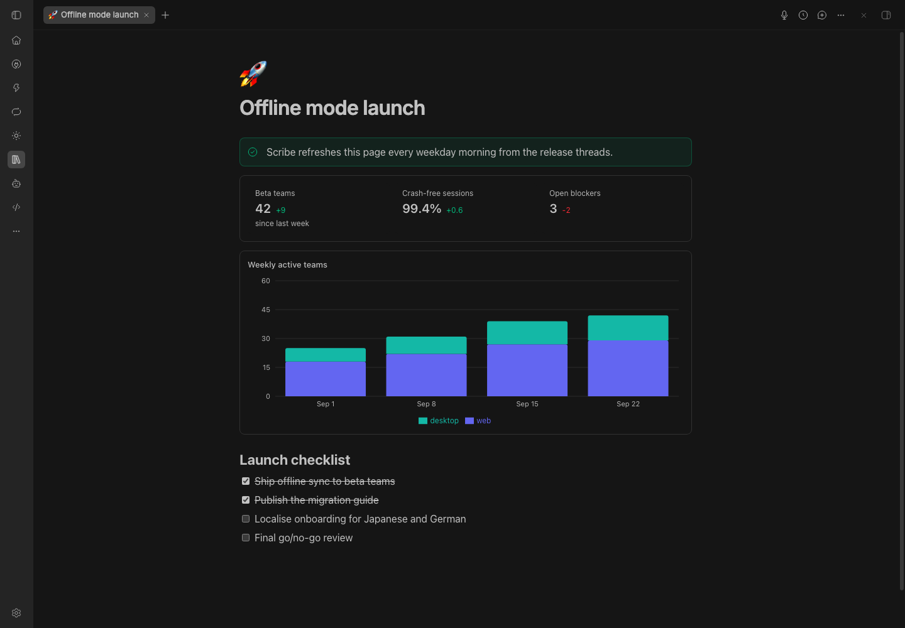

A seeded "Offline mode launch" page, opened from its old
`/plugins/pages/pages/<id>` address, lands as a Studio tab: a tip callout, a
stats block, a stacked bar chart of weekly active teams and a launch
checklist, with Dictate, Version history, Comments and the page menu in the
tab's row. Captured in a staged BB (stable BB 0.46.0). Recapture with `BB_CAPTURE_ONLY=pages`.

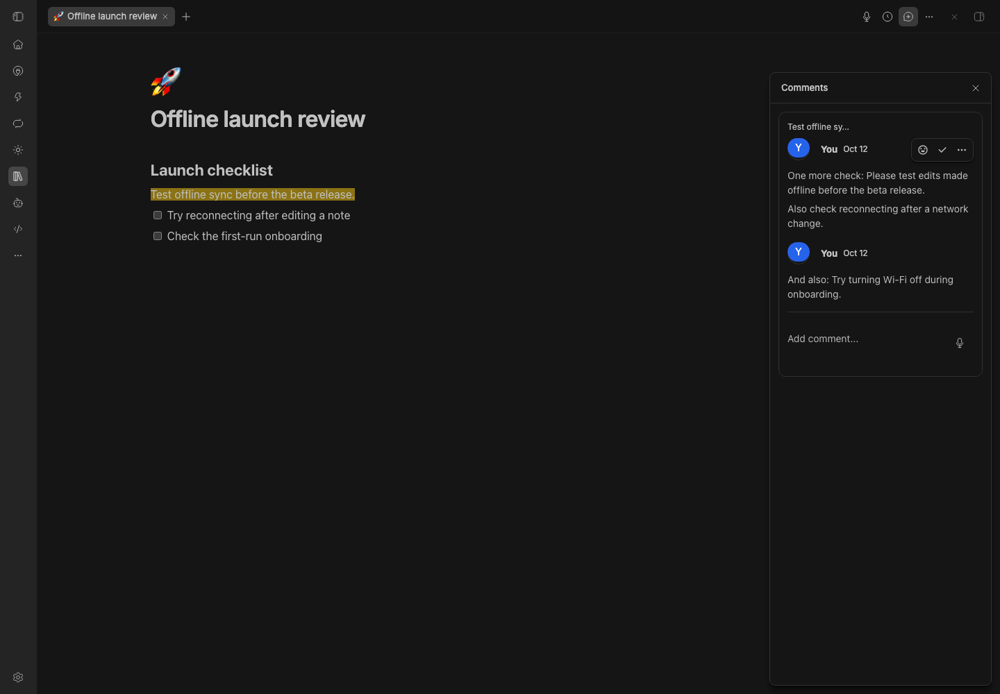

An anchored comment and a reply, both dictated through Talk into the comment
drafts and saved explicitly; the page body is unchanged. The microphone also
fits the [phone comment sheet](assets/pages-comments-mobile.png). Recapture
with `BB_CAPTURE_ONLY=pages-comments`.

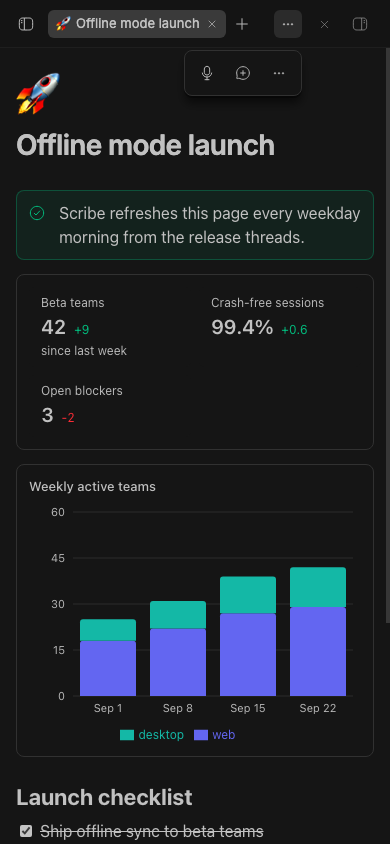

The compact page header at 390 pixels, with **Item actions** open.

### What you get

- **A block editor.** Built on [BlockNote](https://www.blocknotejs.org): type
  `/` for headings, lists, checklists, toggles, quotes, code, tables, images,
  video, audio, files, and the custom blocks below. Blocks can be dragged,
  nested, and turned into other types. Markdown shortcuts work as you type.
- **Live collaboration.** Every page is a Yjs document synced over a
  WebSocket. Agents edit the same document from the server, so their
  changes stream into your editor, with cursors, while you keep typing.
- **Code and diagrams.** Code blocks are syntax-highlighted for about
  twenty languages, in light and dark. A `mermaid` block renders its
  diagram; click it to edit the source.
- **HTML blocks.** An `html` block runs its HTML, CSS, and scripts in a
  sandboxed frame (no access to BB, its cookies, or storage) that grows to
  fit its content. Click its label to edit the source.
- **A card in the agent's reply.** When an agent creates or changes a page,
  its reply shows the page's card (`::page{id="…"}`). The card shows the
  page's text inline, read-only, and updates as the page changes. The chevron
  hides or shows the text; the choice is remembered for every Studio card.
  Click the title or the arrow to open the page in the thread's **Studio**
  tab, beside the chat. Where there's no workbench, it opens
  in the main area.
- **In a thread's workbench.** The **Studio** tab (see Workspace) lists the
  thread's pages with its other items (the ones made or changed in it, and
  the page it was started from), then the project's recent ones. **New →
  Page** makes a page in the thread's project and links it to the thread in
  Studio. A page opens in its live editor, with a link to the full page.
- **Custom blocks.** Callouts, charts (bar, line, area, pie), stat rows, and
  embed cards for links, BB threads, and other pages. Paste a link on an
  empty line to turn it into a card; web links fetch their title,
  description, and preview image.
- **Studio embeds.** The `/` menu's Studio group embeds an artifact or a
  recording, picked by search, or makes a new whiteboard (`/whiteboard`, also
  found as `/drawing`, `/sketch` or `/diagram`) or mini app in the page's
  project and embeds it.
  Embeds stay live:
  - a recording plays in the page, with its summary, decisions and
    transcript; click a line to play from there;
  - a whiteboard shows its scene, and **Sketch** (or a double-click) adds a
    pen, an eraser and five colors. Strokes save as ordinary Excalidraw
    elements, merged with other edits. A handle on its bottom edge sets its
    height in this page (see [Whiteboards](#whiteboards)), and **Open full
    size** opens the full editor over the page. `/whiteboard` makes a new one
    in the page's project and opens it ready to draw. Pages draws the scene
    as plain SVG and doesn't load Excalidraw until you open it full size;
  - an artifact shows its content (images, HTML, PDFs, code, text).

  Pasting a link to a Studio item embeds it too.
  Charts and stats are edited as JSON, which makes them easy for agents to
  write.
- **Mentions.** Type `@` to mention another page, a BB thread, a
  Studio item, or a date. Page and thread mentions open where they point.
- **Comments.** Select text to comment on it. Threads show in a floating
  card where you can reply, react, edit, and resolve. Agents can read, start,
  reply to, and resolve threads. Clients without the editor, like the BB
  Studio phone app, use Studio's `pages.comments`, `pages.commentBlocks`,
  `pages.commentCreate`, `pages.commentReply` and `pages.commentResolve` RPCs,
  which write as you.
- **Pages in the library.** Studio's library filtered to pages
  (`/plugins/studio/studio/pages`) lists every page, with search over titles
  and content, filters, a project filter, and sorting and grouping from
  **Display**. **New → Page** opens a blank page as a Studio tab.
- **Projects and nesting.** Pages belong to a project or are global, and
  nest to any depth, with a breadcrumb back up. Give a page an emoji icon,
  move it, archive it, or delete it from its ⋯ menu.
- **Threads about a page.** The header's new-thread button opens a composer
  beside the page with the page as context; sending starts an agent thread in
  the page's project. The page's ⋯ menu opens its linked thread, links
  another, or unlinks it (see Item threads).
- **Version history.** Pages saves a version before an agent's first
  edit in a while. You can save one yourself and restore any version, and the
  current page is saved before a restore.

### Dictation

Talk is built into Studio too, so you can dictate into a page:

- The **Dictate** button at the top right, or **Dictate** in the `/` menu, starts Talk. Press
  **Stop dictation** or ✓ in Talk's pill to finish, and the transcript goes in
  at your cursor. Blank lines in the transcript start new paragraphs. If you
  haven't clicked into the page yet, the text goes at the end.
- *Talk: Start or finish dictation* from the command palette works while the
  cursor is in a page.
- If you finish while you're somewhere else, Talk keeps the text. Its **Go
  back** button reopens the page, and the text is added when the page loads.

Talk does the recording, transcription, and durability. Pages only marks the
editor as a Talk dictation field and inserts the text Talk hands it.

### Checklists and agents

A checklist item is a unit of work. **Hand to agent** (in the item's ⋮⋮
menu, or `/hand to agent` on the item) starts a thread in the page's project
with the item as its prompt and a mention of the page. Pages puts a mention
of that thread at the end of the item, labelled with the thread's state:
**Agent · starting**, **working**, **needs input**, **replied**, **failed**,
**archived** or **deleted**. Click it to
open the thread. Check the item off yourself after reviewing; the agent is
told not to.

### Notes from the composer

When a message grows into meeting notes, **Expand to page** in a thread's
composer (the ⤢ button beside the microphone) moves the draft into a temp
page and opens it in the thread's Studio tab, beside the chat.

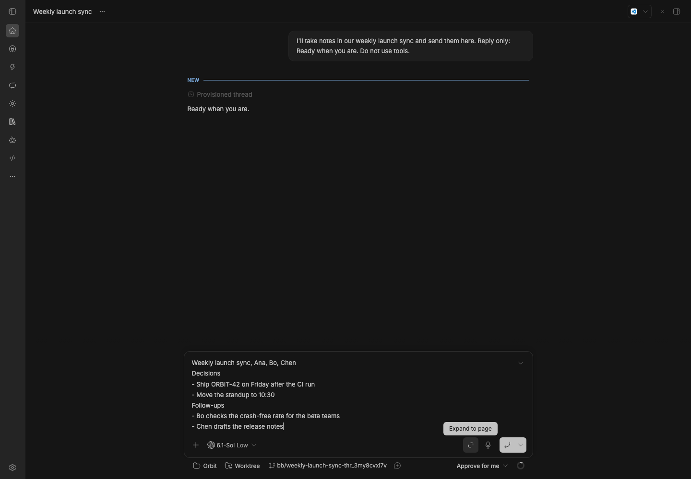

Notes typed in the composer of a staged "Weekly launch sync" thread, with the
pointer on **Expand to page**.

- **Where it goes.** The page is tagged **Notes** in Studio, in the thread's
  project, titled like "Notes · Oct 13, 2:05 PM · Weekly launch sync" (the
  time in your time zone). Studio records the thread it came from, and lists
  the page with that thread.
- **The draft moves.** Once the page holds the text, the composer is cleared,
  so there's only one copy and nothing is sent by accident. Each typed line
  stays its own paragraph and `- ` lines stay one list. Attachments stay in
  the composer. With a note already open, Expand adds the draft to the end
  of it instead of starting another.
- **Nothing is lost.** The page is saved to BB as it's made, and typing in it
  autosaves like any page. When you come back to the thread, a **Notes in
  progress** chip above the composer reopens it.

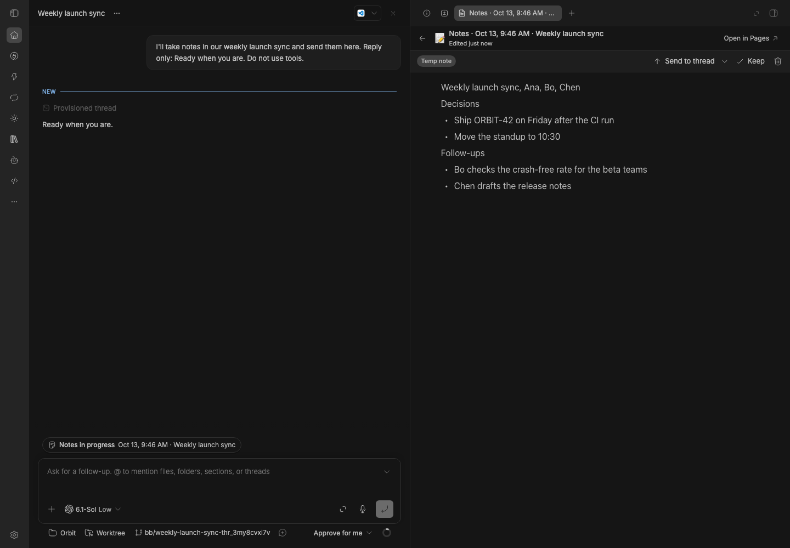

After Expand: the note open in the side panel with the draft's lines, the
composer empty, and the **Notes in progress** chip above it.

While the page is a temp note, its header (in the side panel and in Pages)
has three done actions:

- **Send to thread** sends the page's Markdown as your message. A note over
  8,000 characters goes as a link to the page and "Summarize these notes"
  instead, with the content for the agent. The ⌄ menu picks either one.
- **Keep** asks for a title and keeps the page.
- **Discard** asks first, then deletes the page.

A sent or kept note stays tagged Notes as an ordinary page, so your meeting
notes collect in one place; it's no longer a temp note, and the chip goes.

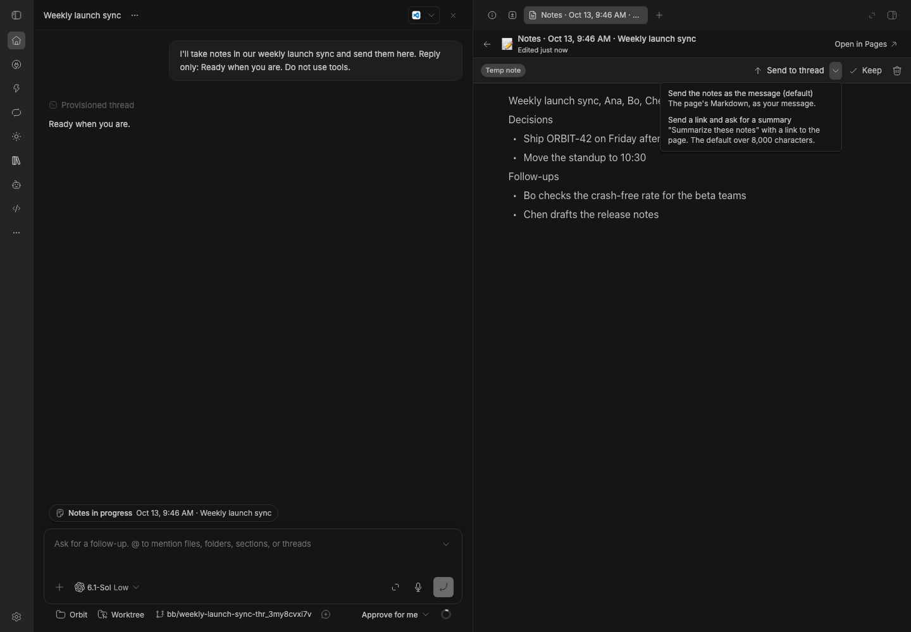

The note reopened from the chip after a reload, with Send's menu open: the
notes as the message (the default for this length), or a link and a request
to summarize. Captured in a staged BB (stable BB 0.46.0). Recapture with
`BB_CAPTURE_ONLY=pages-notes`.

The iOS app can do the same over Studio's `notes.*` RPC methods:
`notes.create` (text and a thread; adds to the open note), `notes.forThread`,
`notes.forPage`, `notes.send` (`auto`, `content` or `summarize`),
`notes.keep` and `notes.discard`.

### For agents

Agents get eight tools: `pages_list`, `pages_read`, `pages_create`,
`pages_edit`, `pages_comments`, `pages_comment`, `pages_comment_reply`, and
`pages_comment_resolve`. `pages_read` returns Markdown with a block id on the
line before each block, and `pages_edit` applies small operations against those ids. An
agent can then change one checklist item or paragraph without overwriting
what you are typing.

The same actions are available from the CLI (`bb pages …` before the merge):

```sh
bb studio pages list [--all]
bb studio pages show <page-id|title> [--ids]
bb studio pages create <title> [--global] [--markdown <text>]
bb studio pages append <page-id|title> <markdown…>
```

[skills/pages/SKILL.md](skills/pages/SKILL.md) documents the tools, the
Markdown extensions (charts, stats, HTML, embeds, callouts, mentions), and the agent
workflows.

### Storage

In **Settings → Studio → Threads**, **Page history** (`snapshotsPerPage`) controls history
retention. The default is 50. Set 1 to 1000 to keep that many versions, or 0
to keep all. Lowering the limit removes older versions when that page next
saves a version. Existing pages use the new limit without a restart.

Pages, versions, uploads, notes' threads (`page_notes`), and historical requests live in Studio's SQLite
database in the BB data directory. Uploads are limited to 15 MB each and are
served back at `/api/v1/plugins/studio/http/pages/files`; a page saved before
the merge, with `/api/v1/plugins/pages/http/files` addresses in it, shows its
files from Studio too. Live editing syncs over Studio's `/pages/sync`
WebSocket. The editor (BlockNote, Yjs, Mermaid, Shiki, Recharts) loads the
first time a page opens, not with Studio; the server loads pdf-lib only for a
PDF export.

BlockNote's menus and toolbars are styled with Tailwind classes that live in
`node_modules`, which `bb plugin build` doesn't scan. `blocknote-tailwind.txt`
lists them so the build generates them. After upgrading `@blocknote/shadcn`,
run `pnpm tailwind:blocknote` (and `pnpm css:blocknote` for the stylesheet).

### Backup

Pages are the `pages` section of `bb studio backup` (see
[docs/backup.md](../../docs/backup.md)), as they were with the separate
plugin, so older backups restore into Studio. A backup holds each page's
content with its comments, the Markdown copy, saved versions and uploaded
files, plus its title, icon, place in the tree, template and refresh settings,
and whether it is archived. Page request history, page chats and checklist
hand-offs are left out, because they point at BB threads that won't exist on
another BB. A page that is open in an editor or has unsaved changes is not
overwritten on restore: it is reported as failed with a reason, and restoring
again after you close it picks it up.

## Explore

Explore is experimental. Agents end answers that read code with a few things they noticed **Along the way**; clicking one drafts "💬 Tell me more" about it so the agent explains it in the thread. It ran inside the Studio Pages plugin and moved into Studio with it: Studio keeps the Next row's click log in its own database. The CLI is `bb studio pages explore stats` (`bb pages explore stats` before the merge).

Explore's settings are in **Settings → Studio → Agent replies** (keys `explore_next`, `explore_explore`, `explore_quickReplies`, `explore_replyItems`, as before): **Next row** (on), **Things to explore** (on), **Quick replies** (on), and **Your usual quick replies** (`👍 Looks good, 🔁 Try another way, ❓ Explain more`). They apply to agent sessions started after the change. A session's instructions carry one line about the Next row (or Explore): which attributes are on and your usual quick replies; the full rules are in the studio skill's "Agent guide" (`skills/studio/SKILL.md`), which the agent loads before it writes one.

### Next row

With **Explore: End replies with a Next row** on (the default), agents end a reply with one compact **What next?** card instead of separate lines. Each row has a short label saying what its buttons are for; hover a label for more:

- **Reply**: quick answers to this message, when it asks you something. Turn them off with **Explore: Offer quick replies**; the agent prefers the ones in **Explore: Preferred quick replies** when they fit. Clicking a reply or a request drafts it for you to send.
- **Ask for**: things the agent offers to do next, such as "📄 Write this up as a page" or "🧵 Start a thread to fix the retry bug".
- **By the way**: what the agent noticed along the way, told back to you in plain sentences: "I noticed the new endpoint retries without waiting between tries. If the server is down, it will get hammered." Notes marked 🐛 have **Fix this**, which drafts a request to fix it.

The agent writes it as one line, and any group can be left out:

```
::next{reply="👍 Ship it|🧪 Add tests first" btw="🐛 I noticed the new endpoint retries without waiting. If the server is down, it will get hammered." do="📄 Write up the plan as a page"}
```

Studio logs each suggestion once when it's shown and counts its clicks. The log keeps the last 180 days (at most 50,000 suggestions). `bb studio pages explore stats [--days 30]` prints how often each kind (reply, do, fix; older logs also have more, for the removed Tell me more, and explore, for the removed Visual explainer) is clicked and the most-clicked labels, so the instructions can be tuned from real use. Older replies with `::explore` or `::reactions` lines, or `explore` items in `::next`, still render.

## Artifacts

Artifacts are built into Studio: the images, pages, reports and files your
agents make, kept with every version. They used to be the separate Studio
Artifacts plugin (`artifacts`). Items keep that id as their namespace
(`artifacts:<id>`), so tags, tabs, links and chats carry over. If you
still have the old plugin, see [docs/upgrade-unified-studio.md](../../docs/upgrade-unified-studio.md).

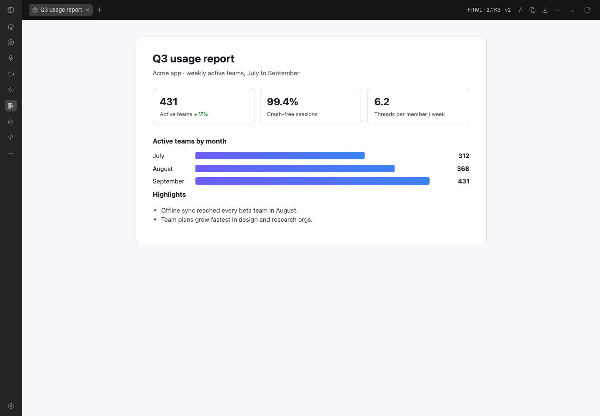

Captured from a staged BB after the merge: the seeded HTML report "Q3 usage
report", saved twice from a staged thread's workspace, open as a Studio tab
at version 2 (`HTML · 2.1 KB · v2` in the tab row, with Source, Copy,
Download and the ⋯ menu) in its sandboxed frame. Recapture with
`BB_CAPTURE_ONLY=studio-artifacts`, which also checks that the old address
opens it as a tab.

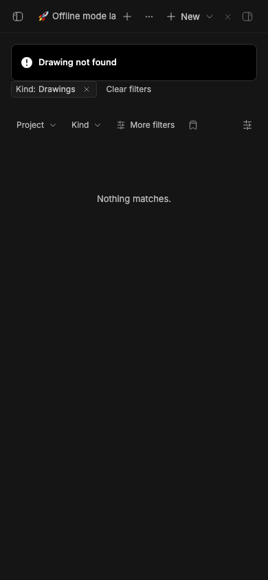

The same viewer at 390 pixels wide as a Studio tab, with **Item actions**
open. The tab row shows only the viewer's own tools; Chat appears where the
artifact opens outside the workspace, such as beside a thread. Recapture
with `BB_CAPTURE_COMPACT_HEADERS=1 BB_CAPTURE_ONLY=artifacts-compact-header`.

- **In the library.** Artifacts list next to pages, recordings and drawings,
  with type, size and version columns, image thumbnails, projects, archive,
  move and delete. Artifacts have no collection page of their own:
  `/plugins/studio/studio/artifacts` opens the library filtered to the
  Artifact kind. Studio search matches titles, descriptions and the text of
  text files up to 1 MB (HTML by its words). Studio can't create an artifact;
  they come from threads.
- **Viewer** (`/plugins/studio/studio/artifacts/<id>`, loaded the first time
  one opens). Images fit the window, and a click shows actual size. HTML runs
  in a sandboxed frame, PDFs open in the browser's viewer, and audio and video
  play with seeking. Markdown renders as a document. Code and text use BB's
  source viewer (first 2 MB). Other files offer a download. The header has an
  editable title, the artifact's chat, Copy, Download, and a menu with Open
  source thread, Save as page, Versions, Move to and Delete. Select text or
  drag over an image to **Send to thread**.
- **Live HTML.** An HTML artifact's page gets `window.playground`, the same
  API as BB playgrounds: shared state that persists per artifact and syncs to
  every open copy, theme changes, an event log, actions an agent can run
  (`artifacts_live`, or `bb studio artifacts state|watch|actions|do`), and
  `send(label, data)`, which puts an @artifact pill holding that data in the
  thread's composer. A playground's HTML works unchanged as an artifact.
  In a chat card the page's frame fits its height (120–640 px).
- **Save from a thread.** The save icon in the thread's **Studio** tab lists the
  files the latest reply created, changed or generated, the thread's storage
  files, and what the thread already saved. Nothing is saved automatically.
- **Agent tools and skill.** `artifacts_save`, `artifacts_list` and
  `artifacts_read`, and the `artifacts` skill. A saved artifact comes back as
  `::artifact{id="art_…"}`, a card with an inline preview that opens the
  viewer beside the chat. `@artifact` mentions give the agent the artifact's
  details and, for text up to 1 MB, its contents.
- **Commands.** `bb studio artifacts save <path> [--title <title>]
  [--description <text>]`, `list [--thread]`, `show <id>`,
  `export <id> [path] [--force]` and `delete <id>`. A plugin registers one CLI
  command, so the old `bb artifacts …` moved under `bb studio`.
- **Limits.** 25 MB per file. A version is keyed on its source thread and
  path; unchanged bytes add no version. Saving reads only from the thread's
  workspace or thread storage.

Files are stored as BLOBs in Studio's SQLite database. Contents come from
`GET /api/v1/plugins/studio/http/artifacts/content`. Every response except a
real PDF carries a `sandbox allow-scripts` CSP, so HTML gets an opaque origin
and can't call BB's API with your session.

## Whiteboards

A whiteboard is an [Excalidraw](https://excalidraw.com) scene that lives in a
page. There's one way to make one in each place: `/whiteboard` in a page,
**New → Whiteboard** in Studio (a new page called "Untitled whiteboard"
holding one 640px whiteboard), `whiteboard_create` for agents and
`bb studio whiteboards create` on the command line. Each is embedded in its
page as `{"kind":"drawing","target":"drw_…"}`, with an optional `"height"`.
Whiteboards used to be "drawings", the separate Studio Draw plugin
(`excalidraw`) and then a kind of their own. Items keep that id as their
namespace (`excalidraw:<id>`) and the kind id `drawing`, so tags, tabs,
links, filters and chats carry over. If you still have the old plugin, see
[docs/upgrade-unified-studio.md](../../docs/upgrade-unified-studio.md).

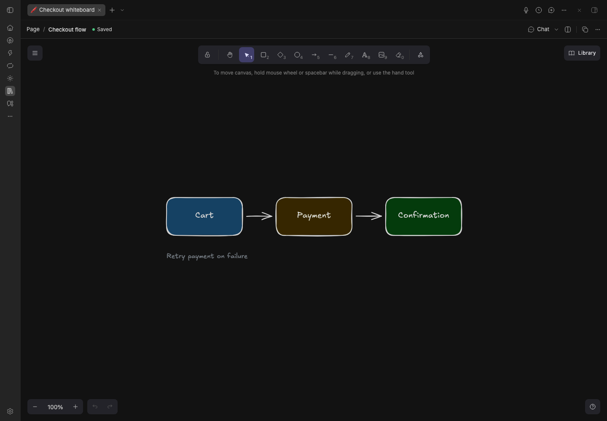

The seeded "Checkout flow" whiteboard, opened full size from its page
("Checkout whiteboard") with **Open full size**: the full Excalidraw editor
covers the page in the same tab, with **Page** (back), the name, sync status,
Chat and the ⋯ menu in its bar. Cart, Payment and Confirmation boxes are
joined by arrows, with a "Retry payment on failure" note. Recapture with
`BB_CAPTURE_ONLY=excalidraw`, which also opens it from its old
`/plugins/excalidraw/drawings/<id>` address, checks that it lands as a
Studio tab, and checks that Esc returns to the page.

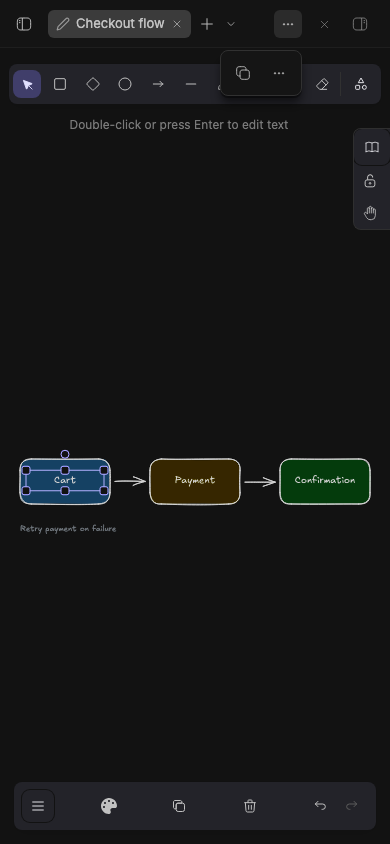

The same editor at 390 pixels wide as a Studio tab, with **Item actions**
open. Recapture with
`BB_CAPTURE_COMPACT_HEADERS=1 BB_CAPTURE_ONLY=draw-compact-header`.

- **In a page.** See [Studio embeds](#pages) under Pages: the page shows the
  whiteboard as SVG with a pen and an eraser.
- **Height.** Drag the handle on the whiteboard's bottom edge, from 160 to
  1200 pixels (320 by default). Focus it to use the arrow keys (Shift for
  bigger steps, Home and End for the smallest and largest); double-click it
  for the default. The height is saved on the page's embed, so the same
  whiteboard can be tall in one page and short in another, and an agent can
  set it with `pages_edit`. The width is the page's column. Read-only pages
  have no handle. The iOS app shows a page's whiteboard as a row that opens it.
- **Full size, in place.** **Open full size**, or a click on the whiteboard's
  header, opens the full editor over the page wherever the page is: a
  thread's side panel or workbench, or the Studio tab. It never takes you to
  the Studio tab or out of a thread. **Page** in its bar, or Esc, returns to
  the page at the same scroll. Esc that the editor uses (a text box, a menu)
  stays with the editor. The scene fits the box when it opens.
- **Old drawings.** At startup, Studio embeds each drawing that no page shows
  in its project's **Whiteboards** page (made when needed; older installs
  called it **Drawings**), once each, so none is lost. With no such drawings,
  nothing changes. Templates and archived drawings stay in the library.
- **In the library.** Whiteboards have a **Whiteboards** row in the sidebar,
  after Pages, and list there with thumbnails, projects, search over the
  words on them, archive, move, delete and **Copy text**. They have no `@`
  suggestions of their own: they come with their page.
  `/plugins/studio/studio/drawings` still opens the library filtered to them.
- **Editor** (`/plugins/studio/studio/drawings/<id>`). Excalidraw loads the
  first time a whiteboard opens full size, not with Studio. It autosaves as
  you work. The header has an editable name, sync status, the item's chat,
  copy image, and a menu with **Download PNG**, Move to and Delete. **Back**
  returns to the whiteboard's page. The editor follows BB's active theme. In
  a thread, **Attach** adds the whiteboard to the conversation as an image.
- **Card in the agent's reply.** When an agent adds or changes a whiteboard,
  its reply links the page (`::page{id="…"}`). Older replies' `::drawing`
  cards still show the picture, name and element count, read-only.
- **Agent tools and skill.** `whiteboard_list` (each whiteboard with its
  page), `whiteboard_get` (elements, app state, a text summary, and image
  files without their data; scenes over about 400,000 characters come back
  as element ids), `whiteboard_create` (a name, and a `pageId` with an
  optional `afterBlockId`; without `pageId` it makes a whiteboard page) and
  `whiteboard_update` (upserts and deletes up to 500 elements by id; only the
  elements you send change), and the `whiteboards` skill. The old names
  (`excalidraw_list_drawings`, `excalidraw_get_drawing`,
  `excalidraw_create_drawing`, `excalidraw_update_drawing`, with `drawingId`)
  still work for two releases, so automations and saved prompts keep
  running; move them to the new names.
- **Live co-editing.** Keep a whiteboard open and ask an agent to change it.
  Your page or editor shows its edits live (a page's whiteboard listens for
  Studio's update signal, and checks every 15 seconds in case one was
  missed), and the agent's next read sees yours. Edits merge per element;
  two edits to the same element resolve by Excalidraw's `version`, higher
  wins. Deletions travel as tombstones (pruned after 30 days).
- **Commands.** `bb studio whiteboards list`, `create --page <page-id> <name>`,
  `show <id> [--raw]`, `rename <id> <new-name>`, `delete <id>`,
  `merge <id> <scene-file.json>` (an elements array or a full scene, with its
  image files) and `remove-elements <id> <element-id…>`. `bb studio drawings …`
  is the old name and still works. A plugin registers one CLI command, so the
  old `bb excalidraw …` moved under `bb studio`.
- **Export.** **Download PNG** in the editor renders in your browser. Studio's
  item menu exports PNG, SVG or the `.excalidraw` JSON, drawn on the server
  with Excalidraw's fonts (resvg's WebAssembly build loads on the first PNG).
  Embedded images are drawn if each is under 1.5 MB and all under 4 MB.

Scenes are stored in Studio's SQLite database in Excalidraw's save-file
format. The editor autosaves after a 1.2 second pause, in order, retries a
failed save up to three times, then shows **Retry save**. Unsaved scenes are
also kept in this browser's IndexedDB: on reopening, **Recover draft** merges
one only if the server copy hasn't changed; otherwise **Save as copy**,
**Download draft** or **Discard draft**. Thumbnails come from
`GET /api/v1/plugins/studio/http/drawings/thumbnail`, an SVG with a CSP that
runs nothing.

## Designs

Designs are built into Studio: UI prototypes and slide decks you design with
your agents. A design is a set of rounds; each round holds a few options, and
each option is one self-contained HTML screen. They used to be the separate
Studio Design plugin (`design`). Items keep that id as their namespace
(`design:<id>`), so tags, tabs, links and chats carry over. If you still have
the old plugin, see [docs/upgrade-unified-studio.md](../../docs/upgrade-unified-studio.md).

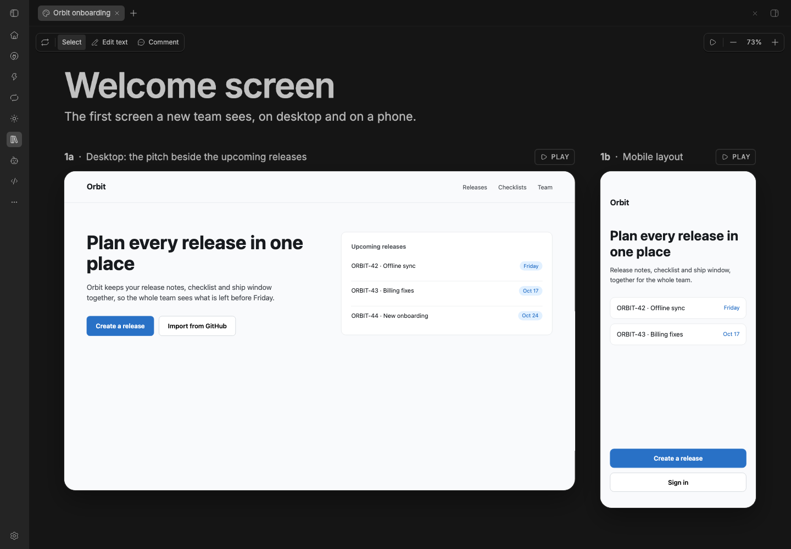

The seeded "Orbit onboarding" design: one round, "Welcome screen", with two
live options side by side, `1a` (desktop) and `1b` (phone), and the floating
pills for Reload, **Select** / **Edit text** / **Comment**, Present and zoom.
Recapture with `BB_CAPTURE_ONLY=design`, which opens it from its old
`/plugins/design/designs/<id>` address and checks that it lands as a Studio
tab; the prototype and deck captures do the same.

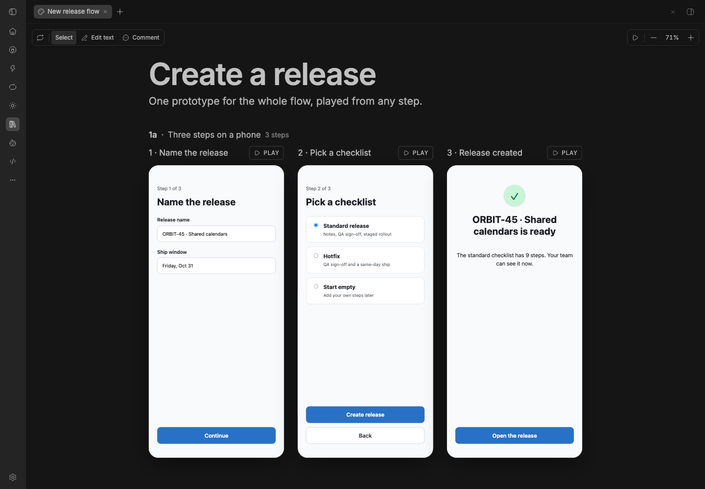

The seeded "New release flow": one mobile prototype that declares three
steps, splayed into one live frame per step.

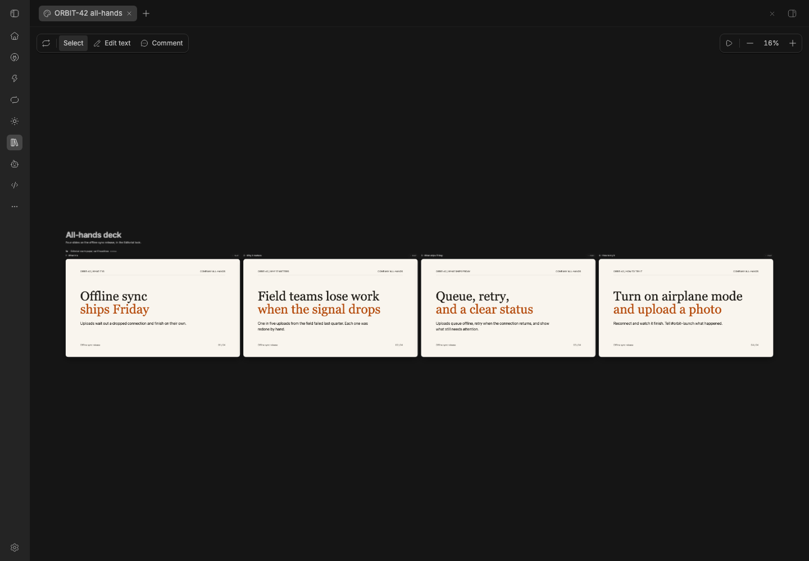

The seeded "ORBIT-42 all-hands" deck: one `slide` screen whose four steps are
its slides, laid out in a row.

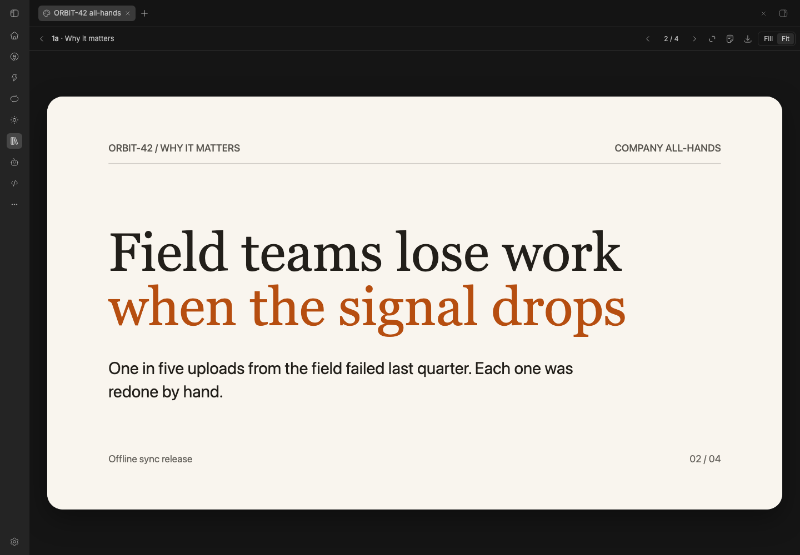

The same deck presented with Play and moved on with →: "Why it matters",
"2 / 4", **Full screen**, **Export PDF**, **Download HTML** and Fit/Fill.

- **In the library.** Designs list next to pages, recordings, drawings and
  artifacts: create, move, rename, duplicate, archive, delete and export
  (each screen's HTML). Designs have no collection page of their own:
  `/plugins/studio/studio/designs` opens the library filtered to the Design
  kind.
- **Canvas** (`/plugins/studio/studio/designs/<id>`; old
  `/plugins/design/designs/<id>` links open here). Drag the background or hold
  Space to pan; pinch, or hold ⌘ and scroll, to zoom. Rounds stack newest
  first. Each option is a live frame at its real size (desktop, tablet,
  mobile, slide, square, story, A4, Letter, email, or any `WIDTHxHEIGHT` from
  200 to 4000 px a side). Screens update as the agent writes them. A
  multi-step prototype declares its steps with a `bb-design-steps` meta tag
  and shows one frame per step.
- **Slide decks.** The agent shows 2–3 directions first, then writes the deck
  as one `slide` screen whose steps are its slides. **Play** presents it
  (←/→, Space, Page Up/Down, Home, End, **Full screen**, **Export PDF**,
  **Download HTML**).
- **Edit text and comments.** In **Edit text** mode, click text on a screen
  and type over it; the change is written into the screen's HTML. In
  **Comment** mode, pin a note to an element; **Send to agent** posts it, with
  the element's selector and markup, to the design's thread.
- **Card in the agent's reply** (`::design{id="…"}`) with the newest round's
  first screens. It opens the design in the thread's **Studio** tab beside
  the chat; back from it, the tab lists the thread's items, designs among them.
- **Questions.** `design_ask` shows a form in the thread (choices, multi,
  short answers, 1–5 scales, each with "Decide for me"); the answers return
  as the tool's result.
- **Reviewer.** `design_ready` starts a reviewer agent in a hidden thread
  beside the design's own. It loads each screen at its size with Browser
  Automation, checks layout, errors and the design rules, and reports back
  only when something needs work, in the design's thread. After 3 such
  reviews in a row, automatic review pauses until you edit, comment or ask.
- **Agent tools and skill.** `design_list`, `design_create`, `design_rename`,
  `design_read`, `design_ask`, `design_ready`, `design_write_screen`,
  `design_edit_screen`, `design_comments`, `design_resolve_comments`,
  `design_save_style` and `design_styles`, and the `design` skill. `@design`
  mentions give the agent the design's rounds and options.
- **Commands.** `bb studio designs list`, `show <id>` (rounds, screens and
  open comments as JSON), `html <id> <screen>`, `rename <id> <new-name>` and
  `delete <id>`.

Designs, rounds, screens, comments and saved styles are stored in Studio's
SQLite database. Frames load from
`GET /api/v1/plugins/studio/http/designs/screen`, whose response carries a
sandbox CSP, so a screen gets an opaque origin with no access to BB.
`bb studio backup` includes each design with its rounds, screens and
comments; saved styles aren't in backups yet.

## Mini apps

Mini apps are built into Studio: small interactive apps with their own data,
which you and your agents build together. A mini app is React source and a
manifest; it runs live in a reply (`::mini{id="mini_…"}`), in a page (an
embed block, or `/mini` in the slash menu), and in its own tab, and every
place shares the same data. Items are `minis:<id>` and open at
`/plugins/studio/studio/minis/<id>`.

Agents are told to make a mini app, rather than a playground or a one-off
HTML file, whenever you want something to use or come back to: a tracker, a
board, a calculator, a form, a poll, a chart to play with.

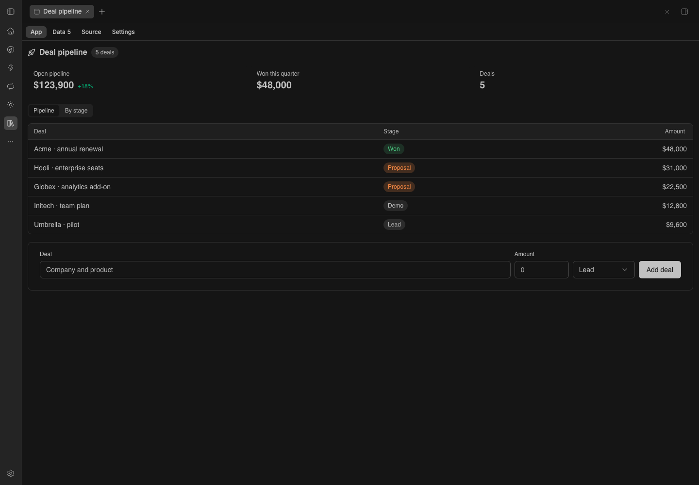

The seeded "Deal pipeline" mini app as a Studio tab in a staged BB, in dark
mode: Kit's badges, tabs, data table, fields, select and button, stat tiles
from `@studio/kit/charts`, a Lucide icon and Tailwind classes, over five
records. The tabs above it switch to its records, source and settings.

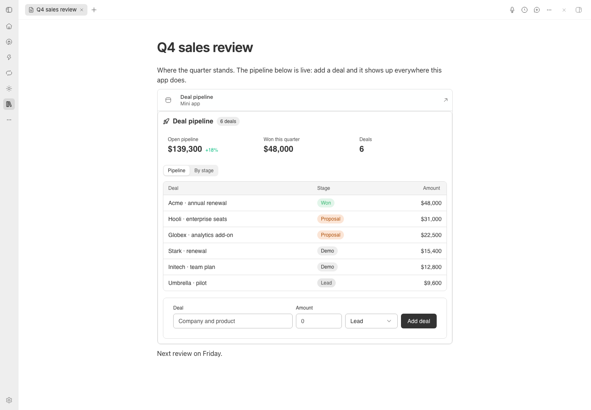

The same app embedded in a page, in light mode. During the capture a record
is added through the server, as an agent's `minis_data` would, and the page
block shows "Stark · renewal" and the new total without a reload.

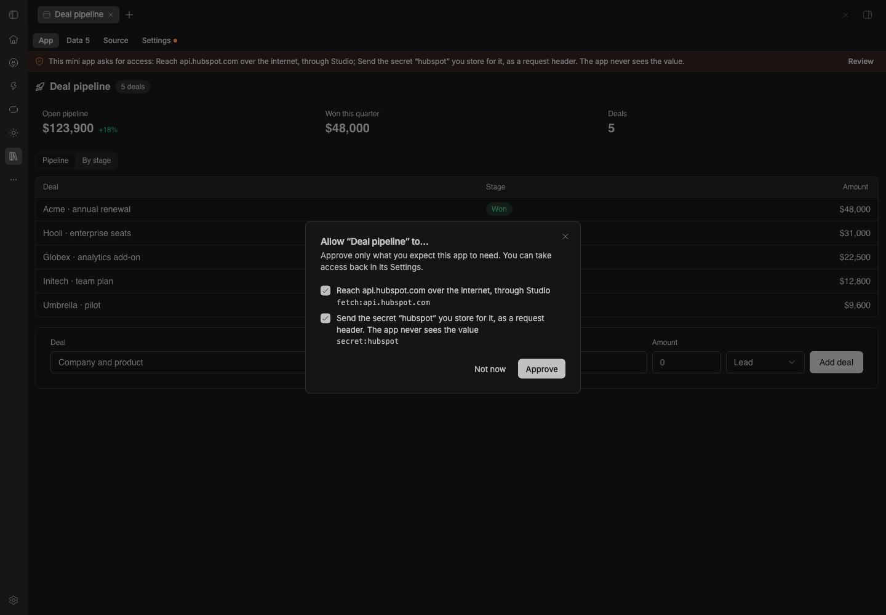

An app that asks to reach an API with a stored secret: the banner over the
app, and the approval dialog. Recapture all three with
`BB_CAPTURE_ONLY=minis,minis-page,minis-approval`; the captures read the
text inside each sandboxed frame, check the frame isn't same-origin, and
check that an approval with a made-up nonce is refused.

### What a mini app is

- **Source and manifest.** Files keyed by path: JSX, TSX, JS, TS, CSS, JSON,
  HTML. `mini.json` names the entry, the shelf libraries, the record
  collections, the access it asks for, and its size in a page or card. Studio
  compiles the source when it's saved (JSX and imports, with Sucrase) and
  refuses source that doesn't compile, so the last good version keeps running.
  The last 50 versions are kept; restore one in Settings.
- **Records.** Collections of JSON records, with per-record revisions so two
  people editing at once don't overwrite each other, live updates in every
  open copy, and filters and ordering on any field (fields listed under
  `indexes` get a database index). Up to 64 KB a record and 50 MB an app.
- **Shared state.** A small JSON value for UI state, as playgrounds and live
  artifacts have.
- **Actions and takes.** The app can expose actions an agent runs in the copy
  you last touched, and send data to the thread's composer for you to send.

### The shelf: libraries without a dependency mess

Mini apps never install anything: no npm, no build step, no `node_modules`.
An app imports only its own files and the shelf: libraries Studio ships at
pinned versions, built into `shelf/` by `node scripts/build-shelf.mjs` and
served from Studio. One copy serves every app, major versions sit side by
side, and nothing loads from the internet.

| Lib | Modules | Loaded |
| --- | --- | --- |
| `react@19` | `react`, `react-dom/client` | always |
| `tailwind@4` | Tailwind in the browser, with BB's colors as theme tokens | always |
| `kit@1` | `@studio/kit`: Studio's own components (Button, Input, Select, Dialog, DropdownMenu, …), Badge, Tabs, DataTable, Field, EmptyState, and hooks for records, state and actions | always |
| `charts@1` | `@studio/kit/charts` (`<Chart>` in the Pages chart format, `<Stats>`), `recharts` | when listed |
| `icons@1` | `lucide-react` | when listed |
| `markdown@1` | `marked` | when listed |
| `dates@4` | `date-fns` | when listed |

Anything else goes into the app as its own file.

### Security

A mini app's frame runs in an opaque origin with a CSP that allows scripts
only from Studio and blocks every connection. It reaches Studio only through
its host component, which checks each message came from its own frame; the
server checks collections, capabilities and rate limits again.

- `playground.fetch` goes through Studio's server, only to hosts the manifest
  lists as `fetch:<host>` and you approve, never to this machine or a private
  network, with redirects checked hop by hop and cookies dropped. Every
  request is in the app's network log.
- A `secret:<name>` you store in the app's Settings is added as a request
  header by the server. The app and agents never see the value.
- `bb.threads.read`, `bb.studio.read` and `bb.open` let the app list your
  thread titles, search Studio item titles, and open threads and items.
- You approve access in the app (a banner, then a dialog). The dialog takes a
  one-time nonce from the server and waits a moment before Approve works, so
  an agent can't approve its own app through RPC or the CLI. Revoke in
  Settings.

Backups keep each app's current source, state and records; approvals and
secrets aren't backed up, so a restored app asks again.

### Elsewhere in Studio

- **Artifacts:** an HTML artifact's menu has **Convert to mini app**: its page
  becomes the app's `index.html` and its live state carries over. Agents do
  the same with `minis_create` and `fromArtifactId`.

### Agents

`minis_create`, `minis_update`, `minis_read`, `minis_list`, `minis_data`
and `minis_live`, the `minis` skill, and
`bb studio minis list|show|data|state|watch|actions|do`. What an app returns
to an agent is wrapped as data, never instructions.

## Recordings

Talk is built into Studio: long-form, durable dictation and recording. It
saves audio as you speak and transcribes it with the voice service in
**Settings → AI services** (your ChatGPT subscription through Codex by
default). Every dictation and recording becomes a titled, searchable item you
can link to and @-mention. It used to be the separate Studio Talk plugin
(`talk`). Recordings keep that id as their namespace (`talk:<id>`), so tags,
tabs, links and chats carry over. If you still have the old plugin, see
[docs/upgrade-unified-studio.md](../../docs/upgrade-unified-studio.md).

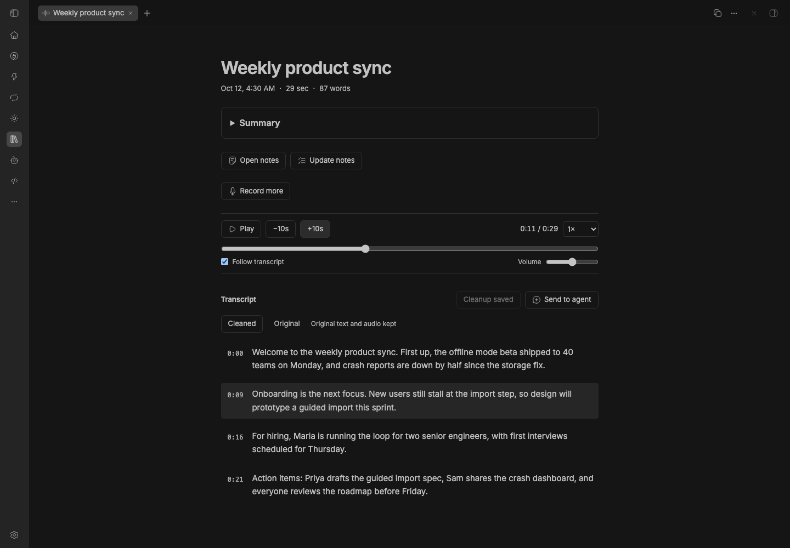

A seeded "Weekly product sync" recording, opened from its old
`/plugins/talk/recordings/<id>` address, lands as a Studio tab. Its audio was
spoken with macOS `say`, uploaded in two sessions and transcribed by BB's
voice service; the capture then makes a summary, a saved cleaned transcript
and a notes page, plays the audio, seeks to the second section and pauses.
Recapture with `BB_CAPTURE_ONLY=talk-page`.

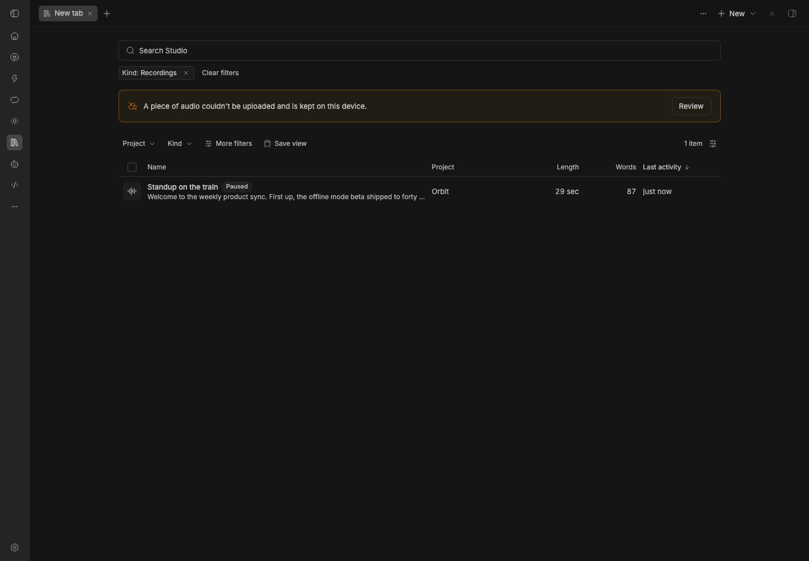

Studio's library filtered to recordings, with the banner for audio this
device kept because the server refused it (a piece set aside in the browser's
store by the capture). **Review** opens
`/plugins/studio/studio/recordings/unsent` as an "Unsent audio" tab, where each piece can be retried,
downloaded or discarded. Recapture with `BB_CAPTURE_ONLY=talk-unsent`.

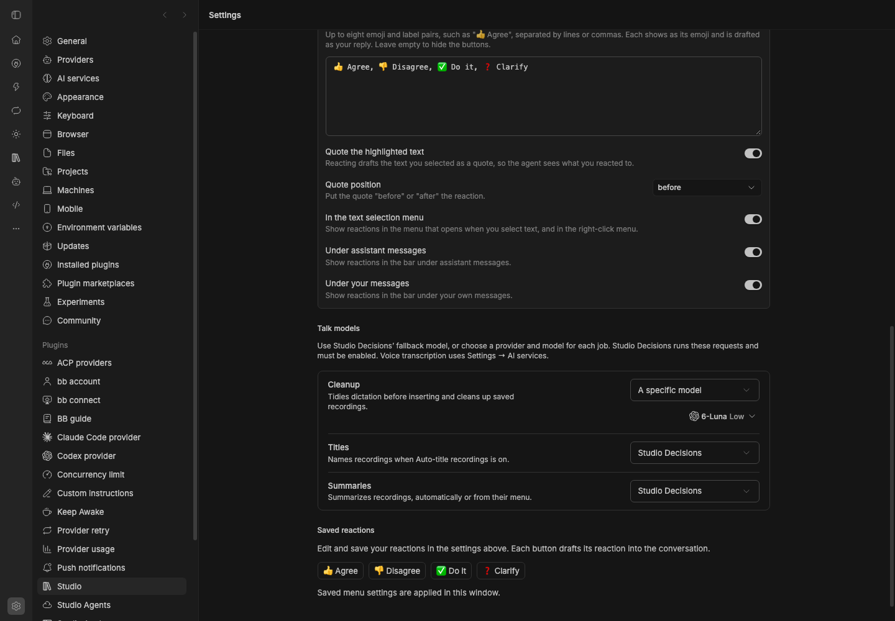

Studio's settings page: Talk's settings, with the
segment length and hold-to-talk key the staged user set,
and **Talk models** with Codex's 6-Luna for cleanup and Studio
Decisions for titles and summaries, chosen through the real controls.

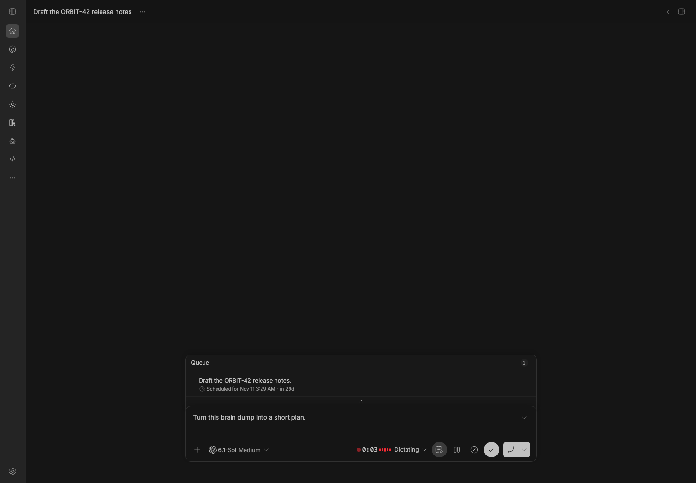

The composer's microphone dictating with Talk: timer, level meter, cleanup
toggle, pause, cancel and finish in place of the microphone.

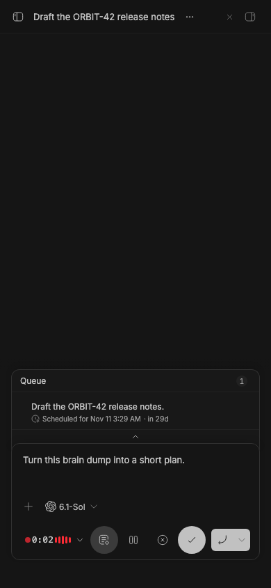

At a 390-pixel viewport the controls use a second toolbar row.

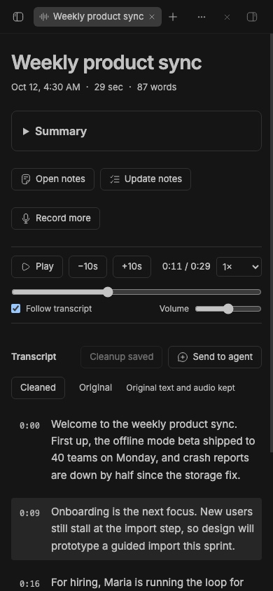

The staged recording at a 390-pixel viewport.

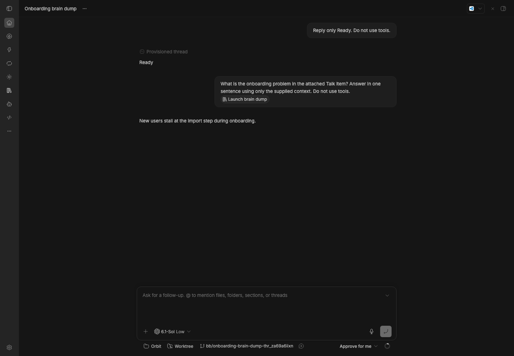

A dictated message with a clickable **Launch brain dump** mention of its
saved source.

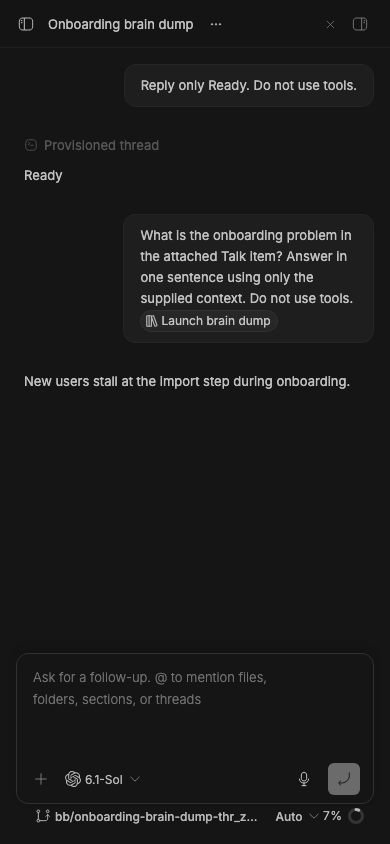

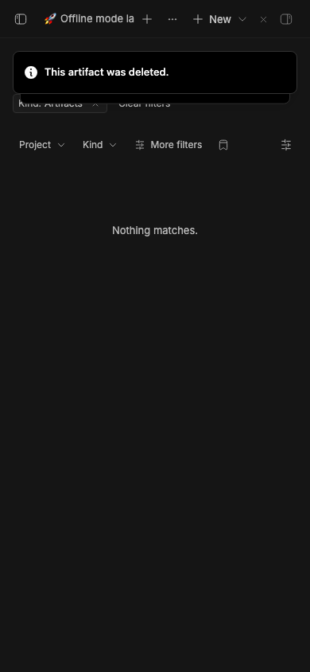

The compact recording header at 390 pixels, with **Chat** and **Item actions**.

### What you get

- **Replaces built-in dictation.** The composer's microphone starts a Talk
  dictation. Pressing it again, or ✓ in the pill, stops recording, waits for
  the transcript, and types it into that composer. ✕ stops without inserting.
- **The source stays with the message.** Chat dictation adds a native Talk
  mention beside the text, attaching the saved item for the agent. Click the
  pill in the sent message to open the original Studio item. The reference
  survives finishing away from the thread and returning later. **Keep as a
  recording** preserves it. Dictation into document fields inserts the text as usual.
- **One dictation, one thread.** While Talk is dictating, the mics in other
  threads are dimmed. Pressing one says where the dictation is, with a **Go
  back** button. The thread being dictated into shows a mic in the sidebar.
- **Finish from anywhere.** Press ✓ from another thread and Talk holds the
  text. It types the text into the dictation's thread when you go back. BB
  keeps unsent composer text on the device, so Talk can't safely write into a
  thread that isn't open. A Studio or page new-conversation composer also
  holds its dictation until you go back to it. **Go back** returns to the
  thread or composer the dictation came from, in the main view or a split.
- **Hold to talk.** Hold Right Option (or the key set in settings) by itself
  to dictate into the focused composer or field, and let go to insert. A
  quick tap does nothing, and Option+key shortcuts and AltGr characters still
  type as usual.
- **Clean-up before inserting.** Talk asks Studio Decisions to drop filler
  words and false starts, and to fix punctuation, without rewording. The
  dictation keeps the raw transcript. Turn it on or off with the ✦ button on
  the dictation pill; the choice is kept per device. If Decisions is missing,
  slow, or returns something that isn't a clean-up, Talk inserts the text as
  spoken.
- **Dictation in other plugins.** Plugins can mark a text surface as a
  dictation field, as Pages does for its editor. Talk
  dictates into it with the same pill, durability, and **Go back** handling
  as a composer. *Talk: Start or finish dictation* works in a focused field.
- **Recordings as spoken notes.** **New → Recording** in any Studio menu (the
  sidebar, the library, or Quick Open) starts one in that
  project and opens its page in the main pane, as a new page would. The
  command *Talk: Start or stop a recording* records for as long as you
  need without inserting anywhere. Use recordings for brain dumps, ideas,
  personal notes, or meetings. **Send to agent** opens a thread with the
  recording attached; mentions include its saved cleaned version when available.
- **A card in the agent's reply.** An agent can show a recording with
  `::recording{id="rec_…"}` on its own line: the summary and the first lines
  of the transcript, read-only. Clicking the title or the arrow opens the
  recording's page.
- **Clean up a recording.** **Clean up transcript** on a finished recording
  creates a saved cleaned version while retaining the original transcript and
  audio. Switch between **Cleaned** and **Original**; copy and text downloads
  use the version shown. Cleanup works section by section, so long recordings
  keep their audio alignment. If it stops, press the button again to continue.
- **Audio playback.** Play or pause, scrub across the recording, skip 10 seconds,
  change speed, and adjust volume. Click a timestamp or transcript section to
  play from there. Highlighting follows the audio; **Follow transcript** keeps
  the current section visible. Timing is per audio section, rather than per word.
- **Dictations stay in the background.** Every dictation is saved in case
  something goes wrong, but Studio's All view leaves them out. Pick
  the **Dictations** filter, or search, to find one. Recordings you start
  from Studio show up as usual.
- **Keep a long dictation as a recording.** After a dictation of five
  minutes or 800 words, a toast offers **Keep**. **Keep as a recording** on
  the dictation's page does the same. It moves the dictation out of the
  background and gives it a title; you can summarize it from its page. The text is still
  inserted.
- **Dictation audio expires.** After a day, a dictation's audio is
  deleted and its transcript is kept. Recordings keep their audio. A
  dictation with a piece still waiting or failed keeps its audio.
- **In the library.** Recordings and dictations list in Studio's library
  next to pages, drawings, designs and artifacts: search, filter to
  recordings or dictations, sort by title, date, length or word count, and
  tick rows to start one thread that mentions them all, copy their
  transcripts as one document, or delete them together. There is no
  Recordings page of its own: `/plugins/studio/studio/recordings` opens the
  library filtered to recordings, and audio this device kept unsent shows as
  a banner there.
- **Dictation at its input.** While its chat input is on screen, a dictation's
  compact controls replace the mic. Expand to read the transcript and it
  becomes a floating pill. Collapse it to dock again. Navigating away also
  floats the controls; returning to the input docks them. Each new dictation
  starts collapsed. Dictation into other plugins' fields uses the floating pill.
- **A pill that follows you.** Recordings and dictations away from their input
  use a small overlay at the top of the window. It stays
  put as you move between threads and pages. Everything else stays clickable.
  Drag it anywhere in the window and it stays there, even after a reload.
  Away from where you started, a back arrow returns you to that thread or
  recording. Click a recording's pill to open its page in the main view. Expand the pill to read the transcript as it arrives; the pill
  remembers whether you left it expanded or collapsed.
- **Streaming transcript.** Audio is cut into pieces of about 25 seconds at
  natural pauses. Each piece is transcribed as soon as it is uploaded, so text
  appears while you are still talking.
- **Linkable and mentionable.** Each recording opens as a Studio tab at
  `/plugins/studio/studio/recordings/<id>` (old `/plugins/talk/recordings/<id>`
  links open there too). It shows up in the composer's @ menu, and
  mentioning it gives the agent its transcript. Its ⋯ menu opens the
  linked thread beside the recording.
- **Auto titles.** Studio Decisions uses its configured fallback model to
  title each recording from its transcript. If Decisions is missing or reports
  that no model is available, Talk uses the transcript's first words and the
  recording date. Titles update as the transcript grows and never replace a
  title you typed.
- **Optional summary.** Choose **Generate summary** in the recording menu
  for a concise paragraph covering the recording's main ideas. It works for
  brain dumps, personal notes, ideas, conversations, and meetings. Enable
  **Automatically summarize recordings** in settings to summarize when a
  recording finishes. Saved summaries stay collapsed until you open them and
  can be regenerated.
- **Notes pages.** On a finished recording, **Make notes** writes a Studio
  Page with a short summary, the decisions made, and the action items as a
  checklist, so you can hand any item to an agent from the page. The page
  links back to the recording, and the recording shows **Open notes**.
  Running it again shows **Update notes** and rewrites the same page: Pages
  saves a version first, and action items you checked off or handed to an
  agent keep their state. Notes use the Summaries model through Studio
  Decisions. Long transcripts are read in parts of about 30,000 characters
  and combined; past six parts, the page says the notes cover the first part.
- **Exports.** Download a finished transcript as Markdown or plain text, or
  download its original audio segments together as a tar archive.
- **Agent tools.** `talk_list`, `talk_read`, and `talk_search` let agents find
  and read bounded portions of recordings and summaries. `talk_make_notes`
  makes or updates a recording's notes page.
- **Mobile layout.** The pill, recording pages, and composer mic all work in
  the BB mobile app, with larger touch targets on small screens.
- **Commands.** *Talk: Start or finish dictation*, *Talk: Start or stop a
  recording* and *Talk: Pause or resume* are Studio commands now. A keyboard
  shortcut set on the Talk plugin's command has to be set again on Studio's
  (BB keys custom shortcuts by plugin).
- **CLI.** `bb studio recordings list [--query <text>] [--json]`,
  `show <id> [--json]`, `transcript <id> [--cleaned] [--offset <chars>] [--limit <chars>]`
  and `notes <id> [--json]`. The bundled `talk` skill documents them for
  agents.

### Durability

- **Saved on the device.** Every few seconds, audio goes into IndexedDB.
  Audio leaves the device store only after the server confirms it is on disk
  (written to a temp file, fsynced, then renamed). While local writes succeed,
  reload/crash recovery keeps committed chunks; the current few-second chunk
  can still be lost.
- **Local storage failure.** Capture stops and keeps the full affected segment
  in this window. Retry saving or download it before closing. If the window
  closes first, that memory-only audio cannot be recovered. Before capture starts,
  Talk writes and reads back a small recovery marker; it refuses capture if this
  fails. The marker remains conservative if later audio and metadata writes both
  fail. On return, interrupted capture requires acknowledgement of a potentially
  missing tail before continuing with saved audio; automatic insertion stays off.
  Clearing browser data can still remove both the audio and its recovery marker.
- **Survives reloads.** Saved chunks stay available after reload. Review an
  interrupted capture before resuming it in a new session; the transcript starts
  a new paragraph. Download uploaded audio remains available before completion.
- **Offline.** While offline, audio keeps saving locally. It uploads with
  backoff when the connection returns.
- **One capture at a time.** A Web Lock makes sure only one window captures.
  Every window shows the pill. Other windows leave the capturing window's
  unsaved audio alone, and upload it only once that window is gone.
- **Refused pieces don't block the rest.** If the server rejects a piece as
  invalid, Talk keeps its audio on the device, says so, and uploads the
  pieces after it. A recording or dictation with a refused piece stays
  paused, and a dictation isn't inserted, since its text would have a gap.
  Retry or discard the piece, then finish it from its page. **Unsent audio** (the toast's *Review*, or the notice on
  the recording's page and the banner in Studio's library filtered to recordings) lists what the device kept:
  retry each piece or all of them (after a Talk update, say), download one
  as an audio file, or discard it. A laptop that sleeps mid-recording doesn't count the
  sleep as recorded time.
- **Deleting.** A recording that a window is still capturing can't be
  deleted. Stop it first.
- **Interrupted recordings.** If a capture stops reporting for two minutes,
  for example because the laptop closed or the app was killed, the recording
  is marked *Interrupted*. **Resume recording** on its page continues it, and
  **Finish** ends a paused or interrupted recording no window is capturing.
  Finish waits until none of its audio is left on this device.
- **Failed transcription.** Failed pieces retry with backoff for about nine hours.
  If the voice service is off, they retry every 10 minutes. **Retry** requeues
  pieces that gave up and retries waiting ones at once. When a dictation you
  finished hits a failure, the pill says *Transcription failed*, shows the
  service's error, and offers **Retry**. Talk inserts nothing until every
  piece is transcribed, so a failure never leaves a gap in the text. Audio is
  never discarded because of a failure.
- **Empty recordings aren't kept.** A dictation or recording that finishes
  with no words is deleted along with its audio, and Talk says so. This
  covers a mic tapped by accident, silence, and noise. A recording with a
  failed piece is kept, because a retry may still find speech.

### Settings

| Setting | Default | Effect |
| --- | --- | --- |
| Microphone button starts Talk | on | The composer mic starts Talk. Off restores BB's one-shot dictation. |
| Name recordings | on | Titles recordings from their transcripts. |
| Summarize recordings | off | Summarizes on completion; the recording menu can summarize on demand. |
| Cleanup model | Studio Decisions | Provider, model, reasoning, and supported service tier for dictation and saved-transcript cleanup. |
| Titles model | Studio Decisions | Model for automatic recording titles. |
| Summaries model | Studio Decisions | Model for automatic and on-demand summaries, and for notes pages. |
| Hold-to-talk key | Right Option (Alt) | Key to hold for dictation: Right Option, Right Command, Right Control, or Off. |
| Keep dictation audio (days) | 1 | Deletes a finished dictation's audio after this many days. 0 keeps it. |
| Transcribe calls | This Mac | Where a recorded call becomes text: WhisperKit on this Mac, Home server, or BB voice service. |
| Home server URL | empty | Shown for Home server: an OpenAI-compatible `/v1/audio/transcriptions` server, such as `http://homelab:8000`. |
| Home server model | empty | Under Transcription models; the model name the server expects. Empty sends `whisper-1`. |
| Model on this Mac | `openai_whisper-large-v3-v20240930_626MB` | Under Transcription models; the WhisperKit model, downloaded on first use. |
| Keep call audio | 30 days | 7 days, 30 days or Forever. The transcript and notes stay until you delete the recording. |

They are on Studio's settings page: **Settings → Studio**, under **Voice** (the microphone and hold-to-talk key) and **Recordings and calls**, whose **Models for titles, summaries and cleanup** disclosure has the three model choices. Audio is cut into pieces of about 25 seconds (a constant now; it was the Segment length setting). Each job can follow Studio Decisions
or use **A specific model**, selected with BB's provider and model picker.
Choices apply to the next request and persist across devices and restarts.
Studio Decisions must be enabled to run either choice. Existing cleaned text,
titles, and summaries stay as saved. Voice transcription is configured in
**Settings → AI services**.

### Recording a call

Talk can record a Zoom, Meet or FaceTime call on macOS 14.2 or later. The
call plays as normal. Open **Record a call** from Studio's **New** menu or the
command palette (**Talk: Record a call**).

- **The first time**, a notice explains that recording laws differ and that
  others on the call may need to agree. It offers a note you can copy into the
  call's chat. Talk doesn't enforce consent.
- **The picker** lists apps playing audio first, plus **All system audio**,
  and a toggle for your microphone. The app's sound is "Them" and your mic is
  "Me". Talk remembers your last choice. The first capture shows macOS's own
  prompt to let BB record other apps' audio.
- **While it records**, a red **Recording call: <App> · mm:ss** bar with
  **Stop** stays on top of every BB screen, with each side's level and the
  model's download progress. The recording's page fills in as Me / Them turns
  a few seconds after each person speaks.
- **Echo:** without headphones, the mic hears the others. The helper cancels
  most of it, and Talk hides any "Me" piece that repeats an overlapping "Them"
  piece.
- **When it ends** (Stop, or the app quits), Talk titles the call, summarizes
  it, makes its notes page and cleans the transcript turn by turn. The
  transcript keeps its "Me:" and "Them:" labels, so the notes say who said
  what.
- **Storage:** call audio stays in Talk's local store for **Keep call audio**
  (30 days by default). The transcript and notes stay until you delete the
  recording, which removes both. With local transcription the audio never
  leaves the Mac. With the home server or BB's voice service, each piece is
  sent there.

Capture runs in `bin/bb-talk-tap`, a native helper Studio's server starts.
It is built from `native/talk-tap` and uses a Core Audio
process tap plus the voice-processing mic. Studio refuses to run it unless it
matches `bin/bb-talk-tap.sha256`. If local transcription can't load its model,
the pieces go to BB's voice service instead.

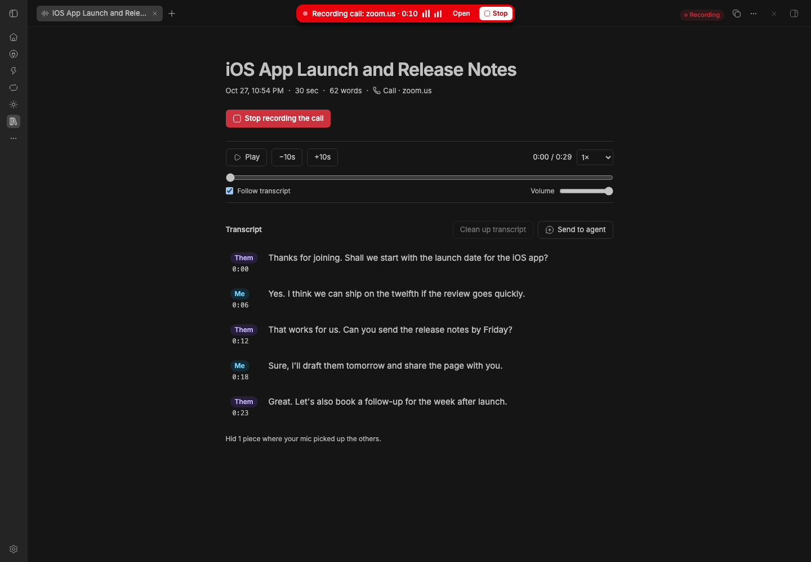

A staged BB plays a short made-up product call through the stub helper
(`src/talk/test/stub-tap.mjs`) in fake mode, with no tap, mic or prompt. The
capture reads the notice, picks zoom.us in the picker, and starts recording.
It then checks the five Me / Them turns, the hidden echo, and that the bar
stays on the settings page.

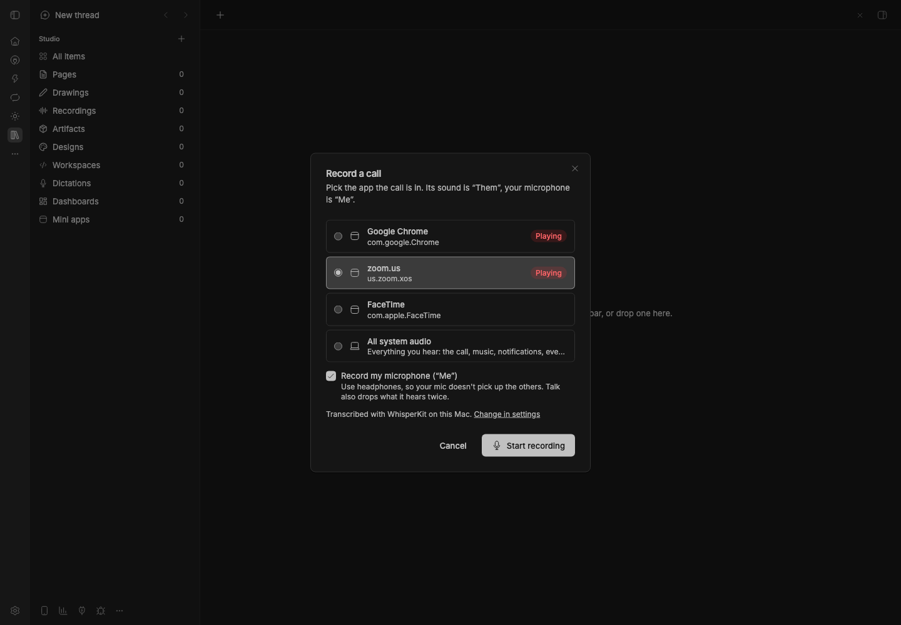

Recapture both with `BB_CAPTURE_ONLY=talk-call`. `scripts/staged-bb.mjs`
gives every staged BB that stub as its helper.

### Dictation fields for other plugins

Other plugins can use Talk without importing its code. The contract is plain
DOM, defined in [src/talk/ui/fields.ts](src/talk/ui/fields.ts):

- **Mark the field.** Put `data-talk-field="<key>"` on the element that wraps
  the text surface, with a key that stays the same across reloads, for example
  `pages:pg_123`. Add `data-talk-field-label` with a name for toasts, such as
  `“Launch plan”`.
- **Start or finish.** Dispatch a bubbling `bb-talk:toggle` event from inside
  the field. If Talk is already busy elsewhere, it shows where instead.
- **Receive the text.** Talk dispatches a cancelable `bb-talk:insert` event
  on the field, with the detail `{ text }`. Insert the text and call
  `preventDefault()`. If no field takes it, Talk keeps the text and delivers
  it once the field has been back on screen for a moment. Text whose field
  hasn't come back within three days is dropped, with a toast; it's still in
  Talk recordings.
- **Go back.** Talk dispatches a cancelable `bb-talk:open-field` on `window`,
  with the detail `{ field }`. The plugin that owns the key navigates to it
  and calls `preventDefault()`. If no plugin does, for example because the
  owner was disabled, Talk copies the waiting text to the clipboard instead.
- **Show state.** While Talk is loaded, `<html data-bb-talk>` is `idle`,
  `dictating`, or `busy`. `data-bb-talk-field` names the field being dictated
  into, and `data-bb-talk-phase` holds the capture phase. `bb-talk:state`
  fires on `window` when any of them change. If `data-bb-talk` is missing,
  Talk isn't installed, so hide dictation controls.

### Limitations

- **First-message context.** Stable BB expands a Talk mention into its saved
  transcript on follow-up messages. A thread's first message keeps the dictated
  text, native mention, and source link; the agent can read the saved item with
  Talk tools.
- **Mic swap can break.** BB has no API for replacing its microphone. A
  content script claims presses on the composer's "Start voice input" button.
  If BB changes that markup, the mic falls back to built-in dictation. Talk
  stays reachable from its commands and Studio.
- **Held text stays on the device.** A dictation finished away from its
  thread or Studio composer waits on the device you dictated on. A main
  new-thread dictation without a Studio route is copied to the clipboard
  after you leave that page. Either way, the dictation is also in Studio's library.
- **Mobile backgrounding.** On mobile, the microphone stops when the BB app
  goes to the background. Talk resumes when the app returns, or shows
  **Resume** when the system needs a tap first.
- **Voice service required.** Transcription needs BB's voice service turned
  on. Audio recorded without it is kept and transcribed once it is available.
- **Speaker labels.** BB's current voice transcription API returns text only.
  Talk does not assign speaker labels without a diarization result.
- **Summaries.** They need Studio Decisions and its configured fallback
  model. If generation fails, use **Generate** or **Regenerate** in the
  recording menu after the model is available.
- **Notes pages.** They need Studio Decisions. Updating
  notes replaces the page's text with fresh notes; restore an earlier version
  from the page's history to get your edits back.
- **Backup and restore.** BB Studio backups include every recording: its
  title, transcript, summary, segment audio (hard-linked when possible) and the
  id of its notes page. Restoring is safe to repeat and never overwrites a copy
  that is newer here or a recording still being recorded or transcribed. A
  restored recording comes back finished, with pieces that were not
  transcribed marked failed so **Retry** can pick them up. It does not keep the
  BB thread it was started from. The notes page reconnects when the backup
  restores the same page; otherwise **Update notes** finds or makes it again.
- **Personal project threads.** Titling runs hidden agent threads in BB's
  Personal project.

Recordings, segments and transcripts are stored in Studio's SQLite database;
segment audio is in `<dataDir>/plugins/studio/talk/audio/<recording>/`. Audio
plays from `GET /api/v1/plugins/studio/http/recordings/audio`. The Studio
provider exports a recording's transcript as Markdown, its audio segments, or
both (`markdown`, `audio`, `bundle`); recordings can't be duplicated, since
copying the metadata without its audio would make a misleading recording.

## Reactions

Emoji reactions on replies, in the text selection menu and the bar under each
message. They were the Studio Reactions plugin (`emoji-react`); Studio has
them built in now (`src/reactions/`).

Select text in a reply. The floating selection menu (next to "Add to chat")
shows one emoji button per reaction. Click one and the composer gets a draft,
then focus:

```
> <the highlighted text>

👍 Agree
```

Buttons show the emoji only. The draft uses the full item text. An item can be
just an emoji (`🚀`); then the draft is that emoji. The draft goes to the
composer for the message's thread, in the main view or a split; with no
usable composer, a toast asks you to open the thread's composer.

**Quote position.** With `before` (default) the quote comes first, then the
reaction. With `after` the reaction comes first, then the quote. If you
already typed a draft, `after` puts the reaction between your text and the
quote.

Older replies that end with a `::reactions{items="…"}` line still render it
as reaction buttons. Agents no longer write it; the [Next row](#next-row)
offers quick replies.

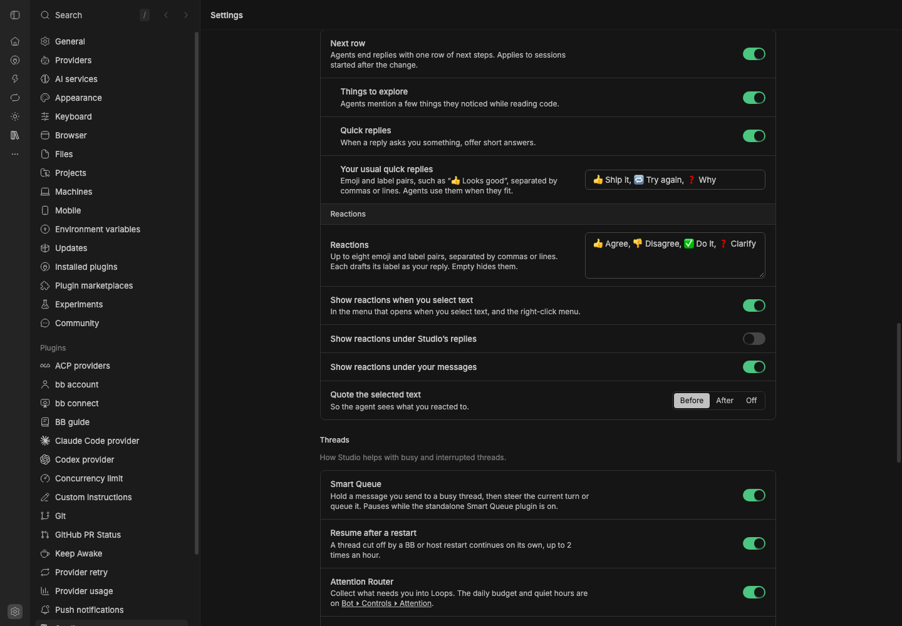

Captured from a staged BB: Studio's **Agent replies** settings section with
the default reaction list (Agree, Disagree, Do it, Clarify) and **Quote the
selected text** on Before. Before it, the capture checks that the seeded agent
reply's message bar shows the four reactions as emoji.

| Setting | Key | Default |
| --- | --- | --- |
| Reactions: up to 8 `emoji label` items, separated by lines or commas. Empty removes the buttons. | `emojiItems` | `👍 Agree, 👎 Disagree, ✅ Do it, ❓ Clarify` |
| Quote the selected text: Before, After or Off (one control for the next two keys) | `quoteSelection` | on |
| | `quotePosition` | `before` |
| Show reactions when you select text (and the right-click menu) | `showInSelectionMenu` | on |
| Show reactions under Studio's replies | `showInAssistantBar` | on |
| Show reactions under your messages | `showInUserBar` | on |

```sh
bb studio settings set emojiItems "👍 Agree, 👎 Disagree, ✅ Do it"
bb studio settings set quotePosition after
```

Message menus read the settings once when Studio's frontend loads. After a
change, the Agent replies section shows **Reload window**, which refreshes the
menus. Other open windows update on their next reload.

**Moving from Studio Reactions.** On its first start with `emoji-react`
installed, Studio copies that plugin's settings once (a KV marker records
it), skipping any you already changed in Studio. Then remove the old plugin
from **Setup → Retired plugins** or with `bb plugin remove emoji-react`;
while both are installed, each shows its own buttons.

## What you get

Links open where you are. In a thread (a card in its replies, or anything
in its side panel), a page mention, an embed, a link in a page's text or any
other Studio link opens as a tab in that thread's side panel, one tab per
item; opening the same item again selects its tab. In the Studio app it opens
as a tab in Studio's workspace. Web links open in BB's browser, and a thread
link opens that thread. ⌘/Ctrl-click opens it in the other place: from a
thread, in the Studio app; in Studio, in a split. Right-click any Studio item
or thread link, anywhere, for **Open**, **Open in Studio** (in a thread's side
panel) or **Open in split** (elsewhere), **Copy reference** (**Copy link** for
a thread) and **New thread with this**. Item and collection headers have an
**Open in split** button; in a thread's side panel it's **Open in Studio**.
Search (⌘⇧K), the Talk pill and recording mentions open in the thread you're
looking at, or in Studio. An editor you leave stays open in the background,
so it's as you left it when you come back.

- **One collection** (sidebar → Studio): every add-on's items in one list,
  with search over titles and content, filters by kind, project and
  tag, and an Archived view. **Display** groups the list by kind, project
  or tag (collapsible) and
  sorts it by name, kind, project, created or last activity, either way; both
  choices are remembered. The column you group by drops out. Drawings show thumbnails;
  recordings show their length and word count. Background kinds, such as Talk's dictations, stay
  out of All; the Kind menu and search still show them.
- **Search from anywhere.** Cmd/Ctrl+K, the rail's Search and ⌥Space open
  Studio's omnibar ([The launcher and Cmd+K](#the-launcher-and-cmdk)). It
  finds conversations and items by title and content (each add-on searches
  its own: page text, transcripts, drawing text, artifact files, table rows),
  runs commands, opens addresses and asks the Bot. With nothing typed it
  lists recent items. On a BB without the palette slot, Cmd/Ctrl+Shift+K
  (**Studio: Search everything**) opens Studio's quick open instead.
- **Tags** group items across add-ons: a page, a drawing and a table can all
  be tagged "Launch". Tag from an item's ⋯ menu or the selection bar, filter
  by tag (or Untagged) from the tag menu, and click a chip to filter by it.
  The tag menu also renames and deletes the active tag.
- **Bot.** Your always-on agent (it replaces the Chief of Staff): a name, a
  drawn avatar, and a workspace of its own (no rail item; the Bots list in the sidebar): its
  Info page, a Bots list in BB's sidebar with the threads it started, and its
  chat as a normal BB thread. See [Bot](#bot).
- **Project leads.** A BB project can have a lead thread, which a
  Heartbeat wakes on a schedule; the personal project's lead is your Bot.
  Set them in Setup under **Project leads**. BB's own sidebar groups
  threads by project. See [`docs/project-leads.md`](../../docs/project-leads.md).
- **Shared actions**: select items (shift-click for a range) to start a
  **New thread** that mentions them, move them to a project, archive, or
  delete. Actions an add-on defines, like Talk's "Copy transcripts" or Draw's
  "Copy text", appear when the selection is all that kind.
- **New ▾** creates any kind an installed add-on offers, in the current
  project. It always opens the full menu, even with a kind filter active.
- **One entry.** Studio's ⋯ menu can hide other plugins' sidebar rows, so
  Studio is the entry for content and VS Code. Existing workspace links and
  saved Studio tabs resolve inside Studio, keeping their workspace IDs.
- **No BB theme of its own.** The old teal "BB Studio" palette
  (`plugin:studio:bb-studio`) is gone: Studio's scenes theme the app. Once
  per install Studio writes BB's Default over an appearance that is
  Default or still set to it (BB already shows Default for the missing
  palette; the write replaces the stored id), so no teal step shows at
  launch (`src/theme/legacy-theme.ts`).
- **Automations tab.** In a thread's side panel, **+ → Automations** lists the
  automations that wake that thread: the name, the schedule in words (such as
  "Every 30 min" or "Weekdays 9:00"; other crons show as written), when it
  runs next, and the last run's result or error. A switch pauses or resumes
  one, and **Edit** opens it in Automations. The tab refreshes when it opens
  and every 30 seconds while it's visible. If BB's Automations plugin is off
  or doesn't answer, the tab says Automations are unavailable.
- **Automations badge.** A regular thread that automations wake shows a clock
  with their count in its header; click it to open the Automations tab. Bot
  threads show a **Bot info** button beside the cache dot instead. Automations
  for that Bot are already listed in Bot info.

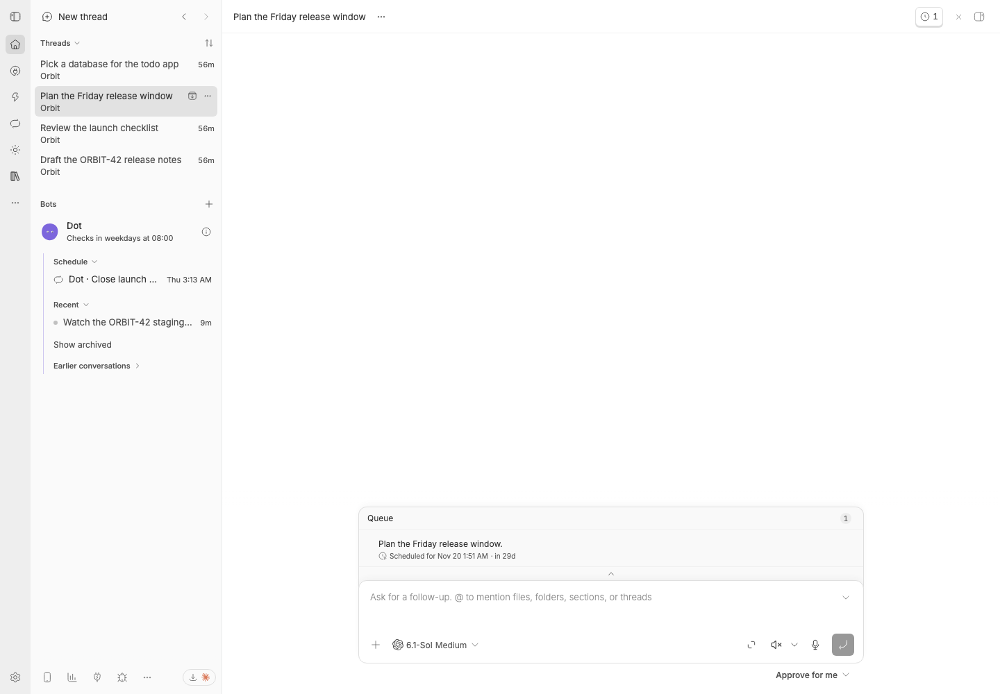
- **For agents**: the `studio_list_items`,
  `studio_tag_items`, `studio_delete_items` and
  `studio_move_items` tools, the `bb studio` CLI, and a `studio` skill. With
  `studio_workspace`, `studio_open_items` and `studio_close_tabs` an agent sees
  the tabs you have open in the BB window you're using, opens items beside
  them, and closes tabs.

```sh
bb studio list [query…] [--all] [--kind <kind>] [--query <text>] [--tag <tag>] [--json]
bb studio tags
bb studio starred [--json]
bb studio move <item-link|plugin:id>… --project <name|id|global>
bb studio providers
bb studio health [--json]
bb studio auth status [--json]
bb studio auth login <provider-or-account> [--no-wait] [--json]
bb studio reindex
```

## Bot

Bot info → **Maintenance** is off for every Bot until you enable it. Enabling
it records a dry-run summary and keeps all actions simulated for one day,
then goes live automatically. It runs daily at 4 AM in the server's local
timezone or after a heartbeat, at most once per local day while active.
**Run now** respects the first-day dry run; **Dry run** always previews.

Each rule has its own toggle: finished owned threads (3 days with a captured
result, 7 without), hidden workers (one day after their owner replies,
otherwise 3), done reminders, stale watchers, recurring automation cleanup,
Memory (8,000 words by default), skills and runner suggestions. Only done
reminders get deleted, after 14 days in Done. Disabled automations older
than 30 days are suggestions. Recurring jobs with 10 empty or `[PASS]` runs
are suggestions; duplicates and retired targets are paused. Pinned skills
are exempt from the existing 30/90-day skill retirement rules.

Pending interactions, open plans, queued work and live automation or runner
targets protect threads. A workspace blocks an archive only when it holds
real work: uncommitted changes to tracked files, or commits ahead of the
branch's own remote-tracking ref. Those threads go to **Needs your call**.
Untracked scratch files, non-git workspaces and statuses that can't be
confirmed don't block. SDK 0.6.37 has no upstream push count, so commits
counted against any other base are treated as unconfirmed. BB archives a
thread's children with it, so a thread with open child threads waits for a
later run.
The same SDK cannot identify loaded idle runtimes, so runtime cleanup skips
them. Archives can be undone with BB's Unarchive. Settings and run history
are append-only. Each run has one Activity entry; only **Needs your call**
sends a short chat alert. Memory cleanup uses one agent-only message.

The standalone “Adopt as runner” prompt is removed. Scheduled candidates
appear in the maintenance summary with an **Adopt** action. Recent in the
Bots sidebar covers 7 days; **Show archived** reveals older and archived
owned threads. Runners keep their existing group.

The `studio-bot-maintenance` capture seeds old clean and dirty Bot threads, a
pending question, an automation-targeted thread, and a completed one-shot
reminder. It turns maintenance on, checks the initial one-day dry run, presses
**Dry run**, then advances only the staged settings clock before the same
maintenance RPC used by **Run now**. After taking the screenshot, the capture
leaves Bot info so its separate Automations list cannot reconcile the reminder
before maintenance does. It asserts no dry-run archives, then checks the live
archive, **Needs your call**, reminder state, and one Activity entry. The
capture is strict and writes `assets/bot-maintenance.png` even when an
assertion fails.

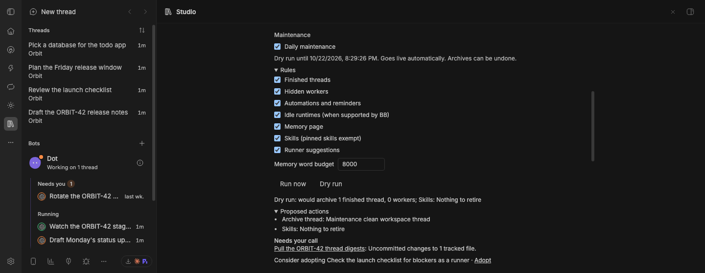

![The Bot's chat in a staged BB: BB's own thread page for Dot, with its first exchange, a finished-thread notice and its two-bullet answer on what's left before Friday's ORBIT-42 release; in BB's sidebar Studio's list: Threads on top (the Orbit project's threads as two-line rows, the sort and group menu beside the heading), then Bots with Dot tinted while its chat is open (Working on 1 thread, its ⓘ beside it) and the threads it started under Needs you, Running, Schedule (an Inbox sweep automation; Schedule has since been removed from the sidebar) and Recent, a follow-up nested under the thread that started it](assets/bot.png)


![The Deploy watch runner's thread, opened from the Runners group as BB's thread page, the Bots list still beside it: its job prompt and first run, then an automation run, each ending [PASS] (their runner_report calls fold into Worked for)](assets/bot-runner-thread.png)

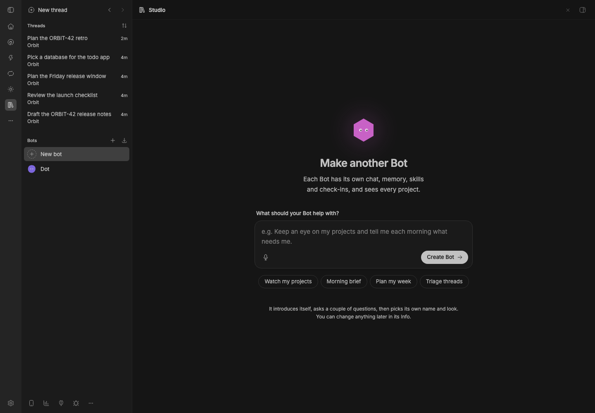


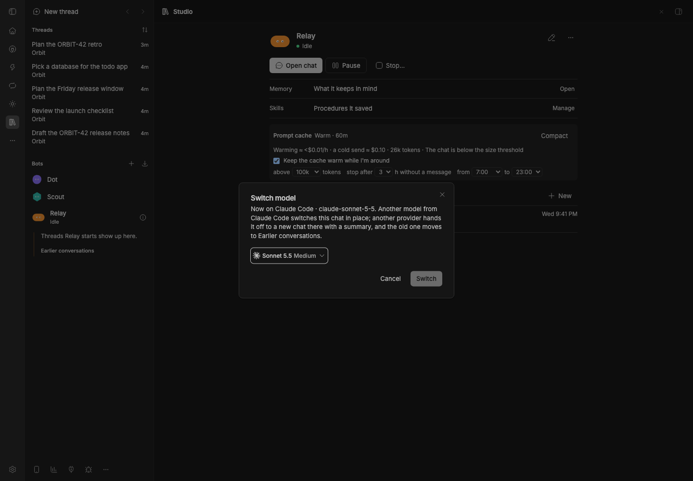

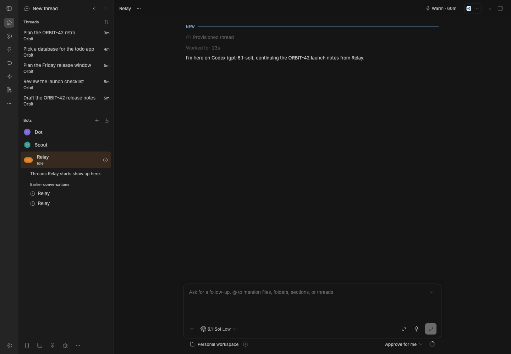


The Bot is your always-on agent, modelled on ChatGPT's dots. It replaced
the Chief of Staff: an existing Chief of Staff became the Bot, named "Chief
of Staff", with the same thread and check-ins; rename it from its page.

- **Workspace**: the Bot page lives under the Studio panel
  (`/plugins/studio/studio/bot`); the rail has no Bot item, since the Bots
  list is always in the sidebar. The bare page opens the last Bot thread you had open in this window: the bot's chat, or a
  runner or worker thread you opened from the Bots list (kept in session
  storage beside the sidebar mode, updated on every thread page shown in
  **bots** mode). With none, or once that thread is gone, it opens the
  primary bot's chat; with no bot, or a bot without a chat, it shows the
  create flow or the bot's Info. The redirect replaces the history entry, so
  Back doesn't bounce to it, and the Bots list stays. A bot's **Info** has
  its own address, `/plugins/studio/studio/bot/<botId>` (the primary's too), which
  its **ⓘ** opens, with **Open chat**; on a bot's thread it is also the top
  of BB's own **Info** tab. Its chat isn't
  embedded: it opens as BB's normal thread page, so it has everything a
  thread has, plugin message actions (Studio's reactions) and **Reply in
  side chat** included. With no bot yet, or on **New bot**, the page is the
  create flow, and the first message opens the new bot's chat.
- **Sidebar**: on a BB with sidebar sections (the BB Studio fork) the
  sidebar is the Bot sidebar (One Bot, many conversations, above); what
  follows is the older list, on a BB without them. On every page but the Studio panel, BB's sidebar shows
  Studio's list in place of its thread list: **Threads** on top, right
  under BB's **New thread**, then **Bots**. **Threads** lists every
  top-level thread as a two-line row: the title, and on the right the age or
  what the thread needs (a **Needs you** or **Failed** pill, a working or
  unread dot, a pin); the project's name on the second line. Pinned come
  first, then newest. The menu beside the heading sorts by last activity or
  creation and can group under project headings (kept on this device).
  Sub-threads, hidden threads and the Bots list's own threads stay out. Each
  row has BB's thread menu (right-click or ⋯) and Archive on hover;
  ⌘-click or middle-click opens a row in a split. Drag a row onto a bot
  under **Bots** to hand the thread to it: the thread moves under that bot
  with the threads it spawns later (`bot_thread_adopt`), and the bot's chat
  gets a 📥 line linking it, which the bot answers with a line or two on
  what the thread is about and whether it waits on anyone. A thread in one
  bot's list drags onto another bot the same way, or back onto **Threads**
  to take it back (`bot_thread_release`): it's in BB's list again and no
  bot's, nor are the threads it spawns, until you hand it over again. A
  bot's own chat and its runners stay put.
  The list is Studio's thread list provider `studio/bot` ("Bot (Studio)" in
  Settings → Appearance). Under **Bots**, every bot (the primary first) with
  its avatar, tinted in its color; the selected one opens into the
  threads it started: **Running** (a thread that is running, waiting on an
  answer, or queued, or has one below it), **Runners**, **Recent**, **Side threads** (on
  its replies), and **Earlier conversations** (its
  handoff chain, closed by default). When its automations run is the Bot
  page's week, not the sidebar. A thread another of its threads started
  nests under that one, at any depth (`bot_activity` returns each thread's
  `parentId`). A row opens the thread as a BB thread in the main pane; a
  bot's row opens its chat the same way, and the Bots list stays. On a
  bot's thread the expanded bot is the thread's owner. Each bot's **ⓘ**
  (shown on hover; always on the expanded one) opens its Info: BB's **Info**
  tab beside the chat when one of its threads is open, else its Bot page.
  When a bot's chat (or an earlier conversation of it) opens, the Info tab
  opens beside it once; if you close the panel, it stays closed until you
  open the chat again. Closed groups are remembered on this device.
- **Switching the list**: BB's `sidebar.threadListProvider` preference is
  global. Each window keeps a sidebar mode in session storage, so a reload
  keeps it: **studio** on the Studio panel (`studio/studio-items`, see
  Workspace), **bots** (`studio/bot`) everywhere else. Entering a Studio
  list remembers your own choice (in this device's storage). With several
  windows, the window you use decides: a window re-applies its mode when
  its route changes or it gains focus.
- **New bot**: **+** next to **Bots** makes a new bot (BB's own **New
  thread** row stays above the list; BB always shows it). **New bot** opens
  `/plugins/studio/studio/bot/new`: the same welcome as a first bot (Make another
  Bot), and **Create Bot** makes it as "New bot" and opens its chat, where it
  sets itself up.
- **Several bots**: the first bot is the **primary**: the personal project's
  lead (the Chief of Staff before it), the one the iOS app shows, and the one
  agent tools act on outside a bot's thread. Each further bot has its own
  thread in the personal project (not a lead; a handoff moves it too), Memory
  page, skills, runners and check-ins. Its check-ins are its own schedule
  on its thread (`trg_heartbeat_bot:<id>`). Every bot has the same
  powers: it sees every project. The page shows the selected bot's Info at
  `/plugins/studio/studio/bot/<botId>` (the bare page shows the primary's only when
  it has no thread to open);
  its runners, check-ins, Memory and skills are that bot's. In a bot's own
  thread its tools act on that bot.
- **The Bot page** (`/plugins/studio/studio/bot/<botId>`, `src/ui/bot/BotPage.tsx`):
  one scroll, most important first, in plain words (no cron strings, ids or
  token counts outside Controls). The header has the avatar, the name and a
  status sentence ("Working on 3 things. 5 things need you. Next: evening
  wrap-up at 6:00 PM."; "Idle. All quiet since 1:00 PM. Next: …"), then
  **Open chat**, **Pause** / **Resume**, **Stop…** and **Controls**. There is
  no ⋯ menu. **Working now** (what's running, a runner by its name) sits
  beside **Needs you**: due todos (Done, Decide, Got it or Nudge), the
  chat's pending questions (Answer), failed runs (Open, and ✕ to dismiss)
  and maintenance's calls ("Archive 3 finished threads?", Review), one
  action each. A failed run's line says what went wrong in plain words
  ("The script stopped with an error (exit 2)", "The script was stopped",
  "Its thread hit an error", "It took too long"), and **Open** opens the run
  itself (`bot_run_link`): its thread at the message it sent (a runner's
  run, a check-in in the chat), or, for a script that sent nothing, its
  automation's runs in the automations plugin. A failed run stays until any
  newer run succeeds (a manual one too, and a watcher's quiet "skipped:
  empty output" tick counts) or you dismiss that run (`bot_run_dismiss`; a
  later failure shows again). A paused job's failure isn't there: Paused
  marks it "Last run failed". With
  nothing running and nothing waiting, both shrink to one line: "Nothing
  running, and nothing needs you." Then **This week** at the page's full
  width with **Paused** below it (see Week under Automations), then
  **Recent** (runs, groups and finished threads in a sentence each; a
  failure in red; one muted line a day for frequent checks with nothing to
  say), compact **Runners** (area colour, schedule in words, state; Pause,
  Run now, Edit, Move and Delete in the row's menu) and, with Todos
  on, the **Todos** summary with **Open Todos** (the full list is the Todos
  page at `bot/<botId>/loops`).
- **Controls** (`bot/<botId>/controls`, `src/ui/bot/BotControls.tsx`): every
  setting, with a back link and section links: **Profile** (avatar, name and
  description with Edit, and **Profile changes** with Revert), **Model**
  (Switch model…), **Memory** (Open), **Skills** (Learn from work, pins,
  history), **Check-ins** (Change…), **Prompt cache** (the only place tokens
  and cost show) and **Maintenance** (the switch, rules, Dry run, Run now and
  history). An external bot has Profile, Model and Check-ins only.
- **Header**: on a Bot's thread, Studio's header button is the Bot, its
  avatar and name, opening BB's Info tab (on a BB with the Global workbench
  there is no header button: BB's ⓘ tab is the way in). BB draws a plugin's header actions as one
  split button, the first as the button and the rest in its menu. Todos has
  no header button: it is in the Bot row's count, the Bot's workbench tab and
  the morning card. BB's header
  button shows its label only; where BB folds header actions into the thread
  menu (a narrow window or split pane), the Bot's row has its avatar. The
  avatar is an app icon: Studio registers icon slots
  (`studio/bot-avatar-<n>`, `src/ui/bot/avatar-icons.tsx`) and fills them
  with the Bots in list order, since a header action names an icon and can't
  draw one.
- **Bot info** is the top of BB's own **Info** tab (ⓘ) on a thread a Bot
  owns, its conversations and workers (`experimental_threadInfoRow` in group
  `0_bot`, which sorts before BB's rows; there is no separate Bot tab, and
  BB's own thread info follows below). On any other thread the Info tab is
  BB's alone. It is a few of BB's own Info rows (`experimental_DetailRow`,
  `src/ui/bot/BotInfoRows.tsx`): **Bot** (its avatar and name, which opens
  the Bot page, with Pause or Resume and Stop as one header icon-button
  group), **Status** (Active, Paused, Stopped, or Paused · in bb on a BB
  Studio copy for a Bot its import stopped, which has no controls),
  **Model** (the model this thread runs on now, read off the thread with
  `thread_model`, by its display name; not the Bot's default, which is only
  in Edit space and the ··· menu) and **Needs
  you** (how many; opens its Todos, or the Bot page without Todos). BB's
  rows follow; the Bot chat's prompt cache is the **Cache** row among them.
- **The Bot is the triage layer** (docs/needs-you/REDO.md): runner
  reports, urgent alerts, failures and its threads' questions go to the
  Bot, which handles them or tells you in its own chat. There's no Needs
  you list. The one signal is on the Bot's row: BB's own thread status
  glyph at its right end (`experimental_ThreadStatusGlyph`, the one BB's
  thread rows draw), with why in its tooltip ("Asked you a question", or
  just how many, "1") and on the selected Bot's second line
  (`src/ui/bot/rowState.ts`). Most urgent first: **needs you** while its
  chat has a pending question or approval, or a released todo
  (`bot_activity`'s `attention`, `bot_attention`); the **spinner** while its
  chat, a thread its chat spawned, or (on the selected Bot) a thread in
  progress is working; **failed** when its chat's last turn failed unread;
  the **unread** dot for replies you haven't read. The Bot's chat is a
  hidden thread, which stable BB (0.48) leaves out of the sidebar's live
  thread view, so `bot_attention` also says whether the chat is busy
  (`working`); Studio's realtime signal on `thread.active` and `thread.idle`
  refreshes it at once. Unread comes from `bot_attention` too, since BB marks
  the chat unread after a check-in's `[PASS]`. It clears when you read or
  answer the chat. The icon rail has no Bot item.
  A thread the Bot started that waits on a question or approval shows
  under Running as **waiting**; it's the Bot's to handle.


- **Profile**: edit the Bot's name and description in its Info tab. Choose a
  drawn avatar (one of nine shapes in one of twelve colors, or **Match the
  name**) or an emoji. A Bot made before drawn avatars shows its emoji until
  you pick a shape; the emoji stays for older clients.
- **Image avatars** are retired: the generator, the upload, the avatar route
  and the `bot_avatar_*` RPCs are gone. Old rows stay in `bots`
  (`avatar_image_id`, `avatar_image_prev`) and `bot_avatar_images`, unread.
  Old `avatarImage` rows in **Profile changes** show as text ("an image" or
  "drawn") with no **Revert**.
- **Self-managed profile**: a Bot can change its own name, description
  (role), emoji, and drawn shape and color with `bot_profile_update`, from
  its own thread only.
  `bot_set` called from a Bot's threads counts as the Bot's edit too. Every
  such edit lands in `bot_profile_changes`, an append-only table (triggers
  refuse updates and deletes): who, when, from which thread, the field, the
  old and the new value. Open Info's **Profile changes** link to see the list
  ("Changed by Dot · description: … → …") with **Revert**, which restores the
  old value and records the revert; the iOS Edit profile sheet shows the same
  list. What's the user's alone (pause, resume, stop,
  delete, model and provider, reasoning, permission mode, turning check-ins
  on or off) isn't in the tool's schema, which rejects unknown keys, and
  `Bots.selfEdit` refuses it as well.
- **Chat**: the Bot's current thread, opened as BB's own thread page, so it
  is exactly any thread: the same timeline, composer, message actions, side
  chat, queued messages, questions and approvals inline. Threads it handed
  off from are under **Earlier conversations** in its sidebar (`bot_chain`,
  which the iOS app also reads for its history).
- **Quiet**: the Bot is told its chat is your inbox. With nothing new (a
  check-in with nothing to report, a notice that a thread it started
  finished fine, an automation result like `[PASS]`) it replies exactly
  `[PASS]`, never a "✓". The iOS app hides it and Studio Mobile sends no
  push for it, but on desktop BB's thread page still shows it as text: the
  plugin SDK can't restyle assistant messages yet (docs/silent-output.md). On check-ins it does the checks itself or reuses the
  worker thread it used before instead of starting a new one each time.
  BB's own "thread completed" notices for threads it started still show in
  the chat: the plugin SDK has no way to turn them off. Recurring work goes
  to runners instead, which post none (below).
- **Starting out**: with no Bot yet, the page is a welcome with one
  question, **What should your Bot help with?** (ideas fill it in), and
  **Create Bot**. See No Bot yet below.
- **Automations** (`src/automations.ts`, table `bot_automations`; Info,
  iOS ⋯ → Automations): what wakes a Bot, four kinds, as a week or a list.
  - **Check-in**: wakes the Bot's own thread with a short instruction on a
    schedule; have several (Morning brief 8:00, Evening wrap-up 18:00). The
    Bot's original check-in (its project heartbeat) is listed first as
    **Check-in**, schedule unchanged; its instruction stays
    the Memory page's `## Check-in` section, and it takes one repeating
    cron. Turning it off keeps its schedule.
  - **Reminder**: one message to the Bot's thread at a time; done once it
    ran. **Run now** on a reminder does not use it up.
  - **Watcher**: a script BB runs on the server host on a schedule that
    wakes the Bot only when it prints something (see **Watchers** below).
  - **Runner**: the runners below, in the same list.

  **Who runs them.** Check-ins (the original one too), reminders and the
  runners Studio made run on Studio's own scheduler
  (`src/triggers/scheduler.ts`, tables `triggers` and `trigger_runs`), so
  they keep running when BB's Automations plugin is off. A run is one
  message to the thread that starts with `[bb automation due:trg_…]`. It
  waits when no host is connected or the thread is still starting, never
  replays missed runs, never runs twice at once, and turns itself off when
  its thread is deleted or archived. Watchers (BB runs their script) and
  adopted runners (they wrap your own BB automation) stay on BB's Automations
  plugin. At startup Studio moves anything still on BB automations over once
  (`src/triggers/migrate.ts`): same schedule, on only if it was on, and the
  old BB automation is deleted (at a later startup if BB's Automations
  plugin was off, so it can't run beside Studio's). Runs from before the
  move are not carried over.

  **With BB's Automations plugin off** (a BB Studio copy imports it off),
  nothing calls it: a watcher made or changed then is one trigger on
  Studio's scheduler too (`trg_watcher_<id>`), and Studio runs its script
  on the server host itself (`src/watcher-script.ts`; its folder is under
  Studio's data folder, `watchers/<id>`) and posts what it finds, with the
  same output rules. Lists read the plugin's automations from its data
  file, read-only. An adopted runner shows with no next run. Rows the
  copy's import paused (made before the import, still paused; `inBb` on
  `bot_automations`) refuse edit, pause, resume, run and delete with "It
  runs in bb", and the Bot page's week and list leave them out. When the
  plugin is on again, the next change to such a watcher moves it back to a
  bb automation. A plugin that is on but not answering still fails the
  list, as before.

  **Automations table** (`bot_automation_table`, `src/automation-table.ts`,
  types in `src/automation-table-contract.ts`; the Automations page, and
  for iOS). Input `{ botId? }` (the primary Bot without one). Output
  `{ botId, mirrored, bbPlugin: "on" | "off", rows }`, each row
  `{ id, kind, name, when, lastRunAt, lastRun, status, inBb, readOnly, bb,
  threadId, instruction, script, via }`:
  - `kind`: `watcher`, `checkin`, `reminder`, `runner`, `schedule` (the
    heartbeat check-in and maintenance) or `bb` (a bb core automation
    Studio didn't make). `id` is the Studio id (`aut_…`, `run_…`,
    `heartbeat`, `maintenance`) or, for `bb`, bb's (`auto_…`); `bb` is the
    linked bb automation `{ id, projectId }` or null.
  - `when`: 24-hour text, such as "Daily 07:45", "Every 2 h, 08:00–23:00",
    "Weekdays 09:00", "Sun 10:15", "Every 20 min", "Once, Nov 14 09:30".
  - `lastRun`: `ok`, `failed` or null; `lastRunAt` null means never.
  - `status`: `active`, `paused` (paused, disabled or imported) or `off` (a
    reminder or one-shot that is done).
  - One row per automation: a bb automation Studio made is part of its
    Studio row, linked by the row's `bb_ids`, a runner's `automation_id`,
    the name "Studio runner <run_id>", or the name "<Bot name> ·
    <automation name>".
  - `via`: why the row is this Bot's. `studio` for the Bot's own rows;
    a bb automation Studio didn't make is the Bot's whose thread it targets
    or was made from (the Bot's chat, `bot_threads`, its runners' threads),
    `thread`; else the primary Bot's, `primary`.
  - bb's automations come from its plugin's `automations_overview`; when
    the plugin doesn't answer (`bbPlugin: "off"`), from its data file,
    read-only.
  - `mirrored`: this is a BB Studio copy with the one-way import from bb
    (`fork-import.json` in the server's data folder). The import pauses
    every Studio automation and runner, turns bb's automations plugin off
    and disables every bb automation, so nothing runs twice beside the live
    bb. On such an install a row made before the import that is still
    paused has `inBb` and `readOnly` true: no pause, resume, edit or delete.
    There is no take-over for automations.

  Check-ins and reminders may pick a cheaper model and reasoning on the
  Bot's provider for routine runs. Every wake-up prompt ends with the
  `[PASS]` rule (docs/silent-output.md).

  **Week** (the default; `src/ui/bot/AutomationsCalendar.tsx`, model in
  `calendar.ts`): **This week**, today and the next 6 days (5 in a narrow
  pane), at the Bot page's full width, time of day down (only the hours
  that have runs, so the week shows whole), in your time zone, with ‹ › for
  other weeks, **Show frequent**, **Week** / **List** and **New** in its
  toolbar. Each check-in, reminder, watcher, runner and plain BB schedule of
  the Bot is expanded from its schedule or cron in its own time zone (quiet
  hours, end dates and DST kept); a one-off is a single block. Past blocks
  are real runs from run history (`bot_automation_runs`, and a runner's last
  run) and open their thread. Colours are by **area**: each runner is one
  (a watcher that wakes a runner is that runner's), the Bot's own jobs are
  grey, and the same colours mark Runners and Paused; the legend under the
  grid lists the areas.
  - **Frequent jobs** (every 2 hours or more often, at least 3 runs a day:
    heartbeats, an hourly watch) are hidden behind **Show frequent** (kept on
    this device) and listed under the legend ("Frequent, hidden: Inbox watch
    · every hour"). Shown, each is a thin band down the day with a tick per
    run, solid for past runs and faint for due ones.
  - **Groups**: runs that start within 15 minutes of the previous one chain
    into one block with its areas' dots, a name and a count ("Area sweep ·
    4", 5:00–5:15). A click lists each run's outcome ("2 new emails",
    "Quiet") with a link to its thread. A group is named from its time ("5
    AM checks") until you rename it in that list or the Bot does
    (`bot_calendar_group_rename`, tool and RPC). The name is saved in Studio
    under the group's window and jobs, so it holds every day they run.
  - **A failure is never hidden**: its block, or its group, turns red with ⚠
    in place of the dots, and hovering or clicking it says what failed, each
    run's result, **Open** its thread and **Run again**.
  - A run going on now grows to the red current-time line. Blocks that
    overlap sit side by side while each keeps 64 px; past that a failure,
    then a live run, keep the room and the rest fold into a "+N" chip.
    Paused jobs aren't drawn; they're listed under **Paused** below the
    week with **Resume**. A due block opens its job in the list.
  ![The redesigned Bot page in a staged BB, dark: Chief of Staff working on 3 things with 5 that need you; Working now (Comms, Project Lead, Systems) beside Needs you (the property tax todo, Security's failed 1:00 PM check, a chat question, the deck decision and three finished threads to archive); This week with the Area sweep and Midday check groups (today's red with the failure), the morning card, camera digest, standup, evening wrap-up and nightly build, frequent heartbeats hidden under the legend, Paused below; then Recent, Runners and Todos](assets/bot-redesign/main-busy-dark.png)
  
  
  
  
  

  **List**: each row shows its newest failed run in red when it was the
  last run ("Last run failed …: the error"), muted when a later run went
  fine; and the schedule in
  words, the next run and its state; open it for the instruction or script,
  recent runs with what came of each (Studio's `trigger_runs`; a watcher's
  from BB's `automations_runs`), Pause /
  Resume, Run now, Edit and Delete. A bot with none only wakes when you
  write. The Bot has `automation_list`, `automation_create`,
  `automation_update`, `automation_pause`, `automation_resume`,
  `automation_run_now` and `automation_delete` ("in 2h check the deploy" is
  a reminder); `runner_*` still work.

  **Turned off by BB** (`src/auto-resume.ts`, table
  `automation_auto_resumes`): BB turns an automation off after its runs
  fail, even for a passing reason. This covers only what still runs on BB
  automations: watchers and adopted runners (Studio's own scheduler never
  turns a schedule off for a failed run). Studio turns one back on when every failed run
  since the last good one was transient: the host daemon disconnected or
  restarted, the connection to the host was lost, the provider stopped
  sending progress, or the target thread was "unavailable … or not
  runnable" while it still exists, not archived or deleted (`threads.get`,
  hidden threads included). It leaves off what you paused (no failed last
  run, paused in BB after the failure, or paused through Studio's Pause or
  Stop), anything of a paused or stopped Bot, reminders, and automations
  whose target thread is gone or archived. Each resume logs a line,
  "Resumed after BB turned it off (host disconnected) — 1 of 3 today": a
  runner's last report (log level), or a check-in's or watcher's last
  outcome and runs. At most three resumes per automation in a rolling 24
  hours; past that it stays off, with a phone push and one line in the
  owning Bot's chat for the Bot to triage (the urgent `runner_report`
  path), once per failure, until it's on again. Studio checks at startup,
  on the five-minute sweep and shortly after a runner's or Bot's thread
  goes idle or fails; the plugin SDK has no automation events.

  **Cut off by a restart** (`src/thread-resume.ts`, table
  `thread_auto_resumes`): when a host daemon restart or a lost host
  connection stops a running turn, BB leaves the thread in error. Studio
  sends it **↻ Resumed after a restart**, with an agent-only note to check
  the current state (files, running commands, messages already sent)
  before redoing anything. Any thread qualifies, not only a Bot's, when it
  is in error and its newest event is `system/thread/interrupted` with
  reason `host-daemon-restarted` (or cause `host-connection-lost`), BB's
  own rule for a restart interruption; stalled turns, your stops and model
  or tool errors don't, and no error text is read. It skips archived and
  deleted threads, threads of a paused or stopped Bot, threads whose host
  is still disconnected and anything with a newer event. Each interrupt is
  resumed once, at most twice per thread in a rolling hour; past that the
  thread stays in error and, once, a Bot's thread gets a line in its Bot's
  chat for the Bot to triage and a phone push, and any other thread gets a
  phone push (Studio Mobile). Studio checks 30 seconds after a thread
  fails, a few seconds after a host connects (`host:changed`), at startup
  once the first minute is past and on the five-minute sweep; it starts one
  resume about every 15 seconds, with at most three resumed turns running.
  Turn it off with **Resume threads cut off by a restart** in Studio's
  settings.
  
  ![Info's Automations in a staged BB: Dot's original Check-in (weekdays 8:00), the Skill curator (weekly, when idle) and Evening wrap-up, the Check the deploy reminder, the Release watch watcher opened with its script, Pause, Run now, Edit, Delete and its two runs (a manual run that woke Dot with "ORBIT-42 v1.4.0 is out on the release page", then Nothing new), and the Inbox watch and Deploy watch runners with their last reports; the Bots sidebar lists the reminder and the evening check-in under Schedule](assets/bot-automations.png)

- **Schedule editor** (`src/ui/bot/ScheduleEditor.tsx`, compiled by
  `src/schedule.ts`): presets, weekday chips, several times a day, every N
  minutes or hours within an active window, quiet hours (runs inside are
  skipped, across midnight too), an end date, the timezone, and a raw cron.
  BB takes one cron per automation, so a schedule compiles to as few crons
  as express it exactly: times that share a minute merge (`0 8,18 * * *`),
  others split (8:00 and 18:30 are two), and Studio keeps them together as
  one automation. More than eight is refused. The end date isn't a cron
  field: Studio pauses the group once the day has passed in its timezone.
  The preview shows the words and the crons.
- **Schedules in words**: wherever the Bot UI would show a raw cron
  (Automations, Runners, Scheduled), `describeCron` in `src/schedule.ts`
  says it in plain English: `5 7,17 * * *` is "Daily 7:05 AM and 5:05 PM",
  `0 */2 * * *` "Every 2 hours", `0 7,12,17,22 * * *` "4× daily: 7 AM, 12,
  5, 10 PM", `0 9 * * 1-5` "Weekdays 9:00 AM", `30 8 * * 1` "Mondays
  8:30 AM", `*/15 * * * *` "Every 15 minutes". A timezone other than this
  machine's is named ("(London time)"). Anything else (a day of the month,
  a month) shows as "Custom: <cron>".

  
- **Memory**: a core profile page per Bot, loaded into every conversation
  and worker, plus memory records the Bot searches; see **Memory** below.
  The profile's `## Check-in` section is what the Bot looks at on each
  check-in, and the check-in prompt says: do its `## Check-in`, and stay
  silent unless something matters.
- **Skills**: when the Bot learns a reusable procedure it saves a skill with
  `bot_skill_write` (name, one-line description, Markdown steps) and fixes
  one in place with `bot_skill_patch` (exact text → new text). Only the
  Bot's thread has these: they live in Studio's `bot_skills` table. Its
  instructions list up to eight skills (pinned, then most recently used)
  by name and one-line description, and say how many more there are.
  `skill_search` finds the rest on demand: it ranks the Bot's own
  non-archived skills by its words in their names, descriptions and full
  text (BM25, names weigh most) and returns the best with a body snippet.
  It loads the full skill with `bot_skill_view` (`bot_skill_list` lists them).
  Writes and patches return advisory notes, never blocking: a body that
  reads like a log of one session (dates, PR numbers, "we tried"), one over
  about 8,000 characters, or a name close to another skill's. BB
  selects plugin skills only from a plugin's manifest, so a skill a plugin
  makes at runtime can't be a native per-thread skill. **Skills** (⋯, or
  Bot info → **Manage skills**) has **Share**, which moves the skill to BB's user skills
  (`<BB data dir>/skills/<name>/SKILL.md`, scope `bb-user`; see
  `bb skill list`), where every agent finds it; it refuses a name that's
  already there. **Delete** removes it. See "Skills that learn" below.
  Each Bot has a **Skills** page (`skills/<botId>`, `src/ui/skills/`) on
  the Bot-page template, beside Memory: its skills (archived ones apart),
  each opening to its body and its versions with diffs and Revert, Delete,
  Restore for archived ones, and History, every version of every skill,
  deletes included. On the fork Studio hides BB's own Skills page, its
  sidebar row and General's "bb CLI skills" (`slots.experimental_hideHostEntries`),
  and refuses BB's public skill registry (skills.sh search, reads and
  installs, from the app, the CLI, the SDK and agents) through
  `experimental_skillsRegistryPolicy` until a person turns **Public skill
  registry** on in Settings, which needs BB's approval dialog
  (`src/skills-registry.ts`). The harnesses' own skill folders
  (`~/.claude/skills`, `~/.agents/skills`) and plugin skills are left alone.
- **Skills that learn** (`src/skill-learning.ts`; after Hermes Agent's
  background review and curator). A Studio bot reviews its own work in the
  background and keeps its skills current. External bots learn on their own
  provider, so none of this runs or shows for them.
  - **Counting.** When the bot's thread goes idle (`thread.idle`), Studio
    reads its new events (`threads.events.list` after the last sequence it
    counted). A `turn/completed` whose turn had any tool item
    (`commandExecution`, `toolCall`, `mcpToolCall`, `fileChange`, ...)
    counts as a tool turn; a `client/turn/requested` from the user counts as
    a user turn. A `bot_skill_write`, `_patch` or `_delete` call resets the
    tool count. The first look at a thread only takes a baseline, so old
    history never trips it.
  - **Review.** When either count reaches the interval (10 by default) and
    the bot is active and idle, Studio forks its thread (`threads.fork`,
    hidden, so no notice reaches the bot), switches the fork to the cheapest
    model of the same provider (a price in the model's description, else a
    name like haiku or luna; or the model you pick) and sends it a review
    prompt: lessons, not logs; one skill per kind of task; merge a repeated
    lesson into one rule; fix wrong lines in place; your corrections and
    "remember this" first; facts about you go in memory records. It has
    only the skill tools plus `pages_read` and `memory_search`,
    `memory_add` and `memory_update`, and replies
    `[PASS]` when there's nothing to save. When it goes idle Studio records
    the result ("Saved 1 skill", "Nothing to save") and archives the fork.
    One review per bot at a time; a new turn in the bot's thread, Pause or
    Stop stops it, and so do 20 minutes. Review forks stay out of Activity.
  - **Curator.** The bot's built-in Maintenance runs skill curation:
    a skill unused for 30 days (not loaded or saved) becomes stale, for 90
    days archived. Archived skills leave the bot's list but are kept;
    **Restore** brings one back. Pinned skills are exempt; nothing is
    deleted. **Bot info → Maintenance** and its **Skills** rule control
    scheduled curation. With **Curator merges overlapping skills** on (off by
    default) it also starts a fork that merges overlapping skills.
  - **Immediate saves and history.** The Bot manages its own skills. Writes,
    patches, and review-fork changes apply immediately. **Bot info → Skills →
    Skill history** keeps every content version, its line diff, and advisory
    lint warnings. **Revert** restores a version in one click and appends a new
    version, preserving what it replaced. Deleted skills also stay in history.
    Built-in lint runs on saves. The optional review model can attach quality
    or safety warnings through `bot_skill_lint`; warnings never block a save.
    History and model findings use append-only tables (`bot_skill_versions`
    and `bot_skill_lints`). Upgrade applies pending changes as approved and
    clears the pending list. For one release, `bot_skill_pending_resolve` is a
    deprecated no-op returning `pending: []`, with `approval: false`.
  - **Settings** (Skills, ⋯ or Bot info → Manage skills): **Learn from
    work** on or off, every N turns, review model, the last review's result
    with **Review now**, pins, and a collapsed **Archived** list. Older iOS
    clients retain their approval controls, but receive no pending changes.
    See [the approval audit](../../docs/approvals.md) for the iOS follow-up.

  
- **Recall**: `bot_history_search` searches BB's thread search, keeping
  only the Bot's threads (its handoff chain and threads it started).
- **Phone**: questions and approvals it, or a thread it started, raises push
  with Answer / Approve as before; every finished turn, the Bot's messages
  included, now pushes with **Reply**, which sends to the thread
  (`BB_REPLY`, see the Mobile plugin).
- **Threads it started**: BB's thread metadata names the thread that made
  each thread. A thread whose `sourceThreadId`, `parentThreadId` or
  `lifecycleOwnerThreadId` is the Bot's thread, or a thread it handed off
  from, counts. `originPluginId` only names a plugin, so it isn't used.
- **Pause** turns check-ins, reminders and watchers off; the Bot is told
  it's paused and gets no Studio tools but its own. **Resume** turns back on
  exactly what Pause or Stop turned off. **Stop** (confirmed) pauses it, stops the running threads it spawned
  itself, and pauses automations that wake it and its runners. A spawned
  thread is a BB child of the Bot's thread (`parentThreadId`) or one that
  archives with it (`lifecycleOwnerThreadId`); a fork or "continue in new
  thread" only has `sourceThreadId`, is often your own work, and keeps
  running. Resume after Stop turns back on exactly the automations and
  runners Stop paused, not ones that were already off; if one fails, the
  Bot stays stopped and Resume retries the rest. Nothing is deleted.
- **Threads on a message** (`src/message-threads.ts`, `src/bot-side-threads.ts`,
  `src/ui/bot/SideThreads.tsx`, `src/ui/bot/reply-in-thread.ts`; table
  `bot_side_threads`; `bot_thread_reply`, `bot_fork_conversation`,
  `bot_side_threads`, `bot_side_threads_for_bot`, `bot_side_thread_open`).
  A reply thread and a fork are both a conversation of the same Bot, forked
  after a message and linked back to it (its `bot_threads` row has
  `forked_from_message_id`; `bot_side_threads` records the message and the
  kind, `reply` or `fork`). `MessageThreads` is the one path that makes them.
  Neither gets a row in Conversations: each lives at its message.
  - **Reply in thread**: on a Bot's replies, a small icon in the message's
    action row, shown on hover (`slots.experimental_messageMetadata` with
    `placement: "actionRow"`), the only way in until it has replies. It
    opens the message's newest reply thread, or makes one
    (`bot_thread_reply`, which finds the fork point from the timeline), and
    opens it as a Conversation tab in the conversation's side panel (the
    workbench, through `openTabRef`; the main view where there is none).
    iOS's **Reply in thread** (`bot_side_thread_open`) takes the same path.
  - **Fork conversation from here** in a message's **···** menu
    (`src/ui/conversations/fork-from-here.ts`, `bot_fork_conversation`,
    where BB has the fork's `slots.experimental_messageAction`) always makes
    a new fork and opens it in the side panel too; it opens full size from
    there.
  - Titles: "Main · thread" for a reply thread, "Main · fork" for a fork
    (the parent conversation's title).
  - **Under the message**, an app overlay (`ThreadIndicators`) draws quiet
    links in the theme's accent color, no emoji, pill or border: "2 replies
    · Last reply 4:13 PM" (Intl time today, the date before) with the last
    replier (the Bot's presence, or your mark), "Replying…" while it works,
    and "Forked here · 1 conversation" for forks. A fork always shows its
    line, even before anyone writes in it. A reply thread with no replies
    shows nothing; the message's reply icon reopens it. Replies count your messages and the Bot's turns, only
    those after the fork: the history a fork copies keeps its original
    times. They are recounted when a thread starts or finishes a turn, and
    for every thread when the plugin starts. A link opens the newest thread
    of its kind in the side panel. Each row in `bot_side_threads` records its
    `kind` (`reply` or `fork`); a fork made outside Studio, such as BB's own
    fork, is linked as a `fork`. Rows from before kinds existed are corrected
    once (`kind_checked`, `correctKinds`): a "· fork" or "· thread" title
    decides, side chats and hidden threads are replies, BB's own forks and
    forks linked before Studio recorded reply threads are forks, and the rest
    stay replies. Only `kind` changes.
  - **The sidebar**: a fork's work and needs-you show on the row of the
    conversation it was forked from (through a chain of forks), else on
    Main (`foldForks` in `src/bot-threads.ts`).
  - **A parent BB can't fork** (no provider session to copy, a turn not
    finished): the thread starts from the transcript instead, a new idle
    thread on the parent's provider, model and environment (a plugin's root
    thread with no input, the fork's idle-thread seam). No turn runs until
    you write. Its first turn gets the conversation up to the message, last
    6,000 characters, as per-turn context (`thread_seeds`,
    `src/thread-seeds.ts`, through `experimental_turnContext`). On a BB
    without that hook, nothing starts and you see the error. The fork
    core restarts a fork whose session copy fails at its first start the
    same way (`fork-start-fallback.fork.ts`). No raw error reaches the user.
  - Side chats bb's side-chat plugin made (mirrored from bb) are matched to
    the message they quote and count the same way.
  It starts on the Bot's default model when that is on the fork's provider
  (BB keeps a fork on its source's provider), else on its source's model.
- **Prompt cache** (`src/bot-cache.ts`, prices in `src/bot-prices.ts`;
  tables `bot_cache_settings`, `bot_cache_pings`, `bot_cache_compactions`,
  `bot_cache_banner_off`).
  Claude Code caches a Bot chat's history for an hour; each send then reads
  it at a fraction of the input price, and once it expires the next send
  writes it all again at 2x. Studio **warms** each Bot's own chat (not its
  runners or the threads it started, which run on their own schedules): when
  the chat is idle, above the size threshold and still warm, it sends a tiny
  ping about every 55 minutes after the last turn or ping. Warming stops
  after the idle cutoff with no message from you (pings, check-ins and
  Studio's notices don't count), in provider overage (the cache lasts
  5 minutes there), while the Bot is paused or stopped, and while the chat
  is busy; there are no waking hours. Your next message resumes it. An expired cache isn't pinged (that would pay the write your
  next message pays anyway), and nothing is sent in the first 5 minutes
  after Studio starts, unless the cache would expire by then: a reload just
  before a ping was due sends it 2 minutes before expiry (but not in the
  first 30 seconds). Only Claude models are warmed; OpenAI's cache can't
  be kept for an hour, so those chats only get the estimates.
  The Bot's other conversations are warmed the same way only while you
  wrote in them in the last two hours (`conversations` in the warmer's
  deps), and get no compaction before expiry; idle ones go cold.
  - **What you see**: the ping is an agent-only message, so BB shows no user
    row, and it tells the Bot to reply exactly `[PASS]`. That reply still
    shows on the desktop (BB has no way to hide a core message row); the
    iOS app hides `[PASS]` replies. BB marks a chat unread when a turn
    ends, so Studio marks it read again if it was read before the ping;
    the Mobile relay sends no push for `[PASS]`. The send carries
    `pluginSubmission` `{ pluginId: "studio", data: { kind: "cache-keepalive" } }`
    for `message.dispatch` hooks; Smart Queue only holds human sends to busy
    threads and pings only go to idle ones. Learn from work doesn't count a
    ping as a user turn, and a ping doesn't stop a running review.
    Maintenance owns skill curation independently of these pings.
  - **Compaction before expiry**: when warming stops for the idle cutoff
    while the cache is still warm, Studio compacts the chat once, when the
    next ping would have been due (55 minutes after the last turn), through
    the same path as **Compact**. Compaction reads the history from the warm
    cache, so your next message writes a short summary instead of the whole
    history. Once per idle stretch (a message from you starts a new one;
    the `/compact` it sends doesn't),
    and never in overage, on a cold, small or busy chat, or with warming
    off. The header menu shows when it will compact or when it did, and the
    cold-send banner doesn't show the size from before compaction.
  - **Header indicator** on a Bot's chat: a Clock icon shows the time left,
    such as **59m**, and turns amber under 10 minutes. An expired cache shows
    **cold** beside a dimmed icon. When warming is off, only the dimmed icon
    appears. Click it for why, the next ping, warming and cold-send costs, a
    warming switch and **Compact now…**. The iOS app shows its status text
    beside the Bot's status.
    On a BB whose context popover takes plugin rows
    (`slots.experimental_contextCardRow`), those details are a **Prompt
    cache** row in BB's own context popover, behind the context ring under
    the composer: the state ("warm 58m", "warming", "cold", "off"), the costs
    as a quiet line, and **Turn warming off** and **Compact now**. The chip is
    then always in the composer's footer row, the clock and "cache 59m"
    ("cache cold", "cache off"), never in the context row above the
    composer, and a click opens that popover; Studio draws no popover of its
    own. Before the thread has a context ring, the
    chip is plain text with the state as its tooltip.

    

    
  - **Cold-send banner**: on a cold Bot chat above the threshold, the
    composer says "Cache expired — next send re-reads ~N tokens (~$X)" with
    **Dismiss** and **Don't show for this thread**. **Compact** is also a
    manual action in Bot info and the header dot's menu.
  - **Settings** (Bot info → Prompt cache, `bot_cache_set`): warming on or
    off (on), size threshold (100k tokens), idle cutoff (3 hours), compact
    before expiry (on). Bot info shows "Warming ≈ $0.07/h" from the price
    table. RPCs: `bot_cache_state` (`threadId`, or `botId` for its chat),
    `bot_cache_set`, `bot_cache_banner_hide`, `bot_cache_compact`.
  - **Economics, honestly**: warming pays a cache read an hour; letting it
    go cold pays one 2x write when you come back. With a read at 0.1x input
    that breaks even around 20 idle hours (about 17 with pings every
    55 minutes), so a few hours of warming while you're around is cheap
    insurance, and warming overnight isn't worth it, hence the idle cutoff
    and the compaction before it. A 300k-token chat on Claude Opus 5.5 ($4 input,
    $0.20 cache read): warming ≈ $0.07/h, a warm send ≈ $0.06, a cold send
    ≈ $2.40. Opus 5.5's read is 0.05x, so there it breaks even nearer
    35 hours. On a subscription these are usage against your limits, not
    dollars billed. Update `src/bot-prices.ts` when prices change.
- **No Bot yet**: the page is a centered welcome, **Meet your Bot**, with
  one question, **What should your Bot help with?** (ideas such as **Watch
  my projects** and **Morning brief** fill it in; Talk can dictate it).
  **Create Bot** (or Enter) makes it as "Chief of Staff", a drawn blob,
  starts its chat in your personal project and opens that as BB's thread
  page with the Bots list. Its first message is the setup (`bot_create`'s
  `setup`, `setupPrompt` in `src/bot.ts`): what you asked for, and to
  introduce itself, ask a couple of questions, then pick its own name,
  description and look with `bot_profile_update`, and offer a check-in.
  Leaving the question empty is fine: it asks. The Bots sidebar shows a
  **Your first bot** row until it exists, and the iOS app has the same
  flow. Its
  instructions come from Studio's agent configuration for its thread, not a
  first message, so its title isn't the instructions.
- Its thread is an implementation detail. A handoff (`thread_handoff`)
  moves the Bot to the new thread. It is the personal project's lead, so it
  sees every project.
- RPCs: `bot_list`, `bot_get`, `bot_create`, `bot_set` (name, avatar emoji, shape, color, role),
  `bot_profile_changes`, `bot_profile_revert` (a change id), `bot_set_thread`,
  `bot_set_run` (check-ins), `bot_pause`, `bot_resume`, `bot_stop`,
  `bot_activity`, `bot_memory`, `bot_chain` (its thread and the ones it
  handed off from, oldest first), `bot_checkin_preset` (`morning`,
  `evening`, `working` or `off`), `bot_skills`, `bot_skill_write`, `bot_skill_share`,
  `bot_skill_delete`, `bot_skill_pin`, `bot_skill_restore`, `bot_learning`,
  `bot_learning_set`, `bot_learning_review`, `bot_skill_curate` (`dryRun`
  lists what it would change), `bot_skill_history`, `bot_skill_revert`,
  `bot_skill_pending_resolve` (deprecated for one release), and the runner RPCs below. Each takes an optional
  `botId` (the primary when absent); `bot_create` makes the primary first,
  then additional bots. Agent tools: `bot_get`, `bot_set`, `bot_pause`,
  `bot_resume`, `bot_stop`, `bot_activity` (`bot_pause` and `bot_stop` work only
  in the Bot's own chat or its handoff chain; threads it started, its runners
  and other threads are refused and the user uses Studio → Bot); only the Bot's thread also gets
  `bot_profile_update`, `bot_skill_list`, `skill_search`, `bot_skill_view`, `bot_skill_write`, `bot_skill_patch`,
  `bot_skill_delete` and `bot_history_search`.
- **Watchers**, for script authors. Studio creates a BB script automation
  (bash, sh, node or python3; timeout up to 15 minutes; working directory
  the automation's storage by default, so files like `last.txt` persist
  between runs). The contract:
  - Exit 0 and print the finding to **stdout**: Studio posts it to the
    Bot's thread as "Watcher <name>: <output>" (first 1,500 characters) with
    a note carrying the watcher's instruction, and the Bot wakes. Point a
    watcher at a runner and the runner wakes instead.
  - Print nothing, or end with a line `{"wakeAgent": false}`: nothing
    happens, no tokens. BB records the run as skipped.
  - Exit non-zero or time out: nothing happens; the run shows as failed
    with its first stderr line. Use it for errors, not for "no change".
  - Keep your own state (the last value seen) in a file; print only what's
    new. Stderr never wakes anyone.

  How it works: BB runs scripts without an agent and tells plugins nothing
  when a run ends, so Studio reads each active watcher's runs at startup and
  once a minute (`automations_runs`). It pages back to its saved completion
  boundary to catch up after downtime, including runs sharing a completion
  timestamp. It saves progress after each successful delivery. A crash after
  sending but before saving can repeat a finding. The script needs no bb CLI,
  token or callback.

  Listing automations only reads state. Startup and minute reconciliation retry
  incomplete provisioning, handoffs and cleanup; the list's outcome shows
  pending provisioning or cleanup. Grouped schedules retain the desired
  configuration and each BB resource's project until reconciliation completes.
  Exhaustion alerts stay pending until chat and phone delivery succeed; a retry
  after a phone failure can repeat the chat line (phone pushes use the same
  coalescing key).
- **Runners** (`src/runners.ts`, table `bot_runners`): automated sub-agents
  so the Bot's chat isn't flooded. A runner is one long-lived thread with a
  name, a job (a short instruction), a schedule (on Studio's own scheduler,
  waking its own thread; the heartbeat's cadences and cron), a state (active or
  paused), its last run and its last report. The Bot makes one with
  `runner_create` when a task becomes recurring; its first run starts at
  once, and each scheduled run's prompt carries the job.
  - **Machines**: `runner_create` and `runner_update` accept an optional
    `machine` (host id or unique host name); Studio stores the resolved id.
    Empty or null keeps the server's Personal project and `project-default`
    environment. Bot Info → Runners has a machine picker and **Move to machine…**;
    remote machine names also appear beside runners in the sidebar's Runners.
    On another machine Studio requests the installed `personal-workspace`
    environment provider when available there. That provider creates a directory
    on the selected host, without using the Mac's Personal folder. If unavailable,
    Studio uses an unmanaged environment with a null path on that host, allowing
    BB to choose its default working directory. BB resolves that host-default
    request; if its default requires an unavailable provider, creation fails
    instead of falling back to the Mac.
  - **Before moving**: absolute and home-relative paths are checked on the target.
    Jobs naming Mac-only tools produce warnings. Review the confirmation dialog,
    or pass `confirm: true` after reviewing tool warnings. The target must have
    the runner's provider CLI installed and signed in; **Install <Provider> on
    <machine>** installs through BB. Sign in directly on that machine using the
    displayed provider hint. Studio never copies credentials.
  - **Migration**: `runner_migrate({ id, machine, confirm? })` (null means server)
    refuses while a run is in progress. It keeps the runner id, Bot, job,
    schedule, reports and automation, starts a new hidden thread with the last
    3 reports as a handoff, retargets the automation, then archives the old thread.
    Spawn, retarget or handoff failures preserve the old thread and target.
  - **Offline machines**: due runs are skipped, with **machine offline** in the
    runner state and one Bot alert per outage. There is no queue or fallback.
    Studio suspends the automation during the outage so BB does not retry the
    skipped run. A connection check clears the state and resumes that automation
    when the host returns, unless the runner or Bot was paused. Admission uses SDK 0.6.37's
    `experimental_hooks` dispatch checkpoint, its only available admission API.
  - **Quiet by default**: a runner never writes to the Bot's chat. It
    reports with `runner_report({ level, summary })`, a tool only runner
    threads get: `log` stays in its thread and the Bot's Info; `tell` posts
    one line, "From runner <name>: …", into the Bot's thread (a message
    sent from the runner's thread, with an agent-only note telling the Bot
    not to answer it); `urgent` is a tell plus a phone push
    (Studio Mobile's `notify`, `turn-finished` on the Bot's thread, so the
    lock screen has **Reply**), and its note asks the Bot to triage it:
    handle it, tell you in its own words, or [PASS]. A runner has no
    attention flag; its row shows only its state. A run with nothing to report ends without a
    message and produces nothing.
  - **No child notices**: BB posts "child completed / failed / needs
    attention" into a thread's `parentThreadId` (any non-fork child) and
    "ownership assigned / removed" when that parent changes;
    `sourceThreadId` and `lifecycleOwnerThreadId` post nothing, but a
    lifecycle owner is immutable and archives its dependents with it (a
    handoff archives the Bot's old thread). So runner threads are spawned
    with no parent or owner, tagged `pluginMetadata: { runner, bot }`, and
    `bot_runners` groups them under the Bot. They're kept out of Activity's
    thread lists.
  - **Not in BB's thread list**: a runner belongs to its Bot, so its thread
    lives only under the Bot (Runners) and is hidden from BB's main Threads
    list. Runners are spawned with `visibility: "hidden"`; an adopted thread
    (a project lead, say) is hidden when adopted; runners from before are
    hidden once at startup (`bot_runners.hidden`, retried if BB refuses). BB
    keeps a hidden thread out of its sidebar, thread search, mention
    suggestions and unread attention, and its subagents inherit it; the
    thread still opens from Studio, runs its automation and takes messages.
    Deleting a runner makes its thread visible again (an adopted one back in
    the list, a Studio-made one in BB's archive). Check-ins, reminders and
    watchers spawn no threads: they wake the Bot's thread (or a runner's) or
    run a script.
  - **Every other thread a Bot uses** (`src/bot-owned.ts`) is hidden the
    same way, so BB's main list keeps only the threads you made. That is the
    Bot's own chat and handoff chain, hidden as soon as the Bot gets it (a
    new Bot, Make this my Bot, a handoff to a new thread or model) and by
    the sweep below; threads its chain spawned at any depth (`parentThreadId` or
    `lifecycleOwnerThreadId`; a fork the user made is theirs), and every
    thread an automation starts when the Bot's chain or a thread it owns
    created that automation (`createdByThreadId`), transitively. A child the
    Bot spawns that sets up its own automation is the Bot's, and so is each
    run's new thread. `thread.created` hides a child of a known Bot thread
    at once; a sweep at startup, every five minutes and just after an
    automation's run finds the rest (`automations_overview`, then
    `automations_runs` for each run's thread, or the run's `[bb automation
    due:<id>]` first message when it's older than the runs page). They stay
    in the Bot's Activity and Recent, which list hidden threads
    (`includeHidden`) except hidden forks (side chats, skill reviews); the
    Bot's chat is its Activity's own thread and opens from the Bots list.
    Studio records each thread it hid (`bot_hidden_threads`) and hides a
    thread only once, so one you show again in BB, the Bot's chat included,
    stays visible. A hidden thread has no unread dot or attention in BB, so
    a question the Bot asks in its chat reaches you through the Bot's row
    (Studio reads its pending interactions). BB's thread
    search skips hidden threads, so the Bot's history search does too.
  - **Sidebar**: a **Runners** group (status dot, next run; hover for the
    schedule and last report). A click opens the runner's thread as a
    normal BB thread.
  - **Info**: a **Runners** section with each runner's schedule and last
    report, **Pause**/**Resume**, **Run now** (a run outside its schedule),
    **Edit** (name, job, schedule with the heartbeat's fields) and
    **Delete** (confirmed: its schedule is deleted, its thread archived).
    **New runner** makes one.
  - **Adopt as runner**: Info lists threads the Bot started (or whose
    automation its thread created) that an automation wakes. Nothing
    changes until you click **Adopt as runner** (applies immediately): the thread is registered, its
    automation and schedule stay, one reporting note is appended to the
    automation's prompt (runner_report instead of `[PASS]` or messaging the
    Bot), and the thread is unnested from the Bot (BB posts one "removed"
    notice, then none) and hidden from BB's thread list. Deleting an adopted
    runner only lets it go: the note is removed and the thread is visible
    again.
  - Pausing a runner turns its schedule off (an adopted runner's BB
    automation is paused); **Stop** on the Bot pauses every
    runner. RPCs: `bot_runners`, `bot_runner_create`, `bot_runner_update`,
    `bot_runner_pause`, `bot_runner_resume`, `bot_runner_run_now`,
    `bot_runner_delete`, `bot_runner_seen`, `bot_runner_adopt`. The Bot's
    tools: `runner_create`, `runner_update`, `runner_pause`,
    `runner_resume`, `runner_delete`, `runner_list`, `runner_run_now`.
- **External bots**: Studio no longer lists the Studio Agents plugin or
  offers Import bot. A bot made earlier on an external agent (Hermes,
  OpenClaw, Grok or Dot) keeps working where that plugin is still
  installed: its chat, sub-threads, check-ins, Pause, Resume and Stop work,
  Info says "Runs on …", and Studio's Memory page, skills, runners and
  `bot_*` tools don't reach it (`bot_external_providers` still reports the
  providers).
- **Model is the thread's**: a bot follows its current thread, and the
  provider and model are that thread's (`bot_get` reads them off BB). BB keeps
  a thread on one provider for life: `threads.update` changes only its model
  and reasoning level, and BB's composer (in the bot's chat too) picks models
  within the thread's provider, with no hook for a plugin to intercept. So
  another provider is the Bot's ⋯ menu → **Switch model…**, BB's own
  provider/model picker bound to the generic
  `thread_handoff_to_model({ threadId, providerId, model, reasoning? })`: the
  same provider (Opus → Sonnet) switches the thread in place
  (`change: "in-place"`); another (Claude → Codex) hands it off
  (`change: "handoff"`, "Handing off to Codex…") through the project-lead
  handoff: a new thread there gets a summary of the old one and its
  permission, the old one is archived and shows as Earlier conversation, and
  a bot's chain, check-in and runners follow. It works on any thread. Nothing
  is stored on the bot. The primary bot leads with Studio's tools, so it
  can't move to an external provider.
- **Default model**: what a Bot's new conversations start on (**+ New**,
  and **Fork conversation from here** where the default is on the fork's
  provider). Each conversation then keeps its own model: BB's composer
  picker changes that conversation only, Studio never sets a model on an
  existing conversation, and changing the default switches none of them,
  Main included. Workers keep their own rules (a runner or automation runs
  on Main's provider and model, or the cheaper model it names). Set it in
  **Edit space** or the sidebar's ··· → **Default model**
  (`bot_set_default_model`). Stored per Bot (`bots.default_provider_id`,
  `default_model`, `default_reasoning`); a Bot without one gets its Main's
  model the first time it is read, once, so nothing changes on upgrade.
- **Kind follows the current thread's provider**: an external provider
  (Studio Agents) makes it an external bot, any other a Studio bot with
  Memory, skills, runners and bot tools (`provider_id` only caches the
  provider for synchronous reads).
- **Backup**: a Studio backup includes the Bot (name, avatar, shape, color,
  role, state, Memory page id) and its skills; they're restored only on a BB without a Bot. The
  Memory page itself comes back with Pages.
- No per-action rules or approval gates: the Bot works like any agent. `chief_of_staff`,
  `chief_of_staff_set` and `chief_of_staff_set_run` remain as deprecated
  aliases for one release.

## Memory

Each Studio Bot has one memory, shared by all its conversations and workers
(`src/memory`). It has two layers:

- **Core profile**: a short Studio page you edit: who you are, how you work,
  hard rules, people and places, and the Bot's `## Check-in` list. It is the
  Bot's memory page (`memoryPageId` in `bot_get`), so the check-in,
  Maintenance and the Bot page find it there. Its text is loaded **always**:
  Studio's agent configuration adds it to the instructions of every
  conversation of the Bot (its chat, side threads, forks of its chat) and
  every worker (runners, threads it started or owns) at each session start
  or resume, right after the Bot's own instructions.
  Older BB hosts keep at most 4,096 characters of a plugin's instructions
  (BB since #7050 keeps 32,768), so the profile gets at most 2,500
  characters (`PROFILE_CAP_CHARS`) and never more than what is left after
  the Bot's own instructions and the conversation note. After it come only
  one-line pointers (`src/agent-instructions.ts`): Pages, mini apps, the
  Next row or Explore, and the kinds routing; their full rules are in the
  studio skill's "Agent guide", which every session gets and loads on
  demand. A typical conversation (a role, eight skills, a profile split from an old page)
  stays within 4,096 characters (`src/agent-instructions.test.ts`). A longer profile is cut
  at a line break, and the Bot is told the rest is on the page (`pages_read`).
  The Memory view shows the profile's length against the cap, in amber when
  it is over. A new Bot's memory
  page is a core profile from the start.
- **Memory records**: facts, decisions and notes in Studio's database
  (`memory_records`, full-text search with SQLite FTS5; the topic weighs
  double). Each record has a topic, a date, a source (a conversation, a
  worker, another thread, a page and its section, or you) and, when it
  corrected another record, a `replaces` pointer. A correction never edits a
  record: it adds a new one that replaces it, and the old one stays as
  history, marked replaced. Archive hides a record from the Bot and the list;
  it is kept and can be restored.

The Bot is told to search records before it relies on what it remembers, to
save new ones and correct old ones with the tools below, and not to keep
facts on a page. Skill reviews save facts as records too.

### Memory tools

Every conversation and worker of a Studio Bot has these. They act for the
Bot of the calling thread (a thread no Bot owns counts for the primary Bot).

- `memory_search { query, topic?, limit? }` (limit 1–50, default 10): returns
  `{ total, records: [{ id, topic, date: "2026-11-07", source: { kind, id,
  title, section?, finished? }, text, replaced, replacedBy?, replaces?,
  archived? }] }`. Current records come first; an empty query lists the
  newest.
- `memory_add { topic, text, source? }`: saves a record. The source defaults
  to the calling thread, as Studio placed it (`bot_threads`): Main is
  "Main", another conversation its title, a worker its title (a runner's
  "Runner: <name>"). A thread Studio hasn't placed yet falls back to the
  older guesses (the Bot's chat, a side thread, a runner, a thread the Bot
  started). Give a source to link elsewhere, for example a finished
  conversation's summary: `{ kind: "conversation", id: "<thread id>",
  title?: "Launch prep" }` (the title is looked up when left out).
  `kind` is `conversation`, `worker`, `thread`, `page` or `manual`; every
  kind but `manual` needs an `id`.
- `memory_update { id, text, topic? }`: saves a NEW record that replaces
  `id` (which must be current, not already replaced) and keeps the old one.

### The Memory view

`/plugins/studio/studio/memory` shows the Bot last picked in this window (or
the primary); `/plugins/studio/studio/memory/<botId>` shows one Bot, on the
Bot pages' template. The header reads "Memory · <Bot>". The toolbar has a
search field ("Search N records"; `/` focuses it, Esc clears it and a second
Esc leaves it), topic pills (All, then topics by how many records use them),
a sort (Newest, Oldest, Topic) and **New** (a record). Then the core profile,
a folded block with its length ("900 of 2,500 characters", amber when over)
that opens to the page, edited in place with the page editor. Then the
records, one line each with its topic and date (an empty list reads "No
records"), and the replaced ones folded below. A record opens as a tab in the
workbench beside the page (`bb://record/mem_…`): its text, topic, date, source link ("from Main", "from
“Launch prep” (finished)", "from Runner: staff sweep") and the "replaces
“…” (date)" line in amber, with **Edit** (it saves a new record that
replaces the one you edited) and **Archive** (with Undo).

### Splitting an old Memory page

A Bot made before core profiles has one Memory page that holds everything.
Studio splits it once, on its own: at plugin start for every Bot that still
has an old page and no core profile, and on the first load of that Bot's
memory (`memory.overview`) if it hasn't happened yet. There is no preview
and nothing to confirm; the Memory view only ever shows the core profile and
the records. The old page is only read: nothing on it is changed, moved,
archived or deleted, and the records link to it. Until the split runs, the
Bot is told to read the old page when it needs it and not to edit it, and
Maintenance doesn't tidy it.

How the page is split (`src/memory/split.ts`):

- Every heading is a section (`##`, `###`, `####`, below a lone `#` title),
  so a page with two top sections ("Check-in", "Memory") and many
  subsections ("How Patrick works", "Standing rules", "Fork", …) treats each
  subsection on its own. Text under a heading before its first subheading
  is a section of its own, named after that heading; an empty one is none.
  Text above the first heading becomes records (topic "Notes").
- A section is named by its heading; under a parent that says something
  ("## Projects" › "### Larkspur") the name is "Projects › Larkspur", under a
  catch-all one ("Memory", "Notes", "Facts and decisions") just its own
  heading. The name is the records' default topic and their source section.
- Only two kinds of section stay in the **core profile**: the check-in list
  and how the user works, that is a section whose heading, or a heading
  above it, is "Check-in" or "How <name> works" ("How Patrick works", "How
  he works"; any case). Every other section (who the user is, rules,
  people, preferences, Systems, Facts and decisions, Fork, …) becomes
  **records**.
- The profile must fit the 2,500-character cap (`PROFILE_CAP_CHARS`). When
  those sections are longer, the longest goes to records, then the next,
  until the rest fits, so a split profile is never over the cap. A page with
  neither section gets a profile with the two empty headings.
- Profile sections are copied word for word, in page order, into a NEW page,
  "<Bot>'s core profile"; a subsection sits under its profile parent, else
  under its own `##` heading.
- In a records section, each top-level bullet (with its nested bullets),
  paragraph, quote or table row is one record. Its topic is the nearest
  heading above it, or a short bold label it starts with (`**homelab:** …`). Its
  date is the first date in its text (`2026-11-07`, `Nov 7`, `7 Nov 2026`,
  `11/7/2026`; without a year, the latest such date on or before the page's
  last edit) unless that is after the page's last edit (a due date);
  otherwise the page's last edit. Its source is the old page, by title and
  id, with the section heading. A code block joins the record above it.

The split makes the profile page, adds the records, records the split
(`memory_profiles.split_at`, with the old page's id) and points the Bot's
memory page at the new profile. That marker keeps it from ever running
again for the Bot.

### Memory RPC

All methods are Studio RPC (`studio` plugin) and take an optional `botId`;
without one they act on the primary Bot. External Bots (Studio Agents) keep
their own memory, so every method refuses them. Shapes are in
`src/memory/contract.ts`; `src/public-contract.ts` includes them, so they are
in `contracts/studio.schema.json` and the iOS app's generated
`StudioContract.swift` (`Studio.Method.memory_list` and the rest).

A record (`MemoryRecordView`):

```ts
{
  id: string; botId: string; topic: string; text: string;
  createdAt: number; updatedAt: number;            // ms; createdAt is the record's date
  source: { kind: "conversation" | "worker" | "thread" | "page" | "manual"; id: string | null; title: string; section: string | null };
  sourceState: "live" | "finished" | "missing" | null; // a thread source: archived = finished, gone = missing
  replacesId: string | null; replaces: { id: string; text: string; createdAt: number } | null;
  replacedById: string | null; replacedAt: number | null;
  archived: boolean;
}
```

| Method | Request | Response |
| --- | --- | --- |
| `memory.overview` | `{ botId? }` (splits the Bot's old Memory page first, if that hasn't happened) | `{ bot: { id, name }, profile: { pageId, title, updatedAt, chars, cap, over } \| null, split: { state: "needed" \| "done" \| "none", legacyPageId, legacyTitle, splitAt }, counts: { current, replaced, archived }, topics: [{ topic, count }] }` |
| `memory.list` | `{ botId?, query?, topic?, sort?: "relevance" \| "newest" \| "oldest" \| "topic", includeReplaced? = true, includeArchived? = false, limit? = 200 (max 500) }` | `{ records: MemoryRecordView[], total }`; sort defaults to relevance with a query, newest without; current records always come first |
| `memory.add` | `{ botId?, topic, text, source? }` (no source: "Added by you") | `{ record }` |
| `memory.update` | `{ botId?, id, text, topic? }` | `{ record, replaced }`: the new record and the one it replaced |
| `memory.archive` | `{ botId?, id, archived: boolean }` | `{ record }` |
| `memory.profile` | `{ botId? }` | `{ profile: { pageId, title, updatedAt, chars, cap, over, markdown } \| null }`; edit the page with the Pages RPC |

Every write publishes `studio-changed` on Studio's realtime channel.

### Todos

Todos (the loops store) are shared live: one store for every Bot. The
`todos_*` tools (and their `loops_*` aliases) are in every session that gets
Studio's full tool list: the Bot's chat, runners and other threads. A side
thread gets only its read-only Bot tools, so it has no `todos_*` tools, and a
paused or stopped Bot's chat has none either. Todos are not in the
instructions: the Bot reads them with `todos_list` when it needs them, and
due todos are posted to the primary Bot's chat.

## Pages and Apps

Studio makes two kinds of thing. Each item has a **family** and, within it, a **type**.

| Family | Type | What it is | Id | Namespace (`pluginId`) | `kind` |
| --- | --- | --- | --- | --- | --- |
| `page` (documents) | `doc` | A page you write | `pg_…` | `pages` | `page` |
| | `design` | UI screens or a slide deck | `dsn_…` | `design` | `design` |
| | `whiteboard` | A whiteboard, shown in a page | `drw_…` or a UUID | `excalidraw` | `drawing` |
| `app` (things that run) | `mini` | A mini app | `mini_…` | `minis` | `mini` |
| | `artifact` | A saved file or live HTML | `art_…` | `artifacts` | `artifact` |

Recordings, dictations, VS Code workspaces and other plugins' items belong to neither family.

**Ids never change.** An id's prefix says its type, and every reference Studio
keeps (tags, stars, item chats, activity, links, comments, versions, tabs,
mentions, backups) is still `<pluginId>:<id>`, with the namespace in the table.

**What an item reports.** `kind` is what it always was, so saved filters, older
clients and add-ons read it as before. Studio adds `family` and `type` beside
it on every item it returns (`overview`, `items`, `itemAt`, `create`,
`searchAll`). Items outside the two families have neither.

**The item index.** The `items` table has one row per page and app: id,
namespace, family, type, title, project, parent, created, updated, archived and
template. The rows are copies. Each type's own tables still hold its content,
and database triggers write the row on every insert, update and delete, so no
code path can skip it. `ItemIndex.heal()` (`src/item-index.ts`) compares the
index with the types' tables and repairs it; Studio runs it at startup and
after a restore. The migration that made the table filled it from the existing
rows and moved or deleted nothing.

**Addresses.** Both forms open the same item in the same editor:

| Address | Opens |
| --- | --- |
| `/plugins/studio/studio/pages/<id>` | Any page type: a doc, a design or a whiteboard |
| `/plugins/studio/studio/apps/<id>` | Any app type: a mini app or an artifact |
| `/plugins/studio/studio/designs/<id>`, `…/drawings/<id>`, `…/minis/<id>`, `…/artifacts/<id>` | That type, as before |
| `/plugins/design/designs/<id>` and the other add-on addresses | That type, as before |

Write the family address in new links. An item's `href` is still its type's
own address, which is the form tabs, search and saved links hold; the family
address resolves to it. `/plugins/studio/studio/apps` lists every app.
A tab opens with `{ kind, id }`, where `kind` is a family (`page`, `app`), a
type, or the older kind name: `{ kind: "page", id: "dsn_…" }` and
`{ kind: "design", id: "dsn_…" }` open the same design. `page:<id>` links take
any page type's id. Reply cards (`::page`, `::design`, `::mini`, `::artifact`)
are unchanged.

**Filters.** `family:page` and `family:app` filter by family and `type:design`
by type, in the filter bar, `bb studio list` and `studio_list_items`. `kind:`
means what it did, so a saved `kind:design` or `kind:page` shows what it showed
before; `type:` also reads the older names (`type:drawing` is whiteboards).
`searchAll` takes `apps`, `pages`, `doc` and `whiteboard` in `kinds` too.

**Agent tools.** Use the family tools. Every older tool keeps its name, its
parameters and its handler; the family tools run those same handlers.

| Family tool | Does |
| --- | --- |
| `pages_list` | Docs; with `type: "design"` or `"whiteboard"`, that type (as `design_list`, `whiteboard_list`) |
| `pages_read` | A doc; given a `dsn_…` or `drw_…` id, that item (as `design_read`, `whiteboard_get`) |
| `pages_create` | A doc; with `type: "design"` or `"whiteboard"`, one of those (as `design_create`, `whiteboard_create`) |
| `apps_list` | Every app from the index; with `type`, that type's own list (as `minis_list`, `artifacts_list`) |
| `apps_read` | Any app by id (as `minis_read`, `artifacts_read`) |
| `apps_create` | `{ type, input }`, where `input` is the fields of `minis_create` or `artifacts_save` |

`type` on `pages_list` and `pages_create` is new and optional; every input
those tools took before means the same. Editing stays with each type's tools
(`pages_edit`, `design_write_screen`, `whiteboard_update`, `minis_update`,
`artifacts_save`). A type turned off in **Setup → Kinds** is
left out of `apps_list` and refused by the family tools.

**Backups** carry no index: restored items index themselves, and the check runs
after a restore. A backup made before the index restores the same way.

## How it works

- Some kinds are built into Studio (Artifacts so far; see
  [`docs/merging-add-ons.md`](../../docs/merging-add-ons.md)). They implement
  the same provider contract in-process, keep the plugin id they had as add-ons,
  and open under Studio's one panel. Other add-ons reach them through Studio's
  `provider.call`.
- Add-ons implement the Studio provider contract (`studio_describe`,
  `studio_list`, `studio_search`, `studio_create`, `studio_move`,
  `studio_archive`, `studio_delete`, `studio_action`) from
  [Studio’s internal kit](src/kit), and publish them for RPC discovery.
  Studio finds them with `bb.sdk.plugins.experimental_discoverRpc` and calls
  them with `callRpc`. Any plugin can join the suite this way.
- Studio keeps an FTS5 index of item titles and `studio_read` text. `studio_changed` updates changed items; `bb studio reindex` rebuilds the index. The `searchAll` RPC returns ranked items and thread matches with snippet ranges.
- An add-on tells Studio when its items change (`studio_changed`); Studio
  relays that over realtime and the open collection refetches.
- A stopped or failing add-on shows up as unavailable instead of breaking the
  collection.
- Studio stores tags, open tabs, saved views and project leads itself, keyed by
  `<plugin id>:<item id>` where items are involved, so add-ons don't need to
  know about them. Tags on items an add-on no longer lists are
  dropped. Each add-on owns its data, editors, tools, CLI and mentions.

See [`docs/studio.md`](../../docs/studio.md) for the design.

## Setup

**Studio → Setup** (`/plugins/studio/studio/setup`) is the one place to set up
BB Studio. It lists every add-on from this repository's marketplace with its
one-line description and status: **Installed**, **Not installed**, **Turned
off**, **Needs setup** or **Broken**, with its health checks under it.

- **Install** and **Install all** install missing add-ons from the
  `bb-studio` marketplace, and **Turn on** enables one that's off. Install all
  skips Studio Mobile, which only the iOS app needs. Each action shows the
  same CLI command with a Copy button, for when it fails.
- If BB doesn't know the `bb-studio` marketplace yet, the page shows
  `bb marketplace add git:github.com/patleeman/bb-studio@main` first.
- **Retired plugins** shows `studio-tables` and `emoji-react` (Studio
  Reactions, built into Studio now) if they're installed: why it is
  retired, what removing it keeps and deletes. **Remove…** asks before it
  removes anything.
- **Kinds** turns built-in kinds on and off and picks who opens and creates
  each; see [Kinds](#kinds).
- Problems with plugins outside BB Studio are listed at the bottom.

`bb studio setup` prints the same status, the retired plugins and the
commands left to run; `--json` prints the whole summary.

## Kinds

**Setup → Kinds** lists the kinds built into Studio: pages, whiteboards,
recordings and dictation, artifacts and designs.


Captured from a staged BB: the Kinds section of Studio's Setup page with
Designs turned off for the shot. Each kind shows what it covers and its
On/Off switch; the off one says its designs are kept. No plugin in the
staged BB replaces a kind, so no "Open and create with" menu shows.

- **On/Off.** Off hides the kind: Studio's collection, search and New menus
  leave its items out, agents don't get its tools or instructions, and its
  thread tab, composer entries and reply cards go away. Nothing is deleted;
  turning it back on restores everything.
- **Open and create with** shows when another plugin offers its own version
  of the kind (see [Replacing a built-in kind](#replacing-a-built-in-kind)).
  Choose Studio, that plugin, or Automatic: your choice wins, else a single
  replacing plugin, else Studio. The chosen one gets the New entries
  (Studio's New menu, Quick open's New commands, the composer's + entry) and
  agents are told to make new ones there. Items already made with the
  built-in keep opening in Studio.

When it applies:

| What | When |
| --- | --- |
| Collection, search, New menus, Quick open | At once |
| Agent tools and instructions | From each thread's next session start or resume; a running session keeps what it has |
| Thread tabs, composer entries, reply cards, the recorder | After a window reload (Setup offers **Reload window**) |

No `bb plugin reload studio` is needed. Turning recordings off stops the
recorder and dictation in the window after its reload; recordings already
transcribing finish on the server.

### Replacing a built-in kind

A Studio provider (`studio_describe` version 2) may declare that one of its
kinds stands in for a built-in kind with `replaces`, set to `page`,
`drawing`, `recording`, `artifact` or `design`:

```ts
studio_describe: () => ({
  pluginId: "notion-pages",
  version: 2,
  panel: null,
  kinds: [{
    id: "notion-page",
    label: "Notion page",
    plural: "Notion pages",
    icon: "FileText",
    replaces: "page",
    create: { mode: "rpc" },
    capabilities: { create: true, move: false, archive: false, delete: true, rename: true, duplicate: false, export: false, comments: false, versions: false, links: true },
    mentionProviderId: null,
    columns: [], actions: [], canArchive: false, blurb: "Pages in Notion.",
  }],
}),
```

The field is optional, so older providers are unaffected. Your kind keeps
its own id and items; Studio only routes New to it when it's chosen (or the
only replacement) and offers New on your kind only then.

## Hands-free voice

Talk with your Bot hands-free: the waveform button beside the composer's mic
starts a voice session (GPT-Live, or the Realtime API as the fallback), and a
small floating pill stays over every page until End. Each session keeps its
record in a voice thread under the Bot. The design, the eyes-free rules,
measured latency and cost are in [docs/voice/spike.md](../../docs/voice/spike.md).

## Backup and restore

`bb studio backup [--out <file|folder>]` saves every Studio item into one
`.zip`. That covers pages, recordings with their audio, drawings, artifacts,
designs, and Studio's tags, project leads, views, links, comments and
versions. `bb studio restore <file>` shows what would change, and `--yes`
restores it. Restore matches each item by its original id, so running it
again changes nothing, and it never overwrites a copy that is newer here.
Projects are matched by path or name; items whose project isn't on the BB
become global items. The Setup page has the same **Back up** and **Restore…**
actions; restoring there shows the dry run and asks before it changes
anything. [docs/backup.md](../../docs/backup.md) describes the file format,
what's left out and how conflicts are handled.

## Sidebar footer

The footer holds Settings, **Theme**, **···** and BB's update button. Once per
install Studio moves BB's Mobile apps, Report a bug and Provider usage items
and its own Accounts, Plugin health and Report a bug items into **···**
(`src/footer-arrangement.ts`, BB's `sidebar.hiddenFooterItems`); Customize
footer puts any of them back, and Studio doesn't redo it. On BB Studio 1.0.1
and later Studio also hides BB's own Mobile page (bb's TestFlight and Android
downloads; the server address stays in Settings, Machines), BB's Mobile apps
and Report a bug items and Provider usage's item
(`slots.experimental_hideHostEntries`, `src/ui/footer/hide-bb-chrome.ts`).
Usage is in Accounts.

**Report a bug** opens a new issue on `patleeman/bb-studio` with the bug form
(`.github/ISSUE_TEMPLATE/bug_report.yml`) filled with the BB Studio version,
the bb base ("bb 0.49.0 @ 7794941") and the OS from the browser's client
hints. Nothing else is sent; logs go in only if you paste them.

## Plugin health

Studio checks every enabled plugin when it starts and every 3 minutes after
that. It reads two things:

- **BB's own status for every plugin.** A plugin that needs setup, stopped
  with an error, doesn't work with this BB version, or has a background
  service that keeps restarting.
- **Plugins' own checks.** A plugin can publish `studio_health` with
  `registerHealth` from `src/kit/health`. It reports problems only the
  plugin can see, like a missing API key. Each problem has a fix link, which
  defaults to the plugin's settings page. Studio Decisions reports a missing
  or failing Jev provider and an unavailable fallback model.

The **Plugin health** item in the sidebar footer's **···** menu lists the problems. It opens
by itself when a problem you haven't seen is found twice in a row, 30 seconds
apart, so a plugin that's only reloading doesn't open it. It closes by itself
once those problems are fixed or hidden, or with its close button. Each problem has three
actions: **Fix** opens the place to fix it, **Turn off plugin** disables the
plugin, and **Hide** hides it until it changes or goes away and comes back.
**Open plugin setup** goes to the Setup page, which also shows hidden
problems and what passed. `bb studio health` prints every plugin's problems
and exits 1 when a problem isn't hidden.


## Sign in again

Studio watches the sign-ins BB's agents run on: each Account Pooler login
(`bb pool account list`: an enabled account in `error`) and each provider's
own login on this Mac (BB's provider readiness: `expired`, or
`unauthenticated` for a provider that was signed in before; and a turn that
fails with a sign-in error such as "OAuth session expired and could not be
refreshed", until a later turn on that provider succeeds). Each signed-out
account or provider is one row in the Bot page's **Needs you**, "Codex signed
out", with **Sign in again**.

**Sign in again** opens a dialog and runs the sign-in for that row:

| Row | What runs | Dialog |
| --- | --- | --- |
| Account Pooler, Codex | the pooler's device login for that account (`codexLogin.start` with `relogin`) | the device code, the link, **Copy code**, **Open browser**; it checks until the pooler saves the login |
| Account Pooler, Claude | the pooler's browser login (`login.start` with `relogin`) | the browser opens; the link, **Copy link**, **Open browser** and a **Code** field that finishes it (`login.complete`) |
| A provider's own login | the provider's sign-in command from BB's readiness check (`codex login --device-auth`, `claude auth login`) in a BB terminal on this Mac that no thread shows | the link and code read from the command's output, and a **Code** field when the command asks for one |

The dialog closes once the login is saved, and the row goes. A refused or
expired code shows its error with **Try again**. Closing the dialog cancels
the sign-in and closes its terminal.

Only the link and the device code leave the server. A provider command's
other output is read in memory to find them and is never sent to the window,
logged or stored; a link that isn't `https` or that carries a token is
dropped, and error messages have token-like text removed. The pasted Claude
code goes straight to the pooler or the command and is not kept.

```sh
bb studio auth status [--json]
bb studio auth login <provider-or-account> [--no-wait] [--json]
printf '%s\n' "$CODE" | bb studio auth complete <session> --code-stdin
bb studio auth cancel <session>
```

`<provider-or-account>` is `codex`, `claude`, a provider id, a pool account's
id, label or email, or an id from `status` (`pool:<id>`, `provider:<id>`). A
provider name picks its signed-out login when there is exactly one. `login`
prints the link and code and waits until the login is saved (exit 1 when it
fails or expires); with a paste step it prints the `complete` command instead.

## Accounts

**Accounts** (the sidebar footer's **···** menu, the notice above the footer,
**Accounts** in ⌘K, or a row in the Bot
page's **Needs you**) lists every sign-in BB's agents run on, in three groups:

| Group | What it lists | Read from |
| --- | --- | --- |
| BB Studio | this app's Account Pooler accounts | the pooler's `status.get`, the pooler's refresh-rejection markers (key names only) and whether each login file exists (never its contents) |
| bb | the Account Pooler of the bb install BB Studio imported from | bb's own server on this Mac (`status.get` on its loopback address from bb's `bb-app-runtime.json`), the same call `bb pool status` makes; no token is needed or read |
| This Mac | each provider's own login (Claude Code, Codex and any other signed-in provider) and its usage windows | BB's provider readiness and BB's usage limits (`bb settings usage`); a login through the Account Pooler shows the pooler's windows instead |

Each account shows its status (Ready, Signed out, Error, Limited, Off), its
5h and 7d windows and per-model limits (Fable, Opus, …) with reset times.
`bb studio accounts` also lists the threads pinned to each pool account (the
pooler's pins used in the last 65 minutes, matched to threads by their
provider session). The panel has no scroller of its own: the footer's card
scrolls. An account whose refresh
token was refused (`invalid_grant`), whose login file is missing, or that
answers 401 or 403 is **Signed out**, not rate limited.

**Sign in** runs in the account's row: Codex shows the device code with
**Copy code** and **Open browser**; Claude opens the browser and takes the
pasted code. It polls until the pooler saves the login. A bb account shows
**Sign in to bb**, which runs bb's own login (`codexLogin.start`,
`login.start`, `login.complete`) on bb's server; it only runs when clicked.
Nothing else is ever sent to bb.

A thread whose pool has no usable account shows **Signed out** under its
header, with Sign in. A model list that failed through that pool shows the
same line under "Could not load models".

### Warnings

A small window in the top right of the screen shows one card per problem:

| Problem | Card | Button |
| --- | --- | --- |
| an account signs out | "Claude signed out" | **Sign in** (**Sign in to bb** for bb) |
| an account fails another way | "Claude error" and the error | **Sign in** |
| a window reaches 90% | "Claude 7d at 97%", the reset time | **Use other account** when BB Studio has another ready account of that provider, else **Switch model** |
| a model is refused or reaches 90% | "Fable at 100%", the reset time | **Switch model** (BB's model picker) |

✕ dismisses a card. The dismissal is kept per account and state (in Studio's
database, `account_warnings`) and the card stays away until that account's
state changes; it comes back if the problem returns later. Without BB Studio's
windows the cards show in the main window's top right instead.

### Footer notice

While something needs you, a pill sits above the sidebar footer: "Codex needs
sign-in" for a signed-out or failing login, the window for a quota that is
used up ("Claude 7d at 100%"), and "· +2" when there are more. It opens
Accounts. A window at 90% or more is a warning card, not a pill. Nothing shows
while every account works, or once its warning is dismissed. It needs BB
Studio 1.0.1 (footer-placed sidebar sections); older builds show only the
cards.

```sh
bb studio accounts [status] [--source studio|bb|local] [--json]
bb studio accounts warnings [--json]
bb studio accounts dismiss <warning-id>
bb studio accounts use-other <account>
bb studio accounts login <account> [--bb] [--no-wait] [--json]
```

`<account>` is a key from `status` (`studio:<id>`, `bb:<id>`, `local:<provider>`),
an account id or id prefix, a label or email, or a provider. `login` runs the
same sign-in as the window (see **Sign in again** for the paste step); a bb
account needs `--bb`. Tokens never leave the pooler: no RPC, CLI output or
log line carries one.

## Development

```sh
pnpm typecheck
pnpm test
bb plugin build .
```

Studio owns its contracts, helpers and UI under `src/kit`. Its runtime dependencies
are declared directly in this package. Tailwind scans the internal sources.
`gen-contracts.mjs` generates Swift contracts from Studio and Mobile's current RPCs.
The temporary `@bb-studio/kit` tarball was used only by the Decisions and Code
upgrade bridges and has been removed with them. Mobile remains a separate
plugin with its own local silent-output helper.

## Templates and export

Pages can be saved as templates from an item's menu. The New menu lists those templates.

The hub offers `duplicate`, `setTemplate`, `instantiateTemplate`, `templates`, `exportItem`, and `exportBulk` RPCs. `exportBulk` returns a base64 ZIP containing the provider's files. Individual exports use the item's menu. Template fields use `{{name}}` style variables; unknown variables remain visible.

## Item threads

An item has no thread of its own until you start or link one. Studio owns the
new-thread button, the linked thread and quotes for every kind.

- **New thread** (the header's icon) opens a composer in the workbench beside
  the item, with the item as its context. Nothing is created until you send;
  then the composer's tab becomes the thread, with the item mentioned in the
  first message, and that thread is linked to the item. Beside a Studio page
  this needs a BB where the page has a workbench (the BB Studio fork); on
  stable BB the composer opens in a split, as before.
- The item's **⋯** menu has **Open “<thread>”** for a linked thread,
  **Link a thread…** (a thread picker) and **Unlink thread**.
- A quote goes to the linked thread, or opens the composer with the quote
  when there is none.

The header no longer has a **Chat** button. Pages keeps its page-chat history.

Old draft keys and quote storage are retained.


## Decisions in Studio

See the [Decisions guide](../../docs/decisions.md) for provider setup and the plugin RPC.

Studio runs Jev, its fallback model and Smart Queue. Configure Decisions on Studio’s settings page (its keys with the API keys, the rest in the Jev, Threads and Advanced sections; `decisions_` keys, also with `bb studio settings`), or run `bb studio decisions status`, `check`, `recent`, `classify` and `fallback`. The standalone `smart-queue` plugin still suppresses Studio’s queue.

The Decisions migration is complete. If Setup still lists an old Decisions
bridge install, it is safe to remove: Studio already has the settings, keys,
fallback model and recent decisions. Settings and keys are server configuration
and are not included in item backups.
