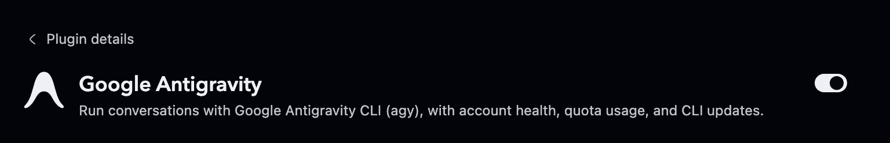

# Google Antigravity provider

Standalone BB provider plugin for Google Antigravity CLI (`agy`).

## Features

- Runs Antigravity sessions through the published BB ACP bridge (`agy acp`).
- Auto-detects `agy` on connected machines and exposes Antigravity's native skill roots and manual compaction.
- Reports signed-in account health and model quota usage (5-hour, weekly, and Gemini model quotas) in BB's Provider usage view.
- Checks `agy --version` against the latest Antigravity CLI release and runs `agy update` from BB Settings.

## Requirements

- Install `agy` on the host machine (`https://antigravity.google/docs/install`).
- Sign in once with `agy acp --login`.

## Staged preview

Shows the Google Antigravity provider registered in BB with version, health, and usage support.
